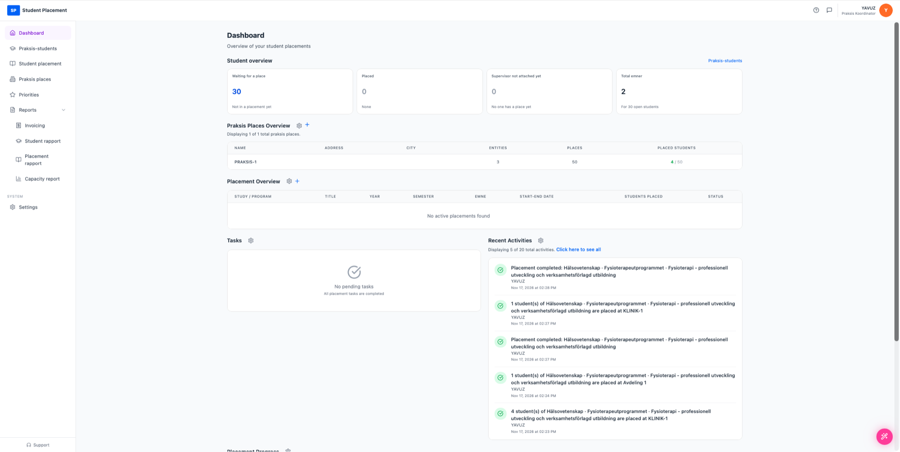
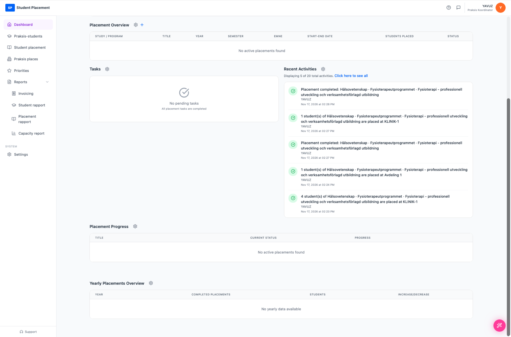
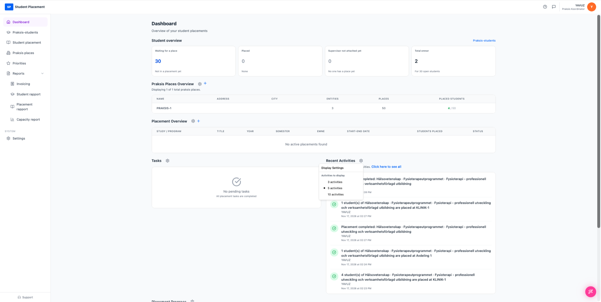
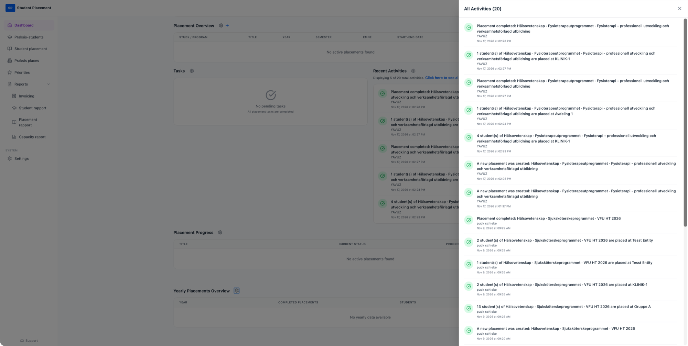

# Test Scenario 00 — Dashboard

:::info[Scenario overview]

- **Page:** Dashboard
- **Role:** Placement Coordinator (PK)
- **Goal:** Get to know the Dashboard — the student overview cards, the widgets and their display settings.
- **Precondition:** Signed in as PK.

:::

## What this page is

The **Dashboard** — *"Overview of your student placements"* — is the first page after signing in. At the top
 is the **Student overview**; below it are widgets that summarise praksis places, placements, tasks and
 activities.

Which widgets are shown is chosen under *Settings → Dashboard Items* (see *Test Scenario 03*). The Student
 overview is always shown.

### Student overview

| Card | Shows |
|---|---|
| **Waiting for a place** | Students *not in a placement yet*. Click to open them in **Praksis-students** (*Waiting* tab). |
| **Placed** | Students who have a place. Click to open them in **Praksis-students**. |
| **Supervisor not attached yet** | Placed students without a supervisor. |
| **Total emner** | Number of emner *for* the open students. |

The **Praksis-students** link (top right of the section) opens the Praksis-students page.

### Widgets

| Widget | Shows |
|---|---|
| **Praksis Places Overview** | Each praksis place with *Address, City, Entities, Places* and *Placed students* (e.g. *4 / 50*). **+** adds a new praksis place. |
| **Placement Overview** | Active placements with *Study / Program, Title, Year, Semester, Emne, Start-End date, Students placed* and *Status*. **+** adds a new placement. |
| **Tasks** | Placement tasks still to do — *"No pending tasks"* when everything is done. |
| **Recent Activities** | The latest events, e.g. *placement created*, *N student(s) … are placed at KLINIK-1*, *Placement completed*, with who did it and when. |
| **Placement Progress** | Active placements with their *Current status* and *Progress*. |
| **Yearly Placements Overview** | Per year: *Completed placements*, *Students* and *Increase/Decrease*. |

Each widget has a **gear** icon with **Display Settings**: how many rows (or tasks/activities) to show — *3*,
 *5* or *10* — and, for the tables, **Visible Columns** to show or hide columns.

---

## Steps

### 1. Open the Dashboard

Sign in, or click **Dashboard** in the sidebar. Here the Student overview shows *30 waiting for a place*,
 *0 placed*, *0 supervisor not attached yet* and *2 total emner — for 30 open students*. Praksis Places
 Overview lists **PRAKSIS-1** with *3 entities*, *50 places* and *4 / 50* placed students.

<figure>

<figcaption>Dashboard — Student overview and the first widgets</figcaption>

</figure>

Scroll down to see **Placement Progress** and **Yearly Placements Overview**.

<figure>

<figcaption>Dashboard — Placement Progress and Yearly Placements Overview</figcaption>

</figure>

### 2. Change what a widget shows

Click the **gear** next to a widget title — here **Recent Activities**. Under **Display Settings → Activities
 to display** choose *3*, *5* or *10 activities*. Table widgets also have **Visible Columns**.

<figure>

<figcaption>Display Settings — how many activities to show</figcaption>

</figure>

### 3. See all activities

In **Recent Activities** (*"Displaying 5 of 20 total activities"*), click **Click here to see all**. A panel
 **All Activities (20)** opens on the right with the full list. Close it with **×**.

<figure>

<figcaption>All Activities — the full activity list</figcaption>

</figure>

### 4. Jump to the students

Click the **Waiting for a place** card. **Praksis-students** opens with the **Waiting** tab selected (see
 *Test Scenario 06*).

---

## Final result

The coordinator can read the Dashboard at a glance, adjust what each widget shows, open the full activity list
 and jump from the student cards to Praksis-students.

## Notes

-   The **?** icon in the top bar opens this help center in a new tab.
-   To hide or show whole widgets, use *Settings → Dashboard Items* (*Test Scenario 03*).

---

<ScenarioFeedback scenarioId="TS-00-dashboard" />
