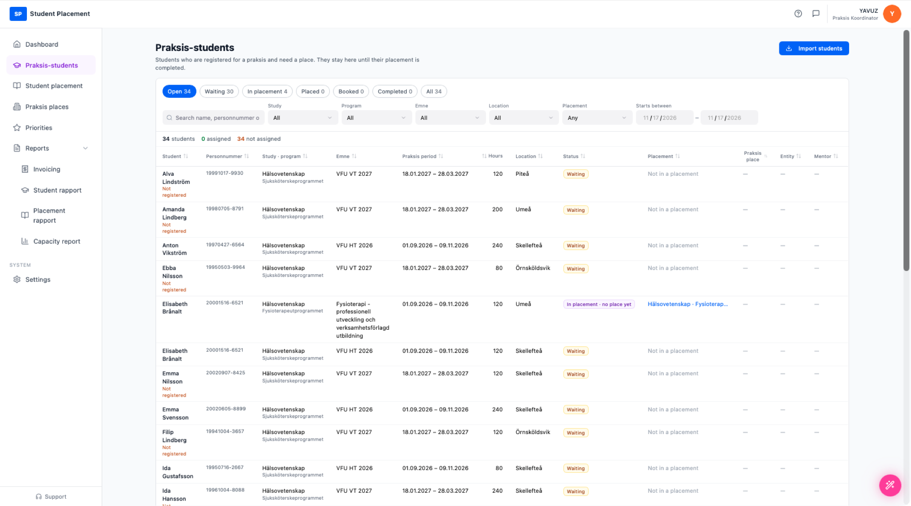
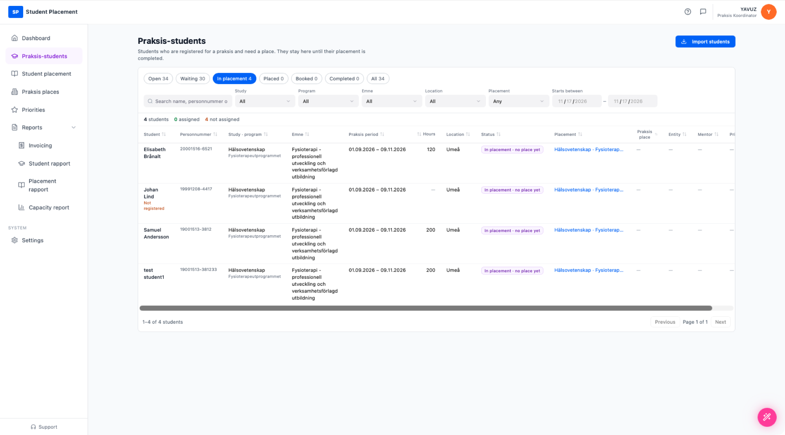
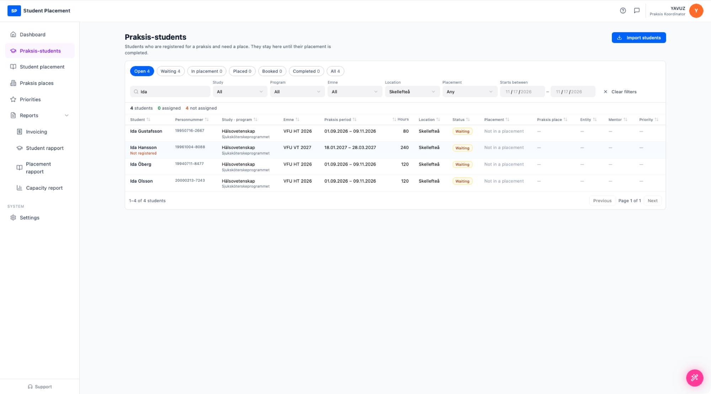
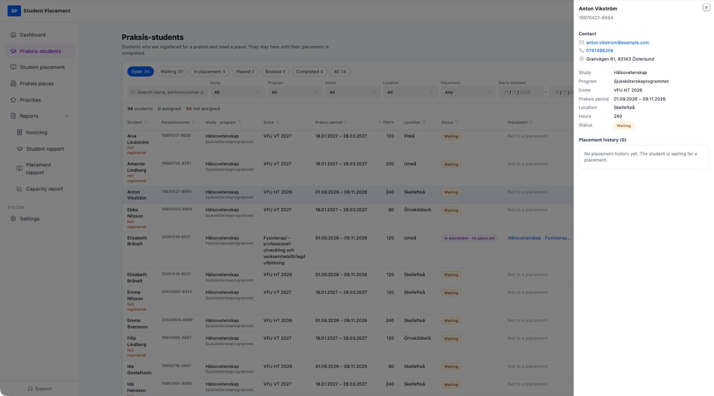
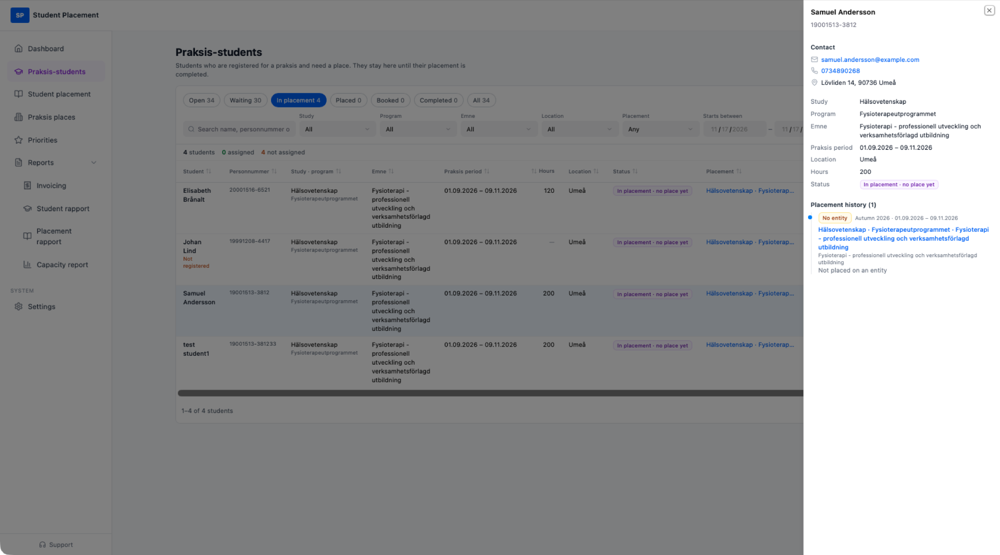
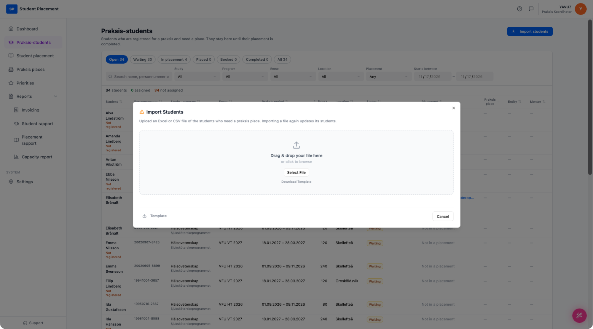

# Test Scenario 06 — Praksis-students

:::info[Scenario overview]

- **Page:** Praksis-students
- **Role:** Placement Coordinator (PK)
- **Goal:** Find the students who need a praksis place, narrow the list with the status tabs, search and filters, open a student's details and placement history, and see how students are imported.
- **Precondition:** Signed in as PK, with students already imported. This walkthrough uses the existing students of **Hälsovetenskap** (34 open students).

:::

## What this page is

**Praksis-students** lists *"Students who are registered for a praksis and need a place. They stay here
 until their placement is completed."* It is the starting point of the placement workflow — step 1,
 **Students from Praksis-students**, pulls the students waiting for an emne from this list (see
 *Test Scenario 03b — Workflows*).

The page has four parts:

- **Status tabs** with live counts — **Open**, **Waiting**, **In placement**, **Placed**, **Booked**,
  **Completed** and **All**. **Open** (the default) shows every student whose placement is not yet completed.
- **Search and filters** — a search box (*name, personnummer or email*), **Study**, **Program**, **Emne**,
  **Location**, **Placement** (*Any*, *Not in a placement*, *In a placement*) and a **Starts between**
  date range.
- A **summary line** — number of students, how many are **assigned** (*has a praksis place*) and how many
  are **not assigned** (*no praksis place yet*).
- The **student table** — Student, Personnummer, Study · program, Emne, Praksis period, Hours, Location,
  Status, Placement, Praksis place, Entity, Mentor and Priority. Every column header can be clicked to sort.

Students marked **Not registered** under their name were imported with *Registered* set to *No* in the
 import file.

---

## Steps

### 1. Open Praksis-students

Click **Praksis-students** in the sidebar. The **Open** tab is selected and lists all open students — here
 *34 students, 0 assigned, 34 not assigned*. Students who are not in a placement show the status
 **Waiting** and *Not in a placement*.

<figure>

<figcaption>Praksis-students — the Open tab with status tabs, filters and the student table</figcaption>

</figure>

### 2. Switch status tab

Click **In placement**. The list shows only the students who have been taken into a placement — here 4
 students with the status **In placement · no place yet**. The **Placement** column shows the placement
 as a link (*Hälsovetenskap · Fysioterapeutprogrammet · …*); Praksis place, Entity and Mentor stay empty
 until a place is assigned.

<figure>

<figcaption>In placement — students in a placement that have no praksis place yet</figcaption>

</figure>

### 3. Search and filter

Go back to **Open**. Type `Ida` in the search box, then select **Skellefteå** under **Location**. The list
 narrows to the 4 matching students, and the counts on the status tabs update to match the search and
 filters (*Open 4*, *Waiting 4*). A **Clear filters** button appears — click it to reset the search and
 all filters.

<figure>

<figcaption>Search "Ida" + Location Skellefteå — 4 students; Clear filters resets</figcaption>

</figure>

### 4. Open a student's details

Click a student row — here **Anton Vikström**. A side panel opens with the student's **Contact** details
 (email, phone, address), **Study**, **Program**, **Emne**, **Praksis period**, **Location**, **Hours** and
 **Status**. Below is the **Placement history** — for a waiting student it reads *"No placement history
 yet. The student is waiting for a placement."*

<figure>

<figcaption>Student details — contact, study details and an empty placement history</figcaption>

</figure>

### 5. Check the placement history

Close the panel (**×**), switch to **In placement** and click **Samuel Andersson**. His **Placement history
 (1)** lists the placement he is in — term and dates (*Autumn 2026 · 01.09.2026 – 09.11.2026*), the placement
 as a link, and the badge **No entity** with *"Not placed on an entity"*, because no praksis place has been
 assigned yet.

<figure>

<figcaption>Placement history — one placement, not yet placed on an entity</figcaption>

</figure>

### 6. Import students

Click **Import students** (top right). The **Import Students** dialog explains: *"Upload an Excel or CSV file
 of the students who need a praksis place. Importing a file again updates its students."* Drag a file onto
 the drop zone or click **Select File**. Click **Template** (or **Download Template**) to get an Excel file
 with the expected columns:

| Required | Optional |
|---|---|
| First name, Last name, Personnummer, Email, Program, Start date | Phone, Address, Study, Program code, Emne code, Emne, End date, Hours, Location, Registered |

Click **Cancel** to close the dialog without importing.

<figure>

<figcaption>Import Students — upload an Excel/CSV file or download the template</figcaption>

</figure>

---

## Final result

The coordinator can see at a glance which students still need a praksis place, narrow the list by status,
 search and filters, look up a student's contact details and placement history, and knows how to bring new
 students in with an import file.

## Notes

-   Re-importing a file **updates** the students in it — you don't need to delete them first.
-   Students stay on this page until their placement is **Completed**; use the **All** tab to see every student.

---

<ScenarioFeedback scenarioId="TS-06-praksis-students" />
