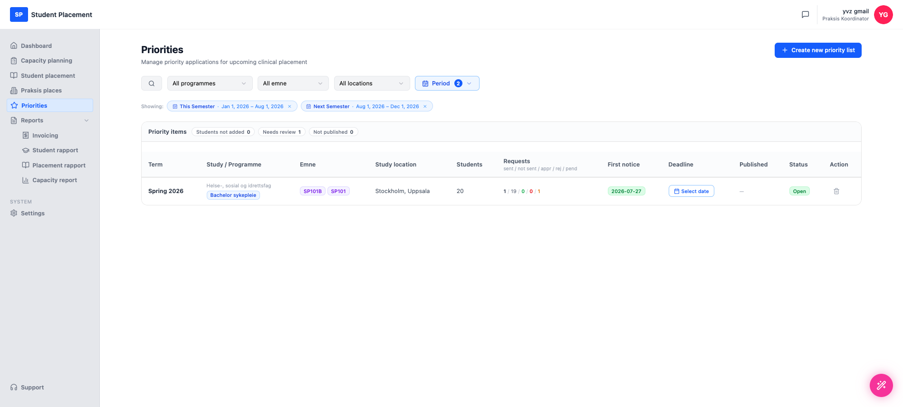
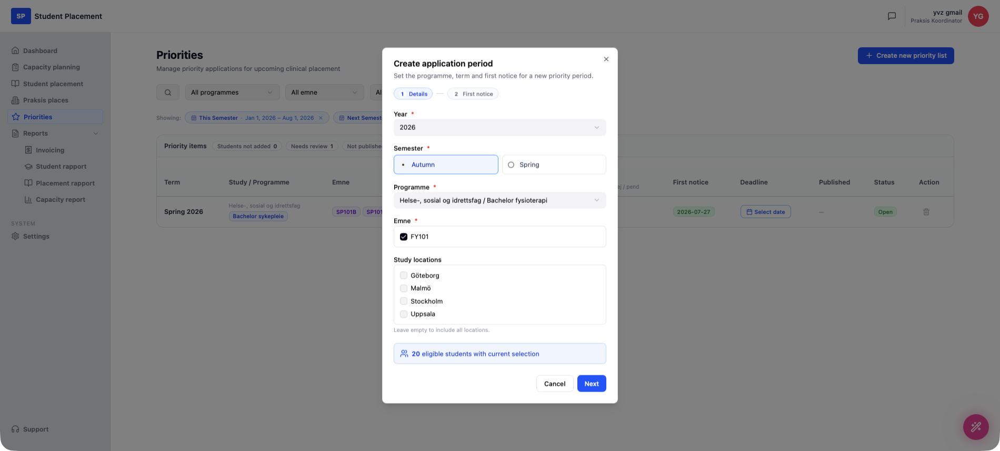
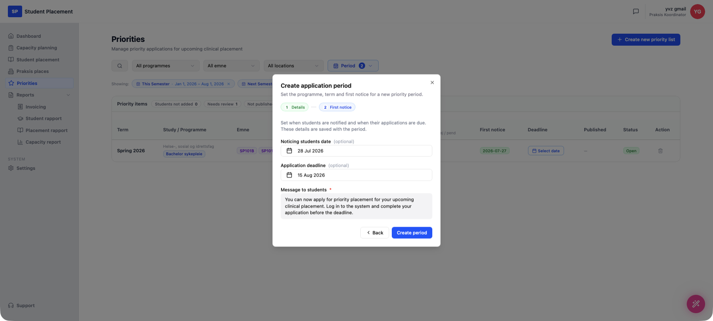
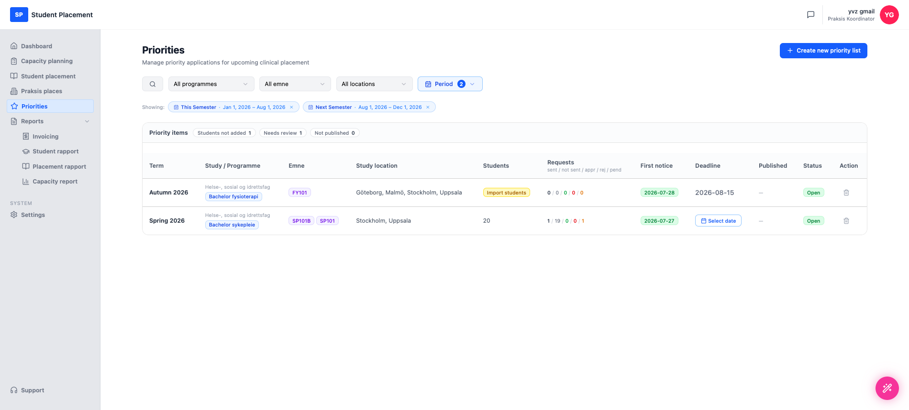

# Priorities - Creating new priority list

:::info[Scenario overview]

- **Page:** Priorities
- **Role:** Placement Coordinator (PK)
- **Goal:** Create a new priority period for a term/programme, and set up its first-notice date, deadline and message to students.
- **Precondition:** Signed in as PK. The page may already list other priority periods — the flow works the same either way.

:::

## What this page is

**Priorities** manages priority applications for upcoming clinical placement: for a given term and programme, eligible students can be invited to submit a priority request (special circumstances such as medical reasons or childcare that should weigh into where they're placed). Each row in the table is a **priority period** — one term/programme/emne combination — showing its students, submitted requests (sent / not sent / approved / rejected / pending), first-notice date, deadline, published status and open/closed state. Everything starts from clicking **Create new priority list**.

---

## Steps

### 1. Start on the Dashboard

After signing in you land on the **Dashboard**.

<figure>

<figcaption>Starting point — the Dashboard</figcaption>

</figure>

### 2. Open Priorities

Click **Priorities** in the sidebar. The page lists existing priority periods as a table, with **Create new priority list** in the top right.

<figure>

<figcaption>Priorities — existing periods, before creating a new one</figcaption>

</figure>

### 3. Create application period — Details

Click **Create new priority list**. The dialog opens on step **1 · Details**. Select the **Year**, the **Semester** (Autumn/Spring), and a **Programme** (a flattened Study / Programme list) — here `Helse-, sosial og idrettsfag / Bachelor fysioterapi`. If the programme has emner, pick at least one — here `FY101`. **Study locations** is optional (leave empty to include all). A live counter shows *"N eligible students with current selection"* as you narrow the criteria.

<figure>

<figcaption>Step 1 · Details — year, semester, programme, emne and eligible-student count</figcaption>

</figure>

### 4. Create application period — First notice

Click **Next** to reach step **2 · First notice**. Set the (optional) **Noticing students date** — when students are emailed to apply — and the (optional) **Application deadline**, plus the **Message to students** (prefilled with a sensible default, editable). Click **Create period**.

<figure>

<figcaption>Step 2 · First notice — notice date, deadline and message to students</figcaption>

</figure>

---

## Final result

The new period appears at the top of the Priorities table — here **Autumn 2026 / Bachelor fysioterapi / FY101** — with a yellow **Import students** badge in the Students column (no students imported yet), the first-notice date and deadline just set, and status **Open**. From here the coordinator imports students and moves on to collecting and publishing requests (see the next scenario).

<figure>

<figcaption>New priority period created — Autumn 2026 / Bachelor fysioterapi, awaiting students</figcaption>

</figure>

---

<ScenarioFeedback scenarioId="TS-12-priorities-create-list" />
