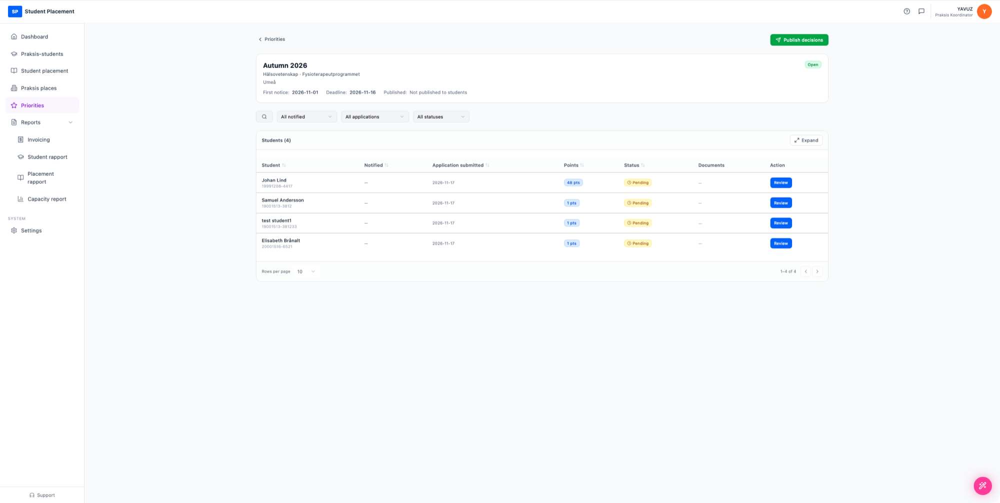
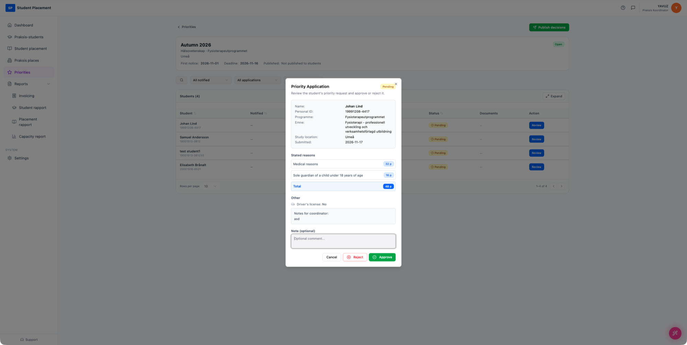
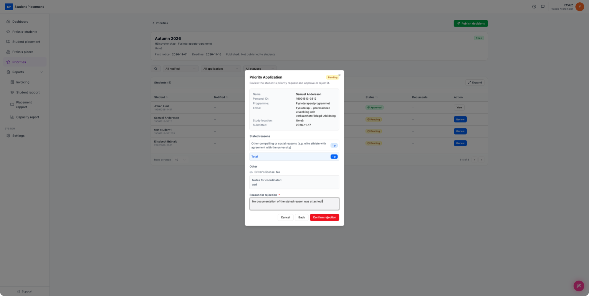
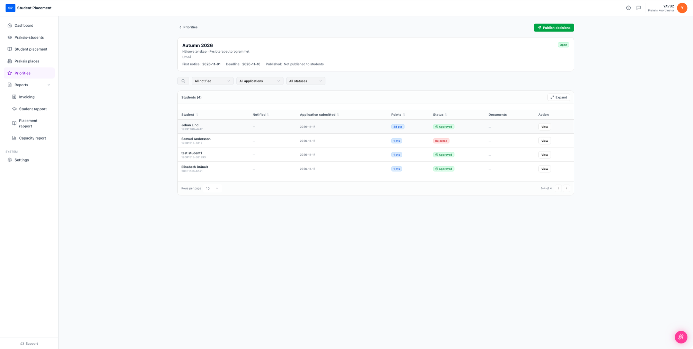
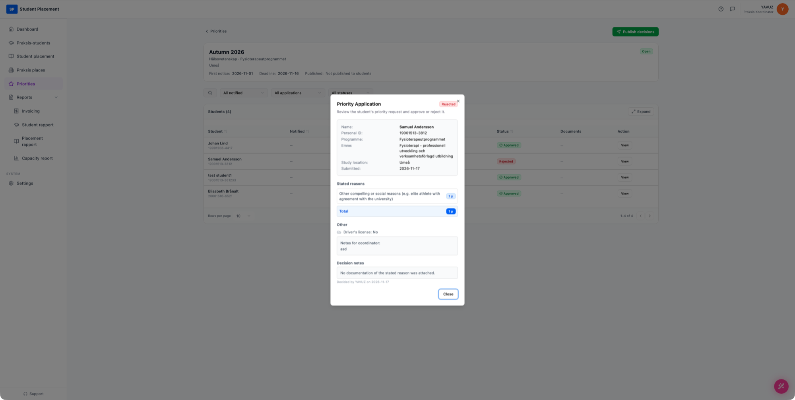
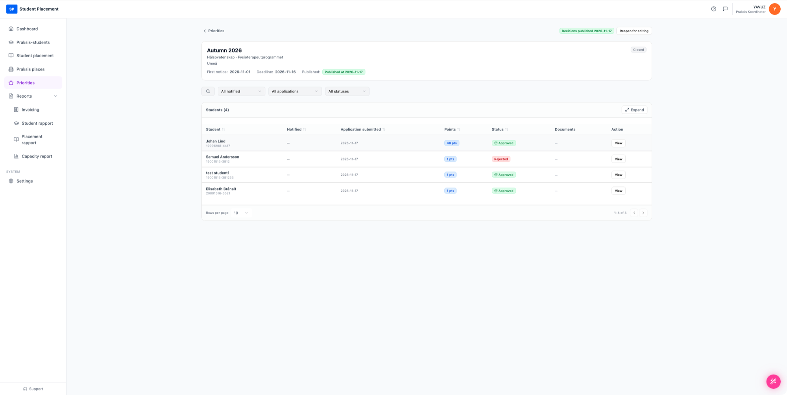
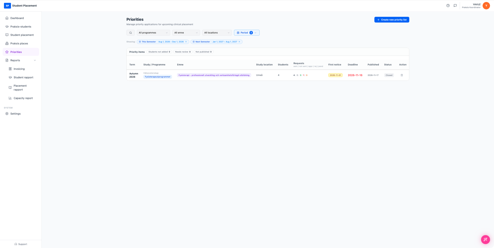

# Test Scenario 13 — Priorities - Review and publish decisions

:::info[Scenario overview]

- **Page:** Priorities → *priority list*
- **Role:** Placement Coordinator (PK)
- **Goal:** Review the students' priority applications, approve or reject each one, and publish the decisions to the students.
- **Precondition:** A priority list exists (see *Test Scenario 12*) and its students have submitted applications. This walkthrough uses the list **Autumn 2026 · Hälsovetenskap · Fysioterapeutprogrammet · Umeå** with 4 submitted applications.

:::

## What this page is

When students have applied, the **Priorities** page shows it: the **Requests** column counts *sent / not sent /
 appr / rej / pend*, and the **Needs review** and **Not published** counters go up.

Click a list to open it. The header shows the term, study · program, location, **First notice**, **Deadline**,
 **Published** and the status (**Open** or **Closed**), with **Publish decisions** in the top right. Below is the
 **Students** table:

| Column | Content |
|---|---|
| **Student** | Name and personnummer. |
| **Notified** | When the student was notified. |
| **Application submitted** | Date of the application (*—* if none). |
| **Points** | The total priority points of the stated reasons (e.g. *48 pts*). |
| **Status** | **Pending**, **Approved** or **Rejected**. |
| **Documents** | Files attached to the application. |
| **Action** | **Review** while pending; **View** once decided. |

The filters **All notified** (*Notified / Not notified*), **All applications** (*Submitted / Not submitted*) and
 **All statuses** (*Pending / Approved / Rejected*), the search and **Expand** help with long lists.

---

## Steps

### 1. Find the list that needs review

Open **Priorities**. The list shows *4 / 0 / 0 / 0 / 4* — 4 applications sent, all 4 pending — and the counters
 **Needs review 1** and **Not published 1**.

<figure>

<figcaption>Priorities — 4 applications sent, 4 pending</figcaption>

</figure>

### 2. Open the priority list

Click the row. The list is **Open** and *Not published to students*. All 4 students have submitted
 (*2026-11-17*); **Johan Lind** has *48 pts*, the others *1 pts*. Every row is **Pending** with a **Review**
 button.

<figure>

<figcaption>The priority list — 4 pending applications</figcaption>

</figure>

### 3. Review and approve an application

Click **Review** on **Johan Lind**. The **Priority Application** window (*Pending*) shows:

- the student's details — name, personal ID, programme, emne, study location, submitted date;
- **Stated reasons** with their points — here *Medical reasons 32 p* and *Sole guardian of a child under 18 years
  of age 16 p*, **Total 48 p**;
- **Other** — e.g. *Driver's license: No* and the student's **Notes for coordinator**;
- **Note (optional)** for your own comment.

Type a note — here `Medical documentation checked.` — and click **Approve**. The message *"Application
 approved"* appears and the status becomes **Approved**.

<figure>

<figcaption>Priority Application — stated reasons, points and the Approve / Reject buttons</figcaption>

</figure>

### 4. Reject an application

Click **Review** on **Samuel Andersson** (*Other compelling or social reasons … 1 p*) and click **Reject**. A
 required field **Reason for rejection** appears. Type the reason — here `No documentation of the stated reason
 was attached.` — and click **Confirm rejection** (**Back** returns to the review). The message *"Application
 rejected"* appears and the status becomes **Rejected**.

<figure>

<figcaption>Rejecting requires a reason</figcaption>

</figure>

### 5. Decide the remaining applications

Review and approve **test student1** and **Elisabeth Brånalt** the same way. All applications are now decided —
 3 **Approved**, 1 **Rejected** — and every row shows **View**.

<figure>

<figcaption>All decided — 3 approved, 1 rejected</figcaption>

</figure>

**View** opens the application read-only, with the **Decision notes** and *"Decided by YAVUZ on 2026-11-17"*.

<figure>

<figcaption>View — the decision note and who decided</figcaption>

</figure>

### 6. Publish the decisions

Click **Publish decisions** (top right). The decisions are published at once — the message *"Decisions
 published"* appears. The list is now **Closed**, *Published at 2026-11-17*, and the top right shows **Decisions
 published 2026-11-17** with **Reopen for editing**.

<figure>

<figcaption>Decisions published — the list is closed</figcaption>

</figure>

:::warning

**Publish decisions** publishes immediately, without a confirmation — even if some applications are still
 **Pending**. Decide every application first. If you published too early, click **Reopen for editing**: the list
 becomes **Open** and *Not published to students* again, so you can review the rest and publish again.

:::

Back on **Priorities**, the row shows *4 / 0 / 3 / 1 / 0*, **Published 2026-11-17** and **Closed**, and the
 counters are back at 0.

<figure>

<figcaption>Priorities — 3 approved, 1 rejected, published and closed</figcaption>

</figure>

---

## Final result

All 4 applications are decided (3 approved, 1 rejected) and the decisions are published to the students. The
 priority list is **Closed**.

## Notes

-   **Publish decisions** is disabled until the first-notice date (*"Decisions can be published after the first
    notice date"*).
-   **Reopen for editing** lets you change decisions after publishing; publish again when you are done.

---

<ScenarioFeedback scenarioId="TS-13-priorities-collect-and-publish" />
