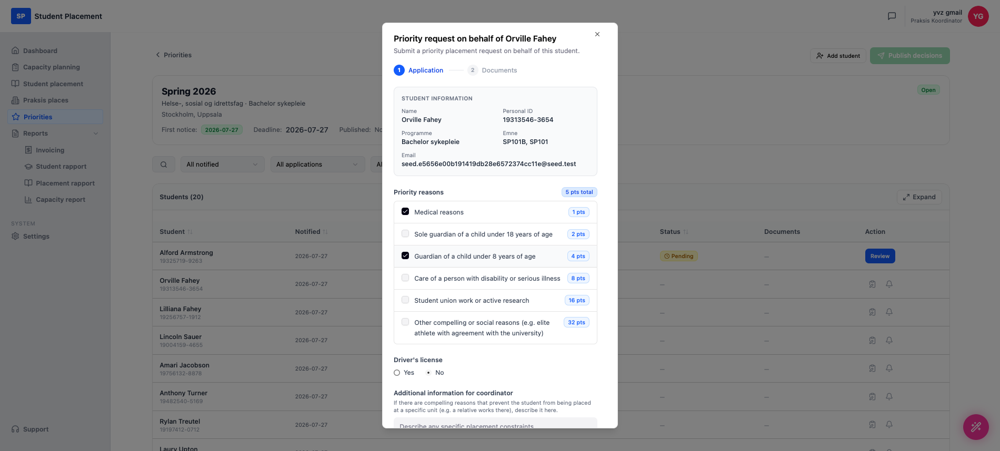
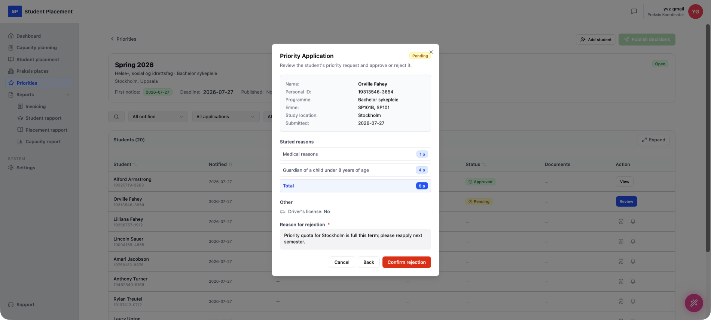

# Priorities - Collecting and publishing

:::info[Scenario overview]

- **Page:** Priorities → *(a priority period)*
- **Role:** Placement Coordinator (PK)
- **Goal:** Collect students' priority requests after the first notice goes out, review and approve or reject each one, then publish the decisions once the deadline has passed.
- **Precondition:** A priority period with students already imported. This walkthrough uses the existing period **Spring 2026 / Bachelor sykepleie (SP101B, SP101)**, which already has its first notice sent.

:::

## What this page is

Opening a priority period from the **Priorities** list shows its detail view: the period's first-notice date, deadline and published status at the top, and a table of every imported student with their notified date, submitted date, points, status and available actions. On the **first-notice date**, the system emails every student in the list a link to log in and submit their own priority request — the reasons that apply to them (medical, childcare, caregiving, etc.), whether they have a driver's license, any placement constraints, and supporting PDF documents. Once a request is submitted it shows up here as **Pending**, ready for the coordinator to **Review** and **Approve** or **Reject**. When every decision is made and the deadline has passed, the coordinator clicks **Publish decisions** — students are emailed a second time with the outcome of their request.

For demonstration purposes — since real students normally submit this form themselves — the coordinator can fill it out **on behalf of a student** using the pencil icon in the Action column, next to a bell icon that resends the first notice.

---

## Steps

### 1. Start on the Dashboard

After signing in you land on the **Dashboard**.

<figure>

<figcaption>Starting point — the Dashboard</figcaption>

</figure>

### 2. Open a priority period

Click **Priorities** in the sidebar, then click a period row — here **Spring 2026**. Its first notice was already sent (**2026-07-27**), so the student table shows one submitted request (Alford Armstrong, **Pending**, 6 pts) and the rest still awaiting a submission, each with a pencil icon (**Submit on behalf of student**) and a bell icon (**Resend first notice**).

<figure>

<figcaption>Spring 2026 — first notice sent, one pending request, rest awaiting submission</figcaption>

</figure>

### 3. Fill a request on behalf of a student — Application

Click the pencil icon on a student who hasn't submitted yet — here **Orville Fahey**. The **Priority request on behalf of…** dialog opens showing the student's information (read-only), then lets you check the applicable **Priority reasons** (each with a point value that totals live), set **Driver's license**, and add **Additional information for coordinator**.

<figure>

<figcaption>Submit on behalf of Orville Fahey — reasons selected, 5 pts total</figcaption>

</figure>

### 4. Fill a request on behalf of a student — Documents

Click **Next: Documents** to reach the second step. Supporting PDF documents can be attached here (drag-and-drop or click), or the request can be submitted without any. Click **Submit application**.

<figure>

<figcaption>Documents step — optional PDF attachments, then submit</figcaption>

</figure>

### 5. Request now shows as Pending

Orville Fahey's row updates immediately: submitted date, **5 pts**, status **Pending**, with a **Review** button in place of the pencil icon.

<figure>

<figcaption>Orville Fahey's request submitted — now Pending with a Review button</figcaption>

</figure>

### 6. Review and approve a request

Click **Review** on a pending request — here Alford Armstrong's. The dialog shows the student's details, stated reasons with their points and total, driver's license, and any placement constraints, plus an optional **Note**. Click **Approve**.

<figure>

<figcaption>Reviewing Alford Armstrong's request — 6 pts total, ready to approve</figcaption>

</figure>

### 7. Review and reject a request

Click **Review** on another pending request — here Orville Fahey's. Click **Reject**; a **Reason for rejection** field appears and is required. Enter the reason and click **Confirm rejection**.

<figure>

<figcaption>Rejecting Orville Fahey's request with a required reason</figcaption>

</figure>

Both decisions apply immediately — Alford Armstrong's row shows **Approved** and Orville Fahey's shows **Rejected**, each with a **View** button so the read-only decision can be revisited later.

### 8. Publish decisions once the deadline has passed

**Publish decisions** (top right) stays disabled — hover it to see why: *"Decisions can be published only after the first-notice deadline has passed."* Once the deadline date is in the past, the button becomes active; clicking it opens a confirmation explaining that publishing closes the period and emails every student who submitted a request with their outcome, after which the period can still be **reopened for editing** if needed.

<figure>

<figcaption>Publish decisions — disabled until the first-notice deadline has passed</figcaption>

</figure>

---

## Final result

Students were notified by email on the first-notice date, submitted (or had submitted on their behalf) their priority requests, and the coordinator reviewed each one — approving Alford Armstrong and rejecting Orville Fahey with a stated reason. Once the deadline passes, publishing the decisions notifies every student by email of their outcome.

---

<ScenarioFeedback scenarioId="TS-13-priorities-collect-and-publish" />
