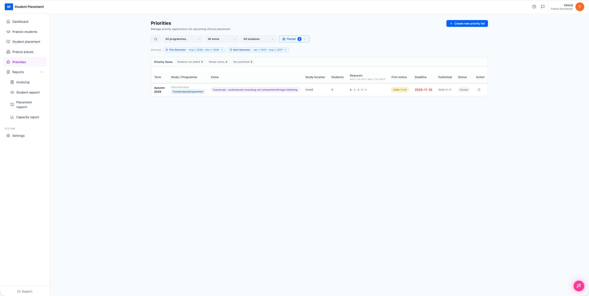
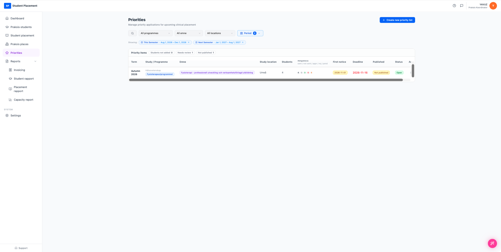
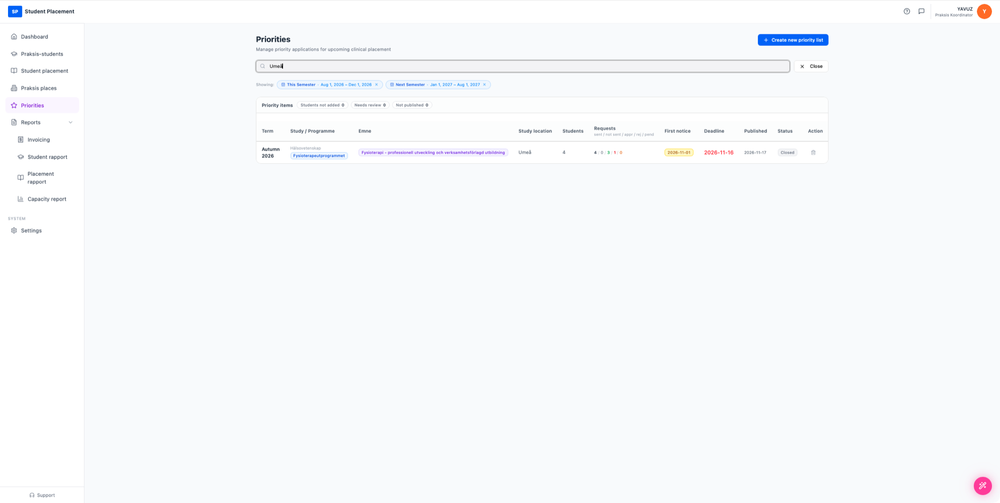
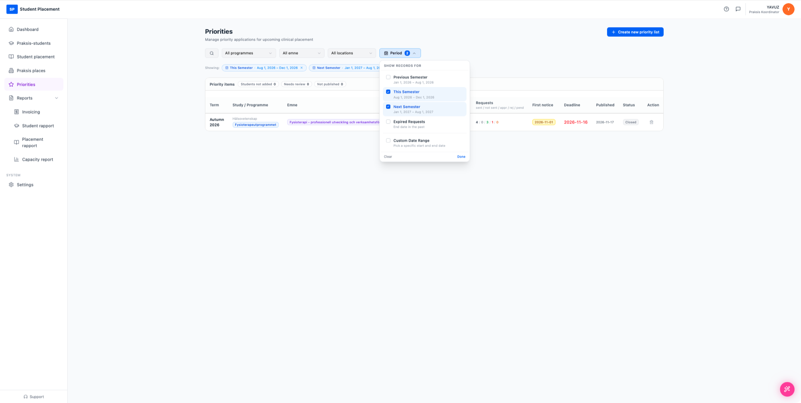
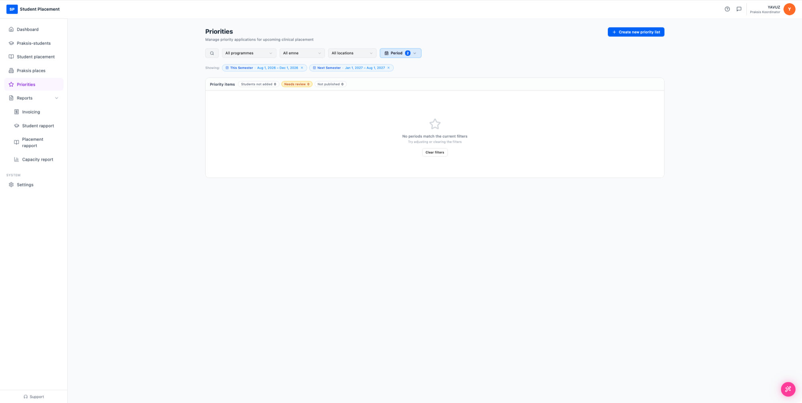

# Test Scenario 13b — Priorities - Overview

:::info[Scenario overview]

- **Page:** Priorities
- **Role:** Placement Coordinator (PK)
- **Goal:** Use the Priorities page as an overview — read the columns, find lists with search and filters, and see at a glance which lists need attention.
- **Precondition:** At least one priority list exists (see *Test Scenarios 12* and *13*). This walkthrough uses the list **Autumn 2026 · Fysioterapeutprogrammet · Umeå**, whose decisions have been published.

:::

## What this page is

**Priorities** — *"Manage priority applications for upcoming clinical placement"* — lists every priority list
 in the chosen periods, one row per list. It shows how far each list has come: how many students applied, how
 many applications are decided, and whether the decisions are published.

### Toolbar

| Control | What it does |
|---|---|
| **Create new priority list** | Starts a new list — see *Test Scenario 12*. |
| **Search** (magnifier) | *Search by term, programme, emne, or location.* **Close** brings the filters back. |
| **All programmes** / **All emne** / **All locations** | Narrow the rows. The menus list only the programmes, emner and locations that have a priority list. |
| **Period** | **Show records for** *Previous Semester*, *This Semester*, *Next Semester*, *Expired Requests* (end date in the past) or a *Custom Date Range*. The active periods are shown as chips under **Showing:** — click **×** on a chip to remove it. |

### Priority items

Three counters show how many lists need attention:

| Counter | Meaning |
|---|---|
| **Students not added** | Lists where students are not added. |
| **Needs review** | Lists with applications still waiting for a decision. |
| **Not published** | Lists whose decisions are not published to the students yet. |

Click a counter to show only those lists; click **Clear filters** to show all again.

### Columns

| Column | Content |
|---|---|
| **Term** | e.g. *Autumn 2026*. |
| **Study / Programme** | The study and program. |
| **Emne** | The emne of the list. |
| **Study location** | e.g. *Umeå*. |
| **Students** | Number of students on the list. |
| **Requests** | *sent / not sent / appr / rej / pend* — *Sent / Not sent yet / Approved / Rejected / Pending*. |
| **First notice** / **Deadline** | The dates — click a date to change it. |
| **Published** | The date the decisions were published (*Not published* or *—* until then). |
| **Status** | **Open** while applications are handled, **Closed** after the decisions are published. |
| **Action** | Trash icon to delete the list. |

---

## Steps

### 1. Open Priorities

Click **Priorities** in the sidebar. The list from *Test Scenario 13* shows *4 students*, requests
 *4 / 0 / 3 / 1 / 0* (4 sent, 3 approved, 1 rejected), *First notice 2026-11-01*, *Deadline 2026-11-16*,
 *Published 2026-11-17* and status **Closed**. All three counters are **0** — nothing needs attention.

<figure>

<figcaption>Priorities — one list, decided and published</figcaption>

</figure>

Compare with the same list before it was reviewed: requests *4 / 0 / 0 / 0 / 4* (4 pending), *Not published*,
 status **Open**, and the counters **Needs review 1** and **Not published 1**.

<figure>

<figcaption>Before review — Needs review 1 and Not published 1</figcaption>

</figure>

### 2. Search

Click the **magnifier** and type, for example, `Umeå`. The rows are filtered by term, programme, emne or
 location. Click **Close** to get the filters back.

<figure>

<figcaption>Search by term, programme, emne or location</figcaption>

</figure>

### 3. Choose the period

Click **Period**. Tick the periods to show — *Previous Semester*, *This Semester*, *Next Semester*, *Expired
 Requests* or *Custom Date Range* — and click **Done**. **Clear** removes all periods.

<figure>

<figcaption>Period — choose which semesters are shown</figcaption>

</figure>

### 4. Filter with a counter

Click **Needs review**. The counter is highlighted and only lists that need review are shown — here none:
 *"No periods match the current filters"*. Click **Clear filters** to show all lists again.

<figure>

<figcaption>Needs review — no lists need review</figcaption>

</figure>

---

## Final result

The coordinator can see every priority list and its progress on one page, find a list with search, filters and
 period, and use the counters to spot lists that still need review or publishing.

---

<ScenarioFeedback scenarioId="TS-13b-priorities-overview" />
