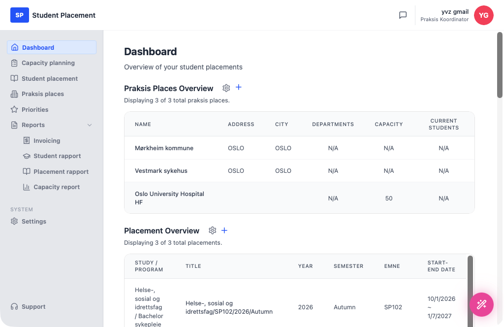
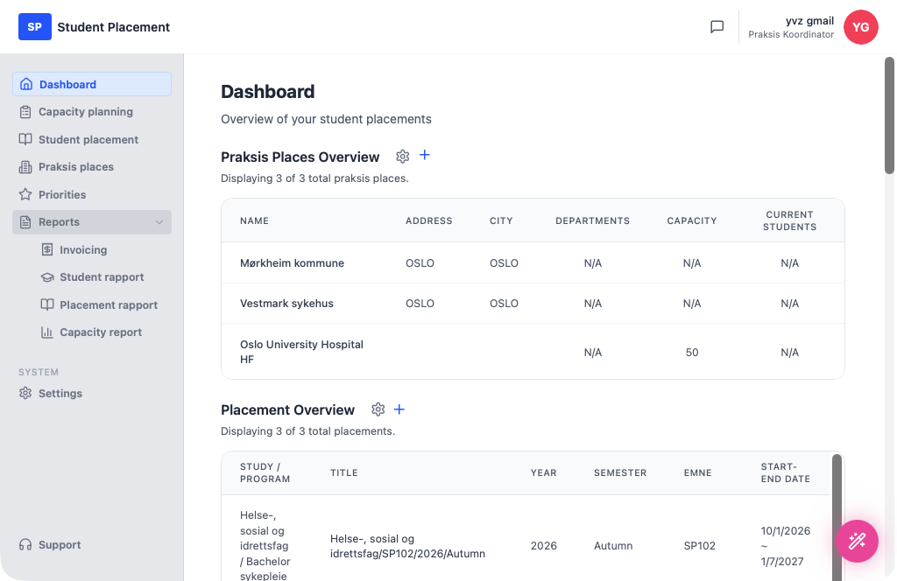
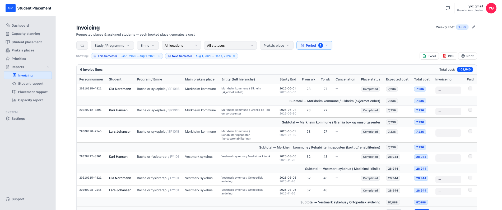
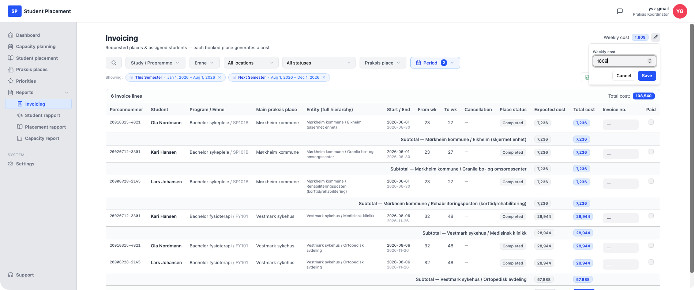
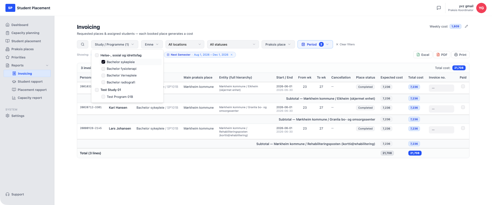
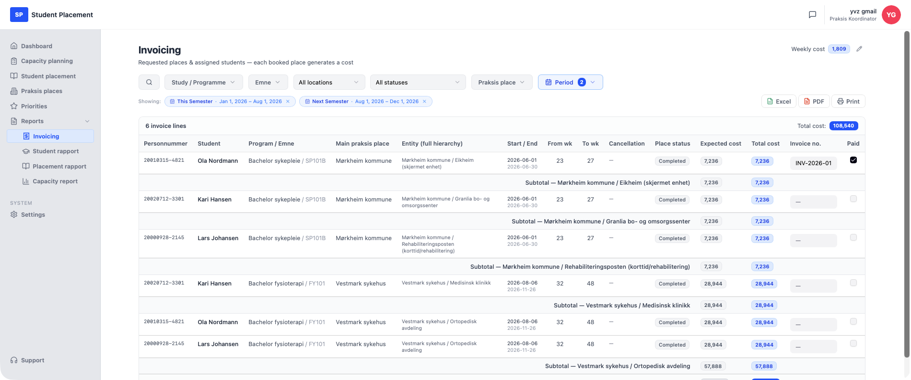

# Reports - Invoicing

:::info[Scenario overview]

- **Page:** Reports → Invoicing
- **Role:** Placement Coordinator (PK)
- **Goal:** Review the auto-generated invoice lines for assigned students, narrow them down with filters, adjust the weekly cost, and record an invoice number and payment status.
- **Precondition:** Signed in as PK, with students already assigned to praksis places. This walkthrough uses the existing **Bachelor sykepleie / SP101B** and **Bachelor fysioterapi / FY101** placements.

:::

## What this page is

**Invoicing** is the first entry under **Reports** in the sidebar (next to **Student rapport**, **Placement rapport** and **Capacity report**). It generates one invoice line per student who has been assigned to a praksis place — booking a place is what generates a cost, so students who are only requested but not yet assigned don't appear.

Each line shows the student, the program/emne, the assigned praksis place with its full entity hierarchy, the start/end dates and the corresponding ISO week range. From the week range, the page computes an **Expected cost** as `(to week − from week − 1) × weekly cost`; the **Total cost** is the same amount unless the placement was canceled without extra cost, in which case it's zero. Lines are grouped by entity with a subtotal per group, and a grand total at the bottom. The **weekly cost** used in the calculation is a single editable value (pencil icon, top right) that applies to the whole report.

Beyond the numbers, each line has two editable fields — **Invoice no.** and a **Paid** checkbox — so the coordinator can track invoicing status directly on the report. The toolbar offers the same filter set as elsewhere (Study/Programme, Emne, location, status, praksis place, period), plus **Excel**, **PDF** and **Print** export buttons for sharing the report outside the app.

By default the report is scoped to the current and next semester — so the totals shown already reflect only that window, not every invoice ever generated. Use the **Period** filter to widen, change, or clear this range and see other date ranges, including past semesters.

---

## Steps

### 1. Start on the Dashboard

After signing in you land on the **Dashboard**.

<figure>

<figcaption>Starting point — the Dashboard</figcaption>

</figure>

### 2. Open Reports → Invoicing

Click **Reports** in the sidebar to expand it, revealing **Invoicing**, **Student rapport**, **Placement rapport** and **Capacity report**. Click **Invoicing**.

<figure>

<figcaption>Reports expanded — Invoicing is the first report</figcaption>

</figure>

### 3. Review the invoice lines

The report opens showing every assigned student as one row, grouped by entity with a **Subtotal** row after each group. The header bar shows the line count and the grand **Total cost**; here **6 invoice lines** total **108,540**.

<figure>

<figcaption>Invoicing — all assigned students, grouped by entity with subtotals</figcaption>

</figure>

### 4. Adjust the weekly cost

Click the pencil icon next to **Weekly cost** (top right). A small editor opens with the current value — here `1809`. Change it and click **Save** to recalculate every Expected/Total cost and subtotal on the page, or **Cancel** to leave it unchanged.

<figure>

<figcaption>Weekly cost — editable value used in every cost calculation</figcaption>

</figure>

### 5. Filter by Study / Programme

Click **Study / Programme** and check a program — here **Bachelor sykepleie**. The table narrows to that program's lines only, the line count and total update (**3 invoice lines**, **21,708**), and the button label shows the active count `(1)`. The same pattern applies to the **Emne**, **Location**, **Status** and **Praksis place** filters, and to **Period** for date-range filtering.

<figure>

<figcaption>Study / Programme filter — narrowed to Bachelor sykepleie</figcaption>

</figure>

### 6. Record an invoice number and mark a line as paid

Clear the filter, then on a line type an invoice number into the **Invoice no.** field — here `INV-2026-0142` — and check the **Paid** checkbox. Both fields save per line as you edit them.

<figure>

<figcaption>Invoice no. entered and Paid checked for the first line</figcaption>

</figure>

---

## Final result

The first invoice line now carries invoice number **INV-2026-0142** and is marked **Paid**, while the report as a whole can be filtered, exported to **Excel**/**PDF**, or **Printed** at any time to share with finance.

---

<ScenarioFeedback scenarioId="TS-14-invoicing-report" />
