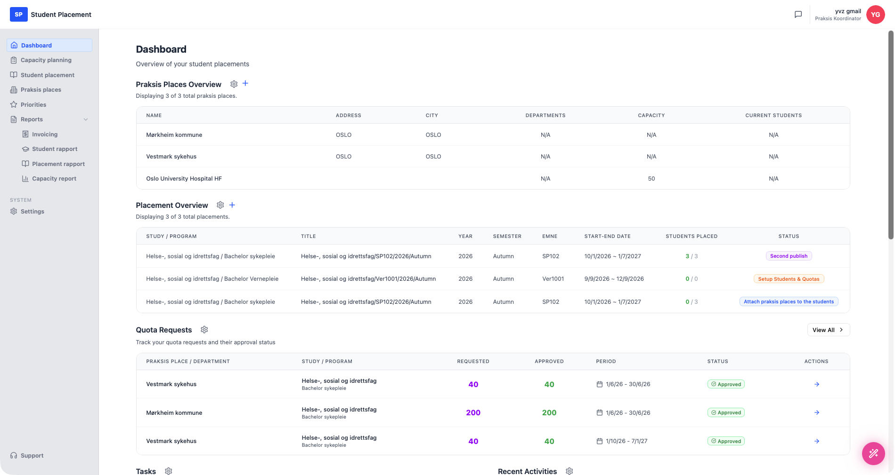
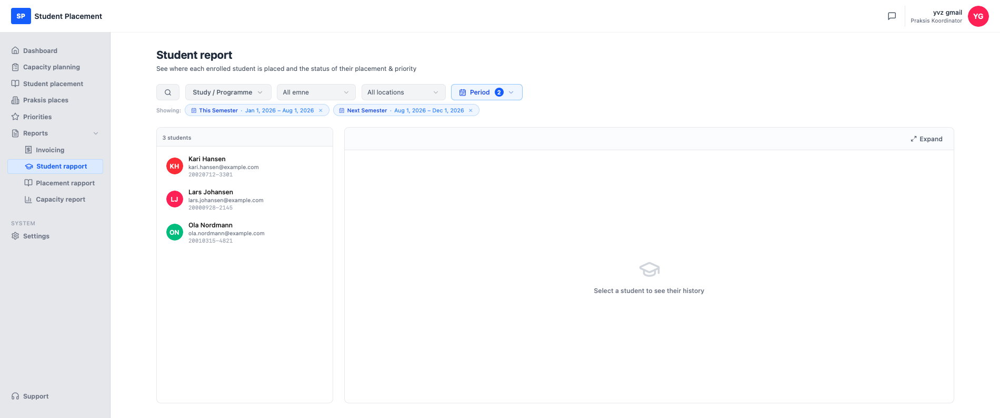
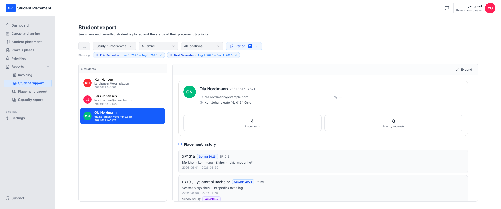
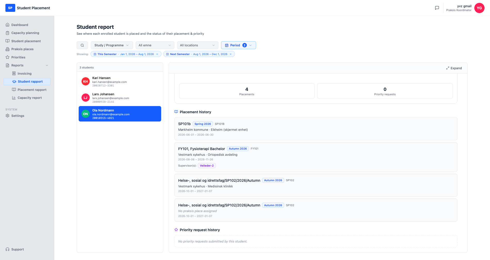
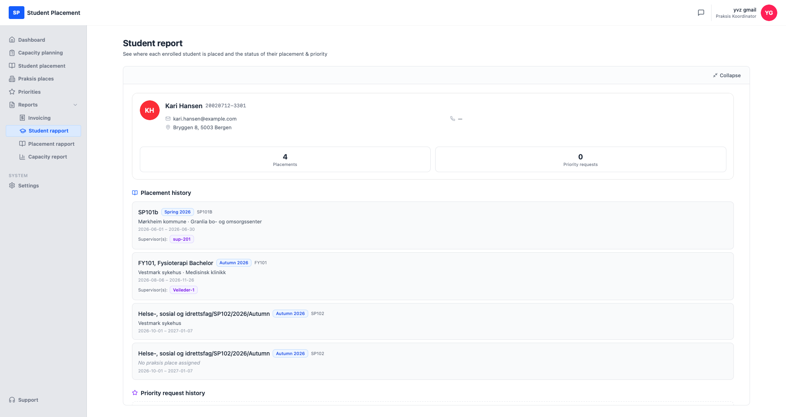
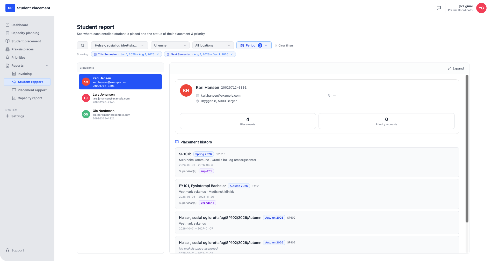

# Reports - Student report

:::info[Scenario overview]

- **Page:** Reports → Student rapport
- **Role:** Placement Coordinator (PK)
- **Goal:** Browse enrolled students, filter the list down, select a student to review their full placement and priority-request history, and expand the profile for a full-width view.
- **Precondition:** Signed in as PK, with enrolled students who have placement history. This walkthrough uses the existing students **Kari Hansen**, **Lars Johansen** and **Ola Nordmann**.

:::

## What this page is

**Student rapport** is the second entry under **Reports** in the sidebar (next to **Invoicing**, **Placement rapport** and **Capacity report**). It's a master/detail view: a filterable list of enrolled students on the left, and the selected student's full profile on the right.

The filter toolbar narrows the student list by **Study / Programme** (a cascading menu — pick a study, then optionally one of its programs), **Emne**, **Location** and **Period**; a search box also matches by name, email or personnummer. Selecting a student on the left loads their profile on the right: an identity card (name, personnummer, email, phone, address, driver's license badge if applicable) with **Placements** and **Priority requests** counts, followed by a **Placement history** section (one card per placement, with term, emne/subject, assigned praksis place and entity, start/end dates and supervisor(s)) and a **Priority request history** section (one card per submitted request, with target semester, points, status and decision details) — both sections show a plain-text empty state when there's nothing to show yet. An **Expand** button in the top right of the detail panel hides the student list and toolbar so the profile can be reviewed at full width; **Collapse** restores the split view.

By default the report is scoped to the current and next semester — so the student list only shows students with a placement or priority request in that window. Use the **Period** filter to widen, change, or clear this range and bring in other students, including past semesters.

---

## Steps

### 1. Start on the Dashboard

After signing in you land on the **Dashboard**.

<figure>

<figcaption>Starting point — the Dashboard</figcaption>

</figure>

### 2. Open Reports → Student rapport

Click **Reports** in the sidebar to expand it, then click **Student rapport**. The page opens with the filter toolbar and a list of enrolled students on the left; no student is selected yet, so the right panel prompts *"Select a student to see their history."*

<figure>

<figcaption>Student rapport — student list and filter toolbar, nothing selected</figcaption>

</figure>

### 3. Select a student

Click a student in the list — here **Ola Nordmann**. Their profile loads on the right: identity card with contact details, then **4 Placements** and **0 Priority requests**, followed by the start of their **Placement history**.

<figure>

<figcaption>Ola Nordmann selected — identity card and start of placement history</figcaption>

</figure>

### 4. Review the full history

Scroll the profile panel to see every placement record — including ones with no praksis place assigned yet — and the **Priority request history** section below it. For this student it reads *"No priority requests submitted by this student."*

<figure>

<figcaption>Remaining placement records, plus the empty-state Priority request history</figcaption>

</figure>

### 5. Expand for a full-width view

Click **Expand** (top right of the detail panel). The student list and toolbar are hidden and the profile — here for **Kari Hansen** — takes the full width, making longer histories easier to scan. Click **Collapse** to return to the split view.

<figure>

<figcaption>Expanded view — Kari Hansen's full placement history at full width</figcaption>

</figure>

### 6. Filter by Study / Programme

Collapse back to the split view, click **Study / Programme**, and pick a study — here **Helse-, sosial og idrettsfag** — then a program such as **Bachelor sykepleie**. The button label updates to show the selection and a **Clear filters** link appears; the student list narrows to matching students only. The same pattern applies to **Emne**, **Location** and **Period**.

<figure>

<figcaption>Study / Programme filter — narrowed to Helse-, sosial og idrettsfag / Bachelor sykepleie</figcaption>

</figure>

---

## Final result

The coordinator can browse any enrolled student, filter the list to the ones they care about, and see a complete history of placements and priority requests for whoever is selected — expanded to full width when there's a lot to review.

---

<ScenarioFeedback scenarioId="TS-15-student-report" />
