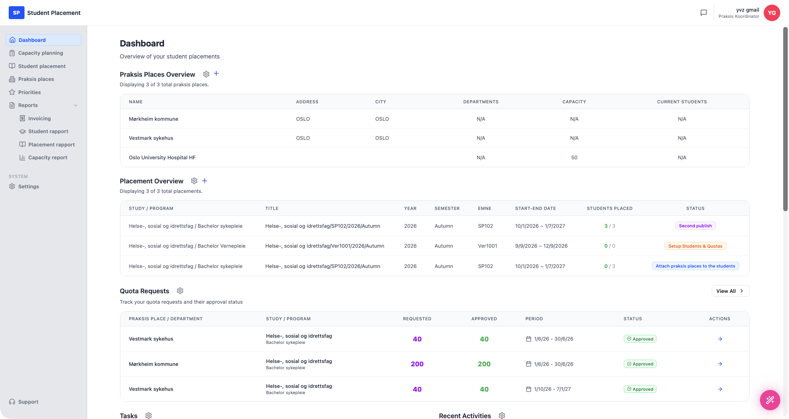
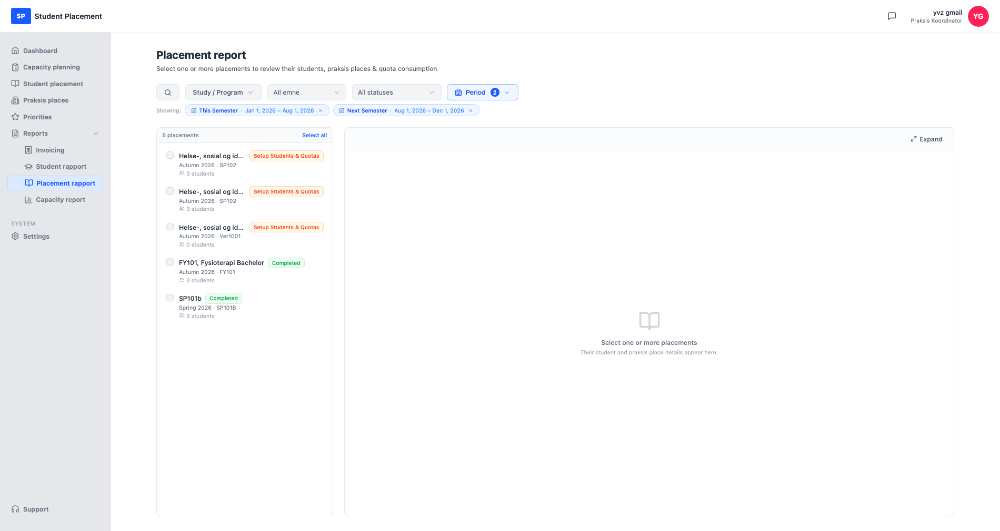
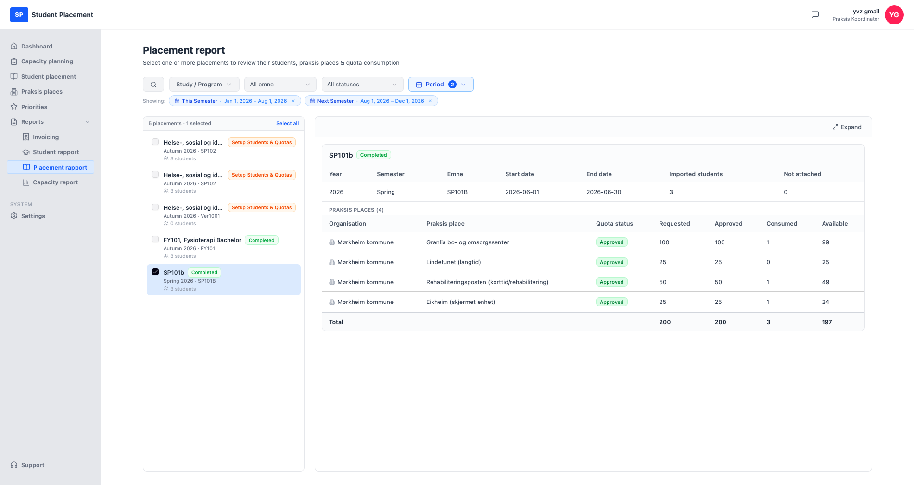
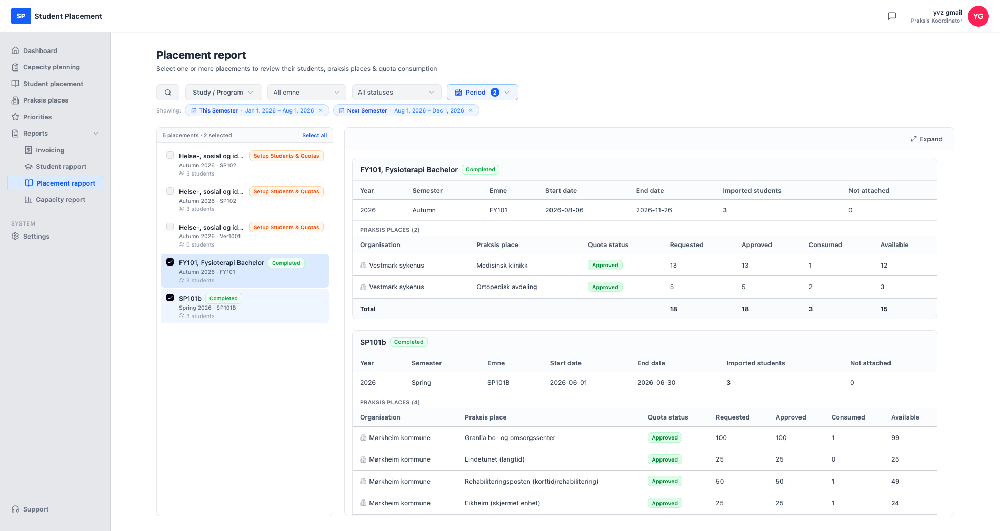
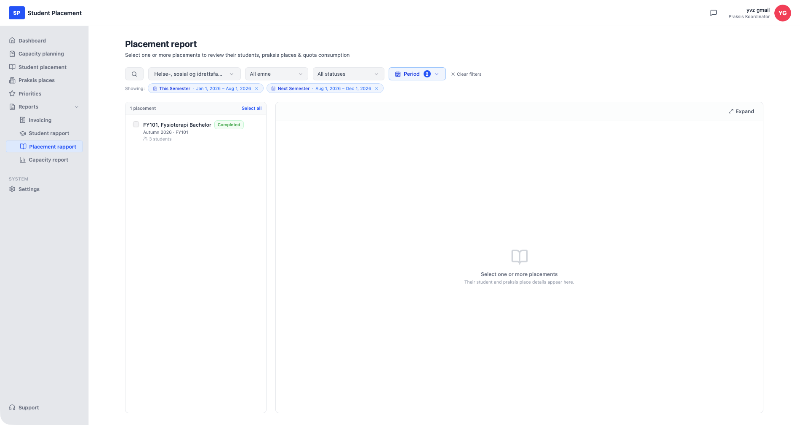
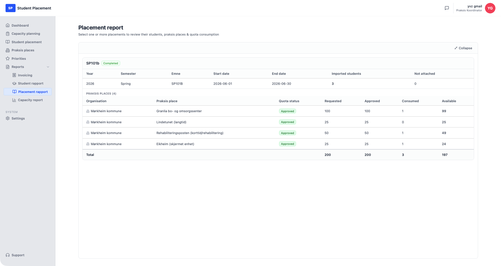

# Reports - Placement report

:::info[Scenario overview]

- **Page:** Reports → Placement rapport
- **Role:** Placement Coordinator (PK)
- **Goal:** Browse placements, select one or more to review their imported students and praksis-place quota consumption side by side, filter the list down, and expand a selection for a full-width view.
- **Precondition:** Signed in as PK, with placements that have imported students and connected praksis places. This walkthrough uses the existing placements **SP101b** and **FY101, Fysioterapi Bachelor**.

:::

## What this page is

**Placement rapport** is the third entry under **Reports** in the sidebar (next to **Invoicing**, **Student rapport** and **Capacity report**). Unlike Student rapport, this is a **multi-select** master/detail view: check as many placements as you like on the left, and each one gets its own section stacked in the detail panel on the right — so you can compare several placements at once instead of one at a time.

The filter toolbar narrows the placement list by **Study / Program** (a cascading menu — pick a study, then optionally one of its programs), **Emne**, **Status** (Draft, Upload students, Select praksis places, First publish, Completed) and **Period**; a search box also matches by title, emne or term. Each placement card in the list shows its title, status badge, term/emne and imported-student count, with **Select all** / **Clear all** above the list. For every checked placement, the detail panel shows a one-row summary (Year, Semester, Emne, Start/End date, Imported students, Not attached) followed by a **Praksis places** table — one row per connected entity, with **Quota status**, **Requested**, **Approved**, **Consumed** and **Available**, plus a **Total** row — or an empty-state message if no praksis places are connected yet. An **Expand** button in the top right of the detail panel hides the placement list and toolbar so the selection can be reviewed at full width; **Collapse** restores the split view.

By default the report is scoped to the current and next semester — so the placement list only shows placements whose dates fall in that window. Use the **Period** filter to widen, change, or clear this range and bring in other placements, including past semesters.

---

## Steps

### 1. Start on the Dashboard

After signing in you land on the **Dashboard**.

<figure>

<figcaption>Starting point — the Dashboard</figcaption>

</figure>

### 2. Open Reports → Placement rapport

Click **Reports** in the sidebar to expand it, then click **Placement rapport**. The page opens with the filter toolbar and a checkbox list of placements on the left; nothing is selected yet, so the right panel prompts *"Select one or more placements."*

<figure>

<figcaption>Placement rapport — placement list and filter toolbar, nothing selected</figcaption>

</figure>

### 3. Select one placement

Check a placement in the list — here **SP101b**. Its section loads on the right: the summary row (**3** imported students, **0** not attached) followed by **Praksis places (4)** with per-entity requested/approved/consumed/available figures and a **Total** row (200 approved, 3 consumed, 197 available).

<figure>

<figcaption>SP101b selected — placement summary and praksis-place quota table</figcaption>

</figure>

### 4. Select a second placement to compare

Check another placement — here **FY101, Fysioterapi Bachelor** — while SP101b stays checked. Its section is added above SP101b's in the detail panel, so both placements' quota tables are visible together for comparison.

<figure>

<figcaption>FY101 and SP101b both selected — their sections stack in the detail panel</figcaption>

</figure>

### 5. Filter by Study / Program

Clear the selection, click **Study / Program**, and pick a study — here **Helse-, sosial og idrettsfag** — then a program such as **Bachelor fysioterapi**. The button label updates, a **Clear filters** link appears, and the placement list narrows (here to **1 placement**). The same pattern applies to **Emne**, **Status** and **Period**.

<figure>

<figcaption>Study / Program filter — narrowed to Helse-, sosial og idrettsfag / Bachelor fysioterapi</figcaption>

</figure>

### 6. Expand for a full-width view

Clear the filter, select a placement, then click **Expand** (top right of the detail panel). The placement list and toolbar are hidden and the selected section(s) take the full width, making wide quota tables easier to read. Click **Collapse** to return to the split view.

<figure>

<figcaption>Expanded view — SP101b's summary and praksis-place table at full width</figcaption>

</figure>

---

## Final result

The coordinator can check off any combination of placements and see their imported-student counts and praksis-place quota consumption side by side — filtered down to the relevant study, program, emne, status or period, and expanded to full width for a closer look.

---

<ScenarioFeedback scenarioId="TS-16-placement-report" />
