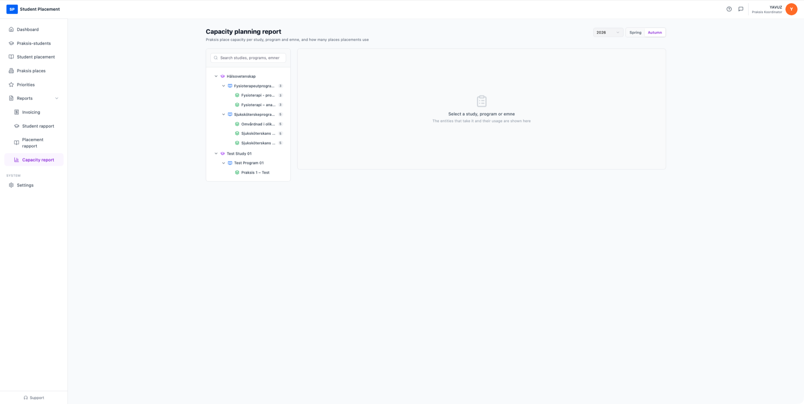
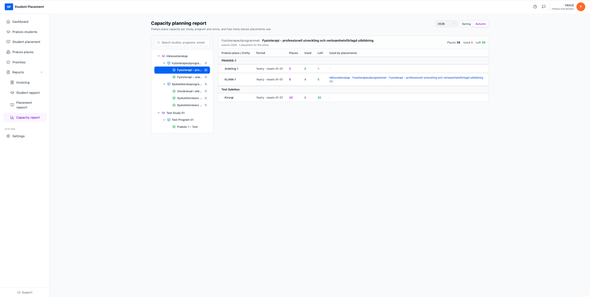

# Test Scenario 17 — Reports - Capacity report

:::info[Scenario overview]

- **Page:** Reports → Capacity report
- **Role:** Placement Coordinator (PK)
- **Goal:** See how many praksis places each entity offers for a study, program or emne, how many are used by placements, and how many are left.
- **Precondition:** Signed in as PK, with entities connected to the program and emne (see *Test Scenarios 04–05*). This walkthrough uses **Fysioterapeutprogrammet** in **Autumn 2026**, where the placement from *Test Scenario 08* uses 4 places on **KLINIK-1**.

:::

## What this page is

**Capacity report** (under **Reports**) opens the **Capacity planning report** — *"Praksis place capacity per
 study, program and emne, and how many places placements use"*.

- **Year and term** (top right) — choose a year (e.g. *2024–2027*) and **Spring** or **Autumn**.
- **Tree** (left) — every study, with its programs and emner. The number next to a program or emne is how many
  entities take it. Use *Search studies, programs, emner* to find one.
- **Report** (right) — for the selected item, one section per emne: the header shows the program · emne,
  the term with the number of placements for the emne, and the totals **Places**, **Used** and **Left**.
  The table lists the entities, grouped by praksis place:

| Column | Content |
|---|---|
| **Praksis place / Entity** | The praksis place (e.g. *PRAKSIS-1*) and its entities. |
| **Period** | How the entity's places are counted, e.g. *Yearly · resets 01-01*. |
| **Places** | Places the entity offers for this program and emne. |
| **Used** | Places taken by placements. |
| **Left** | Places still free. |
| **Used by placements** | The placements that use the entity, with the number of students in brackets — click to open the placement. |

---

## Steps

### 1. Open Reports → Capacity report

Click **Reports** in the sidebar, then **Capacity report**. The tree shows the studies, programs and emner; the
 right panel says *"Select a study, program or emne — The entities that take it and their usage are shown
 here"*. The year is **2026** and the term **Autumn**.

<figure>

<figcaption>Capacity planning report — choose a study, program or emne in the tree</figcaption>

</figure>

### 2. Select an emne

Click the emne **Fysioterapi - professionell utveckling och verksamhetsförlagd utbildning**. The report shows
 *Autumn 2026 · 1 placement for this emne* and the totals **Places 39 · Used 4 · Left 35**:

- **PRAKSIS-1 → Avdeling 1** — 0 places.
- **PRAKSIS-1 → KLINIK-1** — 9 places, 4 used, 5 left; used by the placement *Hälsovetenskap ·
  Fysioterapeutprogrammet · Fysioterapi - professionell … (4)*.
- **Test Sykehus → Kirurgi** — 30 places, none used.

Click the placement name to open the placement.

<figure>

<figcaption>One emne — 39 places, 4 used by one placement on KLINIK-1</figcaption>

</figure>

### 3. Select a program

Click **Fysioterapeutprogrammet**. The report shows one section for each of its emner, stacked. Here both
 emner show the same entities and figures — the second emne (*Fysioterapi – anatomi och fysiologi*, *0
 placements for this emne*) also shows *Used 4* on KLINIK-1.

<figure>

<figcaption>A program — one section per emne</figcaption>

</figure>

### 4. Search and change the term

Type in *Search studies, programs, emner* — for example `Sjuk` — to show only the matching part of the tree.
 Use **Spring** / **Autumn** and the year menu to look at another term; entities that reset yearly show the same
 usage in both terms of the year.

<figure>

<figcaption>Search — only Sjuksköterskeprogrammet and its emner are shown</figcaption>

</figure>

---

## Final result

The coordinator can see, for any study, program or emne and term, how many places each entity offers, how many
 are used and by which placement, and how many are left.

---

<ScenarioFeedback scenarioId="TS-17-capacity-report" />
