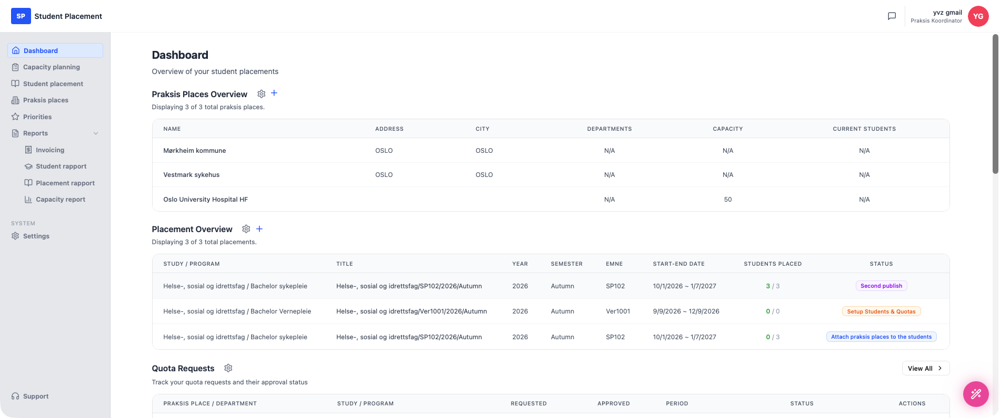
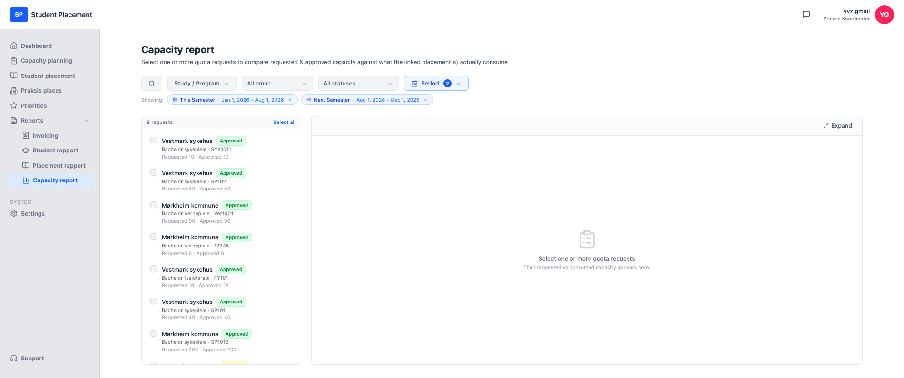
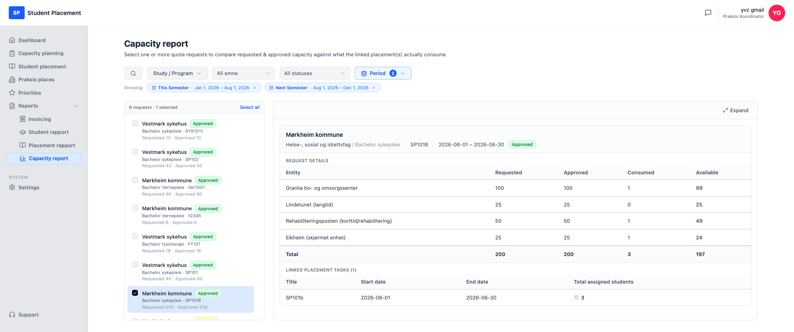
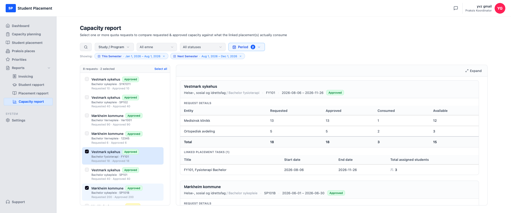
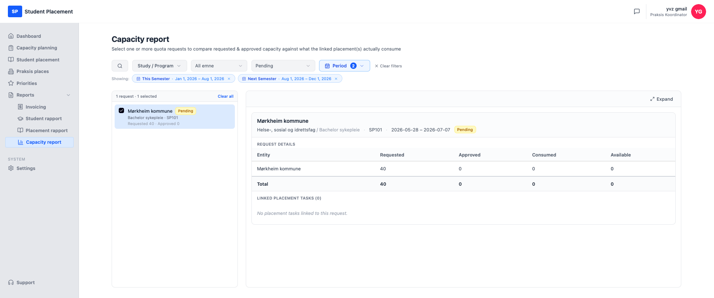
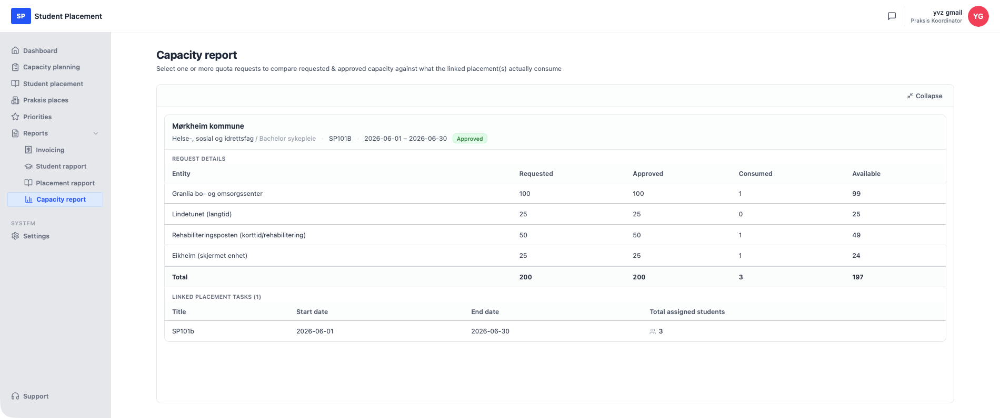

# Reports - Capacity report

:::info[Scenario overview]

- **Page:** Reports → Capacity report
- **Role:** Placement Coordinator (PK)
- **Goal:** Browse quota requests, select one or more to compare requested vs. approved capacity against what their linked placements actually consume, filter the list by status, and expand a selection for a full-width view.
- **Precondition:** Signed in as PK, with quota requests in various statuses. This walkthrough uses the existing requests **Mørkheim kommune / SP101B** (Approved), **Vestmark sykehus / FY101** (Approved) and **Mørkheim kommune / SP101** (Pending).

:::

## What this page is

**Capacity report** is the fourth entry under **Reports** in the sidebar (next to **Invoicing**, **Student rapport** and **Placement rapport**). Like Placement rapport, it's a **multi-select** master/detail view: check as many quota requests as you like on the left, and each gets its own comparison section stacked in the detail panel on the right.

The filter toolbar narrows the request list by **Study / Program** (a cascading menu), **Emne**, **Status** (Pending, Approved, Rejected, Fulfilled) and **Period**; a search box also matches by praksis place, study, program or emne. Each request card in the list shows the praksis place name, a status badge, program/emne, and its requested/approved totals, with **Select all** / **Clear all** above the list. For every checked request, the detail panel shows a header (praksis place, study/program, emne, period, status) followed by a **Request details** table — one row per entity, with **Requested**, **Approved**, **Consumed** and **Available**, plus a **Total** row — and a **Linked placement tasks** table showing which placement(s) draw on this request, with their start/end dates and total assigned students, or an empty-state message if none are linked yet. An **Expand** button in the top right of the detail panel hides the request list and toolbar so the selection can be reviewed at full width; **Collapse** restores the split view.

By default the report is scoped to the current and next semester — so the request list only shows requests whose dates fall in that window. Use the **Period** filter to widen, change, or clear this range and bring in other requests, including past semesters.

---

## Steps

### 1. Start on the Dashboard

After signing in you land on the **Dashboard**.

<figure>

<figcaption>Starting point — the Dashboard</figcaption>

</figure>

### 2. Open Reports → Capacity report

Click **Reports** in the sidebar to expand it, then click **Capacity report**. The page opens with the filter toolbar and a checkbox list of quota requests on the left; nothing is selected yet, so the right panel prompts *"Select one or more quota requests."*

<figure>

<figcaption>Capacity report — request list and filter toolbar, nothing selected</figcaption>

</figure>

### 3. Select one request

Check a request in the list — here **Mørkheim kommune / SP101B**. Its section loads on the right: the header (study/program, emne **SP101B**, period, **Approved** badge) followed by **Request details** with per-entity figures and a **Total** row (200 approved, 3 consumed, 197 available), then **Linked placement tasks (1)** showing the **SP101b** placement with 3 assigned students.

<figure>

<figcaption>SP101B selected — request details and linked placement task</figcaption>

</figure>

### 4. Select a second request to compare

Check another request — here **Vestmark sykehus / FY101** — while SP101B stays checked. Its section is added above SP101B's in the detail panel, so both requests' capacity comparisons are visible together.

<figure>

<figcaption>FY101 and SP101B both selected — their sections stack in the detail panel</figcaption>

</figure>

### 5. Filter by Status

Clear the selection, click the status dropdown, and choose **Pending**. The list narrows to the one matching request — **Mørkheim kommune / SP101**, requested 40 / approved 0. Selecting it shows a **Pending** badge, an **Available** of 0 (nothing approved yet), and *"No placement tasks linked to this request"* since nothing has been assigned against it. The same pattern applies to **Study / Program**, **Emne** and **Period**.

<figure>

<figcaption>Status filter — Pending request with no approved capacity or linked placements yet</figcaption>

</figure>

### 6. Expand for a full-width view

Clear the filter, select a request, then click **Expand** (top right of the detail panel). The request list and toolbar are hidden and the selected section(s) take the full width, making wide comparison tables easier to read. Click **Collapse** to return to the split view.

<figure>

<figcaption>Expanded view — SP101B's request details and linked placement task at full width</figcaption>

</figure>

---

## Final result

The coordinator can check off any combination of quota requests and see requested vs. approved vs. consumed capacity side by side, along with which placements are drawing on each request — filtered down by study, program, emne, status or period, and expanded to full width for a closer look.

---

<ScenarioFeedback scenarioId="TS-17-capacity-report" />
