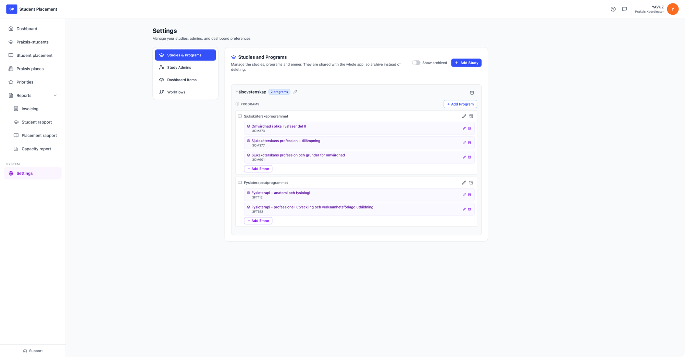
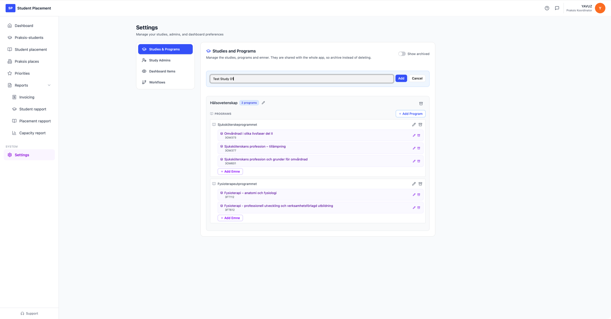
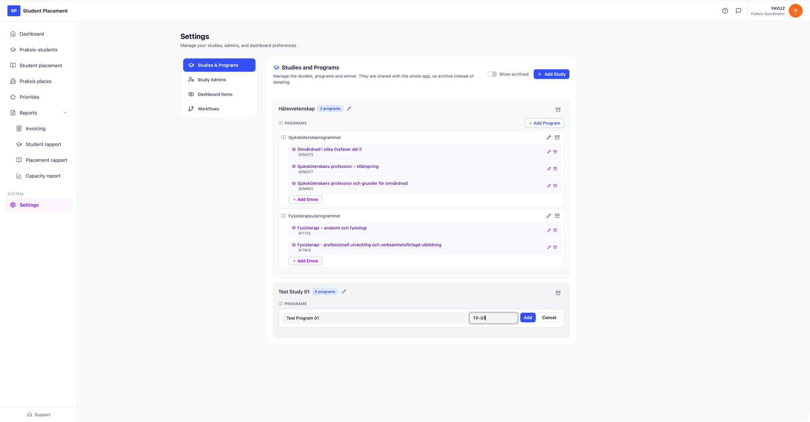
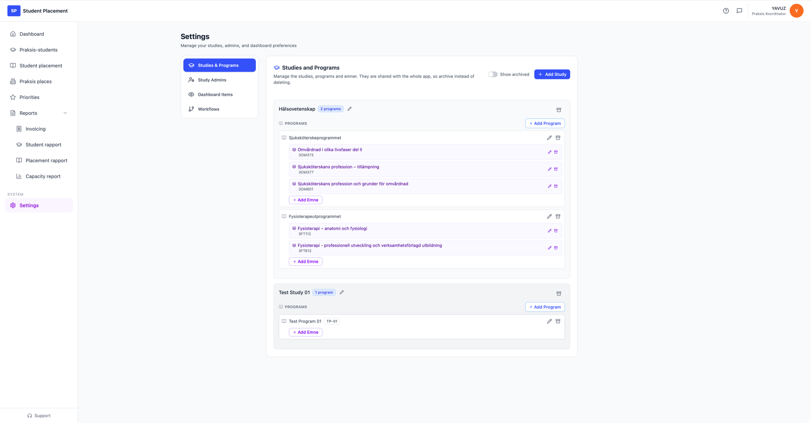
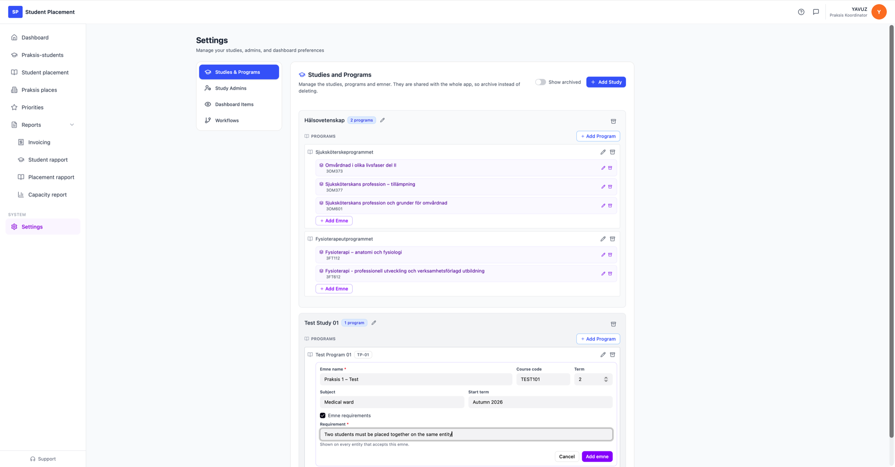
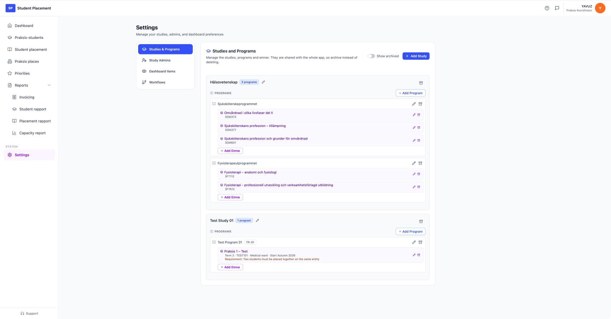
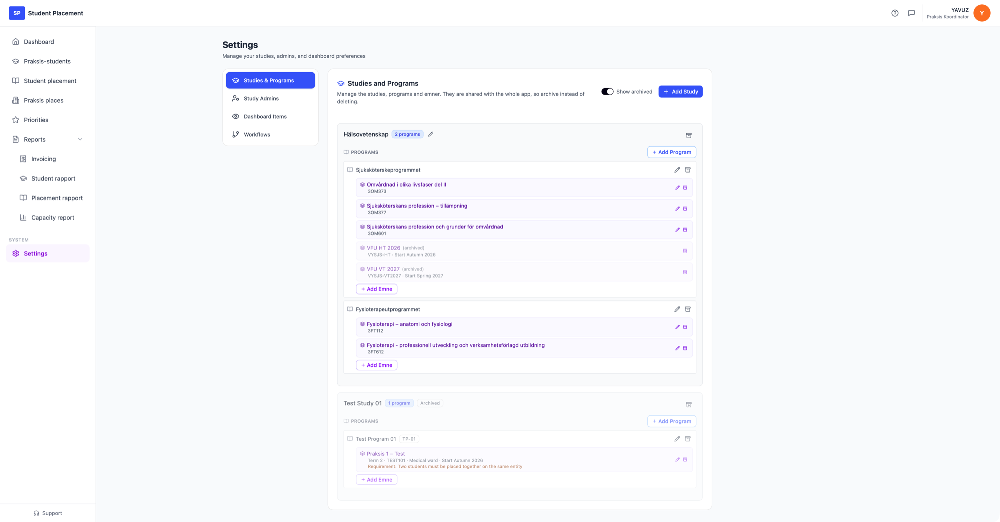

# Test Scenario 01 — Settings - Studies & Programs

:::info[Scenario overview]

- **Page:** Settings → Studies & Programs
- **Role:** Placement Coordinator (PK)
- **Goal:** Create a study, add a program with a program code to it, and add an emne with its details to the program.
- **Precondition:** Signed in as PK. The page may already contain studies — the flow works the same either way.

:::

## What this page is

**Studies & Programs** is the first tab on the Settings page (next to **Study Admins**, **Dashboard Items** and **Workflows**) and is where the academic structure is defined: a **Study** contains one or more **Programs**, and each program can have one or more **Emner**. Studies, programs and emner are shared with the whole app, so they are **archived instead of deleted**: every study, program and emne has an edit (pencil) icon and an archive icon, and archived items can be shown again with the **Show archived** switch and restored.

---

## Steps

### 1. Start on the Dashboard

After signing in you land on the **Dashboard**.

<figure>

<figcaption>Starting point — the Dashboard</figcaption>

</figure>

### 2. Open Settings → Studies & Programs

Click **Settings** in the sidebar (under **System**). Settings opens on the **Studies & Programs** tab by default. Each study is shown as a card with a program count badge; inside it, each program lists its emner with name and course code.

<figure>

<figcaption>Studies & Programs — starting state with existing studies</figcaption>

</figure>

### 3. Create a study

Click **Add Study** (top right). An inline field with the placeholder *"Enter study name (e.g., Helse-, sosial og idrettsfag)"* appears. Type the study name — here `Test Study 01` — and click **Add** (the button is disabled until a name is entered). The new study card appears at the bottom of the list with a **0 programs** badge and the hint *"No programs added yet. Click "Add Program" to add one."*

<figure>

<figcaption>Add Study — name entered in the inline field</figcaption>

</figure>

### 4. Add a program

On the new study card, click **Add Program**. Two inline fields appear: the program name (*"Enter program name (e.g., Nursing)"*) and a **program code** (*"Code (e.g., SYK-B)"*, max 50 characters). Enter `Test Program 01` and the code `TP-01`, then click **Add**.

<figure>

<figcaption>Add Program — name and code entered on the Test Study 01 card</figcaption>

</figure>

### 5. Program added

The study badge now reads **1 program**. The program row shows its code as a tag (**TP-01**), has its own edit (*Edit program name and code*) and archive icons, and an **Add Emne** button.

<figure>

<figcaption>Test Program 01 added — badge shows 1 program</figcaption>

</figure>

### 6. Add an emne to the program

On the program row, click **Add Emne**. An **Add emne** form opens with these fields:

| Field | Required | Example |
|---|---|---|
| **Emne name** | Yes | `Praksis 1 – Test` |
| **Course code** | No (max 50 characters) | `TEST101` |
| **Term** — the term in the program | No (1–12) | `2` |
| **Subject** | No | `Medical ward` |
| **Start term** | No | `Autumn 2026` |
| **Emne requirements** (checkbox) | No | — |

Ticking **Emne requirements** adds a **Requirement** field (required while the box is ticked, max 300 characters) — here `Two students must be placed together on the same entity`. The requirement is *shown on every entity that accepts this emne*. Fill in the form and click **Add emne** (disabled until the required fields are filled).

<figure>

<figcaption>Add emne — all fields filled in, with an emne requirement</figcaption>

</figure>

---

## Final result

The study **Test Study 01** now has **1 program** — **Test Program 01** (**TP-01**) with the emne **Praksis 1 – Test**. The emne row shows its details as *"Term 2 · TEST101 · Medical ward · Start Autumn 2026"* and, underneath, the requirement in orange.

<figure>

<figcaption>Final state — study, program with code, and one emne with details and a requirement</figcaption>

</figure>

## Archiving and restoring (optional)

Studies, programs and emner can't be deleted — they are archived instead. Click the **archive** icon on a study card, program row or emne row.

:::warning

Archiving happens **immediately** — there is no confirmation dialog. If you archive something by mistake, restore it as described below.

:::

Archived items are hidden from the list. Turn on the **Show archived** switch (top right, next to **Add Study**) to show them again: an archived study is greyed out with an **Archived** badge, and an archived emne is marked *(archived)*. Click the **restore** icon on the item to bring it back.

<figure>

<figcaption>Show archived switched on — an archived study and two archived emner</figcaption>

</figure>

---

<ScenarioFeedback scenarioId="TS-01-studies-and-programs" />
