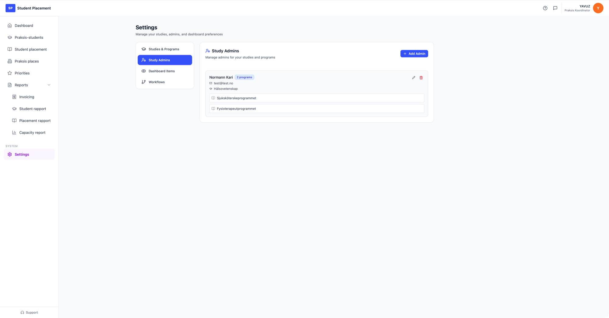
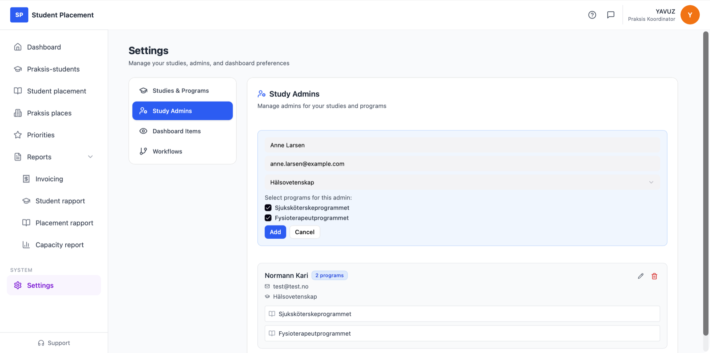
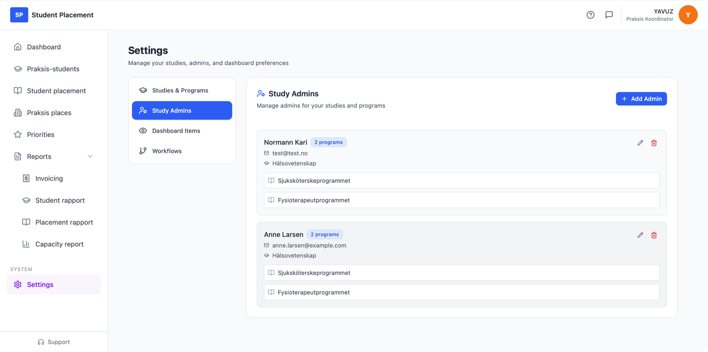
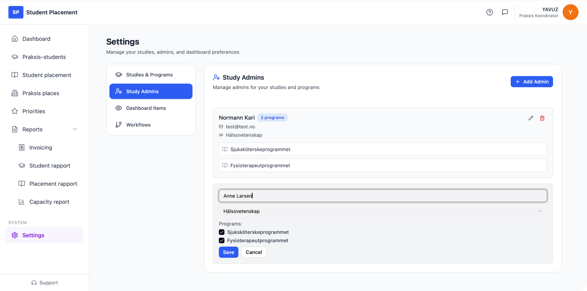
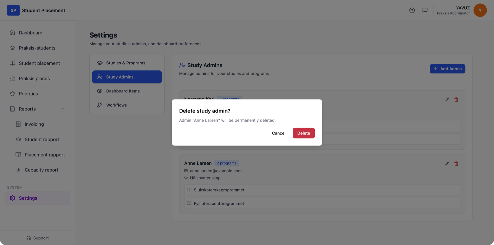

# Test Scenario 02 — Settings - Study Admins

:::info[Scenario overview]

- **Page:** Settings → Study Admins
- **Role:** Placement Coordinator (PK)
- **Goal:** Create a study admin and assign them to a study and its programs.
- **Precondition:** At least one study with programs exists (create one first with *Test Scenario 01*). The page may already list other admins — the flow works the same either way.

:::

## What this page is

**Study Admins** (under Settings) is where you grant people administrative responsibility over a
 study and one or more of its programs. Each admin has a name, an email, a single **study**, and a set of
 **programs** within that study.

---

## Steps

### 1. Start on the Dashboard

After signing in you land on the **Dashboard**.

<figure>

<figcaption>Starting point — the Dashboard</figcaption>

</figure>

### 2. Open Settings → Study Admins

Click **Settings** in the sidebar, then select the **Study Admins** tab. Each existing admin is shown as a card with their name, a **program count** badge, email, study, and the programs they manage, plus edit (pencil) and delete (trash) icons.

<figure>

<figcaption>Study Admins — starting state with one existing admin</figcaption>

</figure>

### 3. Add an admin

Click **Add Admin** (top right). An inline form opens at the top of the list:

1.  Enter the admin's **name** (*"Enter admin name (e.g., Anne Larsen)"*) — here `Anne Larsen`.
2.  Enter the admin's **email** (*"Enter admin email (e.g., anne.larsen@example.com)"*) — here `anne.larsen@example.com`.
3.  Choose a study from the **Select a study** dropdown — here *Hälsovetenskap*.
4.  Once a study is selected, the list *"Select programs for this admin:"* appears with that study's programs. Tick the programs this admin manages — here **Sjuksköterskeprogrammet** and **Fysioterapeutprogrammet**.
5.  Click **Add**.

<figure>

<figcaption>Add Admin — name, email, study and programs selected</figcaption>

</figure>

---

## Final result

The new admin appears at the bottom of the list with a **2 programs** badge, their email, the study, and
 the programs they manage.

<figure>

<figcaption>Final state — Anne Larsen created with 2 programs</figcaption>

</figure>

## Editing an admin (optional)

Click the **pencil** icon on an admin card. The card turns into an edit form where you can change the
 **name**, the **study** and the ticked **programs**. The email can't be changed here. Click **Save** to
 apply or **Cancel** to discard.

<figure>

<figcaption>Edit admin — name, study and programs</figcaption>

</figure>

## Deleting an admin (optional)

Click the **trash** icon on an admin card. A confirmation dialog opens: *"Delete study admin? Admin "Anne
 Larsen" will be permanently deleted."* Click **Delete** to confirm or **Cancel** to keep the admin.

<figure>

<figcaption>Delete study admin — confirmation dialog</figcaption>

</figure>

## Notes

-   **Study admin can see data only for selected studies**

---

<ScenarioFeedback scenarioId="TS-02-study-admins" />
