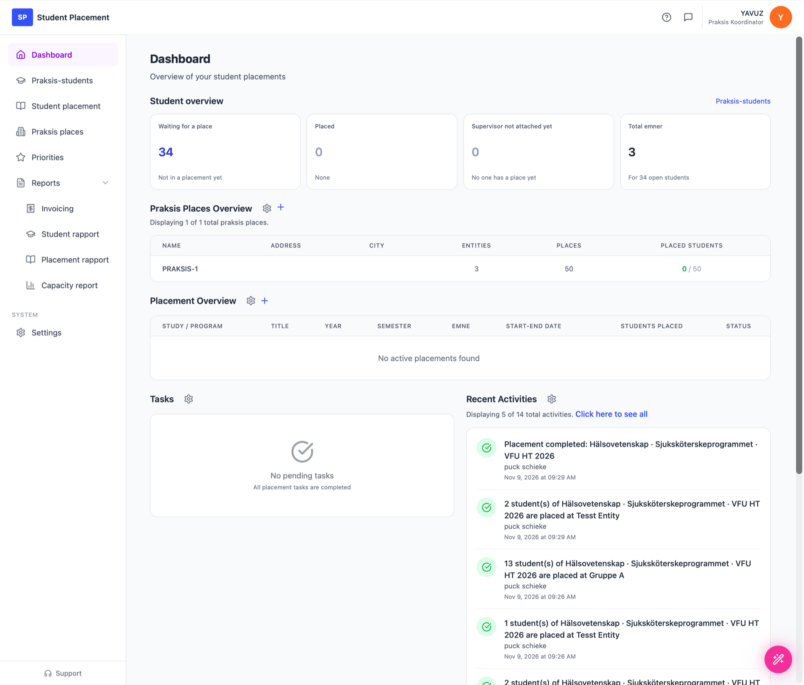
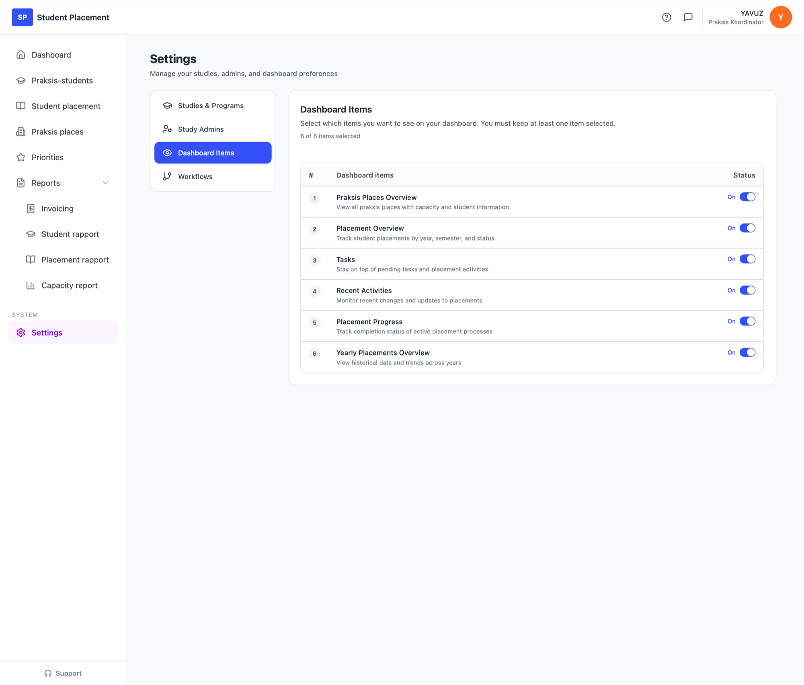
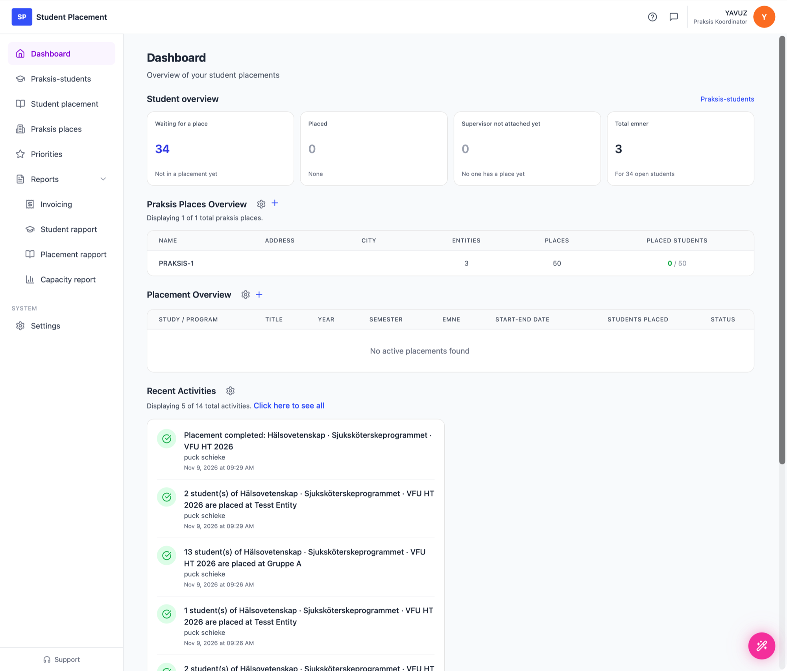
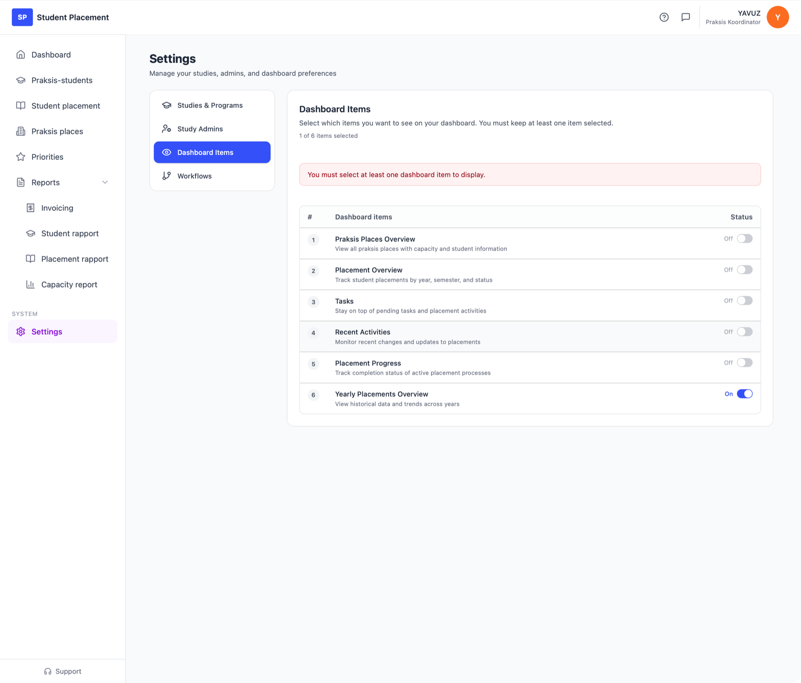

# Test Scenario 03 — Settings - Dashboard Items

:::info[Scenario overview]

- **Page:** Settings → Dashboard Items
- **Role:** Placement Coordinator (PK)
- **Goal:** Choose which widgets appear on the Dashboard, and confirm the Dashboard updates.

:::

## What this page is

**Dashboard Items** (under Settings) controls which widgets are shown on your Dashboard. There are six
 items: **Praksis Places Overview**, **Placement Overview**, **Tasks**, **Recent Activities**,
 **Placement Progress** and **Yearly Placements Overview**. The **Student overview** cards at the top of
 the Dashboard are always shown. Switching an item on or off takes effect **immediately** — there is no
 separate save. At least one item must stay on.

---

## Steps

### 1. Start on the Dashboard

Note the widgets currently shown — including the **Tasks** widget.

<figure>

<figcaption>Dashboard before — the Tasks widget is visible</figcaption>

</figure>

### 2. Open Settings → Dashboard Items

Click **Settings** in the sidebar, then **Dashboard Items**. The items are listed in a numbered table with
 a short description and an **On/Off** switch in the **Status** column. Above the table, a counter shows
 how many items are on (e.g. *6 of 6 items selected*).

<figure>

<figcaption>Dashboard Items — current selection</figcaption>

</figure>

### 3. Turn an item off

Click the switch for **Tasks**. Its status changes to **Off**, the counter drops to *5 of 6 items
 selected*, and a *"Dashboard settings saved"* confirmation appears. The change is saved instantly.

<figure>

<figcaption>Tasks switched off — 5 of 6 items selected</figcaption>

</figure>

### 4. Confirm on the Dashboard

Go back to the **Dashboard** — the **Tasks** widget is no longer shown.

<figure>

<figcaption>Dashboard after — the Tasks widget is gone</figcaption>

</figure>

To show it again, switch **Tasks** back on in Settings → Dashboard Items.

---

## Validation — at least one item

You cannot hide every widget. With only one item left on, switching it off is blocked and a red message
 appears: *"You must select at least one dashboard item to display."*

<figure>

<figcaption>Switching off the last item is blocked</figcaption>

</figure>

## Tip — widget display settings

Most widgets on the Dashboard have their own **gear** icon. It opens **Display Settings** for that widget
 — for example, how many entries to show (the **Tasks** widget offers *3*, *5* or *10 tasks*). It does not
 hide the widget; use Dashboard Items for that.

---

<ScenarioFeedback scenarioId="TS-03-dashboard-items" />
