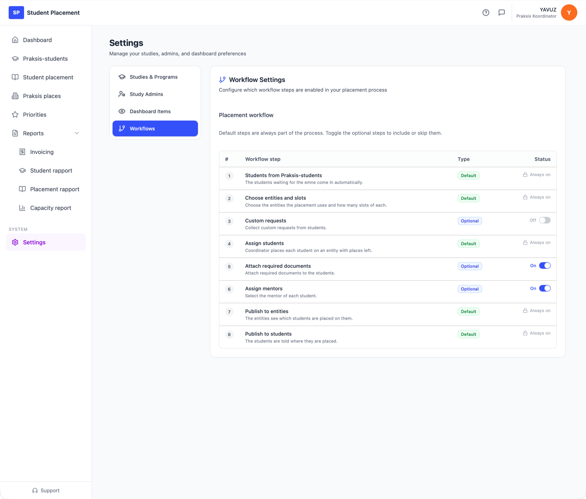
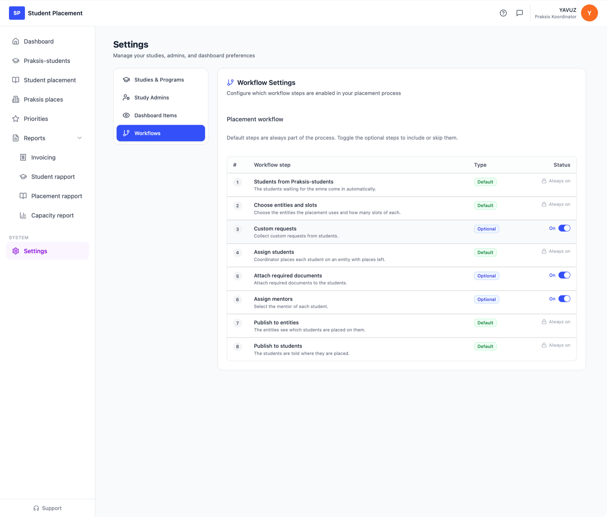

# Test Scenario 03b — Settings - Workflows

:::info[Scenario overview]

- **Page:** Settings → Workflows
- **Role:** Placement Coordinator (PK)
- **Goal:** Understand the steps of the placement workflow, and switch an optional step on or off.

:::

## What this page is

**Workflows** (under Settings) — titled **Workflow Settings** — configures which steps are enabled in your
 placement process. The **Placement workflow** table lists every step in order with its **Type** and
 **Status**:

- **Default** steps are always part of the process. They show a lock and *Always on*, and can't be switched off.
- **Optional** steps have an **On/Off** switch, so you can include or skip them.

| # | Workflow step | What it does | Type |
|---|---|---|---|
| 1 | **Students from Praksis-students** | The students waiting for the emne come in automatically. | Default |
| 2 | **Choose entities and slots** | Choose the entities the placement uses and how many slots of each. | Default |
| 3 | **Custom requests** | Collect custom requests from students. | Optional |
| 4 | **Assign students** | Coordinator places each student on an entity with places left. | Default |
| 5 | **Attach required documents** | Attach required documents to the students. | Optional |
| 6 | **Assign mentors** | Select the mentor of each student. | Optional |
| 7 | **Publish to entities** | The entities see which students are placed on them. | Default |
| 8 | **Publish to students** | The students are told where they are placed. | Default |

:::warning

These settings apply to your placement process, not to a single placement. Change them only when you
 intend to — and if you switch a step on just to try it, switch it back afterwards.

:::

---

## Steps

### 1. Open Settings → Workflows

Click **Settings** in the sidebar, then select the **Workflows** tab. Review the current status of the
 three optional steps — here **Custom requests** is **Off**, while **Attach required documents** and
 **Assign mentors** are **On**.

<figure>

<figcaption>Workflow Settings — 8 steps; Custom requests is Optional and Off</figcaption>

</figure>

### 2. Switch an optional step on

Click the switch for **Custom requests**. Its status changes to **On** and a *"Workflow setting saved"*
 confirmation appears. There is no separate save button.

<figure>

<figcaption>Custom requests is now On</figcaption>

</figure>

### 3. Switch it back off (optional)

Click the same switch again to return **Custom requests** to **Off**. The *"Workflow setting saved"*
 confirmation appears again.

---

## Final result

The **Placement workflow** table reflects your choice for each optional step. Default steps stay
 *Always on*.

---

<ScenarioFeedback scenarioId="TS-03b-workflows" />
