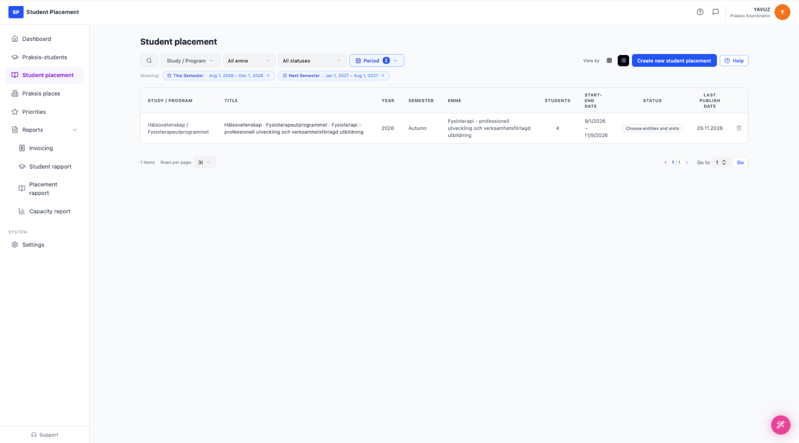
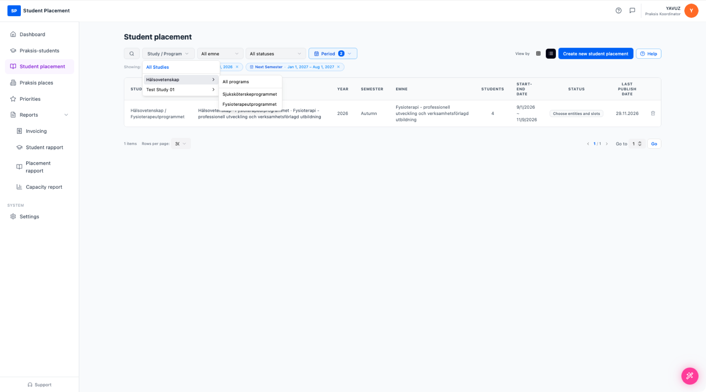
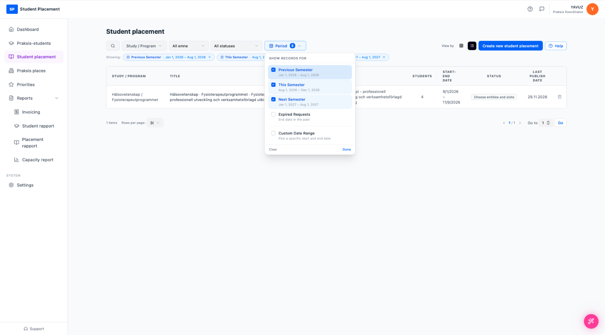
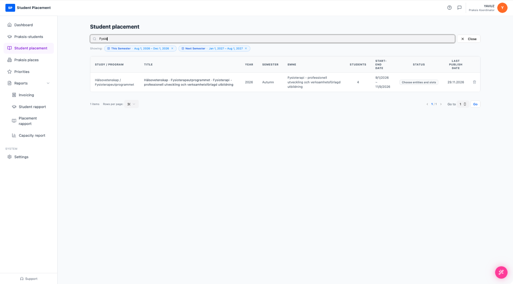
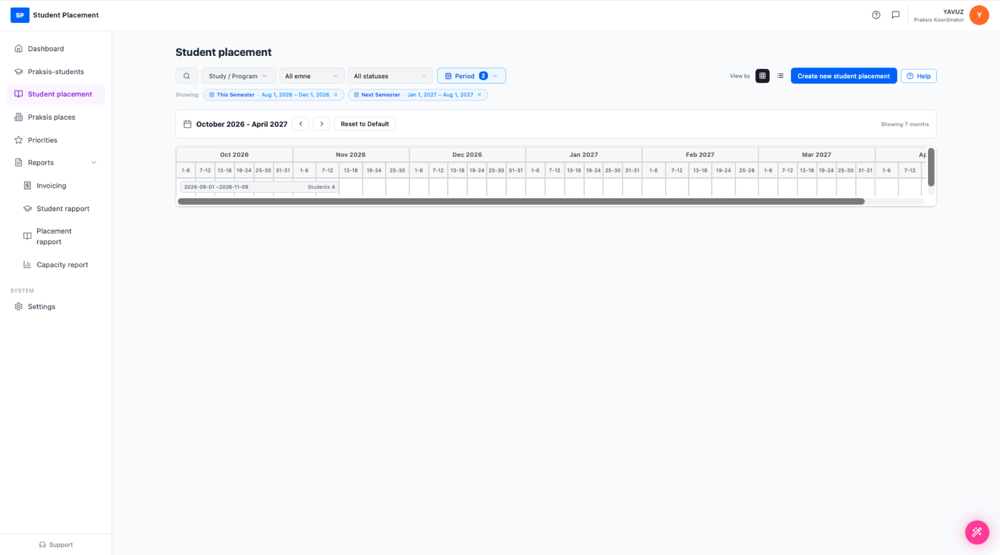

# Test Scenario 07 — Student Placement - Overview

:::info[Scenario overview]

- **Page:** Student placement
- **Role:** Placement Coordinator (PK)
- **Goal:** Get to know the Student placement page — its columns, filters, period selector, the two *View by* modes and the other actions.
- **Precondition:** Signed in as PK. This walkthrough uses the existing placement **Hälsovetenskap · Fysioterapeutprogrammet · Fysioterapi - professionell utveckling och verksamhetsförlagd utbildning** (Autumn 2026, 4 students).

:::

## What this page is

**Student placement** lists all your placements. A placement takes the students waiting for an emne
 (from *Praksis-students*) and moves them through the placement workflow until they are placed and
 published. From this page you find, filter and open placements, and start new ones.

### Toolbar

| Control | What it does |
|---|---|
| **Search** (magnifier) | Opens a search field — *Search placements by title...* — that replaces the toolbar until you click **Close**. |
| **Study / Program** | Cascading menu: **All Studies**, or hover a study and pick **All programs** or one program. |
| **All emne** | Limits the list to one emne. |
| **All statuses** | Limits the list to placements at one workflow step (see *Status* below). |
| **Period** | Chooses which time periods are shown; the badge shows how many are active. |
| **View by** | Switches between **Calendar view** (grid icon) and **Table view** (list icon). |
| **Create new student placement** | Starts a new placement (*Step 1 of 7*). Covered in the next scenario. |
| **Help** | Opens the help center in a new tab. |

Under the toolbar, **Showing:** lists the active periods as chips (e.g. *This Semester · Aug 1, 2026 – Dec 1,
 2026*). Click **×** on a chip to remove that period.

### Columns (Table view)

| Column | Content |
|---|---|
| **Study / Program** | The study and program the placement belongs to. |
| **Title** | The placement title — by default built from *study · program · emne*. |
| **Year** / **Semester** | When the placement runs (e.g. *2026*, *Autumn*). |
| **Emne** | The emne whose students are placed. |
| **Students** | Number of students in the placement. |
| **Start-End date** | The placement period (e.g. *9/1/2026 ~ 11/9/2026*). |
| **Status** | The workflow step the placement is at (e.g. *Choose entities and slots*). |
| **Last publish date** | The *Last publish date* entered when the placement was created. |
| *(trash icon)* | Deletes the placement. |

Click anywhere on a row to open the placement. Below the table you see the number of items, **Rows per page**
 and page navigation (**Go to** a page number).

### Status

The **All statuses** filter lists the steps a placement can be at: *Students from Praksis-students*,
 *Choose entities and slots*, *First publish*, *Attach praksis places to the students*, *Attach required
 documents*, *Assign mentors to the students*, *Publish to entities*, *Publish to students* and *Completed*.
 Which optional steps are used is set in *Settings → Workflows* (see *Test Scenario 03b*).

---

## Steps

### 1. Open Student placement

Click **Student placement** in the sidebar. The page opens in **Table view** with the default periods
 **This Semester** and **Next Semester** (Period badge *2*). Here one placement is shown, at status
 **Choose entities and slots**.

<figure>

<figcaption>Student placement — toolbar, active periods and the placement table</figcaption>

</figure>

### 2. Filter by study and program

Click **Study / Program** and hover **Hälsovetenskap**. A sub-menu shows **All programs**,
 **Sjuksköterskeprogrammet** and **Fysioterapeutprogrammet** — click one to filter the list. Use
 **All emne** and **All statuses** the same way to narrow further.

<figure>

<figcaption>Study / Program — pick a study, then all or one of its programs</figcaption>

</figure>

### 3. Choose the period

Click **Period**. Under **Show records for** you can tick:

- **Previous Semester**, **This Semester**, **Next Semester** — with their date ranges;
- **Expired Requests** — placements whose *end date is in the past*;
- **Custom Date Range** — pick a **From** and **To** date (*"Select both dates to apply filter"*). Choosing a
  custom range turns the other options off.

Each ticked option is added as a chip under **Showing:**. Click **Done** to close the menu; **Clear** removes
 all periods — then no placements are listed until you choose a period again.

<figure>

<figcaption>Period — Previous Semester added to the two default semesters</figcaption>

</figure>

### 4. Search by title

Click the **magnifier**. The toolbar is replaced by a search field — type part of a title, here `Fysio`.
 The list shows the matching placements within the active periods. Click **Close** to get the toolbar back.

<figure>

<figcaption>Search placements by title</figcaption>

</figure>

### 5. Switch to Calendar view

Under **View by**, click the **grid** icon. Each placement is drawn as a bar across the months it runs, with
 its dates and number of students (*2026-09-01 ~2026-11-09 · Students 4*). The header shows the visible
 range (*October 2026 - April 2027*, *Showing 7 months*); use **‹ ›** to move and **Reset to Default** to
 return. Click the **list** icon to go back to **Table view**.

<figure>

<figcaption>Calendar view — placements on a month timeline</figcaption>

</figure>

---

## Final result

The coordinator knows how to read the placement table, narrow it by study/program, emne, status, period and
 title, switch between table and calendar view, and where to start a new placement.

## Notes

-   The filters and the period work together — if a placement is missing, check the **Showing:** chips first.
-   Creating a placement (**Create new student placement**) is described in the next scenario.

---

<ScenarioFeedback scenarioId="TS-07-student-placement-overview" />
