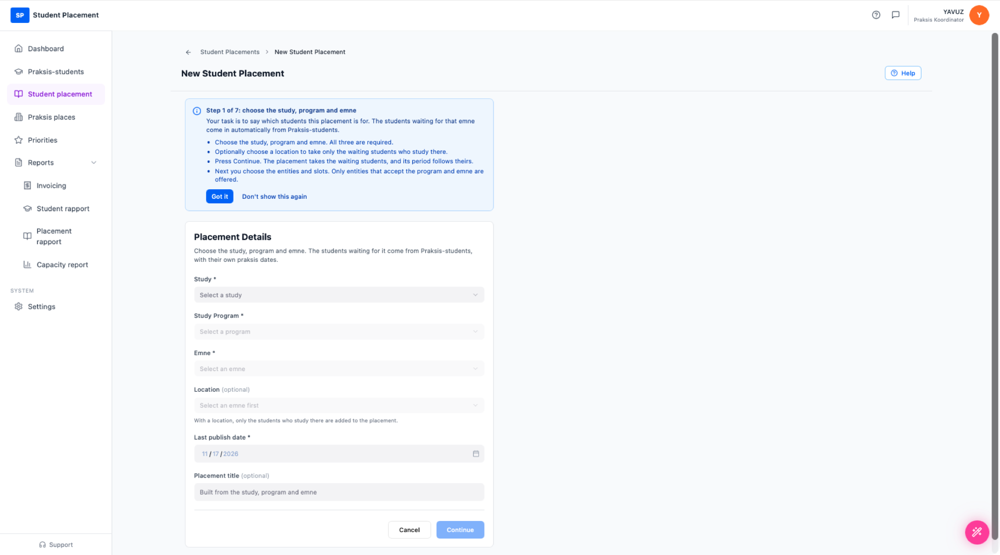
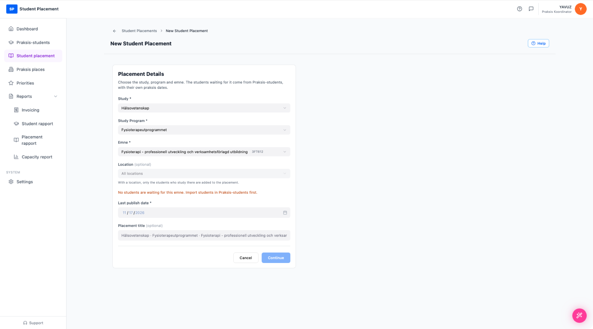
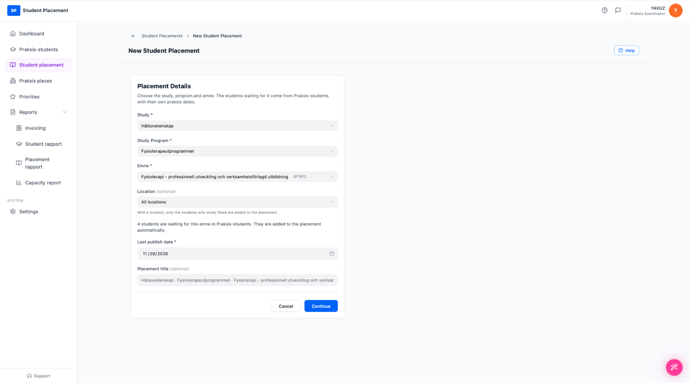

# Test Scenario 08 — Student Placement - Create

:::info[Scenario overview]

- **Page:** Student placement → New Student Placement
- **Role:** Placement Coordinator (PK)
- **Goal:** Create a new student placement for an emne, so the students waiting for that emne are taken into it.
- **Precondition:** Signed in as PK. Students for the emne are waiting in *Praksis-students* (see *Test Scenario 06*). This walkthrough uses **Hälsovetenskap → Fysioterapeutprogrammet → Fysioterapi - professionell utveckling och verksamhetsförlagd utbildning (3FT612)**, with 4 waiting students.

:::

## What this page is

**New Student Placement** is *Step 1 of 7* of a placement. You say **which students** the placement is
 for by choosing a study, program and emne — the students waiting for that emne in **Praksis-students**
 are added automatically, and the placement's period follows their praksis dates. You don't add students
 or dates by hand.

The **Placement Details** form has these fields:

| Field | Notes |
|---|---|
| **Study** * | The study. |
| **Study Program** * | Enabled after a study is chosen; lists the study's programs. |
| **Emne** * | Enabled after a program is chosen; lists the program's emner with their course code (e.g. *3FT612*). |
| **Location** (optional) | *All locations* by default. Lists the locations of the waiting students with a count (e.g. *Umeå · 4 waiting*). *"With a location, only the students who study there are added to the placement."* |
| **Last publish date** * | Must be **today or later**. |
| **Placement title** (optional) | Leave empty to use the title built from *study · program · emne*, shown as placeholder. |

An info box at the top explains the step. Click **Got it** to close it, or **Don't show this again** to hide
 it for good.

---

## Steps

### 1. Open New Student Placement

On the **Student placement** page (see *Test Scenario 07*), click **Create new student placement**. The
 **New Student Placement** page opens with the info box *"Step 1 of 7: choose the study, program and emne"*
 and the empty **Placement Details** form. **Continue** stays disabled until the form is complete.

<figure>

<figcaption>New Student Placement — Step 1 of 7 with the empty form</figcaption>

</figure>

### 2. Choose study, program and emne

Select **Study** `Hälsovetenskap`, **Study Program** `Fysioterapeutprogrammet` and **Emne**
 `Fysioterapi - professionell utveckling och verksamhetsförlagd utbildning` (*3FT612*). Below **Location**
 the form now tells you how many students are waiting:
 *"4 students are waiting for this emne in Praksis-students. They are added to the placement automatically."*

:::note[No waiting students?]

If every student of the emne is already in another placement — or none have been imported — the form shows
 *"No students are waiting for this emne. Import students in Praksis-students first."* and **Continue** stays
 disabled.

<figure>

<figcaption>No students waiting for the emne — Continue is disabled</figcaption>

</figure>

:::

### 3. Location, last publish date and title

Leave **Location** on **All locations** to take every waiting student (here the only location is
 *Umeå · 4 waiting*). Pick a **Last publish date** — here `29.11.2026`; it must be today or later. Leave
 **Placement title** empty to use the suggested title. **Continue** is now enabled.

<figure>

<figcaption>Placement Details filled in — 4 students waiting, Continue enabled</figcaption>

</figure>

### 4. Click Continue

Click **Continue**. The placement is created and opens on its own page:

- **Title:** *Hälsovetenskap · Fysioterapeutprogrammet · Fysioterapi - professionell utveckling och
  verksamhetsförlagd utbildning*
- **Details:** *2026 · Autumn · 2026-09-01 - 2026-11-09 · 4 students* — the period comes from the students'
  praksis dates.
- **Last publish: 29.11.2026** — click it to change the last publish date.
- **Status badge:** **2/7 Choose entities and slots** — the placement moves straight on to step 2.

<figure>

<figcaption>Placement created — now at step 2/7, Choose entities and slots</figcaption>

</figure>

---

## Final result

A new placement exists for the emne, with the 4 waiting students added automatically. It appears in the
 **Student placement** list with status *Choose entities and slots*, and in **Praksis-students** its
 students change from *Waiting* to *In placement*.

## Notes

-   Students who are already in a placement are no longer *waiting*, so they are not taken into another
    placement. Use **Location** to create a placement for only part of the waiting students.
-   Choosing entities and slots (step 2) is described in the next scenario.

---

<ScenarioFeedback scenarioId="TS-08-create-placement" />
