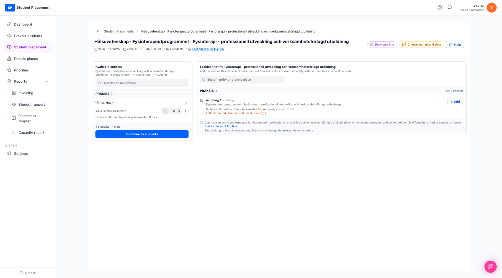
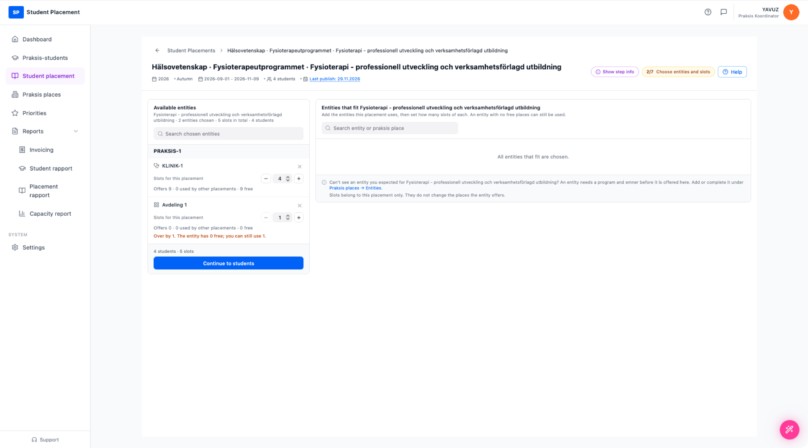
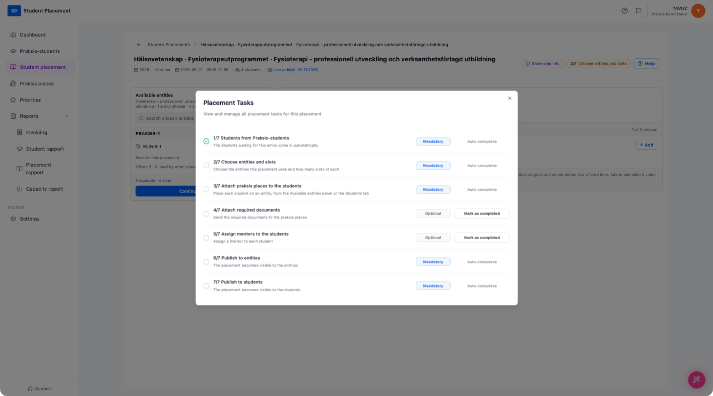

# Test Scenario 09 — Student Placement - Choose entities and slots

:::info[Scenario overview]

- **Page:** Student placement → *placement* (step 2/7, *Choose entities and slots*)
- **Role:** Placement Coordinator (PK)
- **Goal:** Choose which entities take students in this placement and how many slots each one gives it.
- **Precondition:** A placement has been created (see *Test Scenario 08*). This walkthrough continues with **Hälsovetenskap · Fysioterapeutprogrammet · Fysioterapi - professionell utveckling och verksamhetsförlagd utbildning** (4 students).

:::

## What this page is

Right after a placement is created it opens at **Step 2 of 7: choose the entities for this placement**. The
 page has two panels:

- **Entities that fit …** (right) — every entity that accepts the placement's program and emne, grouped by
  praksis place (e.g. **PRAKSIS-1** · *0 of 2 chosen*). Each entity shows its type, program · emne and its
  capacity: *places · used by other placements · free* and how often it resets (e.g. *Yearly · resets
  01-01*). An entity without free places shows *"Full this period. You can still use it, over by 1."*
  Use the search box to find an entity or praksis place.
- **Available entities** (left) — the entities you have chosen for this placement, each with
  **Slots for this placement** (**−** / number / **+**) and a remove button (**×**). The bottom bar sums up
  *students · slots* and holds **Continue to students**.

| Term | Meaning |
|---|---|
| **Places** | What the entity offers in total, for all placements. |
| **Slots** | How many of those this placement uses. *"Slots belong to this placement only. They do not change the places the entity offers."* |

:::tip

Slots guide you and never block: you can place more students than slots, and the entity then shows
 *"over by N"*. You can also continue without any entity and add them later with **Change entities**.

:::

If an entity you expect is missing, it needs a program and emner first — add or complete it under
 **Praksis places → Entities**.

---

## Steps

### 1. Start at step 2

Open the placement (or continue straight from *Test Scenario 08*). The header shows the placement title,
 *2026 · Autumn · 2026-09-01 - 2026-11-09 · 4 students*, **Last publish: 29.11.2026** and the step badge
 **2/7 Choose entities and slots**. The left panel says *"No entities chosen yet. Add entities from the list on
 the right."* Close the info box with **Got it** — you can reopen it with **Show step info**.

<figure>

<figcaption>Step 2 of 7 — the entities that fit are listed on the right</figcaption>

</figure>

### 2. Add an entity and set its slots

Click **Add** on **KLINIK-1** (*9 places · 0 used by other placements · 9 free*). It moves to **Available
 entities** and starts with its free places as slots (**9**). Click **−** until the slots are **4** — one for
 each student. The summary now reads *1 entity chosen · 4 slots in total · 4 students*, and the bottom bar
 *4 students · 4 slots*.

<figure>

<figcaption>KLINIK-1 chosen — 4 slots for this placement</figcaption>

</figure>

### 3. (Optional) Add an entity without free places

Click **Add** on **Avdeling 1** (*0 places · 0 free*). It is added with **1** slot and a warning:
 *"Over by 1. The entity has 0 free; you can still use 1."* The right panel now says *"All entities that fit
 are chosen."* Click **×** (*Remove Avdeling 1*) to take it out again — it returns to the list on the right.

<figure>

<figcaption>An entity with no free places can still be used — it shows "Over by 1"</figcaption>

</figure>

### 4. (Optional) Check the placement tasks

Click the step badge **2/7 Choose entities and slots** in the header. The **Placement Tasks** dialog lists all
 seven steps with their state. Mandatory steps *auto-complete*; optional steps (*Attach required documents*,
 *Assign mentors to the students*) have a **Mark as completed** button. Close the dialog with **×**.

<figure>

<figcaption>Placement Tasks — step 1 is done, step 2 is in progress</figcaption>

</figure>

### 5. Continue to students

With **KLINIK-1 · 4 slots** chosen, click **Continue to students**. The placement moves on to **3/7 Attach
 praksis places to the students**: the left panel shows **KLINIK-1** with *4 / 4* free slots and *0 placed
 here*, and the **Students** table lists the 4 students, all *not assigned*. Use **Change entities** (top of
 the left panel) to go back and change entities or slots.

<figure>

<figcaption>Step 3 of 7 — KLINIK-1 with 4 slots, 4 students to place</figcaption>

</figure>

---

## Final result

The placement uses **KLINIK-1** with **4 slots** for its 4 students and is now at step **3/7 Attach praksis
 places to the students**.

## Notes

-   Placing the students on the entity (step 3) is described in the next scenario.

---

<ScenarioFeedback scenarioId="TS-09-choose-entities" />
