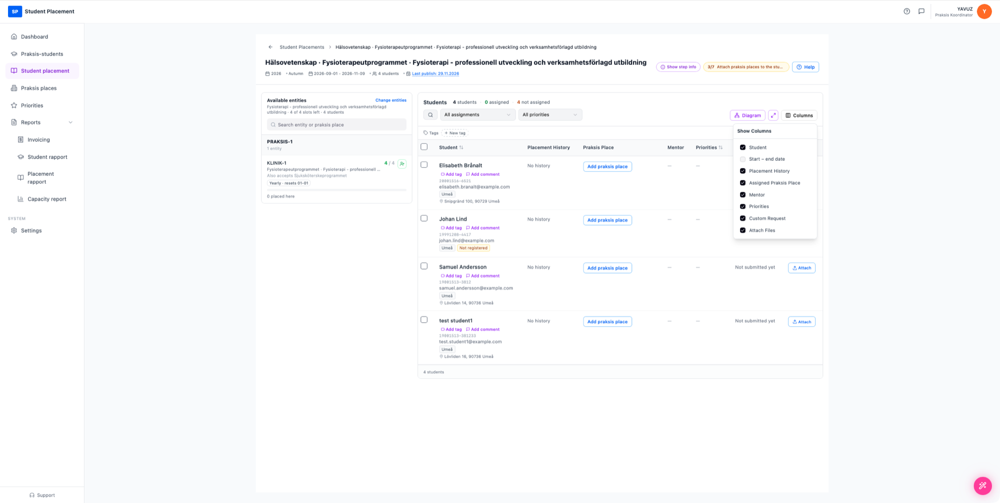
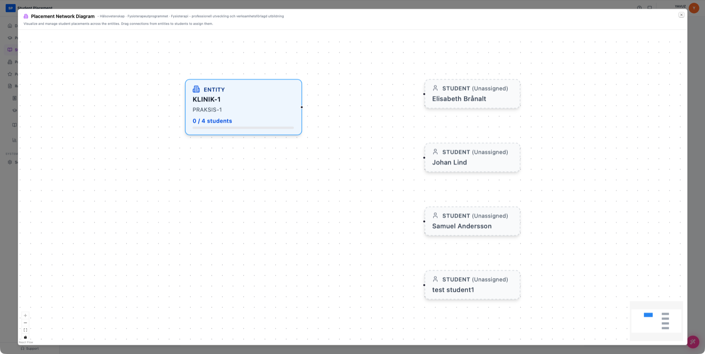
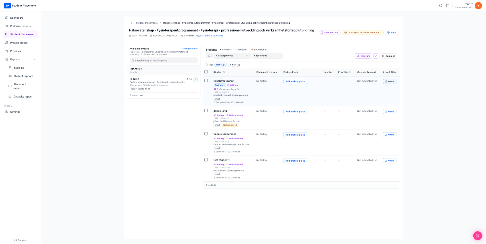
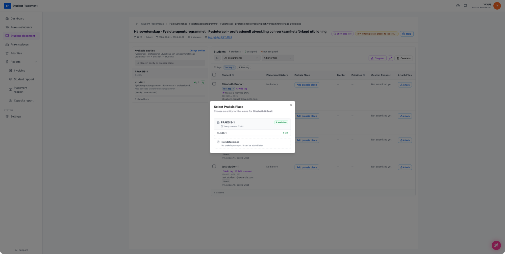
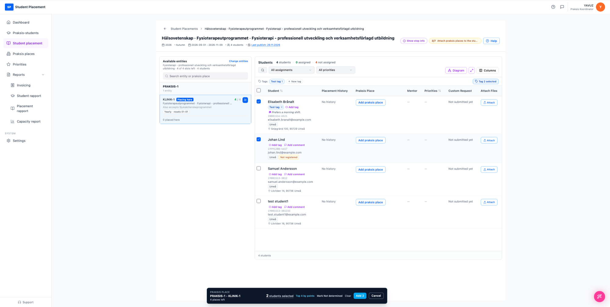
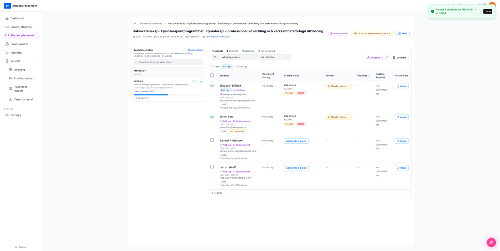
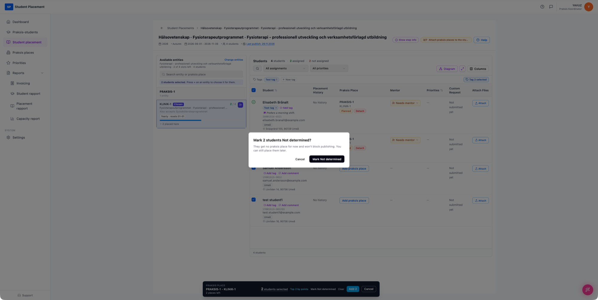
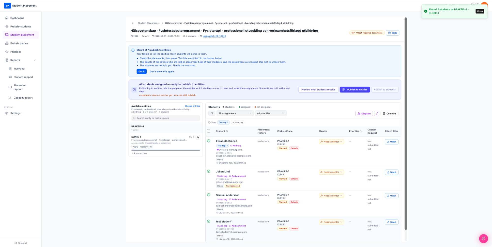

# Test Scenario 10 — Student Placement - Place the students

:::info[Scenario overview]

- **Page:** Student placement → *placement* (step 3/7, *Attach praksis places to the students*)
- **Role:** Placement Coordinator (PK)
- **Goal:** Place every student of the placement on one of the chosen entities — and get to know the tools on this page: filters, columns, diagram, tags, comments and the placement bar.
- **Precondition:** Entities and slots have been chosen (see *Test Scenario 09*). This walkthrough continues with the placement on **KLINIK-1 · 4 slots** and its 4 students.

:::

## What this page is

Step 3 is where students get their praksis place. The info box sums it up: *"Step 3 of 7: place the students
 on entities. Your task is to place every student on one of the chosen entities."*

The page has two panels.

### Available entities (left)

Every entity chosen in step 2, grouped by praksis place, with:

- its free slots (e.g. **4 / 4**) and a bar showing how many places are taken;
- a **+** button (*Place students on KLINIK-1*) — starts placing students on this entity;
- **N placed here** — expands to list the students on the entity, each with **×** to take them off, plus
  **Remove all**;
- a search box (*Search entity or praksis place*) and **Change entities** to go back to step 2.

### Students (right)

The summary *4 students · 0 assigned · 4 not assigned* — click *assigned* or *not assigned* to show only those
 students. The toolbar has:

| Control | What it does |
|---|---|
| **Search** (magnifier) | *Search by name, personnummer, address or student note.* **Close** brings the toolbar back. |
| **All assignments** | *Assigned*, *Not assigned*, *Not determined*, or one praksis place (e.g. *PRAKSIS-1*). |
| **All priorities** | *With priority* / *Without priority*. |
| **Diagram** | Opens the **Placement Network Diagram** (see step 2 below). |
| **Expand** (arrows icon) | Hides the entities panel so the table gets the full width; click again to collapse. |
| **Columns** | Shows or hides columns: *Student*, *Start – end date* (off by default), *Placement History*, *Assigned Praksis Place*, *Mentor*, *Priorities*, *Custom Request*, *Attach Files*. |
| **Tags** | Lists the tags with how many students have each (click one to show those students), and **New tag**. |

Each student row shows the name with **Add tag** and **Add comment**, personnummer, email, study location (and
 *Not registered* when that applies) and home address, followed by these columns:

| Column | Content |
|---|---|
| **Placement History** | Earlier placements (*No history* if none). |
| **Praksis Place** | **Add praksis place** — or, once placed, the praksis place and entity with *Planned* and **Detach**. |
| **Mentor** | After the student is placed: **Needs mentor** — a menu with the entity's contacts and *Add a person…*. |
| **Priorities** | The student's priority, if any. |
| **Custom Request** | *Not submitted yet* until the student sends one. |
| **Attach Files** | **Attach** — opens a file picker to upload a file for the student. |

---

## Steps

### 1. Look at step 3

Open the placement (or continue from *Test Scenario 09*). The badge reads **3/7 Attach praksis places to the
 students**. KLINIK-1 shows *4 / 4* and *0 placed here*; all 4 students are *not assigned*.

<figure>

<figcaption>Step 3 of 7 — entities on the left, students on the right</figcaption>

</figure>

### 2. (Optional) Explore the view tools

- Click **Columns** to choose which columns are shown.

<figure>

<figcaption>Columns — Start – end date is hidden by default</figcaption>

</figure>

- Click **Diagram**. The **Placement Network Diagram** shows the entity (*KLINIK-1 · PRAKSIS-1 · 0 / 4
  students*) and every student (*STUDENT (Unassigned)*). *"Drag connections from entities to students to assign
  them."* Use the zoom and *fit view* buttons bottom-left; close with **×**.

<figure>

<figcaption>Placement Network Diagram — drag from an entity to a student to assign</figcaption>

</figure>

- Click **Expand** (arrows icon) to hide the entities panel; click it again to bring it back.

### 3. Tag a student and add a comment

1. Click **New tag**, type `Test tag` and click **Make the tag "Test tag"**. It appears next to *Tags* with
   the count *0*.
2. On **Elisabeth Brånalt**, click **Add tag** and pick **Test tag**. The tag shows under her name (remove it
   with **×**) and the count becomes *1*.
3. Click **Add comment**, type `Prefers a morning shift.` and click **Save**. The comment (max 1000
   characters, *"Only people at the university see this"*) now shows under her name.

<figure>

<figcaption>Elisabeth Brånalt with "Test tag" and a comment</figcaption>

</figure>

### 4. Place one student with "Add praksis place"

On Elisabeth's row click **Add praksis place**. The **Select Praksis Place** dialog (*"Choose an entity for
 this emne for Elisabeth Brånalt"*) lists **KLINIK-1 · 4 left** under PRAKSIS-1, and **Not determined** —
 *"No praksis place yet. It can be added later."* Click **KLINIK-1**.

<figure>

<figcaption>Select Praksis Place — pick an entity, or Not determined</figcaption>

</figure>

A message confirms *"Assigned Elisabeth Brånalt to KLINIK-1"*. Her row now shows **PRAKSIS-1 · KLINIK-1** with
 *Planned* and **Detach**, and a **Needs mentor** button appears. Click **Detach** to take her off again — it
 happens at once (*"Elisabeth Brånalt detached from praksis place"*).

### 5. Place several students from the entity's +

1. In the left panel click **+** on **KLINIK-1**. The entity is marked *Placing here* and a bar appears at
   the bottom: *PRAKSIS-1 - KLINIK-1 · 4 places left · 0 students selected*. Close the info window with
   **Got it**.
2. Tick **Elisabeth Brånalt** and **Johan Lind**. The bar shows *2 students selected* with **Top 4 by points**,
   **Mark Not determined**, **Clear**, **Add 2** and **Cancel** — and a **Tag 2 selected** button appears next
   to the tags.

<figure>

<figcaption>The placement bar — 2 students selected for KLINIK-1</figcaption>

</figure>

3. Click **Add 2**. The message *"Placed 2 students on PRAKSIS-1 - KLINIK-1"* has an **Undo** button. KLINIK-1
   now shows *2 / 4* and **2 placed here** — click it to see who is placed there.

<figure>

<figcaption>2 assigned · 2 not assigned — KLINIK-1 has 2 slots left</figcaption>

</figure>

### 6. Place the rest — tick first, then +

You can also work the other way round: tick **Samuel Andersson** first. The left panel says *"1 student
 selected. Press + on an entity to choose it for them."* Click **+** on **KLINIK-1** — the entity is marked
 *Chosen* and the bar shows *2 places left*.

Click **Top 2 by points** — it selects the students with the most priority points, as many as there are places
 left (here the two remaining students).

:::note[Mark Not determined]

**Mark Not determined** gives the selected students *no praksis place for now*. It asks first:
 *"Mark 2 students Not determined? They get no praksis place for now and won't block publishing. You can still
 place them later."* In this walkthrough we click **Cancel**.

<figure>

<figcaption>Mark Not determined — asks for confirmation</figcaption>

</figure>

:::

Click **Add 2**.

### 7. All students placed

All 4 students are assigned and KLINIK-1 shows *0 / 4*. A banner appears above the list:
 *"All students assigned — ready to publish to entities"*, with *"4 students have no mentor yet. You can still
 publish."* and the buttons **Preview what students receive**, **Publish to entities** and **Publish to
 students** (disabled until you publish to entities).

**Preview what students receive** shows the placement as a student will see it — entity, dates and contacts —
 and warns if the entity is missing information (e.g. activity description), which you can fill in under
 **Praksis places → Entities**.

<figure>

<figcaption>All students assigned — the publish step opens above the list</figcaption>

</figure>

---

## Final result

All 4 students are placed on **KLINIK-1** (*Planned*), and the placement is ready to be published to the
 entities.

## Notes

-   Slots never block: you can place more students than slots — the entity then shows *"over by N"*.
-   **Detach** takes a student off at once, without asking.
-   Mentors and publishing are described in the next scenarios.

---

<ScenarioFeedback scenarioId="TS-10-place-students" />
