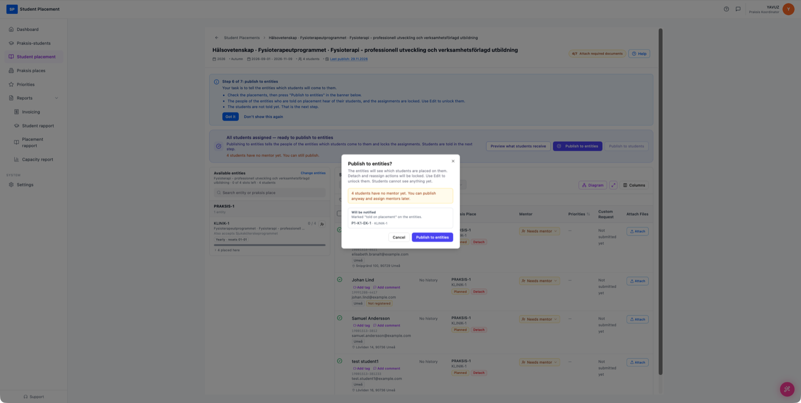
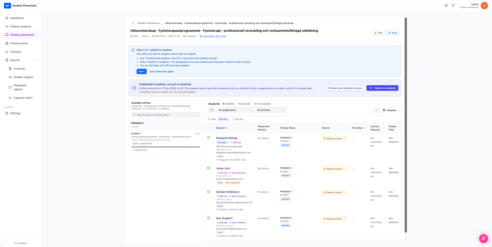
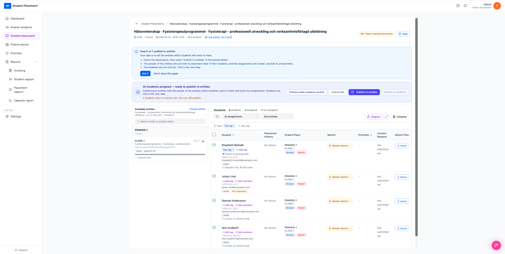
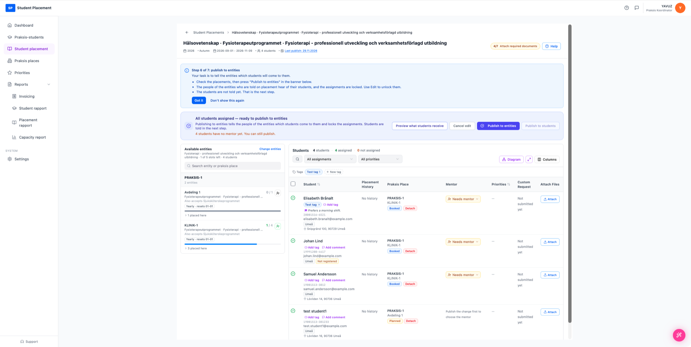
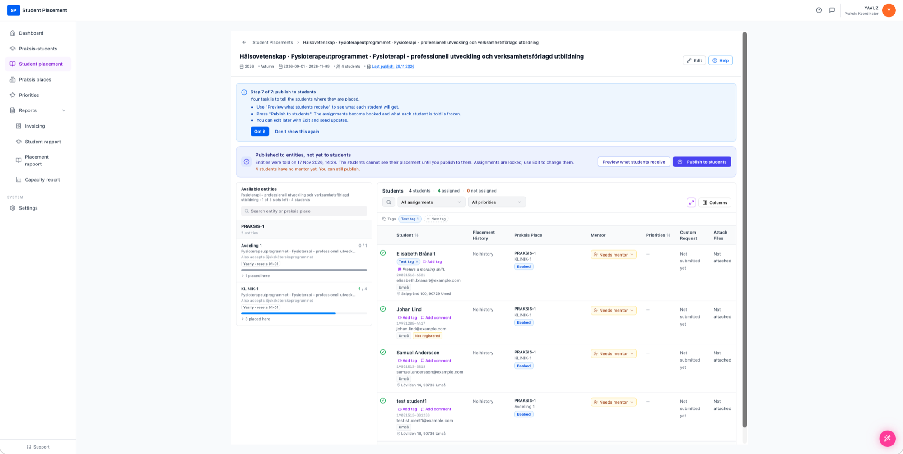

# Test Scenario 10b — Student Placement - Publish to entities and edit

:::info[Scenario overview]

- **Page:** Student placement → *placement* (publish to entities)
- **Role:** Placement Coordinator (PK)
- **Goal:** Publish the placement to the entities, then use **Edit** to change an assignment and publish the change again.
- **Precondition:** All students are placed (see *Test Scenario 10*). This walkthrough continues with the 4 students on **KLINIK-1**.

:::

## What this page is

When every student has a place, a banner appears above the student list: *"All students assigned — ready to
 publish to entities"*. **Publishing to entities** tells the entities which students come to them:

- the **entity contacts** can now see the assignments — which students are placed on their entity;
- the assignments are **locked** (*Booked*) — **Detach** and reassigning are switched off until you press
  **Edit**;
- the **students are not told yet** — that is the next step, **Publish to students**.

Mentors are not required: *"4 students have no mentor yet. You can still publish."*

---

## Steps

### 1. Publish to entities

In the banner, click **Publish to entities**. A confirmation opens: *"Publish to entities? The entities will see
 which students are placed on them. Detach and reassign actions will be locked. Use Edit to unlock them.
 Students cannot see anything yet."* Under **Will be notified** it lists the contacts that are marked *"told on
 placement"* on the entities — here **P1-K1-EK-1 · KLINIK-1**. Click **Publish to entities**.

<figure>

<figcaption>Publish to entities? — shows who will be notified</figcaption>

</figure>

### 2. Check the published placement

The message *"Published to entities"* appears and the banner changes to **"Published to entities, not yet to
 students"** — *"Entities were told on 17 Nov 2026, 14:23. The students cannot see their placement until you
 publish to them. Assignments are locked; use Edit to change them."*

- Every student is now **Booked** on KLINIK-1; **Detach** and **Attach** are gone (*Not attached*).
- **Change entities**, **Diagram** and the step badge are hidden; an **Edit** button appears in the header.
- The banner offers **Preview what students receive** and **Publish to students**.

<figure>

<figcaption>Published to entities, not yet to students — assignments are Booked and locked</figcaption>

</figure>

### 3. Unlock with Edit

Click **Edit** (top right). The placement is unlocked at once: **Detach**, **Change entities**, **Diagram** and
 the step badge return, and the banner shows **Cancel edit** next to **Publish to entities**. Use **Cancel
 edit** to leave without changes.

<figure>

<figcaption>Edit — assignments can be changed again</figcaption>

</figure>

### 4. Make a change

In this example we move **test student1** to another entity:

1. Click **Change entities**, **Add** **Avdeling 1** (it gets 1 slot) and click **Continue to students** —
   see *Test Scenario 09*.
2. On **test student1**, click **Detach**, then **Add praksis place** and choose **Avdeling 1**. The message
   *"Assigned test student1 to Avdeling 1"* confirms it.

The changed student shows **Planned** (not yet published), while the others stay **Booked**. The mentor column
 for the changed student says *"Publish the change first to choose the mentor"*.

<figure>

<figcaption>test student1 moved to Avdeling 1 — Planned until the change is published</figcaption>

</figure>

### 5. Publish the change

Click **Publish to entities** again and confirm. The banner returns to **"Published to entities, not yet to
 students"** with the new time, and **test student1** is now **Booked** on **Avdeling 1**. The assignments are
 locked again.

<figure>

<figcaption>The change is published — all assignments Booked and locked again</figcaption>

</figure>

---

## Final result

The entities have been told about their students — 3 on **KLINIK-1** and 1 on **Avdeling 1** — and the entity
 contacts can see the assignments. The students are not told yet; the placement is ready for **Publish to
 students**.

## Notes

-   Only contacts marked *"told on placement"* on an entity are listed under **Will be notified**. In this
    example Avdeling 1 had no such contact, so only P1-K1-EK-1 (KLINIK-1) was listed — check the entity's
    contacts under **Praksis places → Entities** if someone should be notified.
-   Publishing to students is described in the next scenario.

---

<ScenarioFeedback scenarioId="TS-10b-publish-to-entities" />
