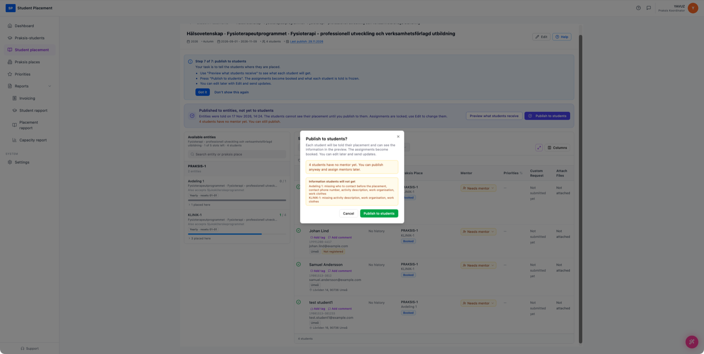
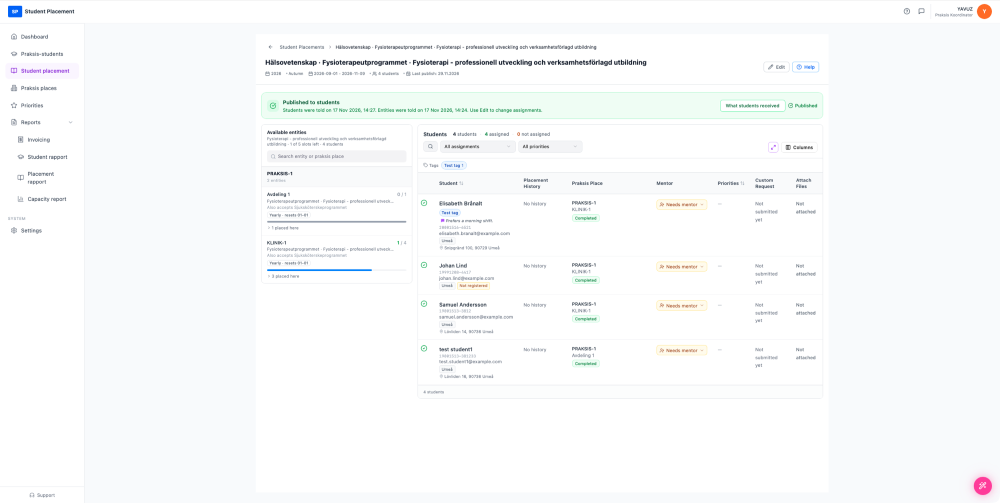
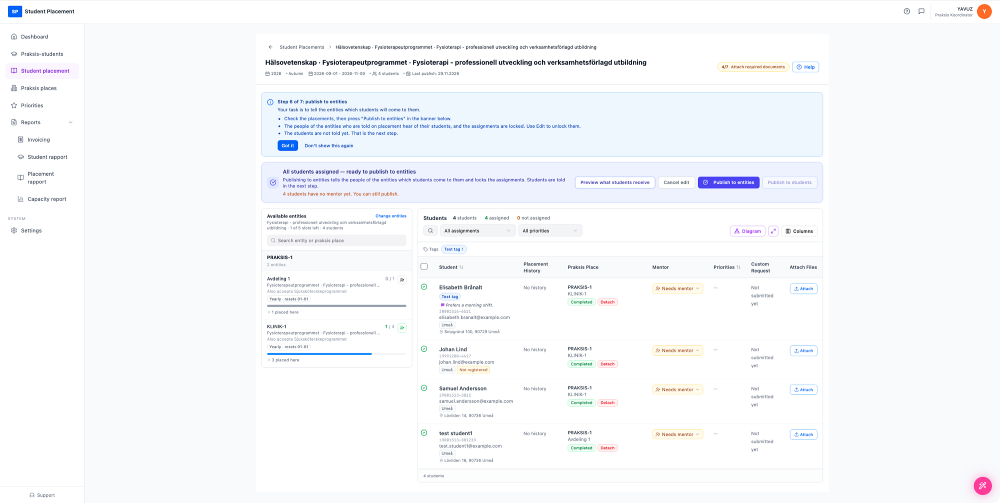
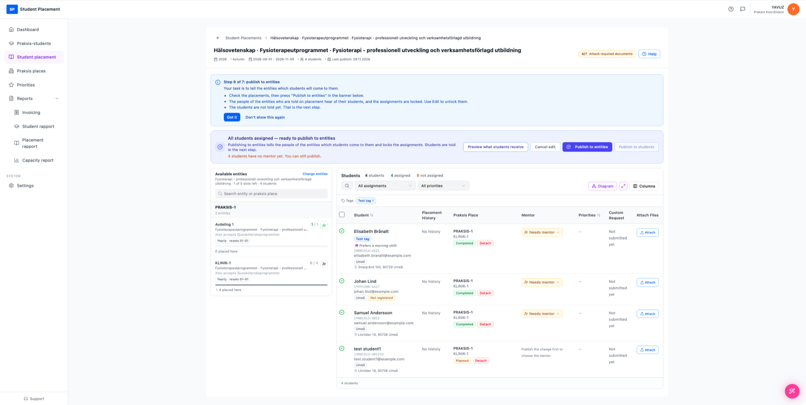
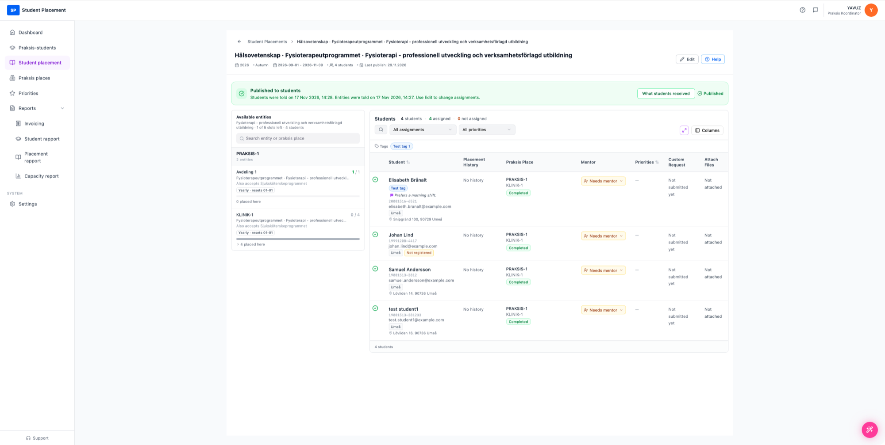

# Test Scenario 10c — Student Placement - Publish to students and edit

:::info[Scenario overview]

- **Page:** Student placement → *placement* (step 7/7, publish to students)
- **Role:** Placement Coordinator (PK)
- **Goal:** Tell the students where they are placed, then use **Edit** to change an assignment and send the update to entities and students.
- **Precondition:** The placement is published to entities (see *Test Scenario 10b*). This walkthrough continues with 3 students on **KLINIK-1** and **test student1** on **Avdeling 1**.

:::

## What this page is

After publishing to entities, the info box shows *"Step 7 of 7: publish to students"*. **Publishing to students**
 tells each student their placement — what they receive is what **Preview what students receive** shows. The
 assignments then show **Completed** and the placement is marked **Published**.

You can still change the placement afterwards: **Edit** unlocks it, and you publish the change to the entities
 and then to the students again.

---

## Steps

### 1. Publish to students

In the banner *"Published to entities, not yet to students"*, click **Publish to students**. A confirmation opens:
 *"Publish to students? Each student will be told their placement and can see the information in the preview.
 The assignments become booked. You can edit later and send updates."*

Under **Information students will not get** it lists what each entity is missing — here *Avdeling 1: missing who
 to contact before the placement, contact phone number, activity description, work organisation, work clothes* and
 *KLINIK-1: missing activity description, work organisation, work clothes*. You can still publish; fill these in
 under **Praksis places → Entities**. Click **Publish to students**.

<figure>

<figcaption>Publish to students? — lists the information students will not get</figcaption>

</figure>

### 2. Check the published placement

The message *"Published to students"* appears. The green banner **"Published to students"** says *"Students were
 told on 17 Nov 2026, 14:27. Entities were told on 17 Nov 2026, 14:24. Use Edit to change assignments."*

- Every student shows **Completed**.
- The banner has **What students received** (the placement as the student sees it, marked *Published* with the
  date) and a **Published** badge.
- Only **Edit** remains in the header; tags and comments can no longer be added.

<figure>

<figcaption>Published to students — all assignments Completed</figcaption>

</figure>

### 3. Edit after publishing

Click **Edit**. The placement unlocks at once, just as after publishing to entities: **Detach**, **Change
 entities**, the step badge and **Cancel edit** return, and the banner offers **Publish to entities** again.
 **Publish to students** is disabled (*"Publish to entities first"*) until the entities have the change.

<figure>

<figcaption>Edit — the placement is unlocked again</figcaption>

</figure>

### 4. Make a change

Move **test student1** back to **KLINIK-1**: click **Detach**, then **Add praksis place** → **KLINIK-1**. The
 student shows **Planned**, the others stay **Completed**.

<figure>

<figcaption>test student1 back on KLINIK-1 — Planned until published</figcaption>

</figure>

### 5. Send the update — entities first, then students

1. Click **Publish to entities** and confirm. The banner returns to *"Published to entities, not yet to
   students"*; test student1 is **Booked**.
2. Click **Publish to students**. The confirmation again lists missing information (now only KLINIK-1). Click
   **Publish to students**.

The banner shows **Published to students** with the new times, and all 4 students are **Completed** on
 **KLINIK-1**.

<figure>

<figcaption>The update is published to entities and students</figcaption>

</figure>

---

## Final result

The students have been told their placement. After the edit, all 4 students are **Completed** on **KLINIK-1**,
 and both the entities and the students have the latest version.

## Notes

-   An edit always goes out in the same order as the first time: **Publish to entities**, then **Publish to
    students**.
-   Mentors are not needed to publish — *"4 students have no mentor yet"*. Assigning mentors is described in the
    next scenario.

---

<ScenarioFeedback scenarioId="TS-10c-publish-to-students" />
