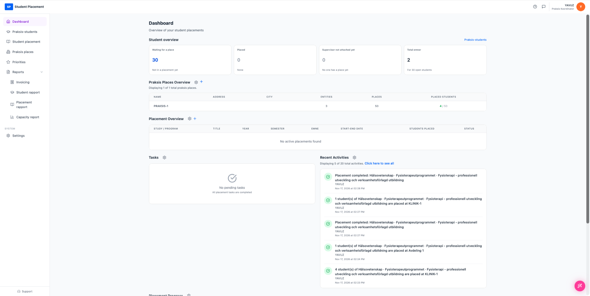
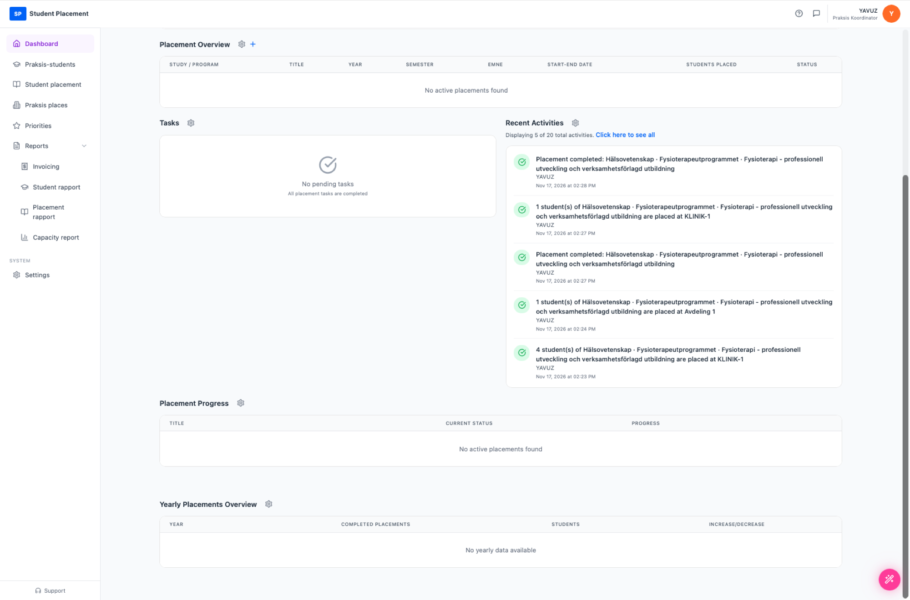
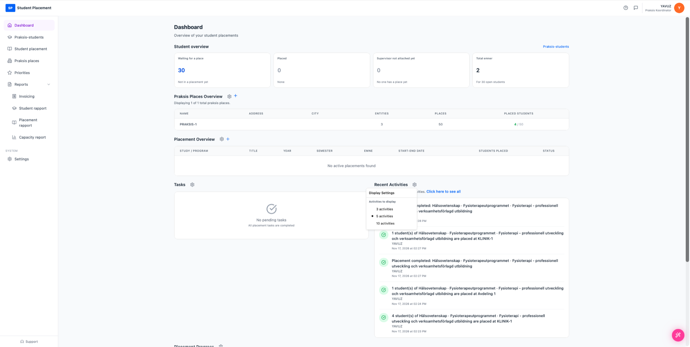
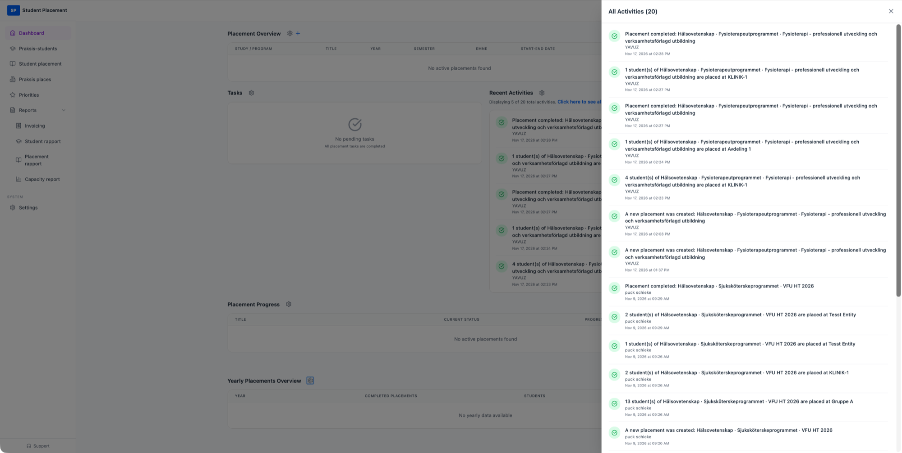

# Testscenario 00 — Dashbord

:::info[Scenariooversikt]

- **Side:** Dashbord
- **Rolle:** Praksiskoordinator (PK)
- **Mål:** Bli kjent med dashbordet — studentoversiktskortene, widgetene og visningsinnstillingene deres.
- **Forutsetning:** Logget inn som PK.

:::

## Hva denne siden er

**Dashbordet** — *oversikt over studentplasseringene dine* — er den første siden etter innlogging. Øverst er
 **Studentoversikt**; under den er widgeter som oppsummerer praksissteder, plasseringer, oppgaver og
 aktiviteter.

Hvilke widgeter som vises, velges under *Innstillinger → Dashbordelementer* (se *Testscenario 03*).
 Studentoversikten vises alltid.

### Studentoversikt

| Kort | Viser |
|---|---|
| **Venter på plass** | Studenter *som ikke er i en plassering ennå*. Klikk for å åpne dem i **Praksis-studenter** (fanen *Venter*). |
| **Plassert** | Studenter som har plass. Klikk for å åpne dem i **Praksis-studenter**. |
| **Veileder ikke knyttet ennå** | Plasserte studenter uten veileder. |
| **Totalt antall emner** | Antall emner for de åpne studentene. |

Lenken **Praksis-studenter** (øverst til høyre i seksjonen) åpner siden Praksis-studenter.

### Widgeter

| Widget | Viser |
|---|---|
| **Oversikt over praksissteder** | Hvert praksissted med *adresse, by, enheter, plasser* og *plasserte studenter* (f.eks. *4 / 50*). **+** legger til et nytt praksissted. |
| **Plasseringsoversikt** | Aktive plasseringer med *studium / program, tittel, år, semester, emne, start–sluttdato, plasserte studenter* og *status*. **+** legger til en ny plassering. |
| **Oppgaver** | Plasseringsoppgaver som gjenstår — *ingen ventende oppgaver* når alt er gjort. |
| **Siste aktiviteter** | De siste hendelsene, f.eks. *plassering opprettet*, *N student(er) … er plassert på KLINIK-1*, *plassering fullført*, med hvem som gjorde det og når. |
| **Plasseringsforløp** | Aktive plasseringer med *nåværende status* og *fremdrift*. |
| **Årlig plasseringsoversikt** | Per år: *fullførte plasseringer*, *studenter* og *økning/nedgang*. |

Hver widget har et **tannhjul**-ikon med **Visningsinnstillinger**: hvor mange rader (eller oppgaver/aktiviteter)
 som skal vises — *3*, *5* eller *10* — og, for tabellene, **Synlige kolonner** for å vise eller skjule kolonner.

---

## Trinn

### 1. Åpne dashbordet

Logg inn, eller klikk på **Dashbord** i sidemenyen. Her viser studentoversikten *30 venter på plass*,
 *0 plassert*, *0 veileder ikke knyttet ennå* og *2 emner totalt — for 30 åpne studenter*. Oversikten over
 praksissteder viser **PRAKSIS-1** med *3 enheter*, *50 plasser* og *4 / 50* plasserte studenter.

<figure>

<figcaption>Dashbord — studentoversikt og de første widgetene</figcaption>

</figure>

Rull ned for å se **Plasseringsforløp** og **Årlig plasseringsoversikt**.

<figure>

<figcaption>Dashbord — plasseringsforløp og årlig plasseringsoversikt</figcaption>

</figure>

### 2. Endre hva en widget viser

Klikk på **tannhjulet** ved en widgettittel — her **Siste aktiviteter**. Under **Visningsinnstillinger →
 Aktiviteter som vises** velger du *3*, *5* eller *10 aktiviteter*. Tabellwidgeter har også **Synlige
 kolonner**.

<figure>

<figcaption>Visningsinnstillinger — hvor mange aktiviteter som vises</figcaption>

</figure>

### 3. Se alle aktiviteter

I **Siste aktiviteter** (*viser 5 av 20 aktiviteter*) klikker du på **Klikk her for å se alle**. Et panel
 **Alle aktiviteter (20)** åpnes til høyre med hele listen. Lukk det med **×**.

<figure>

<figcaption>Alle aktiviteter — hele aktivitetslisten</figcaption>

</figure>

### 4. Gå til studentene

Klikk på kortet **Venter på plass**. **Praksis-studenter** åpnes med fanen **Venter** valgt (se
 *Testscenario 06*).

---

## Sluttresultat

Koordinatoren kan lese dashbordet raskt, justere hva hver widget viser, åpne hele aktivitetslisten og gå fra
 studentkortene til Praksis-studenter.

## Merknader

-   **?**-ikonet i topplinjen åpner dette hjelpesenteret i en ny fane.
-   For å skjule eller vise hele widgeter, bruk *Innstillinger → Dashbordelementer* (*Testscenario 03*).

---

<ScenarioFeedback scenarioId="TS-00-dashboard" />
