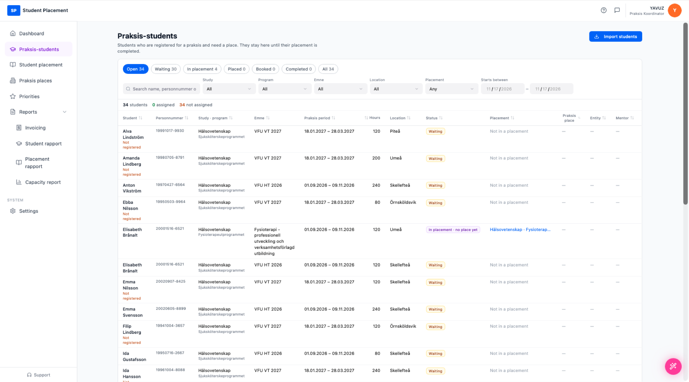
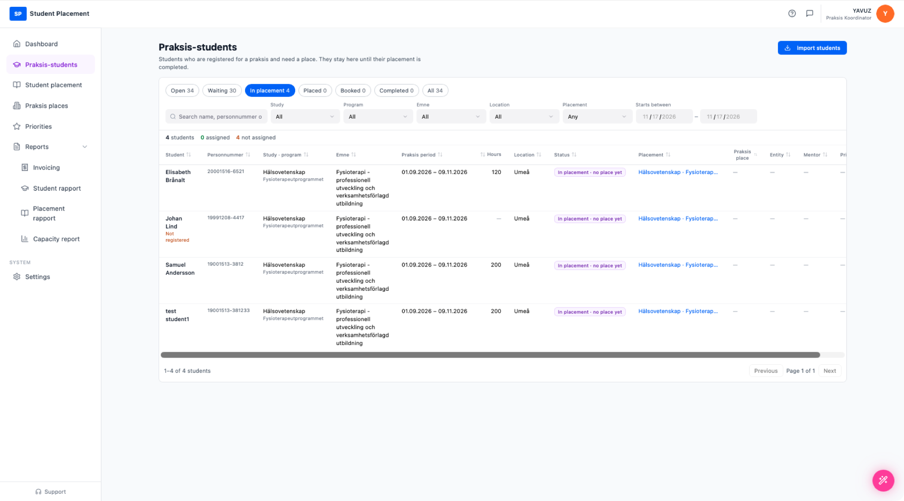
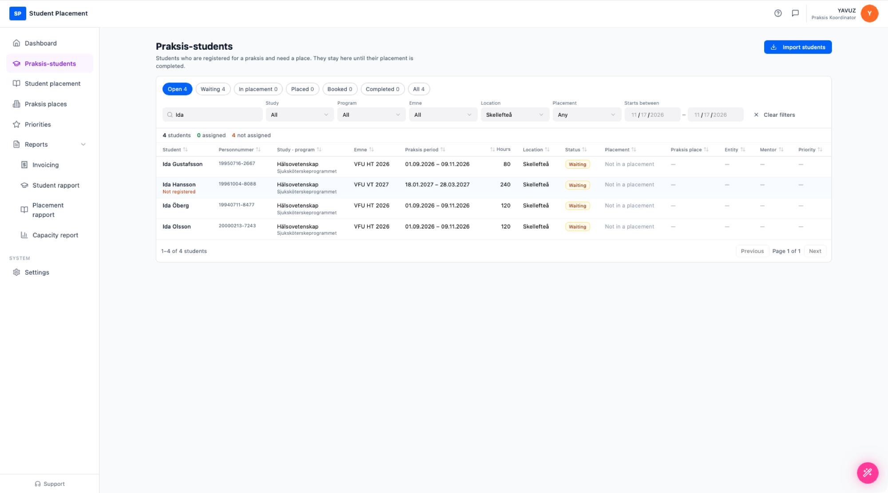
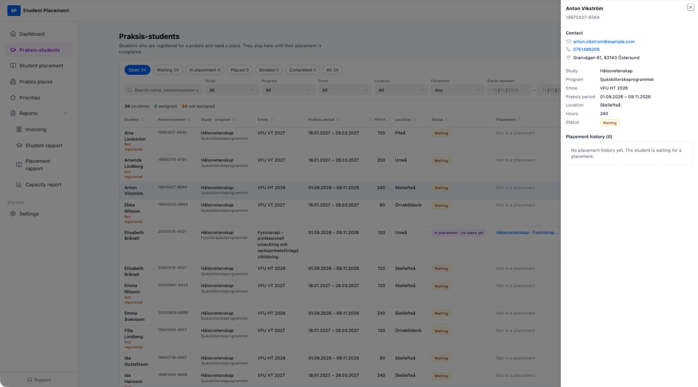
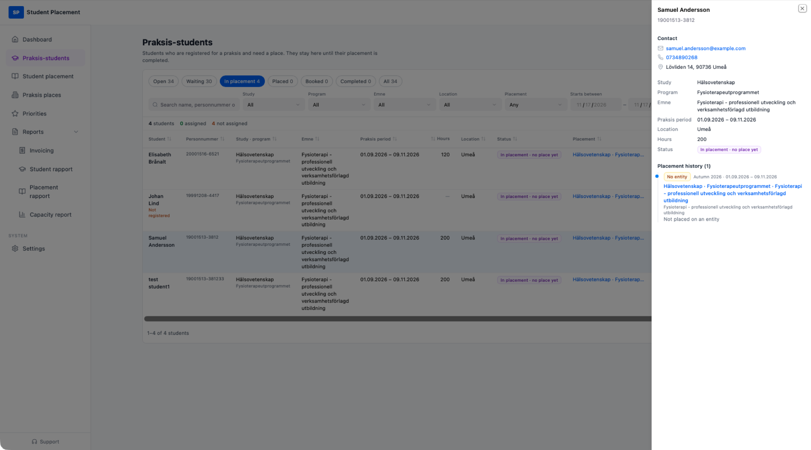
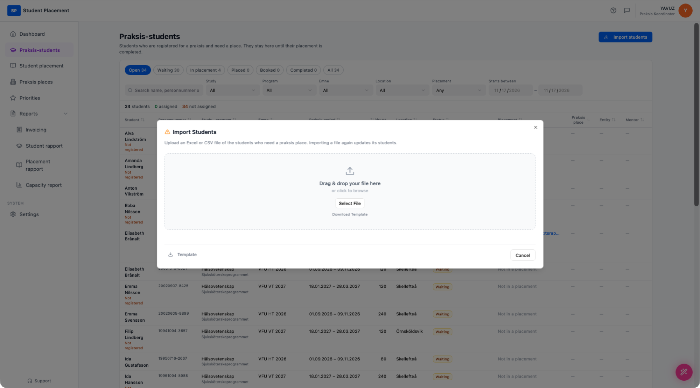

# Testscenario 06 — Praksis-studenter

:::info[Scenariooversikt]

- **Side:** Praksis-studenter
- **Rolle:** Praksiskoordinator (PK)
- **Mål:** Finne studentene som trenger praksisplass, snevre inn listen med statusfanene, søk og filtre, åpne en students detaljer og plasseringshistorikk, og se hvordan studenter importeres.
- **Forutsetning:** Logget inn som PK, med studenter allerede importert. Denne gjennomgangen bruker de eksisterende studentene i **Hälsovetenskap** (34 åpne studenter).

:::

## Hva denne siden er

**Praksis-studenter** viser *studenter som er registrert for en praksis og trenger en plass. De blir
 værende her til plasseringen deres er fullført.* Siden er startpunktet for plasseringsarbeidsflyten —
 trinn 1, **Studenter fra Praksis-studenter**, henter studentene som venter på et emne fra denne listen
 (se *Testscenario 03b — Arbeidsflyter*).

Siden har fire deler:

- **Statusfaner** med fortløpende antall — **Åpne**, **Venter**, **I plassering**, **Plassert**, **Booket**,
  **Fullført** og **Alle**. **Åpne** (standard) viser alle studenter som ikke har fullført plasseringen.
- **Søk og filtre** — et søkefelt (*navn, personnummer eller e-post*), **Studium**, **Program**, **Emne**,
  **Sted**, **Plassering** (*Alle*, *Ikke i en plassering*, *I en plassering*) og et datointervall
  **Starter mellom**.
- En **oppsummeringslinje** — antall studenter, hvor mange som er **tildelt** (*har praksisplass*) og hvor
  mange som **ikke er tildelt** (*ingen praksisplass ennå*).
- **Studenttabellen** — Student, Personnummer, Studium · program, Emne, Praksisperiode, Timer, Sted,
  Status, Plassering, Praksisplass, Enhet, Veileder og Prioritet. Alle kolonneoverskrifter kan klikkes
  for å sortere.

Studenter merket **Ikke registrert** under navnet ble importert med *Registered* satt til *No* i
 importfilen.

---

## Trinn

### 1. Åpne Praksis-studenter

Klikk på **Praksis-studenter** i sidemenyen. Fanen **Åpne** er valgt og viser alle åpne studenter — her
 *34 studenter, 0 tildelt, 34 ikke tildelt*. Studenter som ikke er i en plassering, har status **Venter**
 og *Ikke i en plassering*.

<figure>

<figcaption>Praksis-studenter — fanen Åpne med statusfaner, filtre og studenttabellen</figcaption>

</figure>

### 2. Bytt statusfane

Klikk på **I plassering**. Listen viser bare studentene som er tatt inn i en plassering — her 4 studenter
 med status **I plassering · ingen plass ennå**. Kolonnen **Plassering** viser plasseringen som en lenke
 (*Hälsovetenskap · Fysioterapeutprogrammet · …*); Praksisplass, Enhet og Veileder er tomme til en plass
 er tildelt.

<figure>

<figcaption>I plassering — studenter i en plassering som ennå ikke har praksisplass</figcaption>

</figure>

### 3. Søk og filtrer

Gå tilbake til **Åpne**. Skriv `Ida` i søkefeltet, og velg **Skellefteå** under **Sted**. Listen snevres inn
 til de 4 studentene som passer, og antallet på statusfanene oppdateres etter søket og filtrene
 (*Åpne 4*, *Venter 4*). En knapp **Fjern filtre** vises — klikk på den for å nullstille søket og alle filtre.

<figure>

<figcaption>Søk «Ida» + Sted Skellefteå — 4 studenter; Fjern filtre nullstiller</figcaption>

</figure>

### 4. Åpne en students detaljer

Klikk på en studentrad — her **Anton Vikström**. Et sidepanel åpnes med studentens **Kontakt**-opplysninger
 (e-post, telefon, adresse), **Studium**, **Program**, **Emne**, **Praksisperiode**, **Sted**, **Timer** og
 **Status**. Under vises **Plasseringshistorikk** — for en student som venter, står det *ingen
 plasseringshistorikk ennå; studenten venter på en plassering*.

<figure>

<figcaption>Studentdetaljer — kontakt, studieopplysninger og tom plasseringshistorikk</figcaption>

</figure>

### 5. Se plasseringshistorikken

Lukk panelet (**×**), bytt til **I plassering** og klikk på **Samuel Andersson**. **Plasseringshistorikk
 (1)** viser plasseringen han er i — termin og datoer (*Autumn 2026 · 01.09.2026 – 09.11.2026*),
 plasseringen som en lenke, og merket **Ingen enhet** med *ikke plassert på en enhet*, fordi ingen
 praksisplass er tildelt ennå.

<figure>

<figcaption>Plasseringshistorikk — én plassering, ennå ikke plassert på en enhet</figcaption>

</figure>

### 6. Importer studenter

Klikk på **Importer studenter** (øverst til høyre). Dialogen **Importer studenter** forklarer at du laster
 opp en Excel- eller CSV-fil med studentene som trenger praksisplass, og at *en ny import av samme fil
 oppdaterer studentene i den*. Dra en fil til opplastingsfeltet eller klikk på **Velg fil**. Klikk på
 **Mal** (eller **Last ned mal**) for å få en Excel-fil med de forventede kolonnene:

| Påkrevd | Valgfritt |
|---|---|
| First name, Last name, Personnummer, Email, Program, Start date | Phone, Address, Study, Program code, Emne code, Emne, End date, Hours, Location, Registered |

Klikk på **Avbryt** for å lukke dialogen uten å importere.

<figure>

<figcaption>Importer studenter — last opp en Excel/CSV-fil eller last ned malen</figcaption>

</figure>

---

## Sluttresultat

Koordinatoren ser raskt hvilke studenter som fortsatt trenger praksisplass, kan snevre inn listen med
 status, søk og filtre, slå opp en students kontaktopplysninger og plasseringshistorikk, og vet hvordan nye
 studenter hentes inn med en importfil.

## Merknader

-   En ny import av en fil **oppdaterer** studentene i den — du trenger ikke slette dem først.
-   Studentene blir værende på denne siden til plasseringen er **Fullført**; bruk fanen **Alle** for å se alle studenter.
-   Kolonnenavnene i malen er på engelsk og skal brukes slik de står.

---

<ScenarioFeedback scenarioId="TS-06-praksis-students" />
