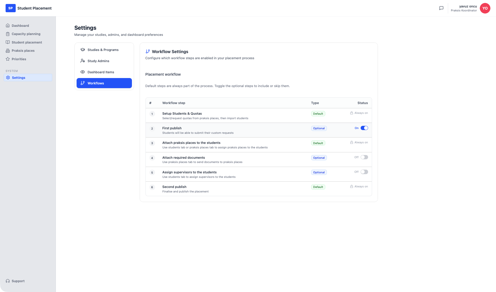
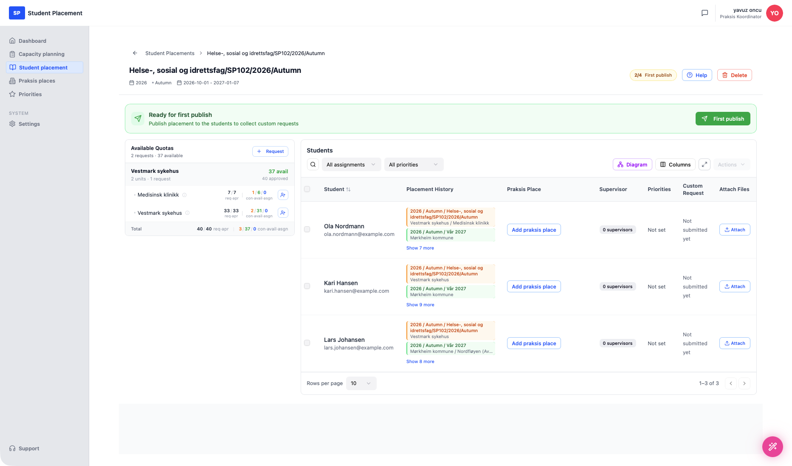
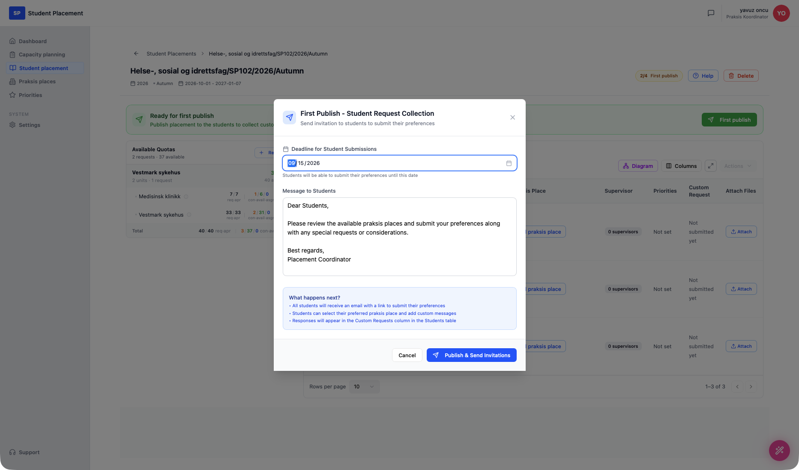
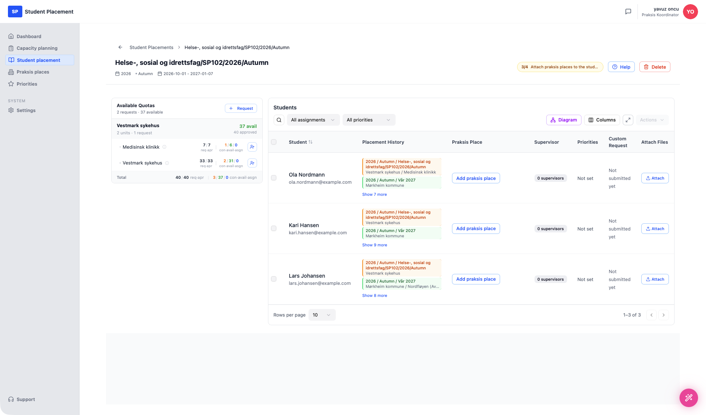

# Student plassering - Samle inn studentønsker

:::info[Scenariooversikt]

- **Side:** Innstillinger → Arbeidsflyter, deretter Student plassering → *(en plassering)*
- **Rolle:** Praksiskoordinator (PK)
- **Mål:** Aktiver det valgfrie arbeidsflyttrinnet **Første publisering**, og publiser deretter en plassering for første gang, slik at studentene får en e-post og kan sende inn sine egne **egendefinerte forespørsler** (ønsket praksissted + en melding).
- **Forutsetning:** En plassering med studenter allerede importert. Denne gjennomgangen bruker **Helse-, sosial og idrettsfag/SP102/2026/Autumn**.

:::

## Hva denne valgfrie arbeidsflyten er

Plasseringsprosessen går gjennom et fast sett med arbeidsflyttrinn. Noen er **Standard** (alltid på) og noen er **Valgfritt** — du slår dem på etter behov. **Første publisering** er et valgfritt trinn som ligger tidlig i prosessen, *før* praksissteder knyttes til studenter.

Når det er aktivert og utløst, sender Første publisering hver importert student en **e-postinvitasjon** om å logge inn og **sende inn ønskene sine**: hvilket praksissted de ønsker, og eventuelle spesielle forespørsler eller hensyn. Svarene kommer tilbake i **Egendefinert forespørsel**-kolonnen i studenttabellen, slik at koordinatoren kan ta hensyn til dem ved tildeling av plasser. Det er mekanismen for å *samle inn studentønsker* før fordelingen.

---

## Trinn

### 1. Aktiver "Første publisering" i Innstillinger → Arbeidsflyter

Åpne **Innstillinger** i sidemenyen og velg fanen **Arbeidsflyter**. Tabellen **Plasseringsarbeidsflyt** viser hvert trinn med **Type** (Standard / Valgfritt) og **Status**. Standardtrinn viser en lås og *Alltid på*; valgfrie trinn har en bryter.

<figure>

<figcaption>Arbeidsflytinnstillinger — "Første publisering" (trinn 2) er Valgfritt og Av</figcaption>

</figure>

Slå på **Første publisering**. En bekreftelse *"Arbeidsflytinnstillingen er lagret"* vises, og statusen bytter til **På**. Dette legger det valgfrie trinnet til arbeidsflyten for alle plasseringer.

<figure>

<figcaption>Første publisering er nå På — trinnet er en del av plasseringsarbeidsflyten</figcaption>

</figure>

### 2. Åpne plasseringen

Opprett en ny plassering og importer studenter. Fordi Første publisering nå er aktivert, har plasseringens arbeidsflyt fått et trinn (fremdriftsmerket viser **2/4**), og et grønt banner vises: **"Klar for første publisering — publiser plasseringen til studentene for å samle inn egendefinerte forespørsler"** med en **Første publisering**-knapp.

Merk at **Egendefinert forespørsel**-kolonnen viser *"Ikke sendt inn ennå"* for hver student — ingenting er samlet inn ennå.

<figure>

<figcaption>Plasseringen er klar for first publish</figcaption>

</figure>

### 3. Første publisering — konfigurer invitasjonen

Klikk på **Første publisering**. Dialogen **Første publisering – innsamling av studentforespørsler** åpnes:

- **Frist for studentinnsendinger** — datoen studentene kan sende inn ønskene sine frem til.
- **Melding til studenter** — en redigerbar e-posttekst (forhåndsutfylt med en standardmelding).
- **Hva skjer videre?** — et sammendrag som bekrefter at alle studentene får en e-postlenke, kan velge et ønsket praksissted og legge til en egen melding, og at svarene vises i **Egendefinerte forespørsler**-kolonnen.

Sett en frist (her `09/15/2026`), juster meldingen om nødvendig, og klikk deretter på **Publiser og send invitasjoner**.

<figure>

<figcaption>Første publisering — sett fristen og meldingen, og send invitasjonene</figcaption>

</figure>

---

## Sluttresultat

Plasseringen er publisert til studentene. Fremdriftsmerket går videre til **3/4 — Knytt praksissteder til studentene**, og "Klar for første publisering"-banneret er borte. Hver importerte student får nå en e-post med en lenke til å sende inn ønskene sine; inntil de svarer, forblir **Egendefinert forespørsel**-kolonnen *"Ikke sendt inn ennå"*, og svarene deres vises der etter hvert som de kommer inn.

<figure>

<figcaption>Etter first publish — invitasjoner sendt, venter på studentinnsendinger</figcaption>

</figure>

---

<ScenarioFeedback scenarioId="TS-11-collect-student-requests" />
