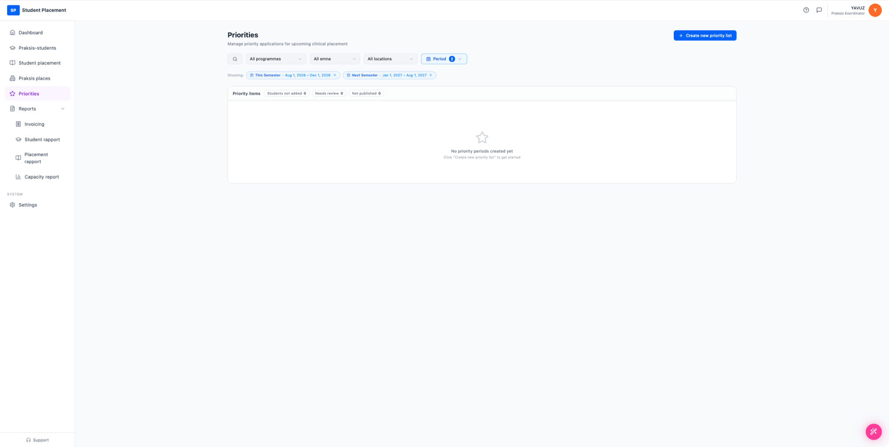
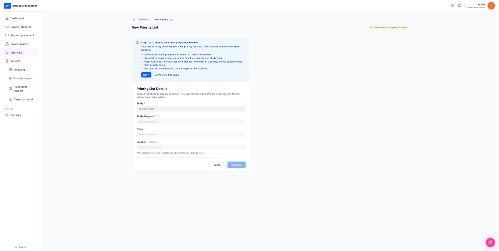
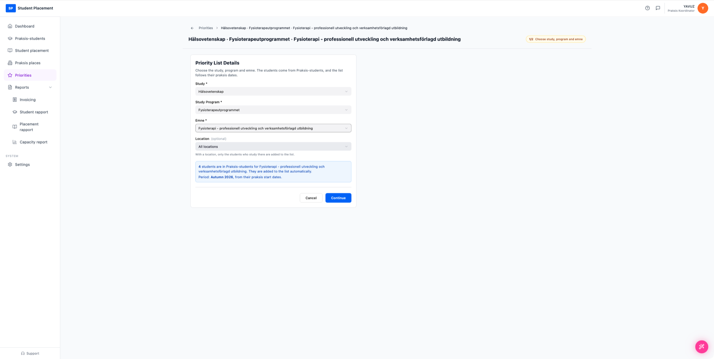
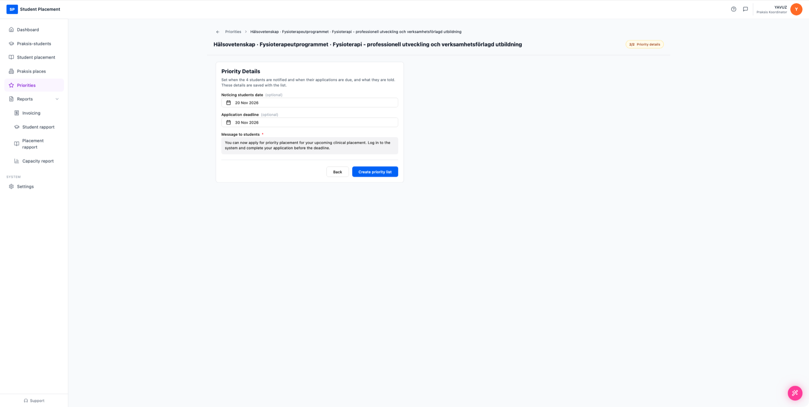
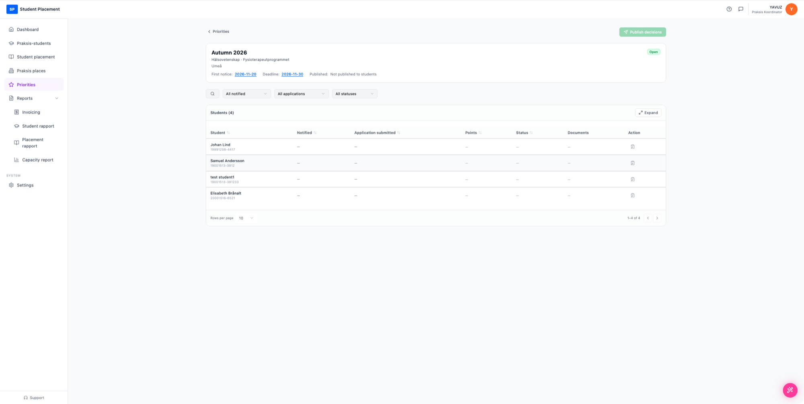
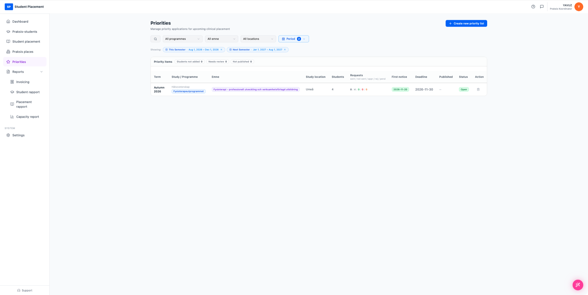

# Testscenario 12 — Prioriteringer - Opprett en prioriteringsliste

:::info[Scenariooversikt]

- **Side:** Prioriteringer → Ny prioriteringsliste
- **Rolle:** Praksiskoordinator (PK)
- **Mål:** Opprette en prioriteringsliste for et emne, slik at studentene kan søke om prioritert plassering — og bli kjent med siden Prioriteringer.
- **Forutsetning:** Logget inn som PK. Studenter for emnet finnes i *Praksis-studenter* (se *Testscenario 06*). Denne gjennomgangen bruker **Hälsovetenskap → Fysioterapeutprogrammet → Fysioterapi - professionell utveckling och verksamhetsförlagd utbildning** (4 studenter).

:::

## Hva denne siden er

**Prioriteringer** — *administrer prioriteringssøknader for kommende praksis* — er der studentene kan be om å
 bli prioritert ved plassering. Hver **prioriteringsliste** hører til ett studium, ett program og ett emne.
 Studentene kommer fra **Praksis-studenter**, og perioden følger praksisdatoene deres.

### Verktøylinje

| Kontroll | Hva den gjør |
|---|---|
| **Opprett ny prioriteringsliste** | Starter en ny liste (2 trinn). |
| **Søk** (forstørrelsesglass) | Søker i listene. |
| **Alle programmer** / **Alle emner** / **Alle steder** | Snevrer inn listen. |
| **Periode** | Velger hvilke tidsperioder som vises; de aktive vises som brikker under **Viser:** (standard *This Semester* og *Next Semester*). |
| **Prioriteringselementer** | Tre tellere — **Studenter ikke lagt til**, **Trenger vurdering**, **Ikke publisert**. Klikk på en for å vise bare de listene; **Fjern filtre** nullstiller. |

### Kolonner

| Kolonne | Innhold |
|---|---|
| **Termin** | f.eks. *Autumn 2026*. |
| **Studium / Program** | Studiet og programmet. |
| **Emne** | Listens emne. |
| **Studiested** | Studentenes sted (f.eks. *Umeå*). |
| **Studenter** | Antall studenter på listen. |
| **Søknader** | *sendt / ikke sendt / godkjent / avslått / venter*. |
| **Første varsel** | Når studentene får beskjed — klikk for å endre datoen. |
| **Frist** | Når søknadene skal være inne — klikk for å endre datoen. |
| **Publisert** | Om vedtakene er publisert til studentene (*—* hvis ikke ennå). |
| **Status** | f.eks. **Åpen**. |
| **Handling** | Søppelbøtteikon for å slette listen. |

---

## Trinn

### 1. Åpne Prioriteringer

Klikk på **Prioriteringer** i sidemenyen. Hvis ingen liste finnes ennå, sier siden at ingen
 prioriteringsperioder er opprettet, og at du kan starte med **Opprett ny prioriteringsliste**.

<figure>

<figcaption>Prioriteringer — tom, med Opprett ny prioriteringsliste øverst til høyre</figcaption>

</figure>

### 2. Trinn 1 av 2 — velg studium, program og emne

Klikk på **Opprett ny prioriteringsliste**. Siden **Ny prioriteringsliste** åpnes på **1/2 Velg studium,
 program og emne**. Infoboksen forklarer at du angir hvilke studenter listen gjelder, og at studentene kommer
 fra Praksis-studenter. Lukk den med **Skjønner**.

<figure>

<figcaption>Trinn 1 av 2 — detaljer for prioriteringslisten</figcaption>

</figure>

Velg **Studium** `Hälsovetenskap`, **Studieprogram** `Fysioterapeutprogrammet` og **Emne** `Fysioterapi -
 professionell utveckling och verksamhetsförlagd utbildning`. **Sted** (valgfritt) står på *Alle steder* — med
 et sted legges bare studentene som studerer der, til på listen. Skjemaet viser nå at 4 studenter i
 Praksis-studenter legges til automatisk, og at perioden er *Autumn 2026*, ut fra praksisstartdatoene deres.
 Klikk på **Fortsett**.

<figure>

<figcaption>4 studenter legges til automatisk — periode Autumn 2026</figcaption>

</figure>

:::note[Ingen studenter?]

Hvis ingen studenter for emnet finnes i Praksis-studenter, sier skjemaet at ingen studenter venter, og at du
 må importere studenter i Praksis-studenter først; **Fortsett** forblir deaktivert.

:::

### 3. Trinn 2 av 2 — prioriteringsdetaljer

På **2/2 Prioriteringsdetaljer** angir du når de 4 studentene varsles, når søknadene skal være inne, og hva de
 får beskjed om:

- **Dato for varsling av studenter** (valgfritt) — velg en dato i kalenderen, her **20. nov. 2026**. Datoer
  bakover i tid kan ikke velges.
- **Søknadsfrist** (valgfritt) — her **30. nov. 2026**. Den må være etter varslingsdatoen.
- **Melding til studentene** * — forhåndsutfylt med en standardtekst om at studentene nå kan søke om prioritert
  plassering og må fullføre søknaden før fristen. Endre den ved behov.

Begge datoene kan også settes senere. **Tilbake** går til trinn 1. Klikk på **Opprett prioriteringsliste**.

<figure>

<figcaption>Trinn 2 av 2 — datoer og melding til studentene</figcaption>

</figure>

### 4. Den nye prioriteringslisten

Meldingen *søknadsperiode opprettet* vises, og listen åpnes: **Autumn 2026 · Hälsovetenskap ·
 Fysioterapeutprogrammet · Umeå**, *Første varsel: 2026-11-20*, *Frist: 2026-11-30*, *Publisert: ikke
 publisert til studentene*, status **Åpen**, og tabellen **Studenter (4)** med kolonnene *Student, Varslet,
 Søknad sendt, Poeng, Status, Dokumenter, Handling*. **Publiser vedtak** er deaktivert — vedtak kan publiseres
 etter datoen for første varsel.

<figure>

<figcaption>Den nye prioriteringslisten — 4 studenter, ikke publisert ennå</figcaption>

</figure>

### 5. Tilbake på siden Prioriteringer

Klikk på **Prioriteringer** (øverst til venstre) for å gå tilbake. Den nye listen vises som en rad:
 *Autumn 2026 · Hälsovetenskap / Fysioterapeutprogrammet · Fysioterapi - professionell … · Umeå · 4 studenter ·
 søknader 0 / 4 / 0 / 0 / 0 · Første varsel 2026-11-20 · Frist 2026-11-30 · Åpen*.

<figure>

<figcaption>Siden Prioriteringer med den nye listen</figcaption>

</figure>

---

## Sluttresultat

Det finnes en prioriteringsliste for emnet, med de 4 studentene, en dato for første varsel, en frist og en
 melding til studentene. Den er åpen og ikke publisert ennå.

## Merknader

-   Innsamling av søknader og publisering av vedtak beskrives i *Testscenario 13*.

---

<ScenarioFeedback scenarioId="TS-12-priorities-create-list" />
