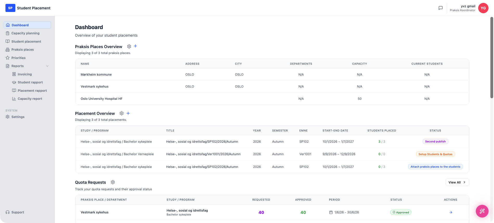

# Prioriteringer - Opprette ny prioriteringsliste

:::info[Scenariooversikt]

- **Side:** Priorities
- **Rolle:** Praksiskoordinator (PK)
- **Mål:** Opprett en ny prioriteringsperiode for et semester/program, og sett opp første varsel-dato, frist og melding til studentene.
- **Forutsetning:** Innlogget som PK. Siden kan allerede vise andre prioriteringsperioder — flyten er den samme uansett.

:::

## Hva denne siden er

**Priorities** administrerer prioriteringssøknader for kommende praksisplassering: for et gitt semester og program kan kvalifiserte studenter inviteres til å sende inn en prioriteringsforespørsel (særskilte forhold som medisinske årsaker eller omsorg for barn som bør veie inn i hvor de blir plassert). Hver rad i tabellen er en **prioriteringsperiode** — én kombinasjon av semester/program/emne — som viser studentene, innsendte forespørsler (sendt / ikke sendt / godkjent / avvist / venter), første varsel-dato, frist, publiseringsstatus og åpen/lukket-tilstand. Alt starter med å klikke **Create new priority list**.

---

## Trinn

### 1. Start på Dashboard

Etter innlogging kommer du til **Dashboard**.

<figure>

<figcaption>Startpunkt — Dashboard</figcaption>

</figure>

### 2. Åpne Priorities

Klikk på **Priorities** i sidemenyen. Siden viser eksisterende prioriteringsperioder som en tabell, med **Create new priority list** øverst til høyre.

<figure>

<figcaption>Priorities — eksisterende perioder, før en ny opprettes</figcaption>

</figure>

### 3. Opprett søknadsperiode — Details

Klikk på **Create new priority list**. Dialogen åpnes på trinn **1 · Details**. Velg **Year**, **Semester** (Autumn/Spring), og et **Programme** (en flatet Study / Programme-liste) — her `Helse-, sosial og idrettsfag / Bachelor fysioterapi`. Hvis programmet har emner, velg minst ett — her `FY101`. **Study locations** er valgfritt (la stå tomt for å inkludere alle). En løpende teller viser *"N eligible students with current selection"* etter hvert som du snevrer inn kriteriene.

<figure>

<figcaption>Trinn 1 · Details — år, semester, program, emne og antall kvalifiserte studenter</figcaption>

</figure>

### 4. Opprett søknadsperiode — First notice

Klikk på **Next** for å komme til trinn **2 · First notice**. Sett den (valgfrie) **Noticing students date** — når studentene får e-post om å søke — og den (valgfrie) **Application deadline**, samt **Message to students** (forhåndsutfylt med en fornuftig standardtekst, redigerbar). Klikk på **Create period**.

<figure>

<figcaption>Trinn 2 · First notice — varsel-dato, frist og melding til studentene</figcaption>

</figure>

---

## Sluttresultat

Den nye perioden vises øverst i Priorities-tabellen — her **Autumn 2026 / Bachelor fysioterapi / FY101** — med et gult **Import students**-merke i Students-kolonnen (ingen studenter importert ennå), varsel-datoen og fristen nettopp satt, og status **Open**. Herfra importerer koordinatoren studenter og går videre til å samle inn og publisere forespørsler (se neste scenario).

<figure>

<figcaption>Ny prioriteringsperiode opprettet — Autumn 2026 / Bachelor fysioterapi, venter på studenter</figcaption>

</figure>

---

<ScenarioFeedback scenarioId="TS-12-priorities-create-list" />
