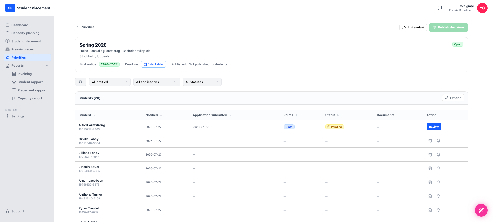
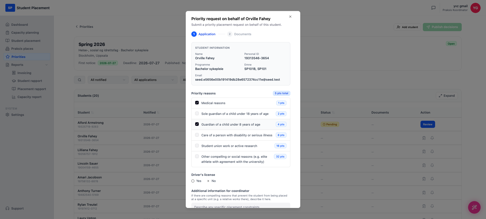
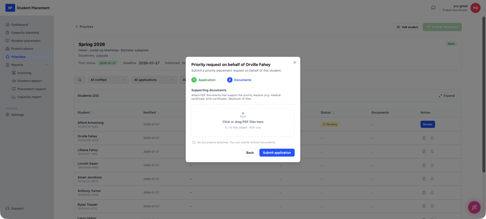
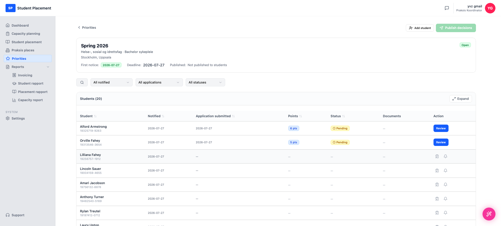
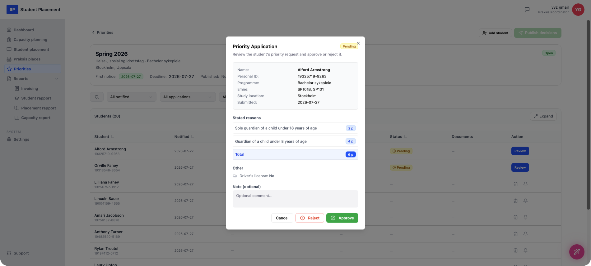
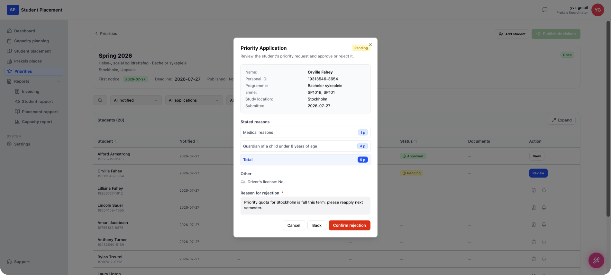
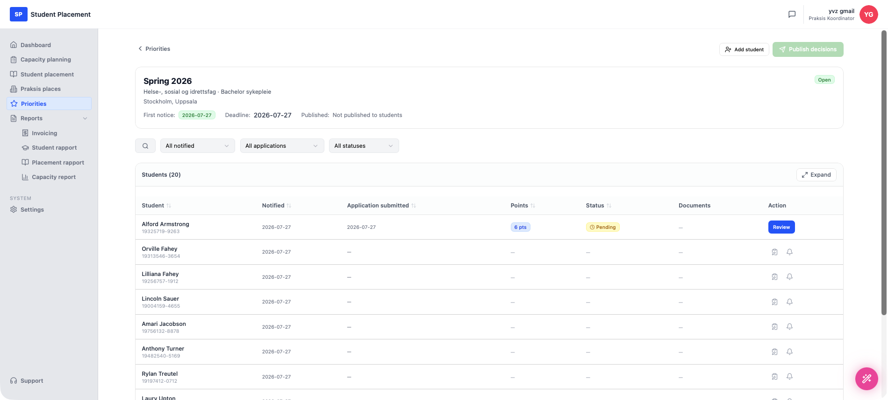

# Prioriteringer - Samle inn og publisere

:::info[Scenariooversikt]

- **Side:** Priorities → *(en prioriteringsperiode)*
- **Rolle:** Praksiskoordinator (PK)
- **Mål:** Samle inn studentenes prioriteringsforespørsler etter at det første varselet er sendt, gå gjennom og godkjenn eller avvis hver av dem, og publiser deretter beslutningene når fristen har passert.
- **Forutsetning:** En prioriteringsperiode med studenter allerede importert. Denne gjennomgangen bruker den eksisterende perioden **Spring 2026 / Bachelor sykepleie (SP101B, SP101)**, som allerede har fått sendt sitt første varsel.

:::

## Hva denne siden er

Å åpne en prioriteringsperiode fra **Priorities**-listen viser detaljvisningen: periodens første varsel-dato, frist og publiseringsstatus øverst, og en tabell over hver importerte student med varslet dato, innsendt dato, poeng, status og tilgjengelige handlinger. På **første varsel-dato** sender systemet en e-post til hver student i listen med en lenke for å logge inn og sende inn sin egen prioriteringsforespørsel — grunnene som gjelder for dem (medisinske, omsorg for barn, omsorgsansvar osv.), om de har førerkort, eventuelle plasseringsbegrensninger, og støttedokumenter i PDF. Når en forespørsel er sendt inn, vises den her som **Pending**, klar for koordinatoren å **Review** og **Approve** eller **Reject**. Når alle beslutninger er tatt og fristen har passert, klikker koordinatoren på **Publish decisions** — studentene får da en ny e-post med utfallet av forespørselen sin.

For demonstrasjonsformål — siden reelle studenter normalt sender inn dette skjemaet selv — kan koordinatoren fylle det ut **på vegne av en student** ved hjelp av blyantikonet i Action-kolonnen, ved siden av et klokkeikon som sender første varsel på nytt.

---

## Trinn

### 1. Start på Dashboard

Etter innlogging kommer du til **Dashboard**.

<figure>

<figcaption>Startpunkt — Dashboard</figcaption>

</figure>

### 2. Åpne en prioriteringsperiode

Klikk på **Priorities** i sidemenyen, og klikk deretter på en periode-rad — her **Spring 2026**. Det første varselet var allerede sendt (**2026-07-27**), så studenttabellen viser én innsendt forespørsel (Alford Armstrong, **Pending**, 6 pts) og resten som fortsatt venter på en innsending, hver med et blyantikon (**Submit on behalf of student**) og et klokkeikon (**Resend first notice**).

<figure>

<figcaption>Spring 2026 — første varsel sendt, én ventende forespørsel, resten venter på innsending</figcaption>

</figure>

### 3. Fyll ut en forespørsel på vegne av en student — Application

Klikk på blyantikonet på en student som ikke har sendt inn ennå — her **Orville Fahey**. Dialogen **Priority request on behalf of…** åpnes og viser studentens informasjon (skrivebeskyttet), og lar deg deretter huke av gjeldende **Priority reasons** (hver med en poengverdi som summeres løpende), sette **Driver's license**, og legge til **Additional information for coordinator**.

<figure>

<figcaption>Send inn på vegne av Orville Fahey — grunner valgt, 5 pts totalt</figcaption>

</figure>

### 4. Fyll ut en forespørsel på vegne av en student — Documents

Klikk på **Next: Documents** for å komme til det andre trinnet. Støttedokumenter i PDF kan legges ved her (dra-og-slipp eller klikk), eller forespørselen kan sendes inn uten noen. Klikk på **Submit application**.

<figure>

<figcaption>Documents-trinnet — valgfrie PDF-vedlegg, deretter innsending</figcaption>

</figure>

### 5. Forespørselen vises nå som Pending

Orville Faheys rad oppdateres umiddelbart: innsendt dato, **5 pts**, status **Pending**, med en **Review**-knapp i stedet for blyantikonet.

<figure>

<figcaption>Orville Faheys forespørsel sendt inn — nå Pending med en Review-knapp</figcaption>

</figure>

### 6. Gjennomgå og godkjenn en forespørsel

Klikk på **Review** på en ventende forespørsel — her Alford Armstrongs. Dialogen viser studentens detaljer, oppgitte grunner med poeng og totalsum, førerkort, og eventuelle plasseringsbegrensninger, samt en valgfri **Note**. Klikk på **Approve**.

<figure>

<figcaption>Gjennomgår Alford Armstrongs forespørsel — 6 pts totalt, klar til godkjenning</figcaption>

</figure>

### 7. Gjennomgå og avvis en forespørsel

Klikk på **Review** på en annen ventende forespørsel — her Orville Faheys. Klikk på **Reject**; et **Reason for rejection**-felt vises og er obligatorisk. Skriv inn grunnen og klikk på **Confirm rejection**.

<figure>

<figcaption>Avviser Orville Faheys forespørsel med en obligatorisk grunn</figcaption>

</figure>

Begge beslutningene gjelder umiddelbart — Alford Armstrongs rad viser **Approved** og Orville Faheys viser **Rejected**, hver med en **View**-knapp slik at den skrivebeskyttede beslutningen kan gjennomgås senere.

### 8. Publiser beslutninger når fristen har passert

**Publish decisions** (øverst til høyre) forblir deaktivert — hold musen over den for å se hvorfor: *"Decisions can be published only after the first-notice deadline has passed."* Når fristdatoen har passert, blir knappen aktiv; å klikke på den åpner en bekreftelse som forklarer at publisering lukker perioden og sender e-post til hver student som sendte inn en forespørsel, med utfallet, og at perioden fortsatt kan **gjenåpnes for redigering** ved behov.

<figure>

<figcaption>Publish decisions — deaktivert inntil første varsel-fristen har passert</figcaption>

</figure>

---

## Sluttresultat

Studentene ble varslet på e-post på første varsel-dato, sendte inn (eller fikk sendt inn på vegne av seg selv) sine prioriteringsforespørsler, og koordinatoren gjennomgikk hver av dem — godkjente Alford Armstrong og avviste Orville Fahey med en oppgitt grunn. Når fristen passerer, varsler publisering av beslutningene hver student på e-post om utfallet.

---

<ScenarioFeedback scenarioId="TS-13-priorities-collect-and-publish" />
