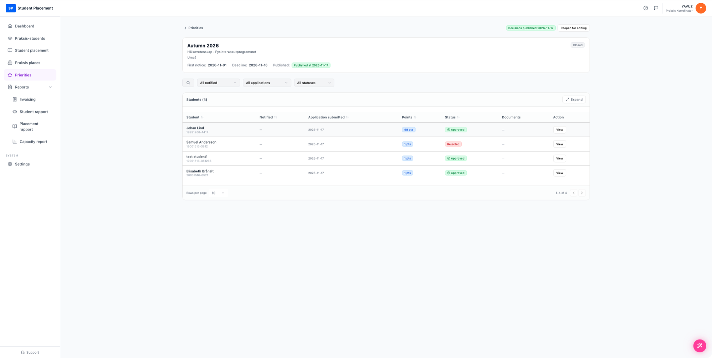

# Testscenario 13 — Prioriteringer - Vurder og publiser vedtak

:::info[Scenariooversikt]

- **Side:** Prioriteringer → *prioriteringsliste*
- **Rolle:** Praksiskoordinator (PK)
- **Mål:** Vurdere studentenes prioriteringssøknader, godkjenne eller avslå hver av dem, og publisere vedtakene til studentene.
- **Forutsetning:** En prioriteringsliste finnes (se *Testscenario 12*), og studentene har sendt søknader. Denne gjennomgangen bruker listen **Autumn 2026 · Hälsovetenskap · Fysioterapeutprogrammet · Umeå** med 4 innsendte søknader.

:::

## Hva denne siden er

Når studentene har søkt, vises det på siden **Prioriteringer**: kolonnen **Søknader** teller *sendt / ikke
 sendt / godkjent / avslått / venter*, og tellerne **Trenger vurdering** og **Ikke publisert** går opp.

Klikk på en liste for å åpne den. Overskriften viser termin, studium · program, sted, **Første varsel**,
 **Frist**, **Publisert** og status (**Åpen** eller **Lukket**), med **Publiser vedtak** øverst til høyre. Under
 er tabellen **Studenter**:

| Kolonne | Innhold |
|---|---|
| **Student** | Navn og personnummer. |
| **Varslet** | Når studenten ble varslet. |
| **Søknad sendt** | Dato for søknaden (*—* hvis ingen). |
| **Poeng** | Sum prioritetspoeng for de oppgitte grunnene (f.eks. *48 pts*). |
| **Status** | **Venter**, **Godkjent** eller **Avslått**. |
| **Dokumenter** | Filer lagt ved søknaden. |
| **Handling** | **Vurder** mens den venter; **Vis** når den er avgjort. |

Filtrene **Alle varslet** (*Varslet / Ikke varslet*), **Alle søknader** (*Sendt / Ikke sendt*) og **Alle
 statuser** (*Venter / Godkjent / Avslått*), søket og **Utvid** hjelper med lange lister.

---

## Trinn

### 1. Finn listen som trenger vurdering

Åpne **Prioriteringer**. Listen viser *4 / 0 / 0 / 0 / 4* — 4 søknader sendt, alle 4 venter — og tellerne
 **Trenger vurdering 1** og **Ikke publisert 1**.

<figure>

<figcaption>Prioriteringer — 4 søknader sendt, 4 venter</figcaption>

</figure>

### 2. Åpne prioriteringslisten

Klikk på raden. Listen er **Åpen** og *ikke publisert til studentene*. Alle 4 studentene har sendt søknad
 (*2026-11-17*); **Johan Lind** har *48 pts*, de andre *1 pts*. Hver rad viser **Venter** og knappen **Vurder**.

<figure>

<figcaption>Prioriteringslisten — 4 ventende søknader</figcaption>

</figure>

### 3. Vurder og godkjenn en søknad

Klikk på **Vurder** ved **Johan Lind**. Vinduet **Prioriteringssøknad** (*Venter*) viser:

- studentens opplysninger — navn, personnummer, program, emne, studiested, innsendt dato;
- **Oppgitte grunner** med poeng — her *Medical reasons 32 p* og *Sole guardian of a child under 18 years of
  age 16 p*, **Totalt 48 p**;
- **Annet** — f.eks. *Driver's license: No* og studentens **Notater til koordinator**;
- **Notat (valgfritt)** for din egen kommentar.

Skriv et notat — her `Medical documentation checked.` — og klikk på **Godkjenn**. Meldingen *søknad godkjent*
 vises, og statusen blir **Godkjent**.

<figure>

<figcaption>Prioriteringssøknad — oppgitte grunner, poeng og knappene Godkjenn / Avslå</figcaption>

</figure>

### 4. Avslå en søknad

Klikk på **Vurder** ved **Samuel Andersson** (*Other compelling or social reasons … 1 p*) og klikk på
 **Avslå**. Et påkrevd felt **Begrunnelse for avslag** vises. Skriv begrunnelsen — her `No documentation of the
 stated reason was attached.` — og klikk på **Bekreft avslag** (**Tilbake** går tilbake til vurderingen).
 Meldingen *søknad avslått* vises, og statusen blir **Avslått**.

<figure>

<figcaption>Avslag krever en begrunnelse</figcaption>

</figure>

### 5. Avgjør de resterende søknadene

Vurder og godkjenn **test student1** og **Elisabeth Brånalt** på samme måte. Alle søknadene er nå avgjort —
 3 **Godkjent**, 1 **Avslått** — og hver rad viser **Vis**.

<figure>

<figcaption>Alle avgjort — 3 godkjent, 1 avslått</figcaption>

</figure>

**Vis** åpner søknaden skrivebeskyttet, med **Vedtaksnotater** og hvem som avgjorde den og når (*Decided by
 YAVUZ on 2026-11-17*).

<figure>

<figcaption>Vis — vedtaksnotatet og hvem som avgjorde</figcaption>

</figure>

### 6. Publiser vedtakene

Klikk på **Publiser vedtak** (øverst til høyre). Vedtakene publiseres med en gang — meldingen *vedtak publisert*
 vises. Listen er nå **Lukket**, *publisert 2026-11-17*, og øverst til høyre står **Vedtak publisert 2026-11-17**
 med **Åpne for redigering**.

<figure>

<figcaption>Vedtak publisert — listen er lukket</figcaption>

</figure>

:::warning

**Publiser vedtak** publiserer med en gang, uten bekreftelse — selv om noen søknader fortsatt **venter**.
 Avgjør alle søknadene først. Hvis du publiserte for tidlig, klikker du på **Åpne for redigering**: listen blir
 **Åpen** og *ikke publisert til studentene* igjen, slik at du kan vurdere resten og publisere på nytt.

:::

Tilbake på **Prioriteringer** viser raden *4 / 0 / 3 / 1 / 0*, **Publisert 2026-11-17** og **Lukket**, og
 tellerne er tilbake på 0.

<figure>

<figcaption>Prioriteringer — 3 godkjent, 1 avslått, publisert og lukket</figcaption>

</figure>

---

## Sluttresultat

Alle 4 søknadene er avgjort (3 godkjent, 1 avslått), og vedtakene er publisert til studentene.
 Prioriteringslisten er **Lukket**.

## Merknader

-   **Publiser vedtak** er deaktivert til datoen for første varsel.
-   **Åpne for redigering** lar deg endre vedtak etter publisering; publiser på nytt når du er ferdig.

---

<ScenarioFeedback scenarioId="TS-13-priorities-collect-and-publish" />
