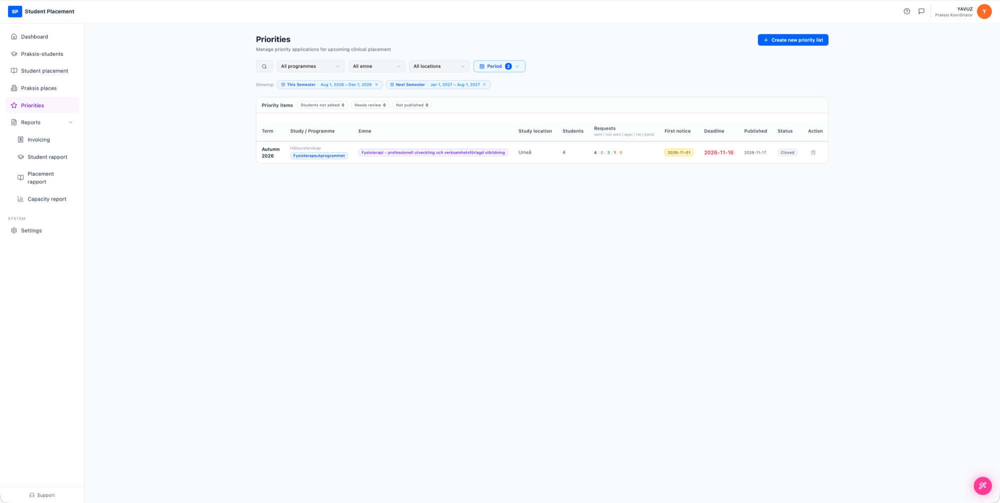
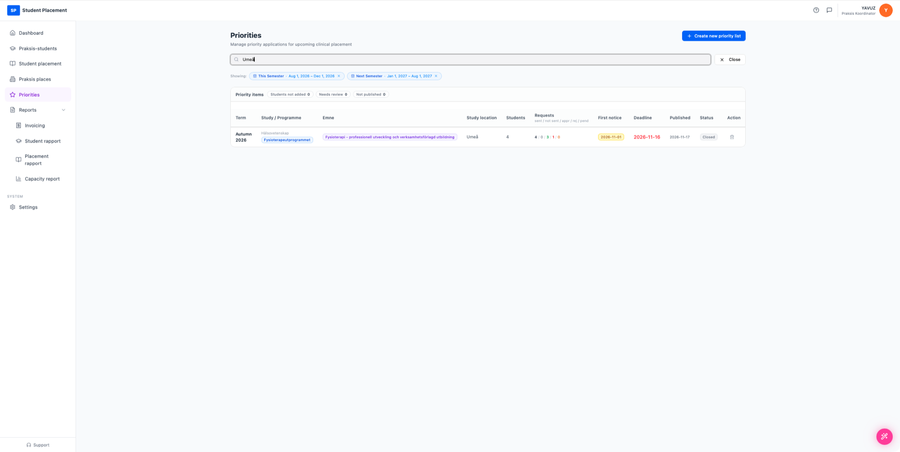
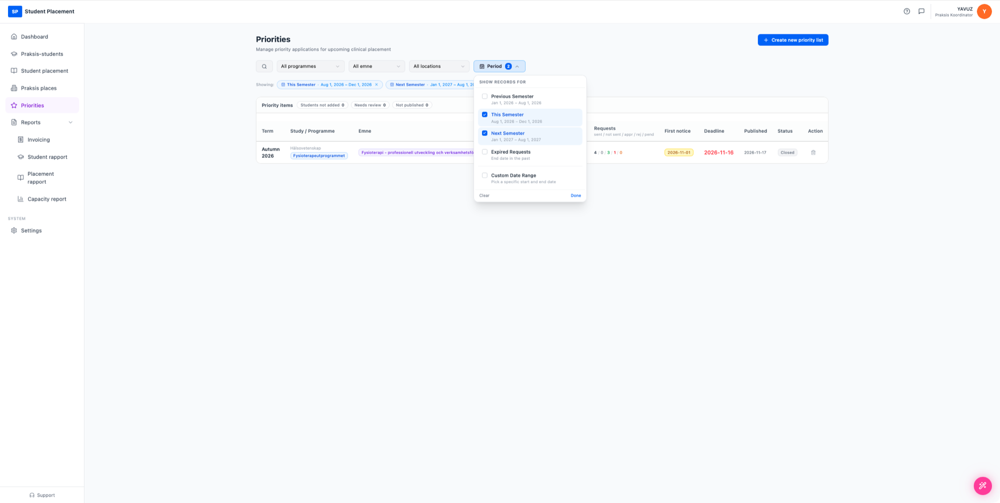
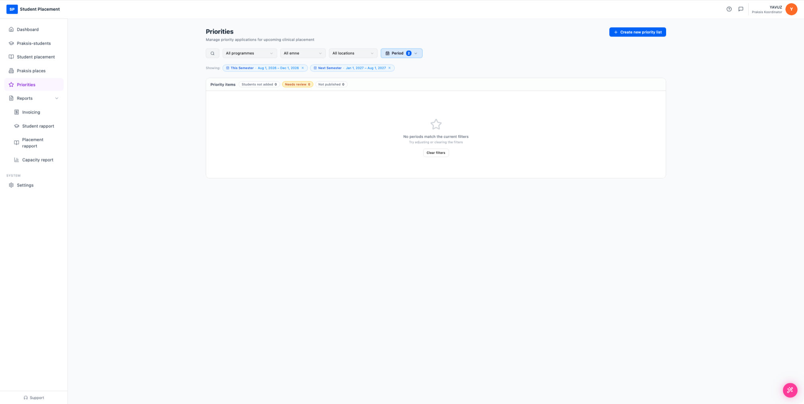

# Testscenario 13b — Prioriteringer - Oversikt

:::info[Scenariooversikt]

- **Side:** Prioriteringer
- **Rolle:** Praksiskoordinator (PK)
- **Mål:** Bruke siden Prioriteringer som oversikt — lese kolonnene, finne lister med søk og filtre, og se raskt hvilke lister som trenger oppmerksomhet.
- **Forutsetning:** Minst én prioriteringsliste finnes (se *Testscenario 12* og *13*). Denne gjennomgangen bruker listen **Autumn 2026 · Fysioterapeutprogrammet · Umeå**, der vedtakene er publisert.

:::

## Hva denne siden er

**Prioriteringer** — *administrer prioriteringssøknader for kommende praksis* — viser alle prioriteringslister i
 de valgte periodene, én rad per liste. Den viser hvor langt hver liste har kommet: hvor mange studenter som har
 søkt, hvor mange søknader som er avgjort, og om vedtakene er publisert.

### Verktøylinje

| Kontroll | Hva den gjør |
|---|---|
| **Opprett ny prioriteringsliste** | Starter en ny liste — se *Testscenario 12*. |
| **Søk** (forstørrelsesglass) | Søk på termin, program, emne eller sted. **Lukk** gir filtrene tilbake. |
| **Alle programmer** / **Alle emner** / **Alle steder** | Snevrer inn radene. Menyene viser bare programmer, emner og steder som har en prioriteringsliste. |
| **Periode** | **Vis poster for** *forrige semester*, *dette semesteret*, *neste semester*, *utløpte* (sluttdato passert) eller *egendefinert datoområde*. De aktive periodene vises som brikker under **Viser:** — klikk på **×** på en brikke for å fjerne den. |

### Prioriteringselementer

Tre tellere viser hvor mange lister som trenger oppmerksomhet:

| Teller | Betydning |
|---|---|
| **Studenter ikke lagt til** | Lister der studenter ikke er lagt til. |
| **Trenger vurdering** | Lister med søknader som fortsatt venter på vedtak. |
| **Ikke publisert** | Lister der vedtakene ennå ikke er publisert til studentene. |

Klikk på en teller for å vise bare de listene; klikk på **Fjern filtre** for å vise alle igjen.

### Kolonner

| Kolonne | Innhold |
|---|---|
| **Termin** | f.eks. *Autumn 2026*. |
| **Studium / Program** | Studiet og programmet. |
| **Emne** | Listens emne. |
| **Studiested** | f.eks. *Umeå*. |
| **Studenter** | Antall studenter på listen. |
| **Søknader** | *sendt / ikke sendt / godkjent / avslått / venter*. |
| **Første varsel** / **Frist** | Datoene — klikk på en dato for å endre den. |
| **Publisert** | Datoen vedtakene ble publisert (*ikke publisert* eller *—* til da). |
| **Status** | **Åpen** mens søknadene behandles, **Lukket** etter at vedtakene er publisert. |
| **Handling** | Søppelbøtteikon for å slette listen. |

---

## Trinn

### 1. Åpne Prioriteringer

Klikk på **Prioriteringer** i sidemenyen. Listen fra *Testscenario 13* viser *4 studenter*, søknader
 *4 / 0 / 3 / 1 / 0* (4 sendt, 3 godkjent, 1 avslått), *Første varsel 2026-11-01*, *Frist 2026-11-16*,
 *Publisert 2026-11-17* og status **Lukket**. Alle tre tellerne er **0** — ingenting trenger oppmerksomhet.

<figure>

<figcaption>Prioriteringer — én liste, avgjort og publisert</figcaption>

</figure>

Sammenlign med den samme listen før vurderingen: søknader *4 / 0 / 0 / 0 / 4* (4 venter), *ikke publisert*,
 status **Åpen**, og tellerne **Trenger vurdering 1** og **Ikke publisert 1**.

<figure>

<figcaption>Før vurdering — Trenger vurdering 1 og Ikke publisert 1</figcaption>

</figure>

### 2. Søk

Klikk på **forstørrelsesglasset** og skriv for eksempel `Umeå`. Radene filtreres på termin, program, emne eller
 sted. Klikk på **Lukk** for å få filtrene tilbake.

<figure>

<figcaption>Søk på termin, program, emne eller sted</figcaption>

</figure>

### 3. Velg periode

Klikk på **Periode**. Kryss av for periodene som skal vises — *forrige semester*, *dette semesteret*, *neste
 semester*, *utløpte* eller *egendefinert datoområde* — og klikk på **Ferdig**. **Fjern** fjerner alle perioder.

<figure>

<figcaption>Periode — velg hvilke semestre som vises</figcaption>

</figure>

### 4. Filtrer med en teller

Klikk på **Trenger vurdering**. Telleren utheves, og bare lister som trenger vurdering, vises — her ingen:
 ingen perioder passer med de gjeldende filtrene. Klikk på **Fjern filtre** for å vise alle lister igjen.

<figure>

<figcaption>Trenger vurdering — ingen lister trenger vurdering</figcaption>

</figure>

---

## Sluttresultat

Koordinatoren ser alle prioriteringslister og hvor langt de har kommet på én side, finner en liste med søk,
 filtre og periode, og bruker tellerne til å se lister som fortsatt trenger vurdering eller publisering.

---

<ScenarioFeedback scenarioId="TS-13b-priorities-overview" />
