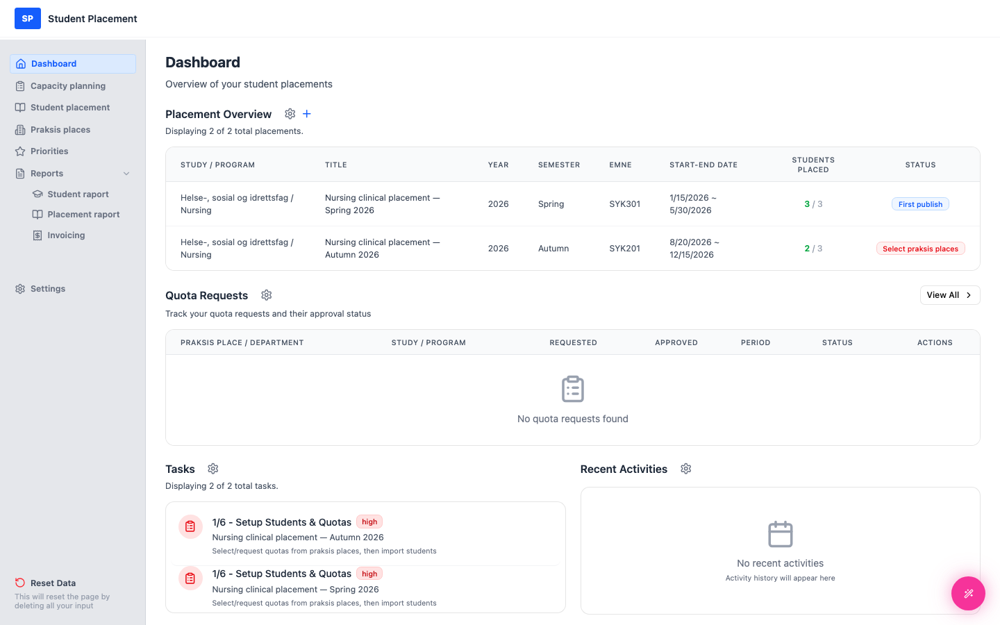
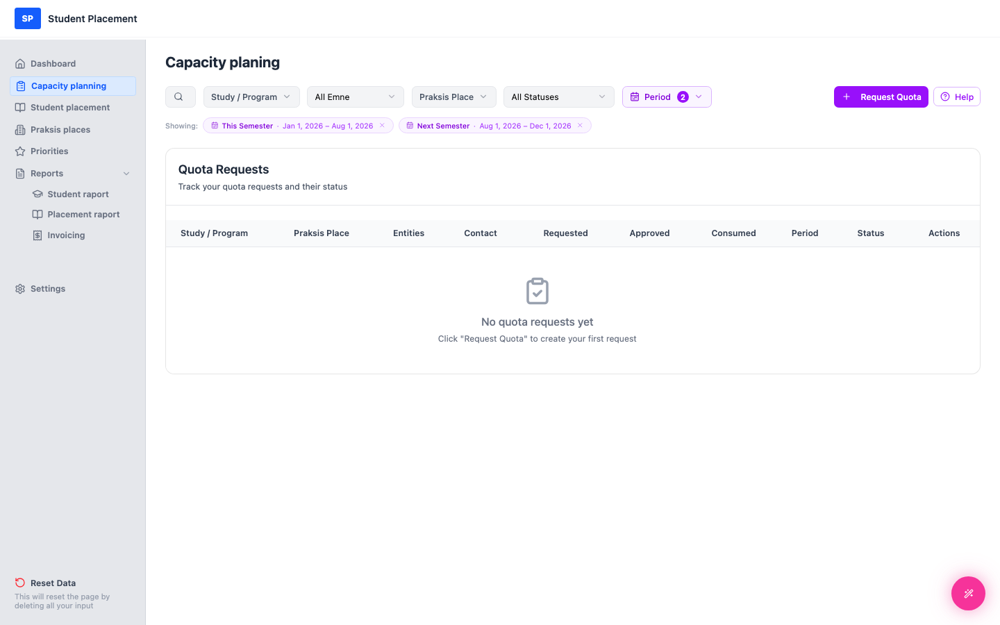
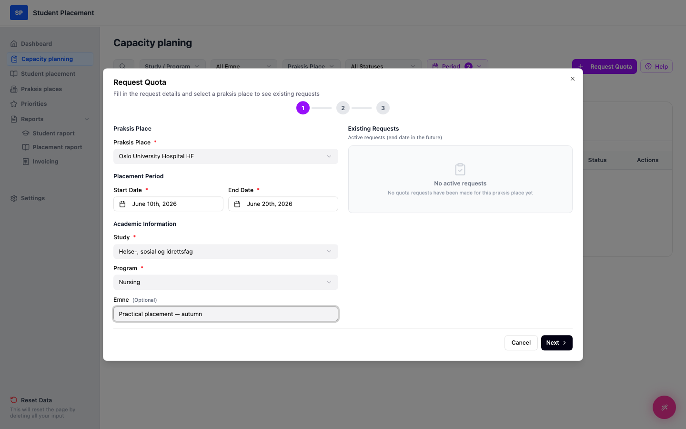
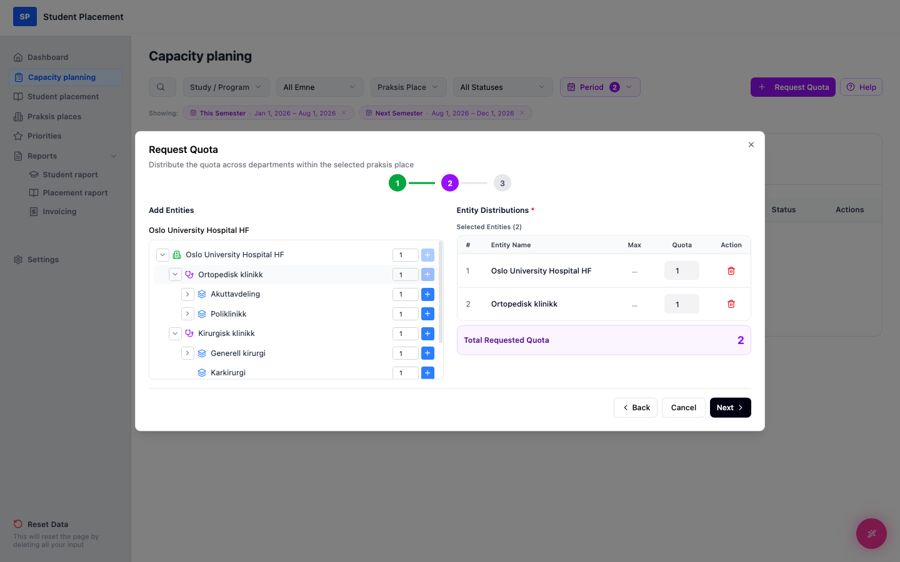
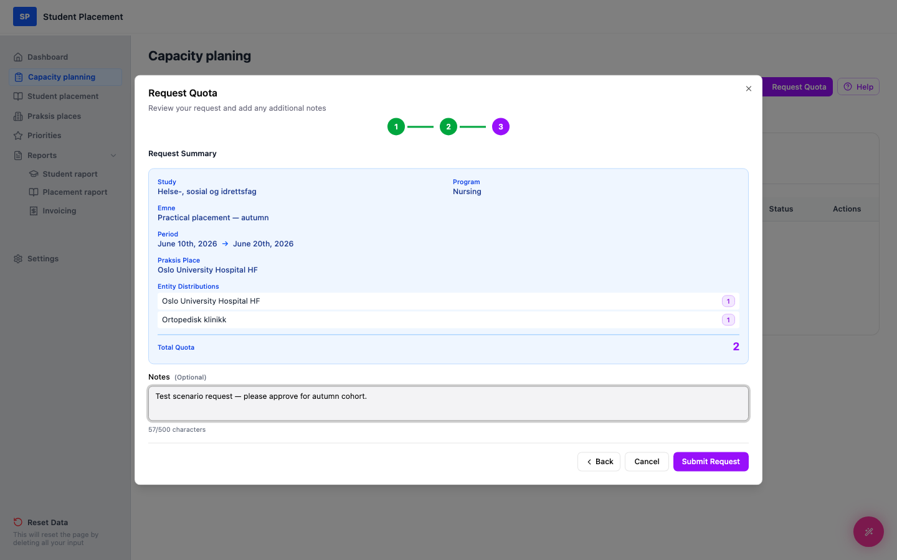
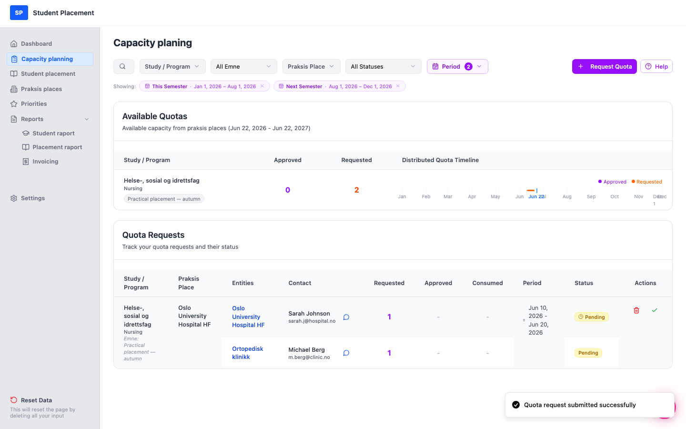

# Testscenario 06 — Kvoteforespørsel - Opprett

:::info[Scenariooversikt]

- **Side:** Kapasitetsplanlegging
- **Rolle:** Praksiskoordinator (PK)
- **Mål:** Opprett en ny kvoteforespørsel fra en tom starttilstand, og bekreft at den vises i forespørselslisten.
- **Forutsetning:** Innlogget som koordinator. Ingen kvoteforespørsler finnes ennå (tomt miljø).

:::

## Hva denne siden er

**Kapasitetsplanlegging** er der koordinatoren ber praksissteder (sykehus/klinikker)
 om studentkapasitet. Listen **Kvoteforespørsler** holder oversikt over hver forespørsel du sender og statusen dens
 (`Venter → Godkjent/Avslått → Oppfylt`). Du starter en ny forespørsel med knappen
 **Be om kvote** (øverst til høyre).

---

## Trinn

### 1. Start på Dashbord

Etter innlogging kommer du til **Dashbord**. Widgeten **Kvoteforespørsler** viser
 *"Ingen kvoteforespørsler funnet"* — miljøet er tomt og klart for scenarioet.

<figure>

<figcaption>Startpunkt — Dashbord</figcaption>

</figure>

### 2. Åpne Kapasitetsplanlegging fra sidemenyen

Klikk på **Kapasitetsplanlegging** i sidemenyen til venstre. Siden åpnes med en tom liste:
 *"Ingen kvoteforespørsler ennå — klikk på «Be om kvote» for å opprette din første forespørsel."*

<figure>

<figcaption>Kapasitetsplanlegging — tom starttilstand (etter klikk i sidemenyen)</figcaption>

</figure>

### 3. Trinn 1 i veiviseren — Forespørselsdetaljer

Klikk på **Be om kvote** (øverst til høyre) for å åpne veiviseren med tre trinn. Obligatoriske felter er merket med `*`.

1.  Velg et **Praksissted** (f.eks. *Oslo University Hospital HF*).
2.  Velg en **Startdato** og en **Sluttdato** *(sluttdatoen må være etter startdatoen)*.
3.  Velg et **Studium**, deretter et **Program** (programvalgene avhenger av studiet).
4.  Skriv eventuelt inn et **Emne** (emne-/fagnavn).
5.  Klikk på **Neste**.

<figure>

<figcaption>Veiviseren trinn 1 — Forespørselsdetaljer</figcaption>

</figure>

### 4. Trinn 2 i veiviseren — Entity Distribution

6.  I treet **Legg til enheter** angir du en kvote og klikker på den blå **+** ved siden av en avdeling.
7.  Legg til minst én enhet; enheter som er lagt til, vises til høyre med en løpende **Total forespurt kvote**.
8.  Klikk på **Neste**.

<figure>

<figcaption>Veiviseren trinn 2 — Fordeling på enheter</figcaption>

</figure>

### 5. Trinn 3 i veiviseren — Sammendrag og merknader

9.  Gå gjennom **Sammendrag av forespørsel**.
10.  Legg eventuelt til **Merknader** til kontaktpersonen ved praksisstedet.
11.  Klikk på **Send inn forespørsel**.

<figure>

<figcaption>Veiviseren trinn 3 — Oppsummering og notater</figcaption>

</figure>

---

## Sluttresultat

En *"Kvoteforespørselen ble sendt inn"*-melding (toast) vises, og den nye forespørselen vises i
 listen **Kvoteforespørsler** med status Venter. Kapasiteten gjenspeiles også
 i seksjonen **Tilgjengelige kvoter** øverst.

<figure>

<figcaption>Siste side — den nye forespørselen vises i listen</figcaption>

</figure>

---

<ScenarioFeedback scenarioId="TS-06-create-quota-request" />
