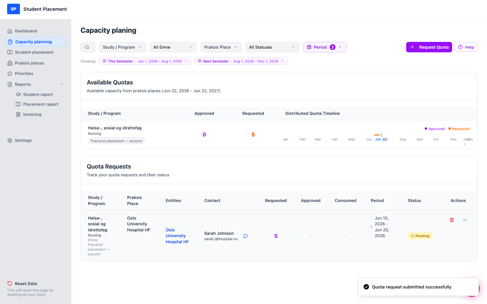
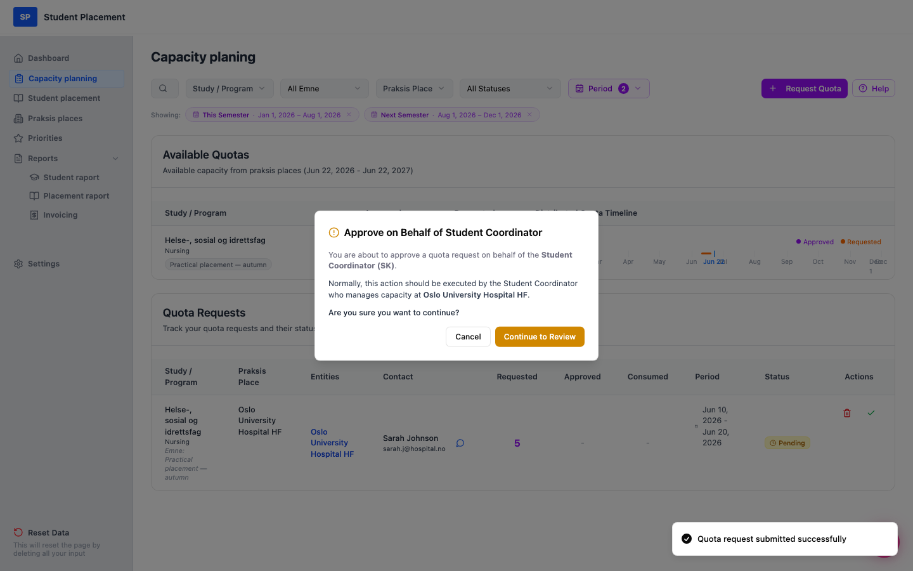
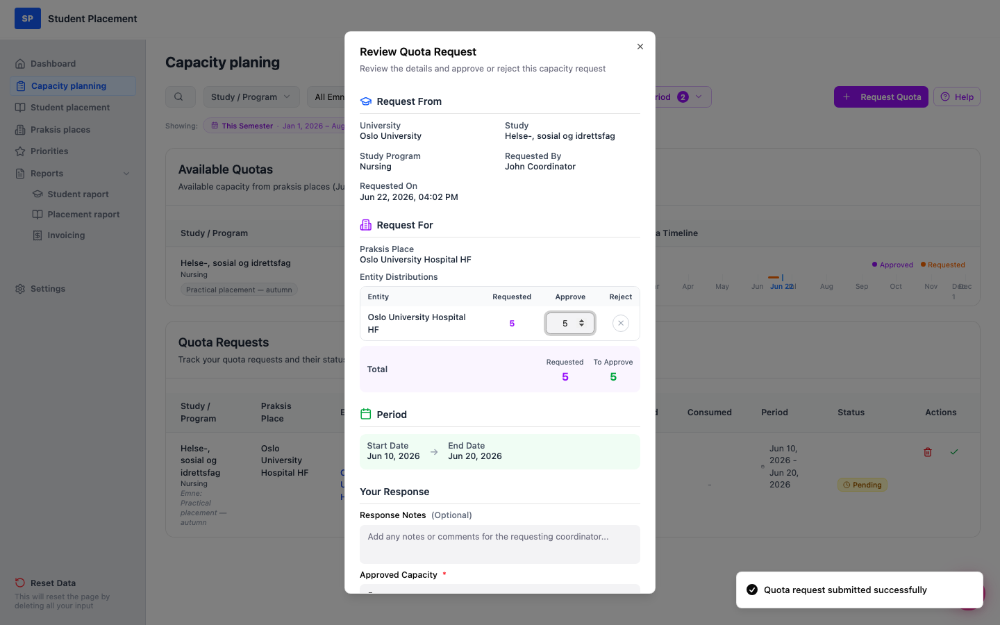
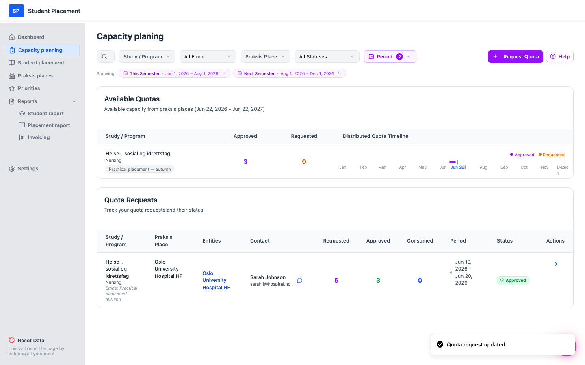

# Testscenario 07 — Kvoteforespørsel - Godkjenn som PK

:::info[Scenariooversikt]

- **Side:** Kapasitetsplanlegging
- **Rolle:** Praksiskoordinator (PK), som godkjenner på vegne av studentkoordinatoren (SK)
- **Mål:** Godkjenn en ventende kvoteforespørsel med den grønne hake-handlingen, og **endre den godkjente kvoten** slik at den avviker fra det som ble forespurt.
- **Forutsetning:** Minst én kvoteforespørsel med status Venter finnes. (Opprett en først med *Testscenario 06*.) Dette scenarioet bruker en forespørsel om **5** plasser.

:::

## Hva dette dekker

En ventende forespørsel godkjennes normalt av studentkoordinatoren (SK) ved praksisstedet. For testing
 kan koordinatoren (PK) godkjenne den direkte fra listen **Kvoteforespørsler** med den grønne
 ✓-handlingen. Under gjennomgangen kan du **senke den godkjente kvoten per enhet** — det
 godkjente antallet kan være mindre enn (men ikke større enn) det forespurte antallet.

---

## Trinn

### 1. Finn den ventende forespørselen og klikk på den grønne haken

På **Kapasitetsplanlegging** finner du forespørselen med status Venter.
 I kolonnen **Handlinger** klikker du på den grønne ✓ (*"Godkjenn på vegne av SK"*).

<figure>

<figcaption>Den ventende forespørselen — grønn ✓ i Handlinger-kolonnen (Forespurt = 5)</figcaption>

</figure>

### 2. Bekreft godkjenningsadvarselen

En advarsel forklarer at du godkjenner på vegne av SK. Klikk på **Fortsett til gjennomgang**.

<figure>

<figcaption>Advarsel — "Godkjenn på vegne av studentkoordinatoren"</figcaption>

</figure>

### 3. Gå gjennom forespørselen

Modalvinduet **Gjennomgå kvoteforespørsel** viser forespørselsdetaljene og en enhetstabell med
 **Forespurt**-antallet og et redigerbart **Godkjenn**-felt per enhet.

<figure>

<figcaption>Gjennomgangsmodal — Forespurt 5, Godkjenn forhåndsutfylt med 5</figcaption>

</figure>

### 4. Endre den godkjente kvoten

I **Godkjenn**-feltet endrer du verdien — her fra **5** ned til **3**. Totalen
 **Til godkjenning** oppdateres til **3**. *(Godkjenningsverdien kan ikke overstige det forespurte antallet.)*
 Klikk deretter på **Godkjenn forespørsel**.

<figure>

<figcaption>Godkjent kvote endret: Forespurt 5 → Til godkjenning 3</figcaption>

</figure>

---

## Sluttresultat

En *"Kvoteforespørselen er oppdatert"*-melding vises nederst til høyre, og forespørselens status blir
 Godkjent, med **Forespurt 5 / Godkjent 3**. Seksjonen
 **Tilgjengelige kvoter** gjenspeiler den godkjente kapasiteten (Godkjent = 3).

<figure>

<figcaption>Siste side — forespørselen Godkjent med Forespurt 5 / Godkjent 3</figcaption>

</figure>

---

<ScenarioFeedback scenarioId="TS-07-approve-quota-request" />
