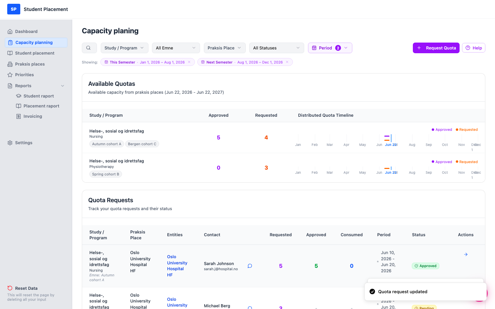
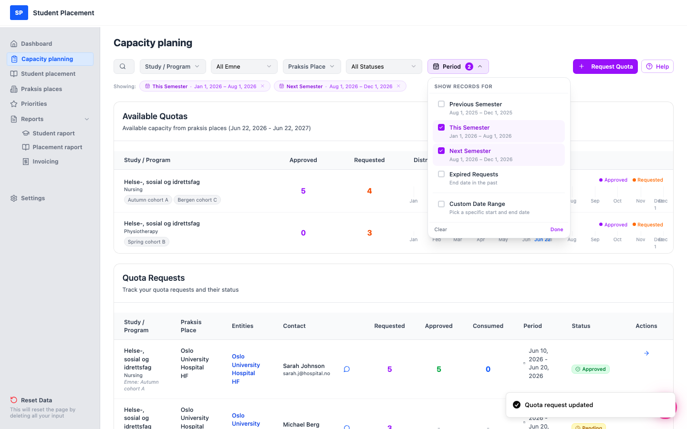
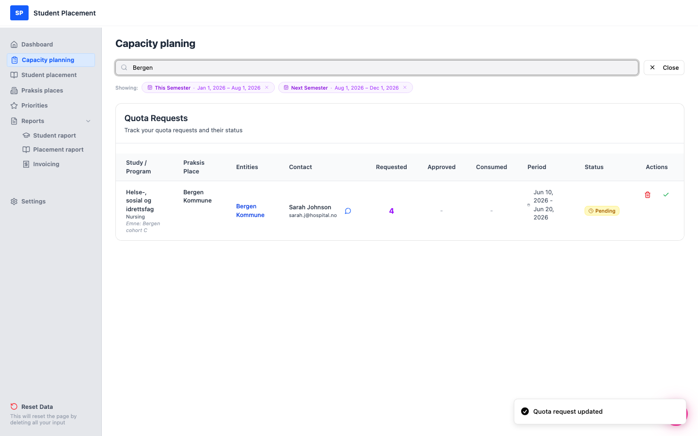
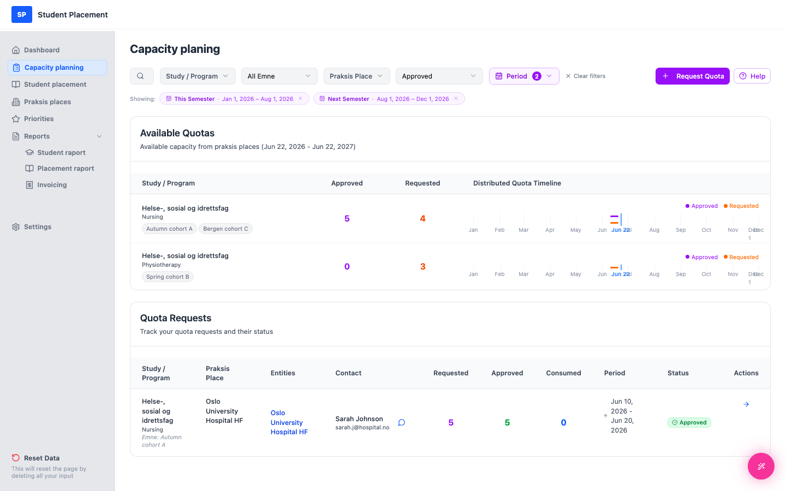
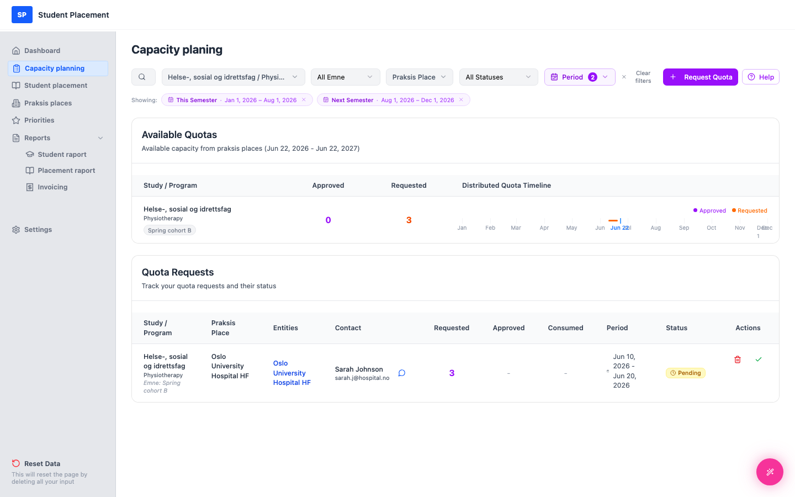
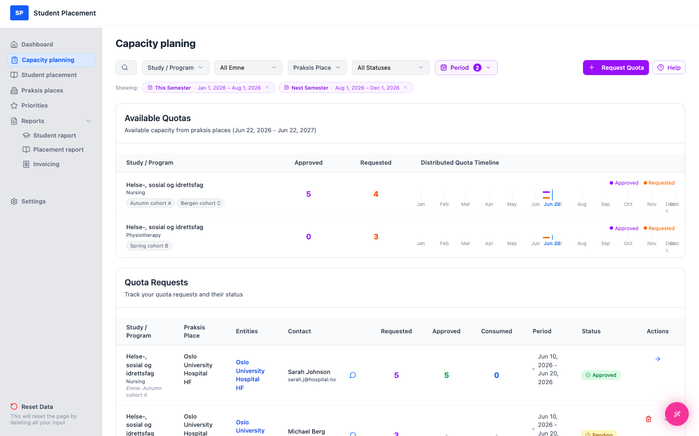

# Testscenario 08 — Kvoteforespørsel - Søk og filtre

:::info[Scenariooversikt]

- **Side:** Kapasitetsplanlegging
- **Rolle:** Praksiskoordinator (PK)
- **Mål:** Bruk søkefeltet og filterkontrollene til å avgrense Kvoteforespørsler-listen, og fjern dem deretter.
- **Forutsetning:** Noen kvoteforespørsler finnes på tvers av ulike programmer, steder og statuser. Dette scenarioet bruker tre:

:::

| Forespørsel | Praksissted | Program | Status |
|---|---|---|---|
| Autumn cohort A | Oslo University Hospital HF | Nursing | Godkjent |
| Spring cohort B | Oslo University Hospital HF | Physiotherapy | Venter |
| Bergen cohort C | Bergen Kommune | Nursing | Venter |

## Kontrollene

-   **Periode** — avgrens listen til ett eller flere semestre, utløpte forespørsler eller et egendefinert datointervall. **Aktivert som standard** (se nedenfor).
-   **Søk** (forstørrelsesglass-ikonet) — fritekstsøk på tvers av studium, program og praksisstedsnavn.
-   **Studium / program** — velg et studium, og gå deretter ned til et bestemt program.
-   **Alle emner** — filtrer på emnekode.
-   **Praksissted** — velg et sted, og deretter eventuelt en bestemt enhet.
-   **Alle statuser** — Venter / Godkjent / Avslått / Oppfylt.
-   **Tøm filtre** — vises når et nedtrekksfilter er aktivt; tilbakestiller alle (endrer ikke Periode-valget).
---

## Trinn

### 1. Merk deg standardvalget for periode

Siden starter **ikke** ufiltrert. Som standard er **Periode**-filteret forhåndsinnstilt til
 **Denne terminen** + **Neste termin** — vist med **2**-merket på Periode-knappen og de to
 chipene under verktøylinjen (*"Viser: Denne terminen · … · Neste termin · …"*). Forespørsler med datoer
 utenfor begge semestrene skjules til du endrer dette.

<figure>

<figcaption>Standardtilstand — Periode = Denne terminen + Neste termin (merke "2", to chips)</figcaption>

</figure>

### 2. Åpne Periode-filteret

Klikk på **Periode**-knappen for å åpne det. De to standardsemestrene er avkrysset. Herfra kan du:

-   Slå av/på **Forrige/denne/neste termin** eller **Utløpte forespørsler** (flervalg).
-   Bytte til **Egendefinert datointervall** og velge en bestemt fra-/til-dato.
-   Bruke **Tøm** for å fjerne alle periodebegrensninger (vise alle perioder), eller **Ferdig** for å ta valgene i bruk.

Du kan også fjerne en periode direkte ved å klikke på **×** på chipen dens under verktøylinjen.

<figure>

<figcaption>Periode-nedtrekksmenyen — Denne terminen og Neste termin avkrysset som standard</figcaption>

</figure>

### 3. Søk etter navn

Klikk på **magnifier**-ikonet (forstørrelsesglasset) for å åpne søkefeltet, og skriv inn et søkeord — her `Bergen`.
 Listen avgrenses til forespørsler der studium, program eller praksissted samsvarer. Klikk på **Lukk** for å avslutte søket.

<figure>

<figcaption>Søk "Bergen" → kun Bergen Kommune-forespørselen</figcaption>

</figure>

### 4. Filtrer på status

Åpne nedtrekksmenyen **Statuser** og velg **Godkjent**. Bare godkjente forespørsler blir igjen.

<figure>

<figcaption>Status = Godkjent → kun "Autumn cohort A"</figcaption>

</figure>

### 5. Filtrer på studium/program

Åpne **Studium / program**, hold pekeren over studiet (*Helse-, sosial og idrettsfag*), og velg deretter et
 program — her **Physiotherapy**. Listen viser kun forespørslene for dette programmet.

<figure>

<figcaption>Studium / program = Physiotherapy → kun "Spring cohort B"</figcaption>

</figure>

### 6. Fjern filtrene

Klikk på **Tøm filtre** (eller **×**) for å tilbakestille nedtrekksfiltrene og gå tilbake til listen
 (Periode-valget beholdes slik det er satt).

<figure>

<figcaption>Filtre fjernet — listen gjenopprettet (standardperioden gjelder fortsatt)</figcaption>

</figure>

---

<ScenarioFeedback scenarioId="TS-08-search-and-filters" />
