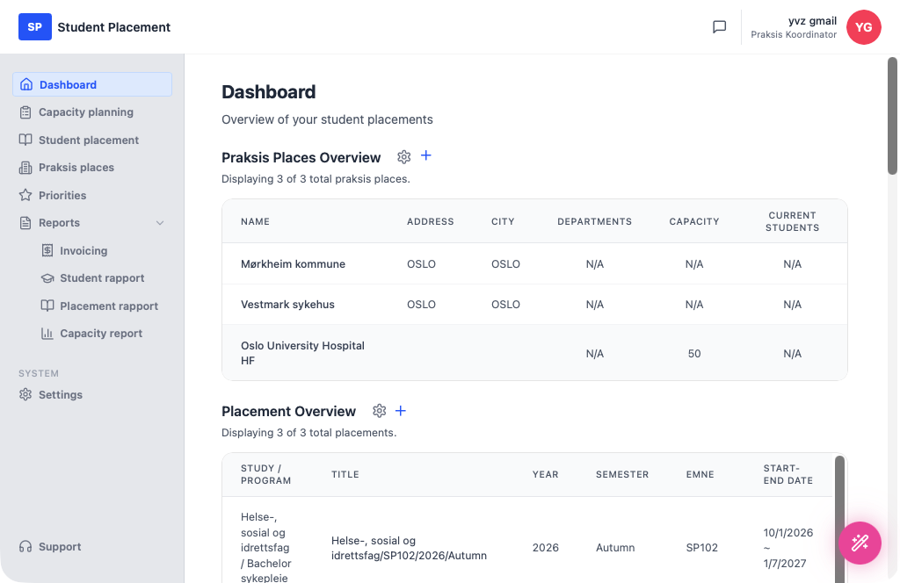
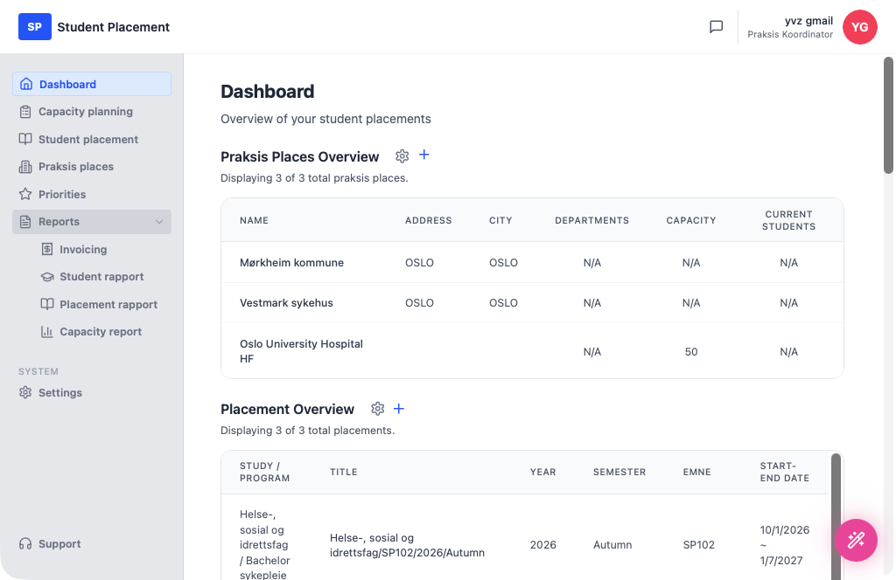
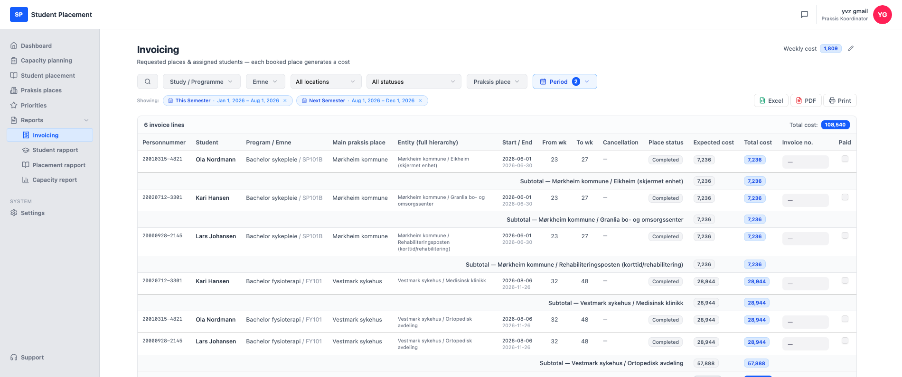
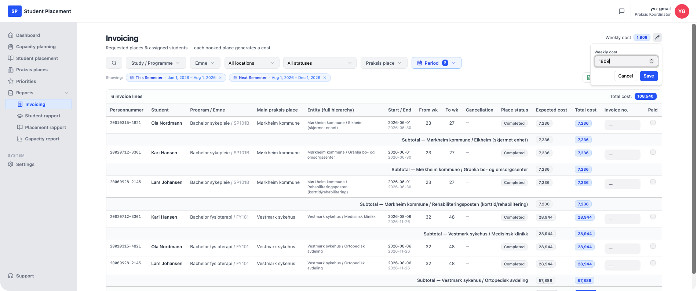
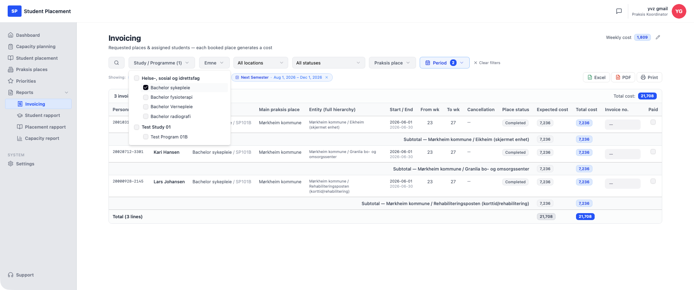
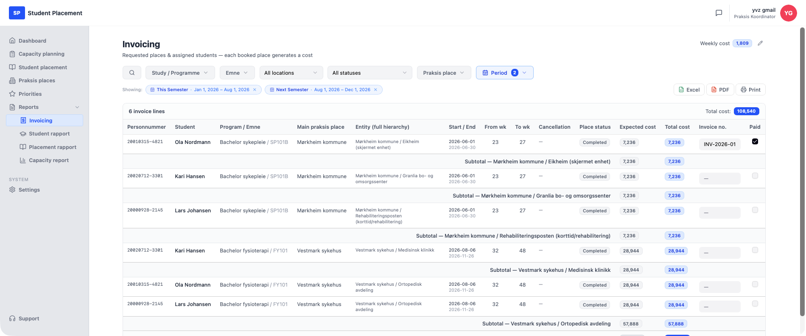

# Rapporter - Fakturering

:::info[Scenariooversikt]

- **Side:** Reports → Invoicing
- **Rolle:** Praksiskoordinator (PK)
- **Mål:** Gå gjennom de automatisk genererte fakturalinjene for tildelte studenter, avgrens dem med filtre, juster ukeskostnaden, og registrer fakturanummer og betalingsstatus.
- **Forutsetning:** Innlogget som PK, med studenter allerede tildelt praksissteder. Denne gjennomgangen bruker de eksisterende plasseringene **Bachelor sykepleie / SP101B** og **Bachelor fysioterapi / FY101**.

:::

## Hva denne siden er

**Invoicing** er den første oppføringen under **Reports** i sidemenyen (ved siden av **Student rapport**, **Placement rapport** og **Capacity report**). Den genererer én fakturalinje per student som er tildelt et praksissted — det er tildelingen av en plass som genererer en kostnad, så studenter som kun er forespurt, men ikke tildelt ennå, vises ikke.

Hver linje viser studenten, program/emne, det tildelte praksisstedet med hele entitetshierarkiet, start-/sluttdato og det tilhørende ISO-ukeintervallet. Ut fra ukeintervallet beregner siden en **Expected cost** som `(til uke − fra uke − 1) × ukeskostnad`; **Total cost** er samme beløp, med mindre plasseringen ble kansellert uten ekstra kostnad — da blir den null. Linjene grupperes per entitet med en subtotal per gruppe, og en totalsum nederst. **Ukeskostnaden** som brukes i beregningen, er én redigerbar verdi (blyantikon øverst til høyre) som gjelder for hele rapporten.

I tillegg til tallene har hver linje to redigerbare felt — **Invoice no.** og en **Paid**-avkrysning — slik at koordinatoren kan følge faktureringsstatus direkte i rapporten. Verktøylinjen tilbyr samme filtersett som ellers (Study/Programme, Emne, sted, status, praksissted, periode), samt knappene **Excel**, **PDF** og **Print** for å dele rapporten utenfor applikasjonen.

Som standard er rapporten avgrenset til inneværende og neste semester — summene som vises, gjenspeiler derfor bare dette tidsrommet, ikke alle fakturaer som noensinne er generert. Bruk **Period**-filteret for å utvide, endre eller fjerne denne avgrensningen og se andre tidsrom, inkludert tidligere semestre.

---

## Trinn

### 1. Start på Dashboard

Etter innlogging kommer du til **Dashboard**.

<figure>

<figcaption>Startpunkt — Dashboard</figcaption>

</figure>

### 2. Åpne Reports → Invoicing

Klikk på **Reports** i sidemenyen for å utvide den, slik at **Invoicing**, **Student rapport**, **Placement rapport** og **Capacity report** vises. Klikk på **Invoicing**.

<figure>

<figcaption>Reports utvidet — Invoicing er den første rapporten</figcaption>

</figure>

### 3. Gå gjennom fakturalinjene

Rapporten åpnes og viser hver tildelte student som én rad, gruppert per entitet med en **Subtotal**-rad etter hver gruppe. Toppfeltet viser antall linjer og totalsummen **Total cost**; her **6 invoice lines** totalt **108,540**.

<figure>

<figcaption>Invoicing — alle tildelte studenter, gruppert per entitet med subtotaler</figcaption>

</figure>

### 4. Juster ukeskostnaden

Klikk på blyantikonet ved siden av **Weekly cost** (øverst til høyre). En liten redigeringsboks åpnes med gjeldende verdi — her `1809`. Endre den og klikk på **Save** for å regne om alle Expected/Total cost-verdier og subtotaler på siden, eller **Cancel** for å la den stå uendret.

<figure>

<figcaption>Weekly cost — redigerbar verdi brukt i alle kostnadsberegninger</figcaption>

</figure>

### 5. Filtrer på Study / Programme

Klikk på **Study / Programme** og huk av et program — her **Bachelor sykepleie**. Tabellen avgrenses til linjene for dette programmet, antall linjer og totalsum oppdateres (**3 invoice lines**, **21,708**), og knappeteksten viser det aktive antallet `(1)`. Samme mønster gjelder for filtrene **Emne**, **Location**, **Status** og **Praksis place**, og for **Period** ved filtrering på datoperiode.

<figure>

<figcaption>Study / Programme-filter — avgrenset til Bachelor sykepleie</figcaption>

</figure>

### 6. Registrer fakturanummer og merk en linje som betalt

Fjern filteret, og skriv deretter inn et fakturanummer i feltet **Invoice no.** på en linje — her `INV-2026-0142` — og huk av **Paid**-boksen. Begge feltene lagres per linje etter hvert som du redigerer dem.

<figure>

<figcaption>Invoice no. fylt inn og Paid huket av for første linje</figcaption>

</figure>

---

## Sluttresultat

Den første fakturalinjen har nå fakturanummer **INV-2026-0142** og er merket **Paid**, mens rapporten som helhet når som helst kan filtreres, eksporteres til **Excel**/**PDF**, eller skrives ut for å deles med økonomiavdelingen.

---

<ScenarioFeedback scenarioId="TS-14-invoicing-report" />
