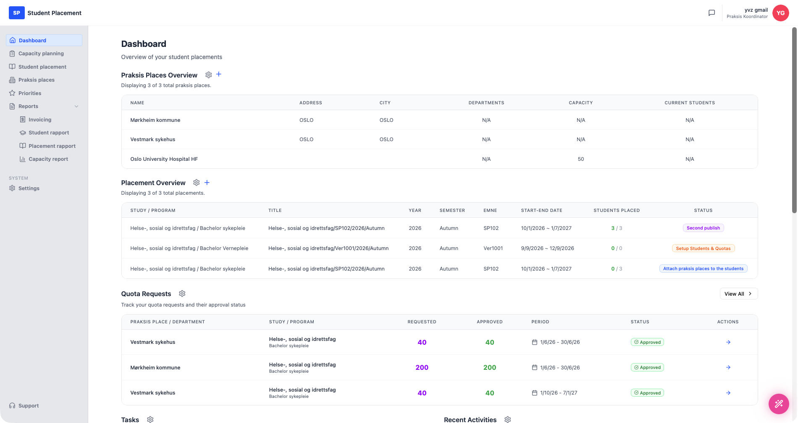
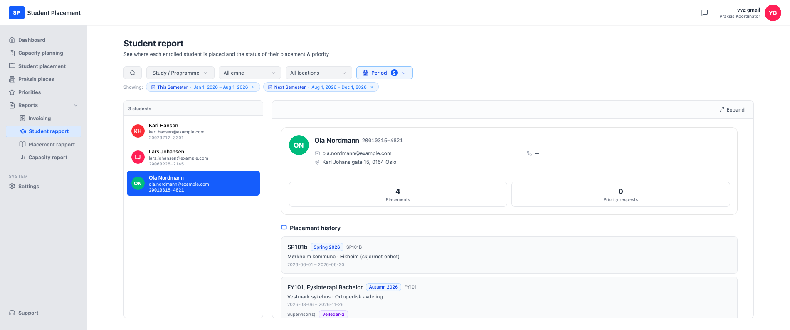
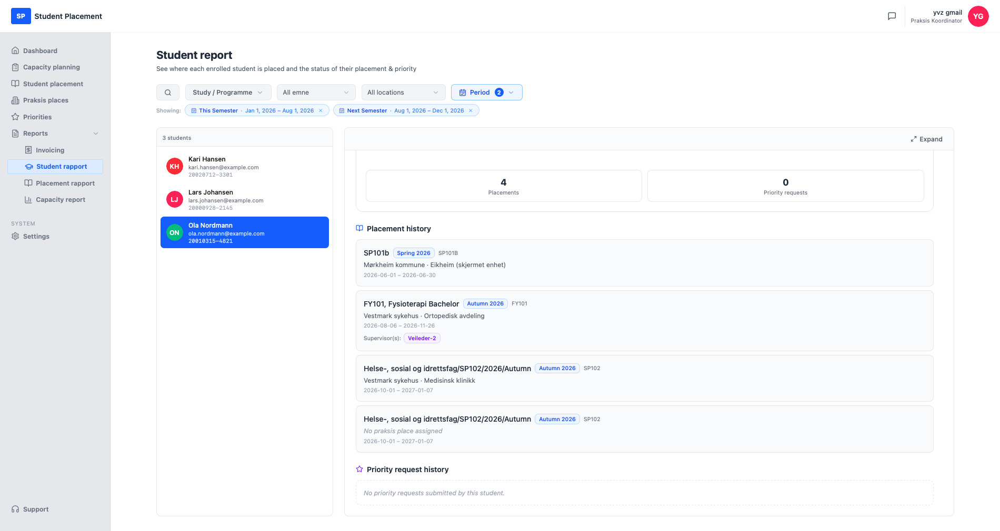
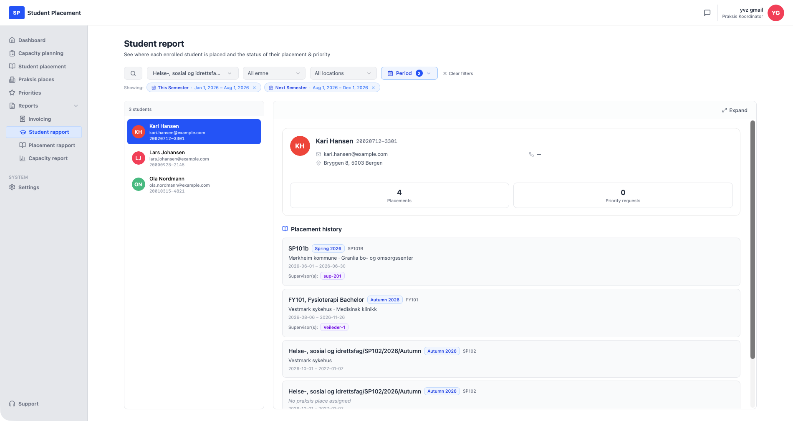

# Rapporter - Studentrapport

:::info[Scenariooversikt]

- **Side:** Rapporter → Studentrapport
- **Rolle:** Praksiskoordinator (PK)
- **Mål:** Bla gjennom innskrevne studenter, avgrens listen med filtre, velg en student for å se hele plasserings- og prioriteringshistorikken, og utvid profilen til full bredde.
- **Forutsetning:** Innlogget som PK, med innskrevne studenter som har plasseringshistorikk. Denne gjennomgangen bruker de eksisterende studentene **Kari Hansen**, **Lars Johansen** og **Ola Nordmann**.

:::

## Hva denne siden er

**Studentrapport** er den andre oppføringen under **Rapporter** i sidemenyen (ved siden av **Fakturering**, **Plasseringsrapport** og **Kapasitetsrapport**). Det er en master/detalj-visning: en filtrerbar liste over innskrevne studenter til venstre, og den valgte studentens fullstendige profil til høyre.

Filterlinjen avgrenser studentlisten på **Studium / program** (en kaskaderende meny — velg et studium, deretter eventuelt et av programmene), **Emne**, **Sted** og **Periode**; et søkefelt matcher også på navn, e-post eller personnummer. Å velge en student til venstre laster profilen deres til høyre: et identitetskort (navn, personnummer, e-post, telefon, adresse, samt merke for førerkort hvis aktuelt) med tellere for **Plasseringer** og **Prioriteringsforespørsler**, etterfulgt av en **Plasseringshistorikk**-seksjon (ett kort per plassering, med semester, emne/fag, tildelt praksissted og entitet, start-/sluttdato og veileder(e)) og en **Historikk for prioriteringsforespørsler**-seksjon (ett kort per innsendt forespørsel, med målsemester, poeng, status og beslutningsdetaljer) — begge seksjonene viser en enkel tekst som tom-tilstand når det ikke er noe å vise ennå. En **Vis**-knapp øverst til høyre i detaljpanelet skjuler studentlisten og verktøylinjen, slik at profilen kan gjennomgås i full bredde; **Skjul** gjenoppretter delt visning.

Som standard er rapporten avgrenset til inneværende og neste semester — studentlisten viser derfor kun studenter med en plassering eller prioriteringsforespørsel innenfor dette tidsrommet. Bruk **Periode**-filteret for å utvide, endre eller fjerne denne avgrensningen og få med andre studenter, inkludert tidligere semestre.

---

## Trinn

### 1. Start på Dashbord

Etter innlogging kommer du til **Dashbord**.

<figure>

<figcaption>Startpunkt — Dashbord</figcaption>

</figure>

### 2. Åpne Rapporter → Studentrapport

Klikk på **Rapporter** i sidemenyen for å utvide den, og klikk deretter på **Studentrapport**. Siden åpnes med filterlinjen og en liste over innskrevne studenter til venstre; ingen student er valgt ennå, så høyre panel viser *"Velg en student for å se historikken."*

<figure>

<figcaption>Studentrapport — studentliste og filterlinje, ingenting valgt</figcaption>

</figure>

### 3. Velg en student

Klikk på en student i listen — her **Ola Nordmann**. Profilen deres lastes til høyre: identitetskort med kontaktinformasjon, deretter **4 plasseringer** og **0 prioriteringsforespørsler**, etterfulgt av starten på **Plasseringshistorikk**.

<figure>

<figcaption>Ola Nordmann valgt — identitetskort og starten på plasseringshistorikken</figcaption>

</figure>

### 4. Se hele historikken

Scroll i profilpanelet for å se alle plasseringsoppføringer — inkludert de uten tildelt praksissted ennå — og **Historikk for prioriteringsforespørsler**-seksjonen under. For denne studenten står det *"Ingen prioriteringsforespørsler er sendt inn av denne studenten."*

<figure>

<figcaption>Resterende plasseringsoppføringer, samt tom-tilstanden for Historikk for prioriteringsforespørsler</figcaption>

</figure>

### 5. Utvid til full bredde

Klikk på **Vis** (øverst til høyre i detaljpanelet). Studentlisten og verktøylinjen skjules, og profilen — her for **Kari Hansen** — fyller full bredde, noe som gjør det enklere å lese lengre historikker. Klikk på **Skjul** for å gå tilbake til delt visning.

<figure>

<figcaption>Utvidet visning — Kari Hansens fullstendige plasseringshistorikk i full bredde</figcaption>

</figure>

### 6. Filtrer på Studium / program

Gå tilbake til delt visning, klikk på **Studium / program**, og velg et studium — her **Helse-, sosial og idrettsfag** — og deretter et program, for eksempel **Bachelor sykepleie**. Knappeteksten oppdateres for å vise valget, og en **Tøm filtre**-lenke vises; studentlisten avgrenses til studenter som matcher. Samme mønster gjelder for **Emne**, **Sted** og **Periode**.

<figure>

<figcaption>Studium / program-filter — avgrenset til Helse-, sosial og idrettsfag / Bachelor sykepleie</figcaption>

</figure>

---

## Sluttresultat

Koordinatoren kan bla gjennom enhver innskrevet student, avgrense listen til dem de bryr seg om, og se en fullstendig historikk over plasseringer og prioriteringsforespørsler for den som er valgt — utvidet til full bredde når det er mye å gå gjennom.

---

<ScenarioFeedback scenarioId="TS-15-student-report" />
