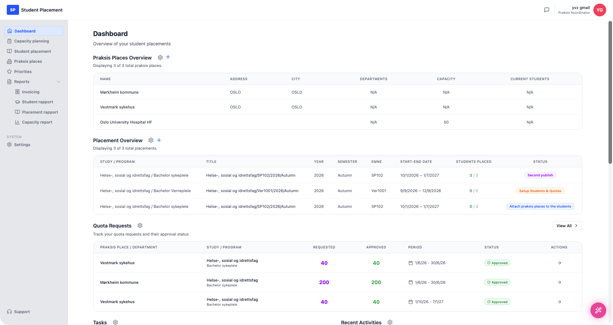
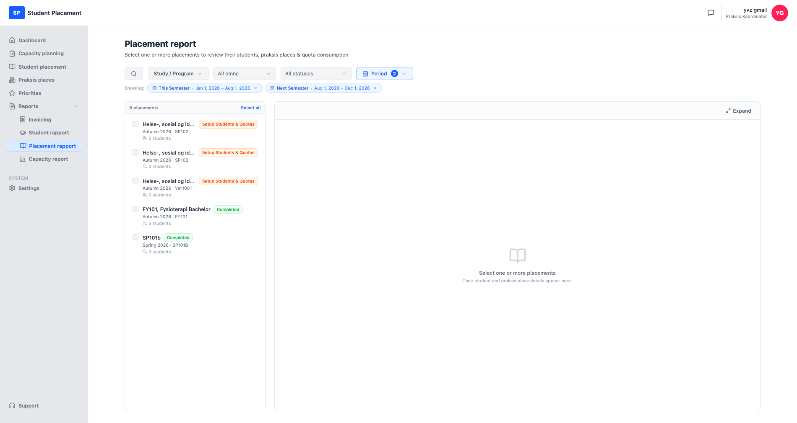
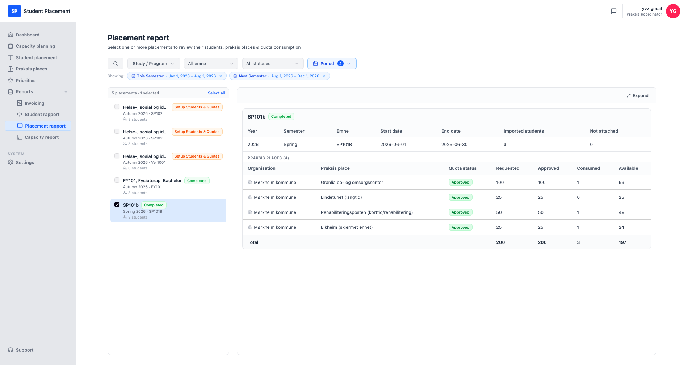
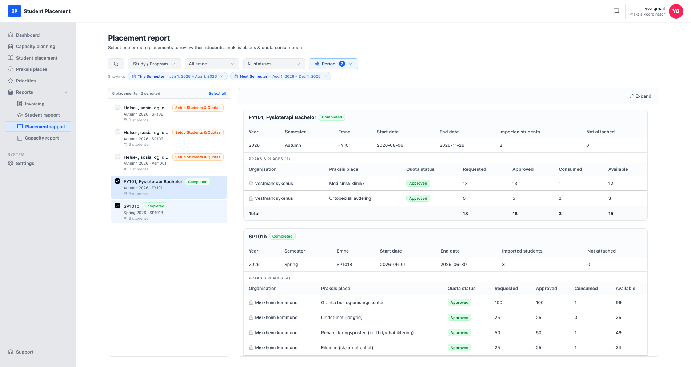
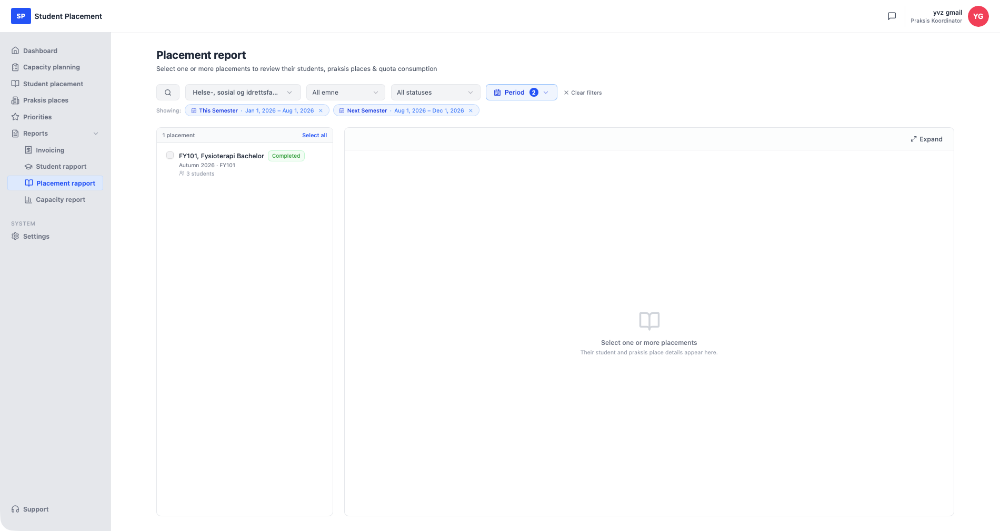
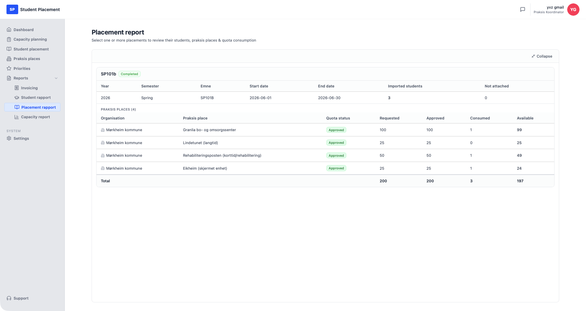

# Rapporter - Plasseringsrapport

:::info[Scenariooversikt]

- **Side:** Rapporter → Plasseringsrapport
- **Rolle:** Praksiskoordinator (PK)
- **Mål:** Bla gjennom plasseringer, velg én eller flere for å se importerte studenter og kvoteforbruk på praksissteder side om side, avgrens listen med filtre, og utvid et utvalg til full bredde.
- **Forutsetning:** Innlogget som PK, med plasseringer som har importerte studenter og tilknyttede praksissteder. Denne gjennomgangen bruker de eksisterende plasseringene **SP101b** og **FY101, Fysioterapi Bachelor**.

:::

## Hva denne siden er

**Plasseringsrapport** er den tredje oppføringen under **Rapporter** i sidemenyen (ved siden av **Fakturering**, **Studentrapport** og **Kapasitetsrapport**). I motsetning til Studentrapport er dette en visning med **flervalg**: huk av så mange plasseringer du vil til venstre, og hver av dem får sin egen seksjon stablet i detaljpanelet til høyre — slik at du kan sammenligne flere plasseringer samtidig i stedet for én om gangen.

Filterlinjen avgrenser plasseringslisten på **Studium / program** (en kaskaderende meny — velg et studium, deretter eventuelt et av programmene), **Emne**, **Status** (Utkast, Last opp studenter, Velg praksissteder, Første publisering, Fullført) og **Periode**; et søkefelt matcher også på tittel, emne eller semester. Hvert plasseringskort i listen viser tittel, statusmerke, semester/emne og antall importerte studenter, med **Velg alle** / **Tøm alle** over listen. For hver avhukede plassering viser detaljpanelet en oppsummeringsrad (År, Semester, Emne, Start-/sluttdato, Importerte studenter, Ikke tilknyttet) etterfulgt av en **Praksissteder**-tabell — én rad per tilknyttet entitet, med **Kvotestatus**, **Forespurt**, **Godkjent**, **Brukt** og **Tilgjengelig**, samt en **Totalt**-rad — eller en tom-tilstand-melding hvis ingen praksissteder er tilknyttet ennå. En **Vis**-knapp øverst til høyre i detaljpanelet skjuler plasseringslisten og verktøylinjen, slik at utvalget kan gjennomgås i full bredde; **Skjul** gjenoppretter delt visning.

Som standard er rapporten avgrenset til inneværende og neste semester — plasseringslisten viser derfor kun plasseringer med datoer innenfor dette tidsrommet. Bruk **Periode**-filteret for å utvide, endre eller fjerne denne avgrensningen og få med andre plasseringer, inkludert tidligere semestre.

---

## Trinn

### 1. Start på Dashbord

Etter innlogging kommer du til **Dashbord**.

<figure>

<figcaption>Startpunkt — Dashbord</figcaption>

</figure>

### 2. Åpne Rapporter → Plasseringsrapport

Klikk på **Rapporter** i sidemenyen for å utvide den, og klikk deretter på **Plasseringsrapport**. Siden åpnes med filterlinjen og en avkrysningsliste over plasseringer til venstre; ingenting er valgt ennå, så høyre panel viser *"Velg én eller flere plasseringer."*

<figure>

<figcaption>Plasseringsrapport — plasseringsliste og filterlinje, ingenting valgt</figcaption>

</figure>

### 3. Velg én plassering

Huk av en plassering i listen — her **SP101b**. Seksjonen lastes til høyre: oppsummeringsraden (**3** importerte studenter, **0** ikke tilknyttet) etterfulgt av **Praksissteder (4)** med tall for forespurt/godkjent/forbrukt/tilgjengelig per entitet og en **Totalt**-rad (200 godkjent, 3 forbrukt, 197 tilgjengelig).

<figure>

<figcaption>SP101b valgt — plasseringsoppsummering og kvotetabell for praksissteder</figcaption>

</figure>

### 4. Velg en plassering til for sammenligning

Huk av en plassering til — her **FY101, Fysioterapi Bachelor** — mens SP101b fortsatt er avhuket. Seksjonen legges til over SP101b sin i detaljpanelet, slik at begge plasseringenes kvotetabeller vises sammen for sammenligning.

<figure>

<figcaption>FY101 og SP101b begge valgt — seksjonene deres stables i detaljpanelet</figcaption>

</figure>

### 5. Filtrer på Studium / program

Fjern utvalget, klikk på **Studium / program**, og velg et studium — her **Helse-, sosial og idrettsfag** — og deretter et program, for eksempel **Bachelor fysioterapi**. Knappeteksten oppdateres, en **Tøm filtre**-lenke vises, og plasseringslisten avgrenses (her til **1 plassering**). Samme mønster gjelder for **Emne**, **Status** og **Periode**.

<figure>

<figcaption>Studium / program-filter — avgrenset til Helse-, sosial og idrettsfag / Bachelor fysioterapi</figcaption>

</figure>

### 6. Utvid til full bredde

Fjern filteret, velg en plassering, og klikk deretter på **Vis** (øverst til høyre i detaljpanelet). Plasseringslisten og verktøylinjen skjules, og de(n) valgte seksjonen(e) fyller full bredde, noe som gjør brede kvotetabeller enklere å lese. Klikk på **Skjul** for å gå tilbake til delt visning.

<figure>

<figcaption>Utvidet visning — SP101b sin oppsummering og kvotetabell for praksissteder i full bredde</figcaption>

</figure>

---

## Sluttresultat

Koordinatoren kan huke av en hvilken som helst kombinasjon av plasseringer og se antall importerte studenter og kvoteforbruk på praksissteder side om side — avgrenset til relevant studium, program, emne, status eller periode, og utvidet til full bredde for en nærmere titt.

---

<ScenarioFeedback scenarioId="TS-16-placement-report" />
