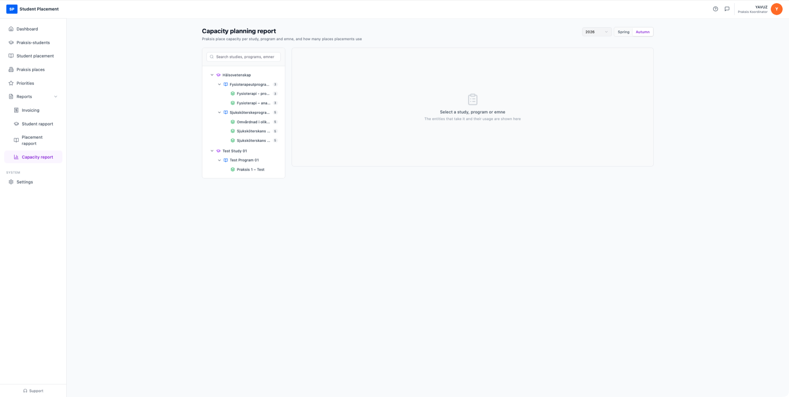
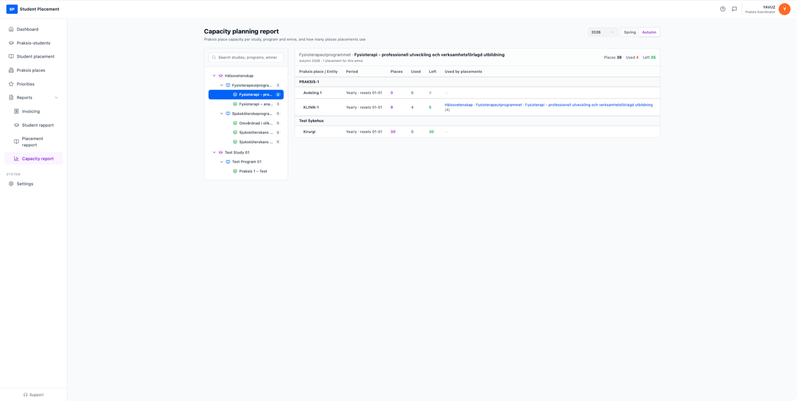
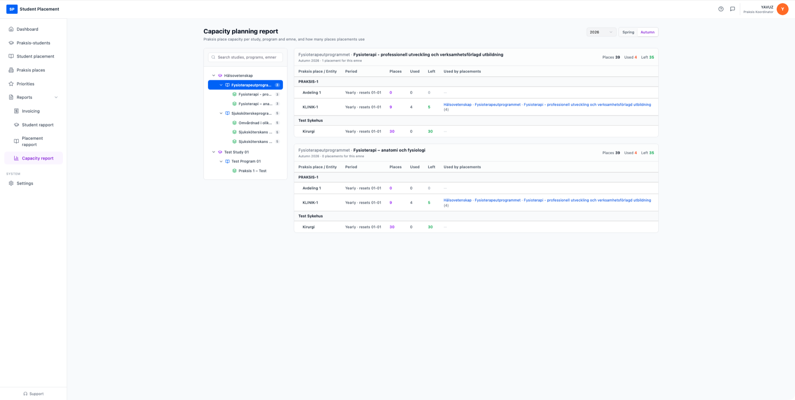
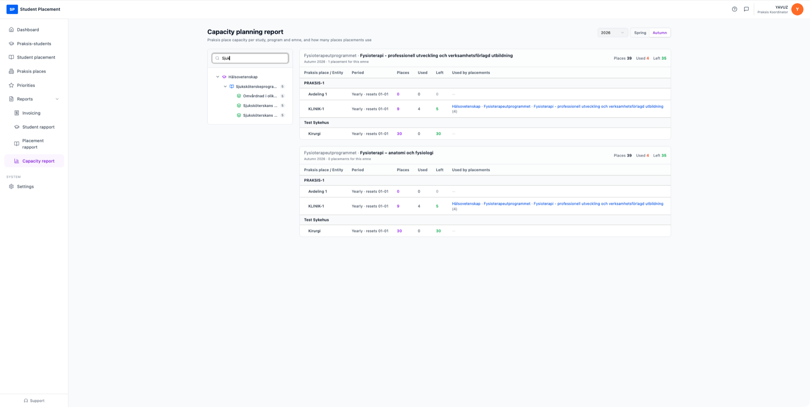

# Testscenario 17 — Rapporter - Kapasitetsrapport

:::info[Scenariooversikt]

- **Side:** Rapporter → Kapasitetsrapport
- **Rolle:** Praksiskoordinator (PK)
- **Mål:** Se hvor mange praksisplasser hver enhet tilbyr for et studium, program eller emne, hvor mange som brukes av plasseringer, og hvor mange som er igjen.
- **Forutsetning:** Logget inn som PK, med enheter koblet til programmet og emnet (se *Testscenario 04–05*). Denne gjennomgangen bruker **Fysioterapeutprogrammet** i **høsten 2026**, der plasseringen fra *Testscenario 08* bruker 4 plasser på **KLINIK-1**.

:::

## Hva denne siden er

**Kapasitetsrapport** (under **Rapporter**) åpner **Kapasitetsplanleggingsrapport** — praksisstedskapasitet per
 studium, program og emne, og hvor mange plasser plasseringene bruker.

- **År og termin** (øverst til høyre) — velg et år (f.eks. *2024–2027*) og **Vår** eller **Høst**.
- **Tre** (til venstre) — alle studier med programmer og emner. Tallet ved et program eller emne er hvor mange
  enheter som tar det. Bruk søkefeltet for å finne et studium, program eller emne.
- **Rapport** (til høyre) — for det valgte elementet, én seksjon per emne: overskriften viser program · emne,
  terminen med antall plasseringer for emnet, og summene **Plasser**, **Brukt** og **Igjen**. Tabellen viser
  enhetene, gruppert etter praksissted:

| Kolonne | Innhold |
|---|---|
| **Praksissted / Enhet** | Praksisstedet (f.eks. *PRAKSIS-1*) og enhetene. |
| **Periode** | Hvordan enhetens plasser telles, f.eks. *Yearly · resets 01-01* (årlig, nullstilles 01-01). |
| **Plasser** | Plasser enheten tilbyr for dette programmet og emnet. |
| **Brukt** | Plasser som er tatt av plasseringer. |
| **Igjen** | Plasser som fortsatt er ledige. |
| **Brukt av plasseringer** | Plasseringene som bruker enheten, med antall studenter i parentes — klikk for å åpne plasseringen. |

---

## Trinn

### 1. Åpne Rapporter → Kapasitetsrapport

Klikk på **Rapporter** i sidemenyen og deretter på **Kapasitetsrapport**. Treet viser studier, programmer og
 emner; høyre panel ber deg velge et studium, program eller emne for å se enhetene og bruken. Året er **2026**
 og terminen **Høst**.

<figure>

<figcaption>Kapasitetsplanleggingsrapport — velg et studium, program eller emne i treet</figcaption>

</figure>

### 2. Velg et emne

Klikk på emnet **Fysioterapi - professionell utveckling och verksamhetsförlagd utbildning**. Rapporten viser
 *Autumn 2026 · 1 plassering for emnet* og summene **Plasser 39 · Brukt 4 · Igjen 35**:

- **PRAKSIS-1 → Avdeling 1** — 0 plasser.
- **PRAKSIS-1 → KLINIK-1** — 9 plasser, 4 brukt, 5 igjen; brukt av plasseringen *Hälsovetenskap ·
  Fysioterapeutprogrammet · Fysioterapi - professionell … (4)*.
- **Test Sykehus → Kirurgi** — 30 plasser, ingen brukt.

Klikk på plasseringsnavnet for å åpne plasseringen.

<figure>

<figcaption>Ett emne — 39 plasser, 4 brukt av én plassering på KLINIK-1</figcaption>

</figure>

### 3. Velg et program

Klikk på **Fysioterapeutprogrammet**. Rapporten viser én seksjon for hvert emne i programmet, under hverandre.
 Her viser begge emnene de samme enhetene og tallene — det andre emnet (*Fysioterapi – anatomi och fysiologi*,
 *0 plasseringer for emnet*) viser også *Brukt 4* på KLINIK-1.

<figure>

<figcaption>Et program — én seksjon per emne</figcaption>

</figure>

### 4. Søk og bytt termin

Skriv i søkefeltet — for eksempel `Sjuk` — for å vise bare den delen av treet som passer. Bruk **Vår** /
 **Høst** og årsmenyen for å se en annen termin; enheter som nullstilles årlig, viser samme bruk i begge
 terminene i året.

<figure>

<figcaption>Søk — bare Sjuksköterskeprogrammet og emnene vises</figcaption>

</figure>

---

## Sluttresultat

Koordinatoren kan for et hvilket som helst studium, program eller emne og termin se hvor mange plasser hver
 enhet tilbyr, hvor mange som er brukt og av hvilken plassering, og hvor mange som er igjen.

---

<ScenarioFeedback scenarioId="TS-17-capacity-report" />
