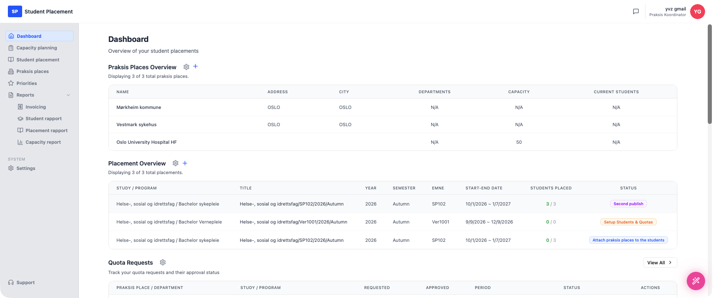
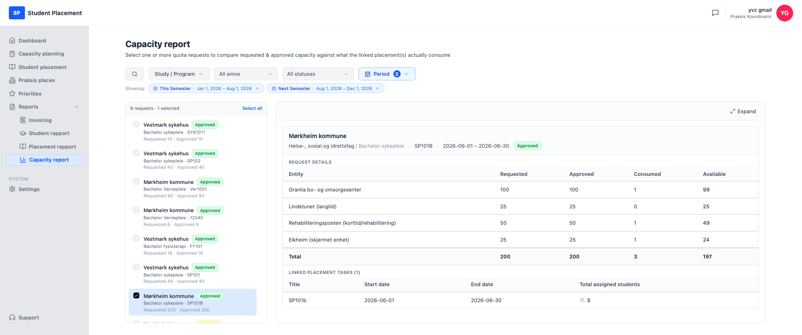

# Rapporter - Kapasitetsrapport

:::info[Scenariooversikt]

- **Side:** Rapporter → Kapasitetsrapport
- **Rolle:** Praksiskoordinator (PK)
- **Mål:** Bla gjennom kvoteforespørsler, velg én eller flere for å sammenligne forespurt vs. godkjent kapasitet mot hva de tilknyttede plasseringene faktisk forbruker, filtrer listen på status, og utvid et utvalg til full bredde.
- **Forutsetning:** Innlogget som PK, med kvoteforespørsler i ulike statuser. Denne gjennomgangen bruker de eksisterende forespørslene **Mørkheim kommune / SP101B** (Godkjent), **Vestmark sykehus / FY101** (Godkjent) og **Mørkheim kommune / SP101** (Venter).

:::

## Hva denne siden er

**Kapasitetsrapport** er den fjerde oppføringen under **Rapporter** i sidemenyen (ved siden av **Fakturering**, **Studentrapport** og **Plasseringsrapport**). I likhet med Plasseringsrapport er dette en visning med **flervalg**: huk av så mange kvoteforespørsler du vil til venstre, og hver av dem får sin egen sammenligningsseksjon stablet i detaljpanelet til høyre.

Filterlinjen avgrenser forespørselslisten på **Studium / program** (en kaskaderende meny), **Emne**, **Status** (Venter, Godkjent, Avslått, Oppfylt) og **Periode**; et søkefelt matcher også på praksissted, studium, program eller emne. Hvert forespørselskort i listen viser navnet på praksisstedet, et statusmerke, program/emne, og forespurt/godkjent-summer, med **Velg alle** / **Tøm alle** over listen. For hver avhukede forespørsel viser detaljpanelet en overskrift (praksissted, studium/program, emne, periode, status) etterfulgt av en **Forespørselsdetaljer**-tabell — én rad per entitet, med **Forespurt**, **Godkjent**, **Brukt** og **Tilgjengelig**, samt en **Totalt**-rad — og en **Tilknyttede plasseringsoppgaver**-tabell som viser hvilke(n) plassering(er) som trekker på denne forespørselen, med start-/sluttdato og totalt antall tildelte studenter, eller en tom-tilstand-melding hvis ingen er tilknyttet ennå. En **Vis**-knapp øverst til høyre i detaljpanelet skjuler forespørselslisten og verktøylinjen, slik at utvalget kan gjennomgås i full bredde; **Skjul** gjenoppretter delt visning.

Som standard er rapporten avgrenset til inneværende og neste semester — forespørselslisten viser derfor kun forespørsler med datoer innenfor dette tidsrommet. Bruk **Periode**-filteret for å utvide, endre eller fjerne denne avgrensningen og få med andre forespørsler, inkludert tidligere semestre.

---

## Trinn

### 1. Start på Dashbord

Etter innlogging kommer du til **Dashbord**.

<figure>

<figcaption>Startpunkt — Dashbord</figcaption>

</figure>

### 2. Åpne Rapporter → Kapasitetsrapport

Klikk på **Rapporter** i sidemenyen for å utvide den, og klikk deretter på **Kapasitetsrapport**. Siden åpnes med filterlinjen og en avkrysningsliste over kvoteforespørsler til venstre; ingenting er valgt ennå, så høyre panel viser *"Velg én eller flere kvoteforespørsler."*

<figure>

<figcaption>Kapasitetsrapport — forespørselsliste og filterlinje, ingenting valgt</figcaption>

</figure>

### 3. Velg én forespørsel

Huk av en forespørsel i listen — her **Mørkheim kommune / SP101B**. Seksjonen lastes til høyre: overskriften (studium/program, emne **SP101B**, periode, **Godkjent**-merke) etterfulgt av **Forespørselsdetaljer** med tall per entitet og en **Totalt**-rad (200 godkjent, 3 forbrukt, 197 tilgjengelig), deretter **Tilknyttede plasseringsoppgaver (1)** som viser plasseringen **SP101b** med 3 tildelte studenter.

<figure>

<figcaption>SP101B valgt — forespørselsdetaljer og tilknyttet plasseringsoppgave</figcaption>

</figure>

### 4. Velg en forespørsel til for sammenligning

Huk av en forespørsel til — her **Vestmark sykehus / FY101** — mens SP101B fortsatt er avhuket. Seksjonen legges til over SP101B sin i detaljpanelet, slik at begge forespørslenes kapasitetssammenligninger vises sammen.

<figure>

<figcaption>FY101 og SP101B begge valgt — seksjonene deres stables i detaljpanelet</figcaption>

</figure>

### 5. Filtrer på Status

Fjern utvalget, klikk på statusnedtrekket, og velg **Venter**. Listen avgrenses til den ene matchende forespørselen — **Mørkheim kommune / SP101**, forespurt 40 / godkjent 0. Å velge den viser et **Venter**-merke, en **Tilgjengelig** på 0 (ingenting godkjent ennå), og *"Ingen plasseringsoppgaver er knyttet til denne forespørselen"* siden ingenting er tildelt mot den ennå. Samme mønster gjelder for **Studium / program**, **Emne** og **Periode**.

<figure>

<figcaption>Statusfilter — Venter-forespørsel uten godkjent kapasitet eller tilknyttede plasseringer ennå</figcaption>

</figure>

### 6. Utvid til full bredde

Fjern filteret, velg en forespørsel, og klikk deretter på **Vis** (øverst til høyre i detaljpanelet). Forespørselslisten og verktøylinjen skjules, og de(n) valgte seksjonen(e) fyller full bredde, noe som gjør brede sammenligningstabeller enklere å lese. Klikk på **Skjul** for å gå tilbake til delt visning.

<figure>

<figcaption>Utvidet visning — SP101B sine forespørselsdetaljer og tilknyttede plasseringsoppgave i full bredde</figcaption>

</figure>

---

## Sluttresultat

Koordinatoren kan huke av en hvilken som helst kombinasjon av kvoteforespørsler og se forespurt vs. godkjent vs. forbrukt kapasitet side om side, sammen med hvilke plasseringer som trekker på hver forespørsel — avgrenset på studium, program, emne, status eller periode, og utvidet til full bredde for en nærmere titt.

---

<ScenarioFeedback scenarioId="TS-17-capacity-report" />
