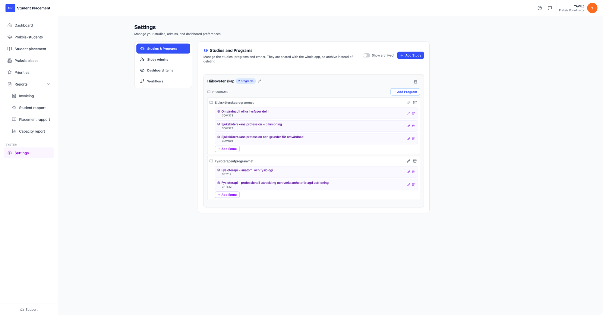
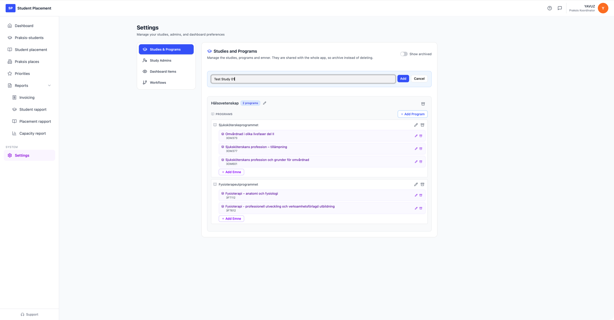
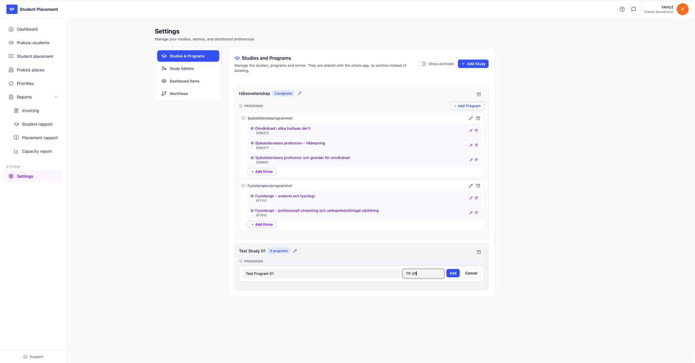
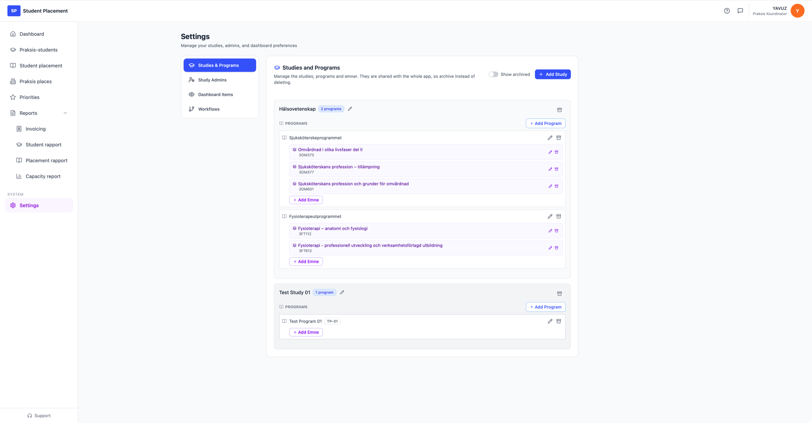
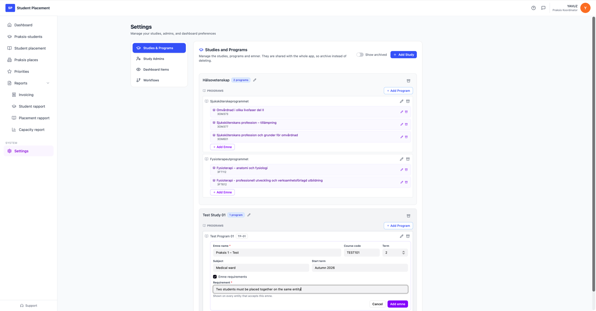
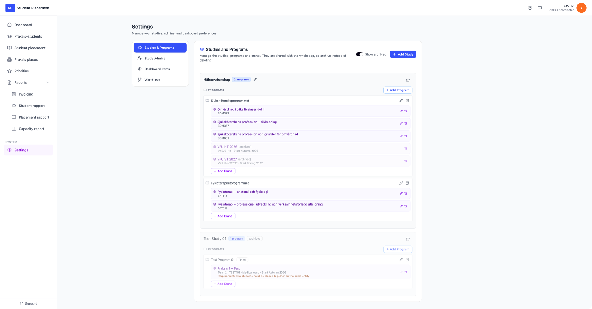

# Testscenario 01 — Innstillinger - Studier og programmer

:::info[Scenariooversikt]

- **Side:** Innstillinger → Studier og programmer
- **Rolle:** Praksiskoordinator (PK)
- **Mål:** Opprett et studium, legg til et program med programkode i det, og legg til et emne med detaljer i programmet.
- **Forutsetning:** Innlogget som PK. Siden kan allerede inneholde studier — flyten er den samme uansett.

:::

## Hva denne siden er

**Studier og programmer** er den første fanen på Innstillinger-siden (ved siden av **Studieadministratorer**, **Dashbord-elementer** og **Arbeidsflyter**), og det er her den faglige strukturen defineres: et **studium** inneholder ett eller flere **programmer**, og hvert program kan ha ett eller flere **emner**. Studier, programmer og emner deles med hele applikasjonen, og blir derfor **arkivert i stedet for slettet**: hvert studium, program og emne har et redigeringsikon (blyant) og et arkiveringsikon, og arkiverte elementer kan vises igjen med bryteren **Vis arkiverte** og gjenopprettes.

---

## Trinn

### 1. Start på Dashbord

Etter innlogging kommer du til **Dashbord**.

<figure>

<figcaption>Startpunkt — Dashbord</figcaption>

</figure>

### 2. Åpne Innstillinger → Studier og programmer

Klikk på **Innstillinger** i sidemenyen (under **System**). Innstillinger åpnes som standard på fanen **Studier og programmer**. Hvert studium vises som et kort med et merke for antall programmer; inne i kortet viser hvert program emnene sine med navn og emnekode.

<figure>

<figcaption>Studier og programmer — starttilstand med eksisterende studier</figcaption>

</figure>

### 3. Opprett et studium

Klikk på **Legg til studium** (øverst til høyre). Et felt med ledeteksten *"Skriv inn studienavn (f.eks. Helse-, sosial og idrettsfag)"* vises i raden. Skriv inn studienavnet — her `Test Study 01` — og klikk på **Legg til** (knappen er deaktivert til et navn er skrevet inn). Det nye studiekortet vises nederst i listen med merket **0 programmer** og hintet *"Ingen programmer er lagt til ennå. Klikk på «Legg til program» for å legge til ett."*

<figure>

<figcaption>Legg til studium — navn fylt inn i feltet</figcaption>

</figure>

### 4. Legg til et program

På det nye studiekortet klikker du på **Legg til program**. To felt vises i raden: programnavnet (*"Skriv inn programnavn (f.eks. Sykepleie)"*) og en **programkode** (*"Kode (f.eks. SYK-B)"*, maks 50 tegn). Skriv inn `Test Program 01` og koden `TP-01`, og klikk på **Legg til**.

<figure>

<figcaption>Legg til program — navn og kode fylt inn på kortet Test Study 01</figcaption>

</figure>

### 5. Program lagt til

Studiemerket viser nå **1 program**. Programraden viser koden som en etikett (**TP-01**), har egne ikoner for redigering (*Rediger programnavn og kode*) og arkivering, samt en **Legg til emne**-knapp.

<figure>

<figcaption>Test Program 01 lagt til — merket viser 1 program</figcaption>

</figure>

### 6. Legg til et emne i programmet

På programraden klikker du på **Legg til emne**. Skjemaet **Legg til emne** åpnes med disse feltene:

| Felt | Påkrevd | Eksempel |
|---|---|---|
| **Emnenavn** | Ja | `Praksis 1 – Test` |
| **Emnekode** | Nei (maks 50 tegn) | `TEST101` |
| **Semester** — semesteret i programmet | Nei (1–12) | `2` |
| **Fagområde** | Nei | `Medical ward` |
| **Oppstartssemester** | Nei | `Autumn 2026` |
| **Emnekrav** (avkrysningsboks) | Nei | — |

Når du krysser av for **Emnekrav**, vises feltet **Krav** (påkrevd så lenge boksen er krysset av, maks 300 tegn) — her `Two students must be placed together on the same entity`. Kravet *vises på hver enhet som tar imot dette emnet*. Fyll ut skjemaet og klikk på **Legg til emne** (deaktivert til de påkrevde feltene er fylt ut).

<figure>

<figcaption>Legg til emne — alle felt fylt ut, med et emnekrav</figcaption>

</figure>

---

## Sluttresultat

Studiet **Test Study 01** har nå **1 program** — **Test Program 01** (**TP-01**) med emnet **Praksis 1 – Test**. Emneraden viser detaljene som *"Term 2 · TEST101 · Medical ward · Start Autumn 2026"*, og under dette kravet i oransje.

<figure>

<figcaption>Sluttilstand — studium, program med kode, og ett emne med detaljer og et krav</figcaption>

</figure>

## Arkivere og gjenopprette (valgfritt)

Studier, programmer og emner kan ikke slettes — de arkiveres i stedet. Klikk på **arkiveringsikonet** på et studiekort, en programrad eller en emnerad.

:::warning

Arkiveringen skjer **umiddelbart** — det kommer ingen bekreftelsesdialog. Hvis du arkiverer noe ved en feil, gjenoppretter du det som beskrevet nedenfor.

:::

Arkiverte elementer skjules fra listen. Slå på bryteren **Vis arkiverte** (øverst til høyre, ved siden av **Legg til studium**) for å vise dem igjen: et arkivert studium er nedtonet med merket **Arkivert**, og et arkivert emne er merket *(arkivert)*. Klikk på **gjenopprett**-ikonet på elementet for å hente det tilbake.

<figure>

<figcaption>Vis arkiverte slått på — et arkivert studium og to arkiverte emner</figcaption>

</figure>

---

<ScenarioFeedback scenarioId="TS-01-studies-and-programs" />
