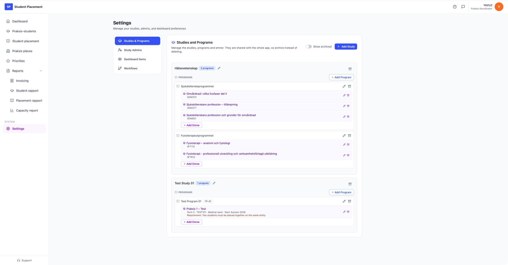
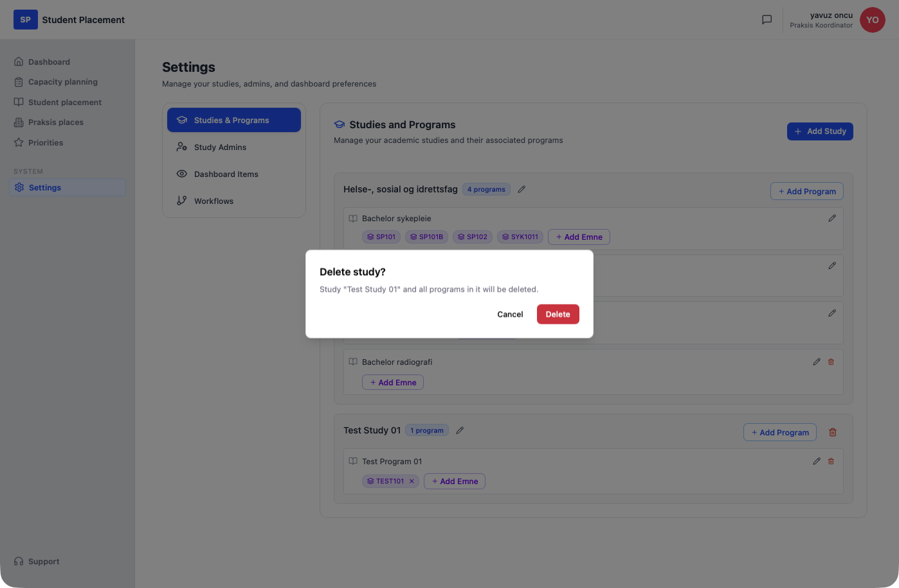

# Testscenario 01 — Innstillinger - Studier og programmer

:::info[Scenariooversikt]

- **Side:** Innstillinger → Studier og programmer
- **Rolle:** Praksiskoordinator (PK)
- **Mål:** Opprett et studium, legg til et program i det, og knytt et emne (kull) til programmet.
- **Forutsetning:** Innlogget som PK. Siden kan allerede inneholde studier — flyten er den samme uansett. I et helt tomt miljø vises i stedet *"Ingen studier er lagt til ennå — klikk på «Legg til studium» for å opprette ditt første studium."*

:::

## Hva denne siden er

**Studier og programmer** er den første fanen på Innstillinger-siden (ved siden av **Studieadministratorer**, **Dashbord-elementer** og **Arbeidsflyter**), og det er her den faglige strukturen defineres: et **studium** inneholder ett eller flere **programmer**, og hvert program kan eventuelt ha ett eller flere **emner** (kull). Hvert studium og program kan senere gis nytt navn (blyantikon) eller slettes (søppelbøtteikon). Denne strukturen styrer senere valg av studium/program andre steder i applikasjonen.

---

## Trinn

### 1. Start på Dashbord

Etter innlogging kommer du til **Dashbord**.

<figure>

<figcaption>Startpunkt — Dashbord</figcaption>

</figure>

### 2. Åpne Innstillinger → Studier og programmer

Klikk på **Innstillinger** i sidemenyen. Innstillinger åpnes som standard på fanen **Studier og programmer**, som viser eksisterende studier som kort med et merke for antall programmer.

<figure>

<figcaption>Studier og programmer — starttilstand med eksisterende studier</figcaption>

</figure>

### 3. Opprett et studium

Klikk på **Legg til studium** (øverst til høyre). Et felt med ledeteksten *"Skriv inn studienavn"* vises i raden. Skriv inn studienavnet — her `Test Study 01` — og klikk på **Legg til**. Det nye studiekortet vises nederst i listen med merket **0 programmer** og hintet *"Ingen programmer er lagt til ennå. Klikk på «Legg til program» for å legge til ett."*

<figure>

<figcaption>Legg til studium — navn fylt inn i feltet</figcaption>

</figure>

### 4. Legg til et program

På det nye studiekortet klikker du på **Legg til program**. Et felt med ledeteksten *"Skriv inn programnavn"* vises i raden. Skriv inn programnavnet — her `Test Program 01` — og klikk på **Legg til**.

<figure>

<figcaption>Legg til program — navn fylt inn på kortet Test Study 01</figcaption>

</figure>

### 5. Program lagt til

Studiemerket viser nå **1 program**. Programraden har egne ikoner for redigering (blyant) og sletting (søppelbøtte) samt en **Legg til emne**-knapp.

<figure>

<figcaption>Test Program 01 lagt til — merket viser 1 program</figcaption>

</figure>

### 6. Legg til et emne i programmet

På programraden klikker du på **Legg til emne**. Et felt med ledeteksten *"Emnekode"* vises i raden. Skriv inn emnenavnet — her `TEST101` — og klikk på **Legg til**. Emnet vises som en chip på programmet, med en **×** for å fjerne det igjen.

<figure>

<figcaption>Legg til emne — navn fylt inn for Test Program 01</figcaption>

</figure>

---

## Sluttresultat

Studiet **Test Study 01** har nå **1 program** — **Test Program 01** med emnet **TEST101** vist som en chip.

<figure>

<figcaption>Sluttilstand — studium, program og ett emne</figcaption>

</figure>

## Slette et studium (valgfritt)

Klikk på søppelbøtteikonet på et studiekort for å åpne en bekreftelsesdialog: *"Slette studium? Studiet «Test Study 01» og alle programmer i det blir slettet."* Klikk på **Slett** for å bekrefte eller **Avbryt** for å beholde studiet.

<figure>

<figcaption>Slette studium — bekreftelsesdialog</figcaption>

</figure>

---

<ScenarioFeedback scenarioId="TS-01-studies-and-programs" />
