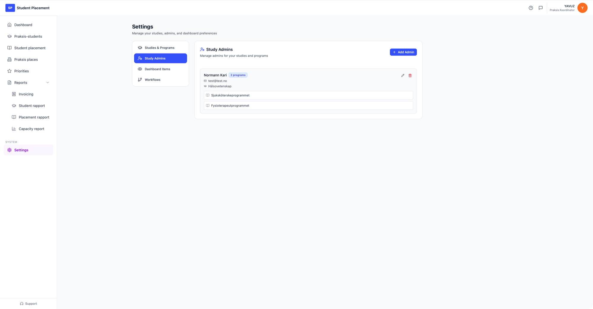
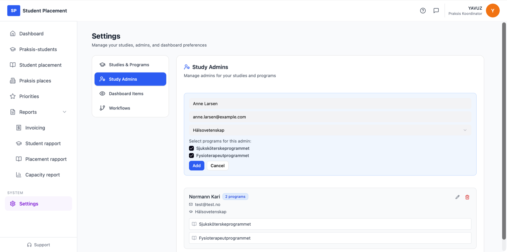
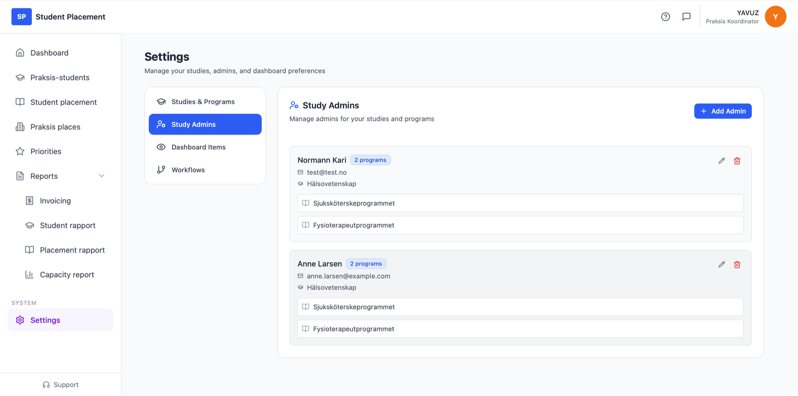
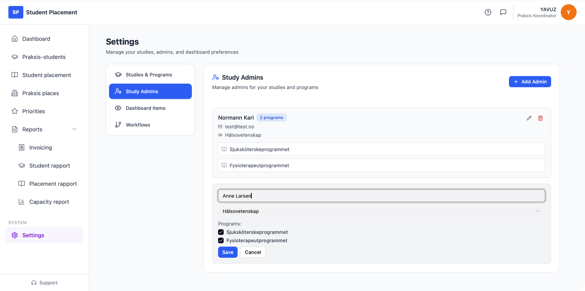
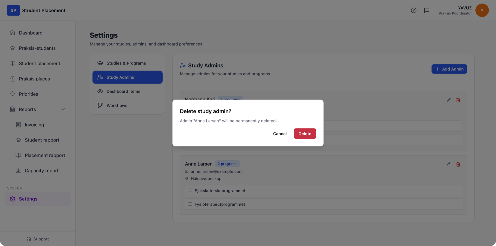

# Testscenario 02 — Innstillinger - Studieadministratorer

:::info[Scenariooversikt]

- **Side:** Innstillinger → Studieadministratorer
- **Rolle:** Praksiskoordinator (PK)
- **Mål:** Opprett en studieadministrator, og tildel vedkommende et studium og programmene i det.
- **Forutsetning:** Minst ett studium med programmer finnes (opprett ett først med *Testscenario 01*). Siden kan allerede vise andre administratorer — flyten er den samme uansett.

:::

## Hva denne siden er

**Studieadministratorer** (under Innstillinger) er der du gir personer administrativt ansvar for et
 studium og ett eller flere av programmene i det. Hver administrator har et navn, en e-postadresse, ett enkelt **studium** og et sett med
 **programmer** innenfor dette studiet.

---

## Trinn

### 1. Start på Dashbord

Etter innlogging kommer du til **Dashbord**.

<figure>

<figcaption>Startpunkt — Dashbord</figcaption>

</figure>

### 2. Åpne Innstillinger → Studieadministratorer

Klikk på **Innstillinger** i sidemenyen, og velg deretter fanen **Studieadministratorer**. Hver eksisterende administrator vises som et kort med navn, et merke for **antall programmer**, e-post, studium og programmene vedkommende forvalter, samt ikoner for redigering (blyant) og sletting (søppelbøtte).

<figure>

<figcaption>Studieadministratorer — starttilstand med én eksisterende administrator</figcaption>

</figure>

### 3. Legg til en administrator

Klikk på **Legg til administrator** (øverst til høyre). Et skjema åpnes øverst i listen:

1.  Skriv inn administratorens **navn** (*"Skriv inn administratornavn (f.eks. Anne Larsen)"*) — her `Anne Larsen`.
2.  Skriv inn administratorens **e-post** (*"Skriv inn administratorens e-post (f.eks. anne.larsen@example.com)"*) — her `anne.larsen@example.com`.
3.  Velg et studium fra nedtrekksmenyen **Velg et studium** — her *Hälsovetenskap*.
4.  Når et studium er valgt, vises listen *"Velg programmer for denne administratoren:"* med programmene i studiet. Kryss av for programmene administratoren skal forvalte — her **Sjuksköterskeprogrammet** og **Fysioterapeutprogrammet**.
5.  Klikk på **Legg til**.

<figure>

<figcaption>Legg til administrator — navn, e-post, studium og programmer valgt</figcaption>

</figure>

---

## Sluttresultat

Den nye administratoren vises nederst i listen med merket **2 programmer**, e-postadressen, studiet og
 programmene vedkommende forvalter.

<figure>

<figcaption>Sluttilstand — Anne Larsen opprettet med 2 programmer</figcaption>

</figure>

## Redigere en administrator (valgfritt)

Klikk på **blyantikonet** på et administratorkort. Kortet blir til et redigeringsskjema der du kan endre
 **navn**, **studium** og avkryssede **programmer**. E-postadressen kan ikke endres her. Klikk på **Lagre**
 for å bruke endringene eller **Avbryt** for å forkaste dem.

<figure>

<figcaption>Rediger administrator — navn, studium og programmer</figcaption>

</figure>

## Slette en administrator (valgfritt)

Klikk på **søppelbøtteikonet** på et administratorkort. En bekreftelsesdialog åpnes: *"Slette
 studieadministrator? Administratoren «Anne Larsen» blir slettet permanent."* Klikk på **Slett** for å
 bekrefte eller **Avbryt** for å beholde administratoren.

<figure>

<figcaption>Slette studieadministrator — bekreftelsesdialog</figcaption>

</figure>

## Merknader

-   **Studieadministratoren kan bare se data for valgte studier**

---

<ScenarioFeedback scenarioId="TS-02-study-admins" />
