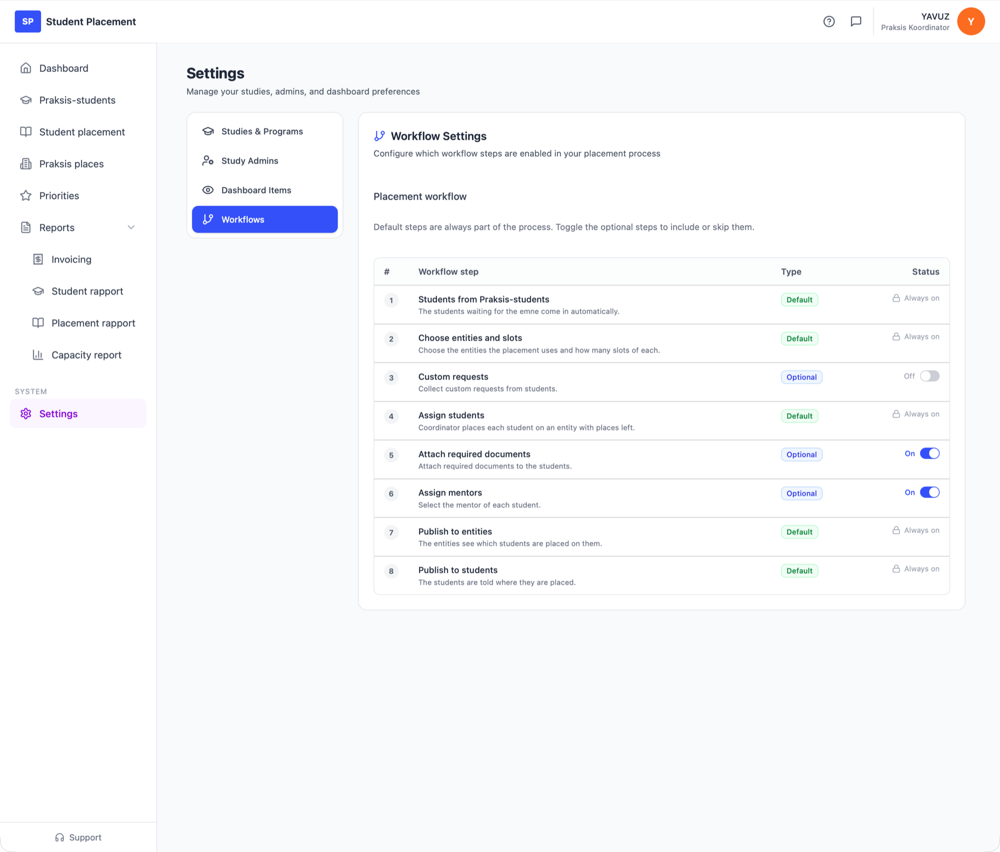
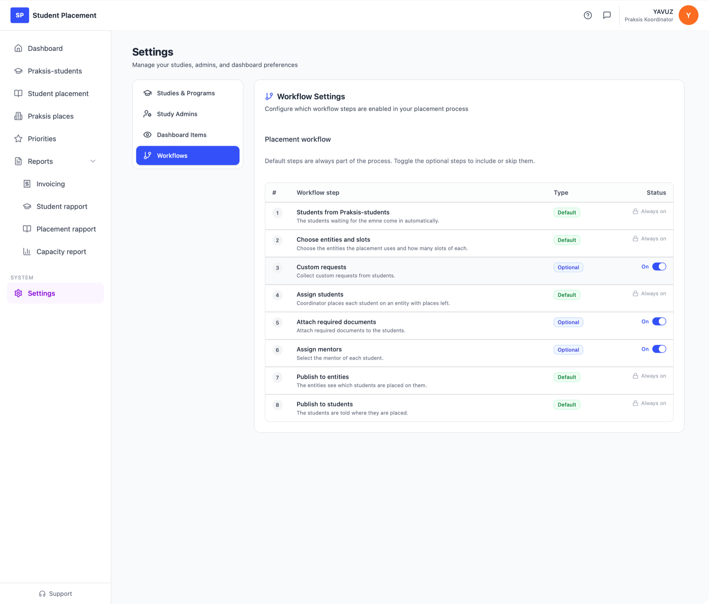

# Testscenario 03b — Innstillinger - Arbeidsflyter

:::info[Scenariooversikt]

- **Side:** Innstillinger → Arbeidsflyter
- **Rolle:** Praksiskoordinator (PK)
- **Mål:** Forstå trinnene i plasseringsarbeidsflyten, og slå et valgfritt trinn av eller på.

:::

## Hva denne siden er

**Arbeidsflyter** (under Innstillinger) — med tittelen **Arbeidsflytinnstillinger** — styrer hvilke trinn
 som er aktivert i plasseringsprosessen din. Tabellen **Plasseringsarbeidsflyt** viser alle trinnene i
 rekkefølge med **Type** og **Status**:

- **Standard**-trinn er alltid en del av prosessen. De viser en lås og *Alltid på*, og kan ikke slås av.
- **Valgfrie** trinn har en **På/Av**-bryter, slik at du kan ta dem med eller hoppe over dem.

| # | Arbeidsflyttrinn | Hva det gjør | Type |
|---|---|---|---|
| 1 | **Studenter fra Praksis-studenter** | Studentene som venter på emnet, kommer inn automatisk. | Standard |
| 2 | **Velg enheter og plasser** | Velg hvilke enheter plasseringen bruker og hvor mange plasser fra hver. | Standard |
| 3 | **Egne ønsker** | Samle inn egne ønsker fra studentene. | Valgfri |
| 4 | **Tildel studenter** | Koordinatoren plasserer hver student på en enhet med ledige plasser. | Standard |
| 5 | **Legg ved påkrevde dokumenter** | Legg ved påkrevde dokumenter til studentene. | Valgfri |
| 6 | **Tildel veiledere** | Velg veileder for hver student. | Valgfri |
| 7 | **Publiser til enheter** | Enhetene ser hvilke studenter som er plassert hos dem. | Standard |
| 8 | **Publiser til studenter** | Studentene får beskjed om hvor de er plassert. | Standard |

:::warning

Disse innstillingene gjelder plasseringsprosessen din, ikke én enkelt plassering. Endre dem bare når du
 mener det — og hvis du slår på et trinn bare for å prøve, slår du det av igjen etterpå.

:::

---

## Trinn

### 1. Åpne Innstillinger → Arbeidsflyter

Klikk på **Innstillinger** i sidemenyen, og velg fanen **Arbeidsflyter**. Se på gjeldende status for de
 tre valgfrie trinnene — her er **Egne ønsker** **Av**, mens **Legg ved påkrevde dokumenter** og
 **Tildel veiledere** er **På**.

<figure>

<figcaption>Arbeidsflytinnstillinger — 8 trinn; Egne ønsker er valgfri og av</figcaption>

</figure>

### 2. Slå på et valgfritt trinn

Klikk på bryteren for **Egne ønsker**. Statusen endres til **På**, og bekreftelsen
 *"Arbeidsflytinnstilling lagret"* vises. Det finnes ingen egen lagreknapp.

<figure>

<figcaption>Egne ønsker er nå på</figcaption>

</figure>

### 3. Slå det av igjen (valgfritt)

Klikk på den samme bryteren igjen for å sette **Egne ønsker** tilbake til **Av**. Bekreftelsen
 *"Arbeidsflytinnstilling lagret"* vises igjen.

---

## Sluttresultat

Tabellen **Plasseringsarbeidsflyt** viser valget ditt for hvert valgfrie trinn. Standardtrinnene forblir
 *Alltid på*.

---

<ScenarioFeedback scenarioId="TS-03b-workflows" />
