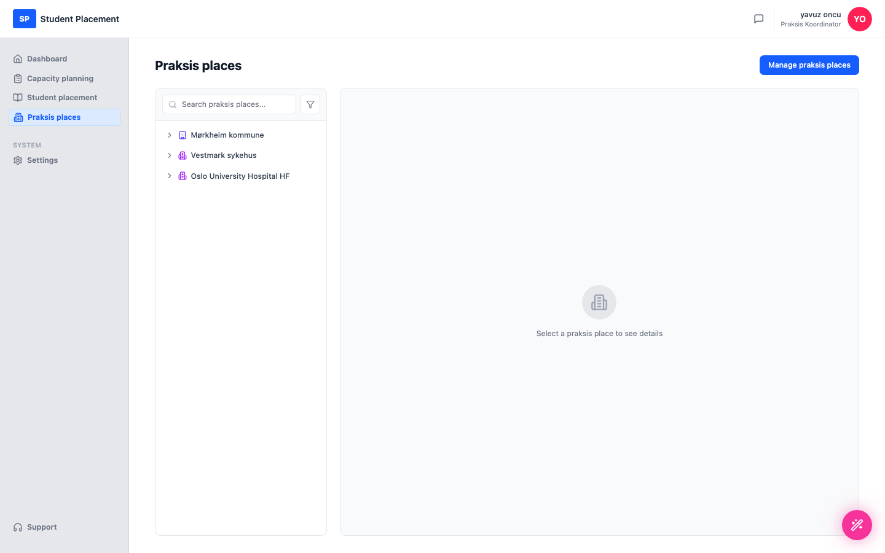
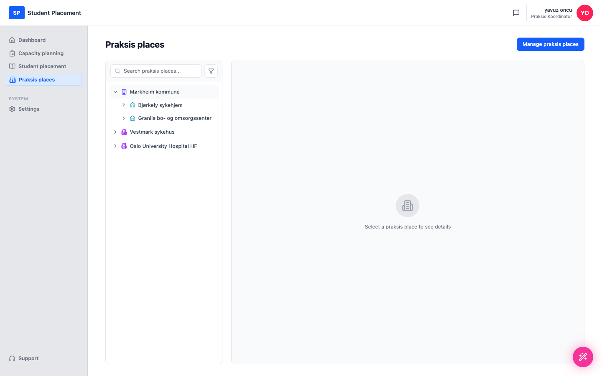
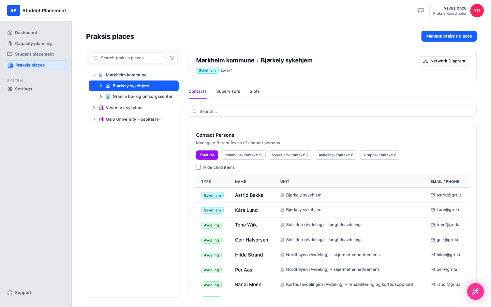
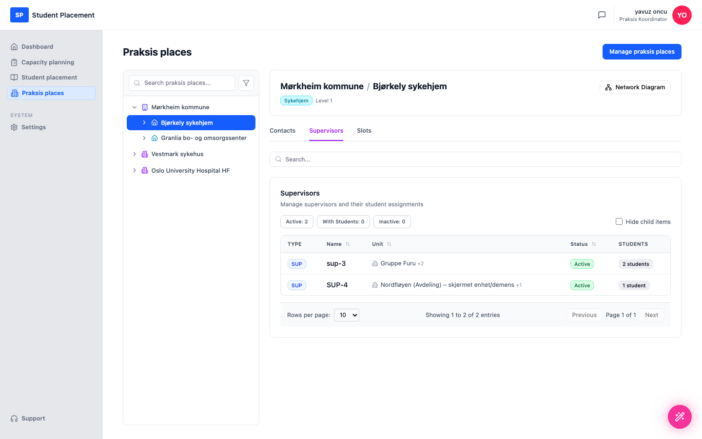
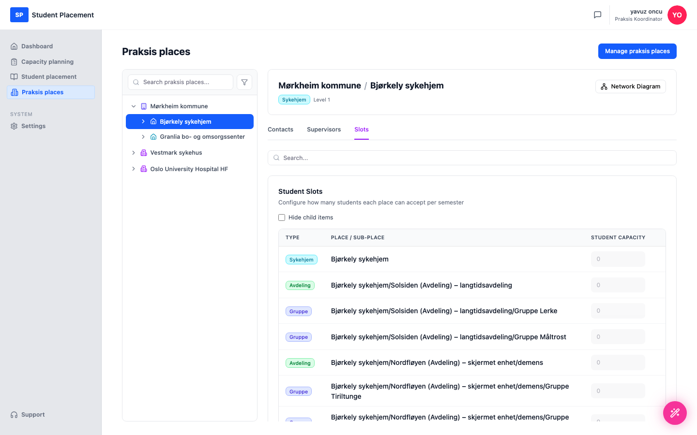

# Testscenario 05 — Utforsk et praksissted

:::info[Scenariooversikt]

- **Miljø:** Live — sp.mosoinpraxis.com/praksis-places
- **Rolle:** Praksiskoordinator
- **Mål:** Bla gjennom organisasjonstreet til et praksissted, og se på kontaktene, veilederne og studentplassene til en enhet.
- **Forutsetning:** Innlogget (passordfri innlogging via e-post). Minst ett praksissted er koblet til organisasjonen din.

:::

## Hva denne siden er

Siden **Praksissteder** har et navigerbart **organisasjonstre** til venstre (steder → understeder →
 avdelinger → grupper). Når du velger en enhet, vises detaljene til høyre fordelt på tre faner:
 **Kontakter**, **Veiledere** og **Plasser** (studentkapasitet).

---

## Trinn

### 1. Åpne Praksissteder

Klikk på **Praksissteder** i sidemenyen. Kolonnen til venstre viser de tilkoblede stedene, som hver kan utvides.

<figure>

<figcaption>Praksissteder — organisasjonstreet (til venstre)</figcaption>

</figure>

### 2. Utvid et praksissted

Klikk på pilen ved det første stedet (**Mørkheim kommune**) for å utvide enhetene — her
 **Bjørkely sykehjem** og **Granlia bo- og omsorgssenter**.

<figure>

<figcaption>Mørkheim kommune utvidet — understedene vises</figcaption>

</figure>

### 3. Velg en enhet → Kontakter

Klikk på en enhet i treet — her **Bjørkely sykehjem**. Panelet til høyre åpnes på
 **Kontakter**-fanen.

<figure>

<figcaption>Kontakter — kontaktpersoner per nivå (Kommune / Sykehjem / Avdeling / Gruppe), med totaler</figcaption>

</figure>

**Kontakter** viser kontaktpersonene som er knyttet til hvert organisasjonsnivå, med antall per
 nivå (f.eks. *Totalt 14*), enhet og e-post/telefon. *Skjul underelementer* begrenser visningen til kun den valgte enheten.

### 4. Veiledere

Bytt til **Veiledere**-fanen for å se veilederne for enheten og studenttildelingene
 deres, med tellere for status (*Active / Inactive / With students*).

<figure>

<figcaption>Veiledere — veiledere, enheten deres, status og tildelte studenter</figcaption>

</figure>

### 5. Plasser

Bytt til **Plasser**-fanen for å se **studentkapasiteten** som er konfigurert for stedet og hvert
 av understedene per semester.

<figure>

<figcaption>Plasser — studentkapasitet per sted / understed</figcaption>

</figure>

---

<ScenarioFeedback scenarioId="TS-05-explore-praksis-place" />
