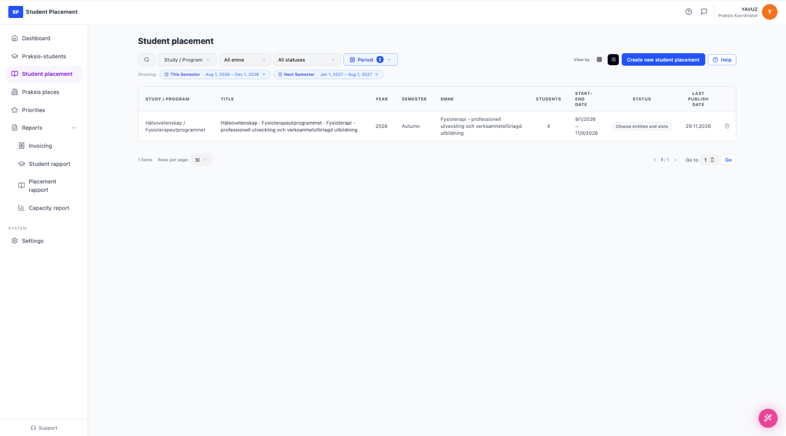
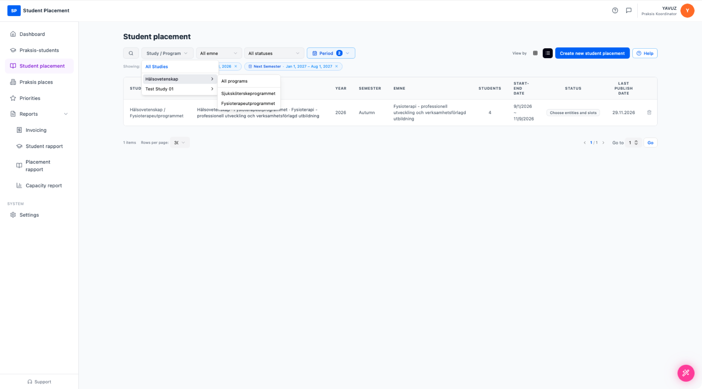
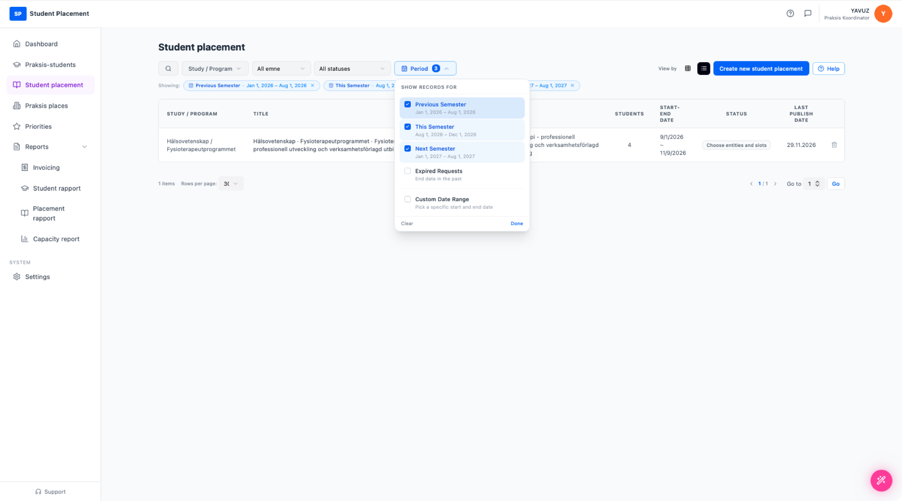
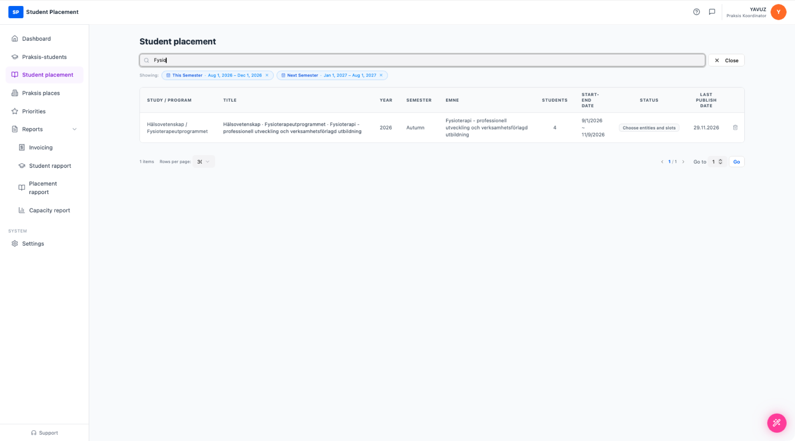
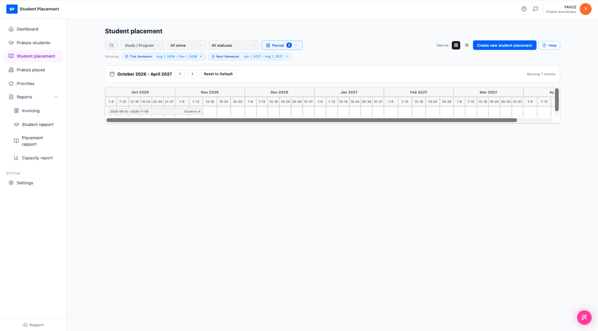

# Testscenario 07 — Studentplassering - Oversikt

:::info[Scenariooversikt]

- **Side:** Studentplassering
- **Rolle:** Praksiskoordinator (PK)
- **Mål:** Bli kjent med siden Studentplassering — kolonnene, filtrene, periodevelgeren, de to *Vis som*-modusene og de andre handlingene.
- **Forutsetning:** Logget inn som PK. Denne gjennomgangen bruker den eksisterende plasseringen **Hälsovetenskap · Fysioterapeutprogrammet · Fysioterapi - professionell utveckling och verksamhetsförlagd utbildning** (høst 2026, 4 studenter).

:::

## Hva denne siden er

**Studentplassering** viser alle plasseringene dine. En plassering tar studentene som venter på et emne
 (fra *Praksis-studenter*) gjennom plasseringsarbeidsflyten til de er plassert og publisert. Fra denne
 siden finner, filtrerer og åpner du plasseringer, og starter nye.

### Verktøylinje

| Kontroll | Hva den gjør |
|---|---|
| **Søk** (forstørrelsesglass) | Åpner et søkefelt — *søk i plasseringer etter tittel* — som erstatter verktøylinjen til du klikker på **Lukk**. |
| **Studium / Program** | Meny i to nivåer: **Alle studier**, eller hold over et studium og velg **Alle programmer** eller ett program. |
| **Alle emner** | Begrenser listen til ett emne. |
| **Alle statuser** | Begrenser listen til plasseringer på ett arbeidsflyttrinn (se *Status* nedenfor). |
| **Periode** | Velger hvilke tidsperioder som vises; merket viser hvor mange som er aktive. |
| **Vis som** | Bytter mellom **Kalendervisning** (rutenettikon) og **Tabellvisning** (listeikon). |
| **Opprett ny studentplassering** | Starter en ny plassering (*trinn 1 av 7*). Beskrives i neste scenario. |
| **Hjelp** | Åpner hjelpesenteret i en ny fane. |

Under verktøylinjen viser **Viser:** de aktive periodene som brikker (f.eks. *This Semester · Aug 1, 2026 –
 Dec 1, 2026*). Klikk på **×** på en brikke for å fjerne perioden.

### Kolonner (tabellvisning)

| Kolonne | Innhold |
|---|---|
| **Studium / Program** | Studiet og programmet plasseringen hører til. |
| **Tittel** | Plasseringens tittel — som standard bygd av *studium · program · emne*. |
| **År** / **Semester** | Når plasseringen går (f.eks. *2026*, *Autumn*). |
| **Emne** | Emnet som studentene plasseres for. |
| **Studenter** | Antall studenter i plasseringen. |
| **Start–sluttdato** | Plasseringsperioden (f.eks. *9/1/2026 ~ 11/9/2026*). |
| **Status** | Arbeidsflyttrinnet plasseringen er på (f.eks. *Velg enheter og plasser*). |
| **Siste publiseringsdato** | *Siste publiseringsdato* som ble angitt da plasseringen ble opprettet. |
| *(søppelbøtteikon)* | Sletter plasseringen. |

Klikk hvor som helst på en rad for å åpne plasseringen. Under tabellen ser du antall elementer, **Rader per
 side** og sidenavigering (**Gå til** et sidetall).

### Status

Filteret **Alle statuser** viser trinnene en plassering kan være på: *Studenter fra Praksis-studenter*,
 *Velg enheter og plasser*, *Første publisering*, *Knytt praksisplasser til studentene*, *Legg ved påkrevde
 dokumenter*, *Tildel veiledere til studentene*, *Publiser til enheter*, *Publiser til studenter* og
 *Fullført*. Hvilke valgfrie trinn som brukes, stilles inn under *Innstillinger → Arbeidsflyter* (se
 *Testscenario 03b*).

---

## Trinn

### 1. Åpne Studentplassering

Klikk på **Studentplassering** i sidemenyen. Siden åpnes i **Tabellvisning** med standardperiodene
 **This Semester** og **Next Semester** (Periode-merket *2*). Her vises én plassering, med status
 **Velg enheter og plasser**.

<figure>

<figcaption>Studentplassering — verktøylinje, aktive perioder og plasseringstabellen</figcaption>

</figure>

### 2. Filtrer på studium og program

Klikk på **Studium / Program** og hold over **Hälsovetenskap**. En undermeny viser **Alle programmer**,
 **Sjuksköterskeprogrammet** og **Fysioterapeutprogrammet** — klikk på ett for å filtrere listen. Bruk
 **Alle emner** og **Alle statuser** på samme måte for å snevre inn videre.

<figure>

<figcaption>Studium / Program — velg et studium, deretter alle eller ett av programmene</figcaption>

</figure>

### 3. Velg periode

Klikk på **Periode**. Under **Vis poster for** kan du krysse av for:

- **Forrige semester**, **Dette semesteret**, **Neste semester** — med datoområdene sine;
- **Utløpte** — plasseringer der *sluttdatoen er passert*;
- **Egendefinert datoområde** — velg en **Fra**- og **Til**-dato (*begge datoene må velges før filteret
  brukes*). Et egendefinert område slår av de andre valgene.

Hvert valg legges til som en brikke under **Viser:**. Klikk på **Ferdig** for å lukke menyen; **Fjern**
 fjerner alle perioder — da vises ingen plasseringer før du velger en periode igjen.

<figure>

<figcaption>Periode — forrige semester lagt til de to standardsemestrene</figcaption>

</figure>

### 4. Søk på tittel

Klikk på **forstørrelsesglasset**. Verktøylinjen erstattes av et søkefelt — skriv en del av en tittel, her
 `Fysio`. Listen viser plasseringene som passer innenfor de aktive periodene. Klikk på **Lukk** for å få
 verktøylinjen tilbake.

<figure>

<figcaption>Søk i plasseringer etter tittel</figcaption>

</figure>

### 5. Bytt til kalendervisning

Under **Vis som** klikker du på **rutenett**-ikonet. Hver plassering tegnes som en stolpe over månedene den
 går, med datoer og antall studenter (*2026-09-01 ~2026-11-09 · Students 4*). Overskriften viser det synlige
 området (*October 2026 - April 2027*, *7 måneder*); bruk **‹ ›** for å flytte og **Tilbakestill** for å gå
 tilbake. Klikk på **liste**-ikonet for å gå tilbake til **Tabellvisning**.

<figure>

<figcaption>Kalendervisning — plasseringer på en månedstidslinje</figcaption>

</figure>

---

## Sluttresultat

Koordinatoren vet hvordan plasseringstabellen leses, hvordan den snevres inn på studium/program, emne, status,
 periode og tittel, hvordan man bytter mellom tabell- og kalendervisning, og hvor en ny plassering startes.

## Merknader

-   Filtrene og perioden virker sammen — hvis en plassering mangler, sjekk først brikkene under **Viser:**.
-   Å opprette en plassering (**Opprett ny studentplassering**) beskrives i neste scenario.

---

<ScenarioFeedback scenarioId="TS-07-student-placement-overview" />
