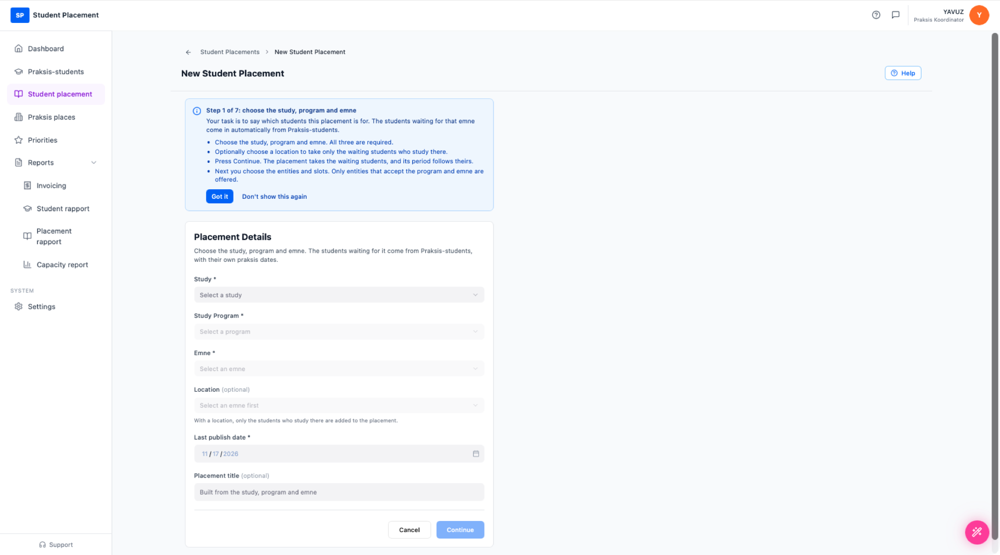
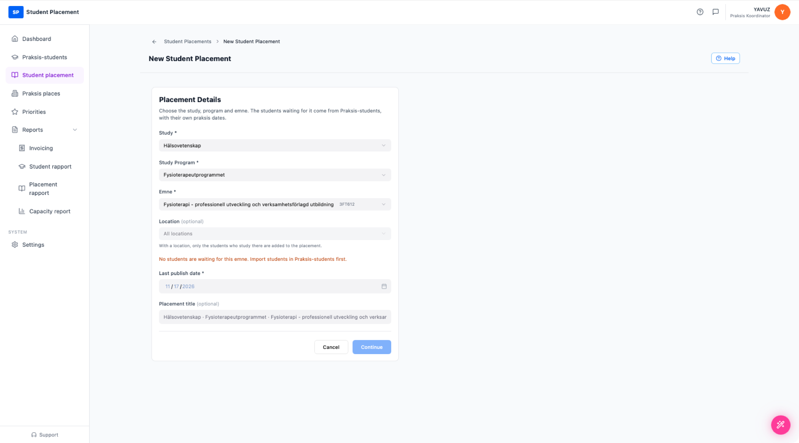
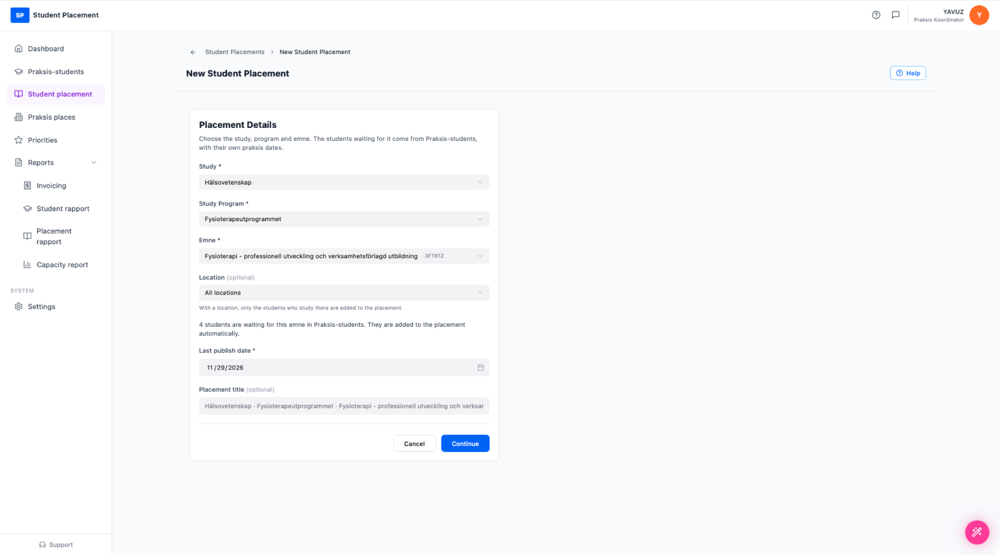
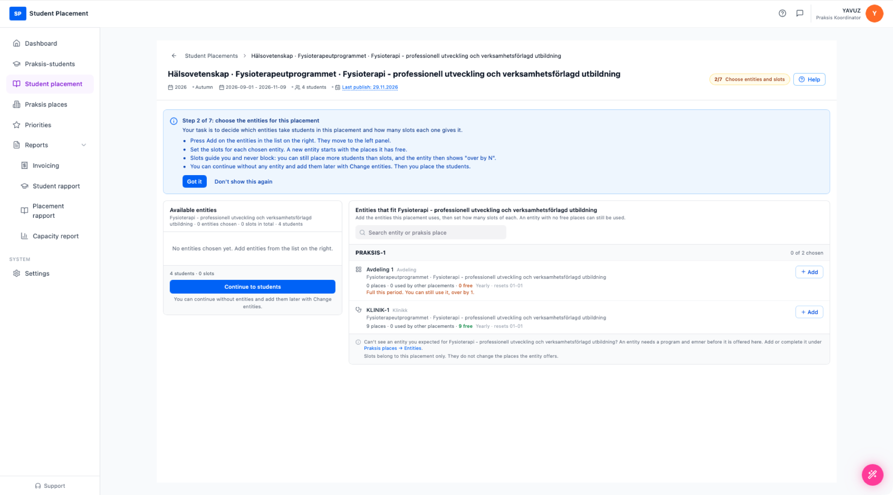

# Testscenario 08 — Studentplassering - Opprett

:::info[Scenariooversikt]

- **Side:** Studentplassering → Ny studentplassering
- **Rolle:** Praksiskoordinator (PK)
- **Mål:** Opprette en ny studentplassering for et emne, slik at studentene som venter på emnet, tas inn i den.
- **Forutsetning:** Logget inn som PK. Studenter for emnet venter i *Praksis-studenter* (se *Testscenario 06*). Denne gjennomgangen bruker **Hälsovetenskap → Fysioterapeutprogrammet → Fysioterapi - professionell utveckling och verksamhetsförlagd utbildning (3FT612)**, med 4 ventende studenter.

:::

## Hva denne siden er

**Ny studentplassering** er *trinn 1 av 7* i en plassering. Du angir **hvilke studenter** plasseringen
 gjelder ved å velge studium, program og emne — studentene som venter på emnet i **Praksis-studenter**,
 legges til automatisk, og plasseringsperioden følger praksisdatoene deres. Du legger ikke inn studenter
 eller datoer for hånd.

Skjemaet **Plasseringsdetaljer** har disse feltene:

| Felt | Merknader |
|---|---|
| **Studium** * | Studiet. |
| **Studieprogram** * | Aktiveres når et studium er valgt; viser studiets programmer. |
| **Emne** * | Aktiveres når et program er valgt; viser programmets emner med emnekode (f.eks. *3FT612*). |
| **Sted** (valgfritt) | *Alle steder* som standard. Viser stedene til de ventende studentene med antall (f.eks. *Umeå · 4 waiting*). Med et sted legges bare studentene som studerer der, til i plasseringen. |
| **Siste publiseringsdato** * | Må være **i dag eller senere**. |
| **Plasseringstittel** (valgfritt) | La feltet stå tomt for å bruke tittelen bygd av *studium · program · emne*, som vises som plassholder. |

En infoboks øverst forklarer trinnet. Klikk på **Skjønner** for å lukke den, eller **Ikke vis dette igjen**
 for å skjule den for godt.

---

## Trinn

### 1. Åpne Ny studentplassering

På siden **Studentplassering** (se *Testscenario 07*) klikker du på **Opprett ny studentplassering**. Siden
 **Ny studentplassering** åpnes med infoboksen *trinn 1 av 7: velg studium, program og emne* og det tomme
 skjemaet **Plasseringsdetaljer**. **Fortsett** er deaktivert til skjemaet er fullført.

<figure>

<figcaption>Ny studentplassering — trinn 1 av 7 med tomt skjema</figcaption>

</figure>

### 2. Velg studium, program og emne

Velg **Studium** `Hälsovetenskap`, **Studieprogram** `Fysioterapeutprogrammet` og **Emne**
 `Fysioterapi - professionell utveckling och verksamhetsförlagd utbildning` (*3FT612*). Under **Sted**
 viser skjemaet nå hvor mange studenter som venter: *4 studenter venter på dette emnet i Praksis-studenter.
 De legges til i plasseringen automatisk.*

:::note[Ingen ventende studenter?]

Hvis alle studentene i emnet allerede er i en annen plassering — eller ingen er importert — viser skjemaet
 *ingen studenter venter på dette emnet; importer studenter i Praksis-studenter først*, og **Fortsett**
 forblir deaktivert.

<figure>

<figcaption>Ingen studenter venter på emnet — Fortsett er deaktivert</figcaption>

</figure>

:::

### 3. Sted, siste publiseringsdato og tittel

La **Sted** stå på **Alle steder** for å ta med alle ventende studenter (her er det eneste stedet
 *Umeå · 4 waiting*). Velg en **Siste publiseringsdato** — her `29.11.2026`; den må være i dag eller
 senere. La **Plasseringstittel** stå tom for å bruke den foreslåtte tittelen. **Fortsett** er nå aktivert.

<figure>

<figcaption>Plasseringsdetaljer fylt ut — 4 studenter venter, Fortsett er aktivert</figcaption>

</figure>

### 4. Klikk på Fortsett

Klikk på **Fortsett**. Plasseringen opprettes og åpnes på sin egen side:

- **Tittel:** *Hälsovetenskap · Fysioterapeutprogrammet · Fysioterapi - professionell utveckling och
  verksamhetsförlagd utbildning*
- **Detaljer:** *2026 · Autumn · 2026-09-01 - 2026-11-09 · 4 students* — perioden kommer fra studentenes
  praksisdatoer.
- **Last publish: 29.11.2026** — klikk for å endre siste publiseringsdato.
- **Statusmerke:** **2/7 Velg enheter og plasser** — plasseringen går rett videre til trinn 2.

<figure>

<figcaption>Plassering opprettet — nå på trinn 2/7, Velg enheter og plasser</figcaption>

</figure>

---

## Sluttresultat

En ny plassering finnes for emnet, med de 4 ventende studentene lagt til automatisk. Den vises i listen
 **Studentplassering** med status *Velg enheter og plasser*, og i **Praksis-studenter** endres studentene fra
 *Venter* til *I plassering*.

## Merknader

-   Studenter som allerede er i en plassering, venter ikke lenger og tas derfor ikke inn i en annen
    plassering. Bruk **Sted** for å opprette en plassering for bare en del av de ventende studentene.
-   Å velge enheter og plasser (trinn 2) beskrives i neste scenario.

---

<ScenarioFeedback scenarioId="TS-08-create-placement" />
