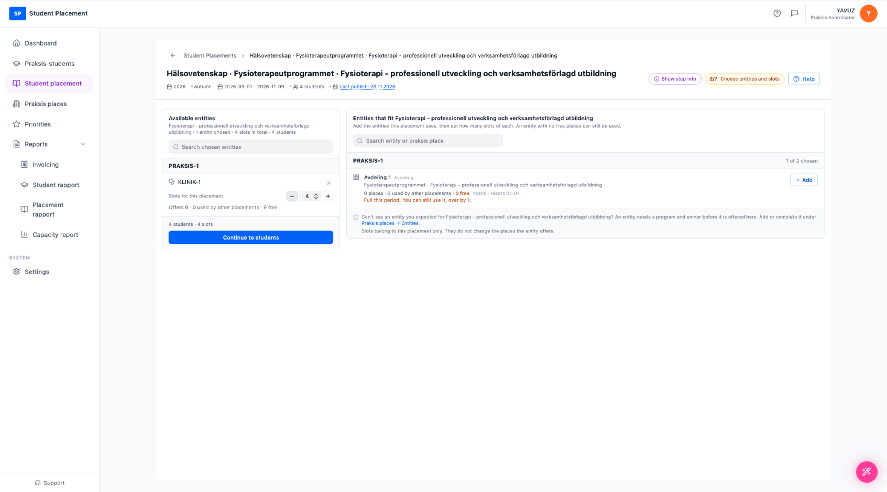
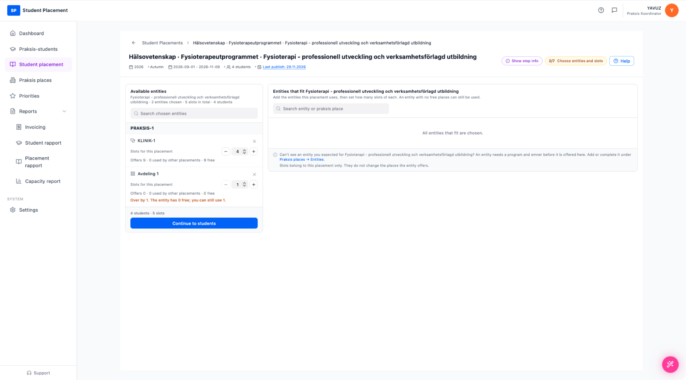
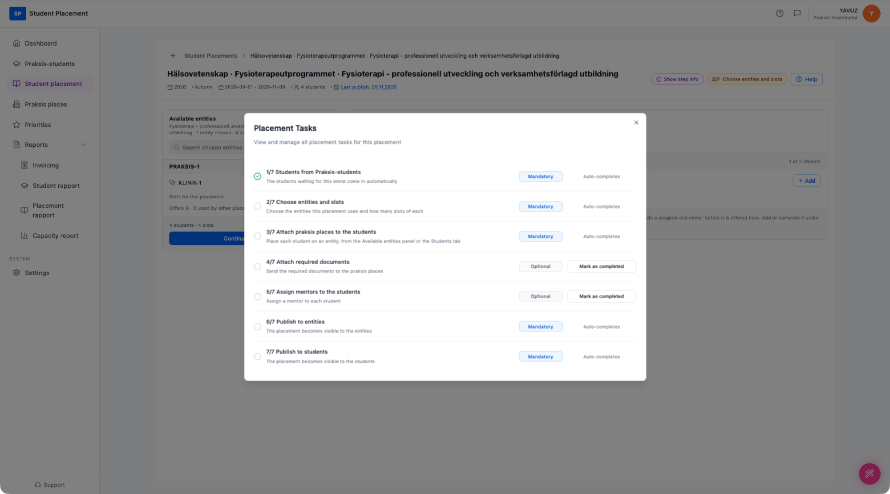

# Testscenario 09 — Studentplassering - Velg enheter og plasser

:::info[Scenariooversikt]

- **Side:** Studentplassering → *plassering* (trinn 2/7, *Velg enheter og plasser*)
- **Rolle:** Praksiskoordinator (PK)
- **Mål:** Velge hvilke enheter som tar imot studenter i denne plasseringen, og hvor mange plasser hver av dem gir.
- **Forutsetning:** En plassering er opprettet (se *Testscenario 08*). Denne gjennomgangen fortsetter med **Hälsovetenskap · Fysioterapeutprogrammet · Fysioterapi - professionell utveckling och verksamhetsförlagd utbildning** (4 studenter).

:::

## Hva denne siden er

Rett etter at en plassering er opprettet, åpnes den på **trinn 2 av 7: velg enhetene for denne
 plasseringen**. Siden har to paneler:

- **Enheter som passer …** (til høyre) — alle enheter som tar imot plasseringens program og emne, gruppert
  etter praksissted (f.eks. **PRAKSIS-1** · *0 av 2 valgt*). Hver enhet viser type, program · emne og
  kapasitet: *plasser · brukt av andre plasseringer · ledige* og hvor ofte den nullstilles (f.eks. *Årlig ·
  nullstilles 01-01*). En enhet uten ledige plasser viser at den er *full denne perioden, men fortsatt kan
  brukes, over med 1*. Bruk søkefeltet for å finne en enhet eller et praksissted.
- **Tilgjengelige enheter** (til venstre) — enhetene du har valgt for plasseringen, hver med **Plasser for
  denne plasseringen** (**−** / tall / **+**) og en fjernknapp (**×**). Linjen nederst oppsummerer
  *studenter · plasser* og har knappen **Fortsett til studenter**.

| Begrep | Betydning |
|---|---|
| **Places** (enhetens plasser) | Det enheten tilbyr totalt, for alle plasseringer. |
| **Slots** (plasseringens plasser) | Hvor mange av dem denne plasseringen bruker. De hører bare til denne plasseringen og endrer ikke det enheten tilbyr. |

:::tip

Plassene er veiledende og blokkerer aldri: du kan plassere flere studenter enn plasser, og enheten viser da
 *«over by N»*. Du kan også fortsette uten enheter og legge dem til senere med **Endre enheter**.

:::

Hvis en enhet du forventer mangler, trenger den program og emner først — legg den til eller fullfør den under
 **Praksissteder → Enheter**.

---

## Trinn

### 1. Start på trinn 2

Åpne plasseringen (eller fortsett rett fra *Testscenario 08*). Overskriften viser tittelen,
 *2026 · Autumn · 2026-09-01 - 2026-11-09 · 4 students*, **Last publish: 29.11.2026** og trinnmerket
 **2/7 Velg enheter og plasser**. Venstre panel sier at ingen enheter er valgt ennå. Lukk infoboksen med
 **Skjønner** — du kan åpne den igjen med **Vis trinninfo**.

<figure>

<figcaption>Trinn 2 av 7 — enhetene som passer, vises til høyre</figcaption>

</figure>

### 2. Legg til en enhet og angi plasser

Klikk på **Legg til** ved **KLINIK-1** (*9 places · 0 used by other placements · 9 free*). Den flyttes til
 **Tilgjengelige enheter** og starter med sine ledige plasser (**9**). Klikk på **−** til plassene er **4** —
 én for hver student. Oppsummeringen viser nå *1 enhet valgt · 4 plasser totalt · 4 studenter*, og linjen
 nederst *4 studenter · 4 plasser*.

<figure>

<figcaption>KLINIK-1 valgt — 4 plasser for denne plasseringen</figcaption>

</figure>

### 3. (Valgfritt) Legg til en enhet uten ledige plasser

Klikk på **Legg til** ved **Avdeling 1** (*0 places · 0 free*). Den legges til med **1** plass og en advarsel:
 *over med 1; enheten har 0 ledige, men du kan fortsatt bruke 1*. Høyre panel sier nå at alle enheter som
 passer, er valgt. Klikk på **×** (*Fjern Avdeling 1*) for å ta den ut igjen — den går tilbake til listen til
 høyre.

<figure>

<figcaption>En enhet uten ledige plasser kan fortsatt brukes — den viser «Over by 1»</figcaption>

</figure>

### 4. (Valgfritt) Se plasseringsoppgavene

Klikk på trinnmerket **2/7 Velg enheter og plasser** i overskriften. Dialogen **Plasseringsoppgaver** viser alle
 sju trinnene med status. Obligatoriske trinn *fullføres automatisk*; valgfrie trinn (*Legg ved påkrevde
 dokumenter*, *Tildel veiledere til studentene*) har knappen **Merk som fullført**. Lukk dialogen med **×**.

<figure>

<figcaption>Plasseringsoppgaver — trinn 1 er fullført, trinn 2 pågår</figcaption>

</figure>

### 5. Fortsett til studenter

Med **KLINIK-1 · 4 plasser** valgt klikker du på **Fortsett til studenter**. Plasseringen går videre til
 **3/7 Knytt praksisplasser til studentene**: venstre panel viser **KLINIK-1** med *4 / 4* ledige plasser og
 *0 plassert her*, og tabellen **Studenter** viser de 4 studentene, alle *ikke tildelt*. Bruk **Endre enheter**
 (øverst i venstre panel) for å gå tilbake og endre enheter eller plasser.

<figure>

<figcaption>Trinn 3 av 7 — KLINIK-1 med 4 plasser, 4 studenter skal plasseres</figcaption>

</figure>

---

## Sluttresultat

Plasseringen bruker **KLINIK-1** med **4 plasser** for de 4 studentene og er nå på trinn **3/7 Knytt
 praksisplasser til studentene**.

## Merknader

-   Å plassere studentene på enheten (trinn 3) beskrives i neste scenario.

---

<ScenarioFeedback scenarioId="TS-09-choose-entities" />
