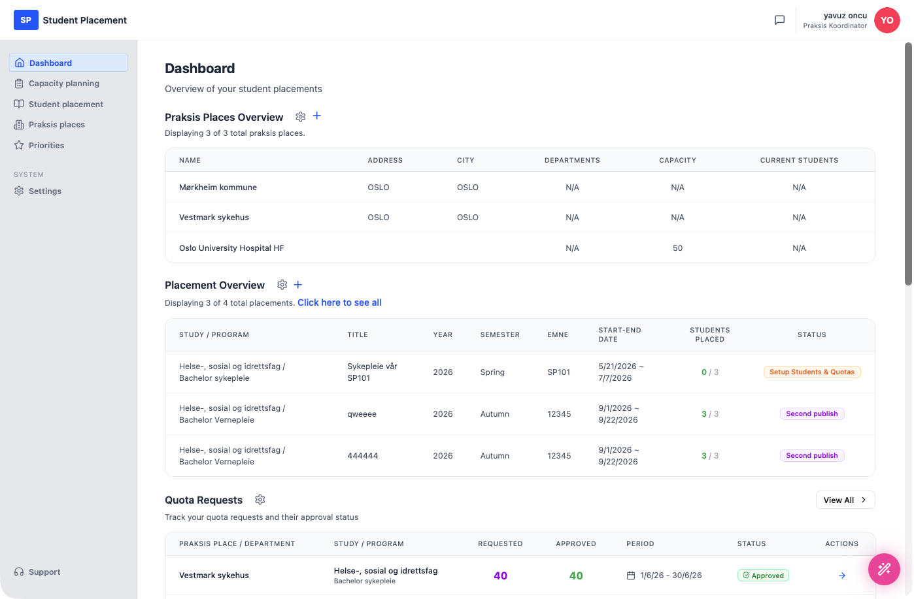
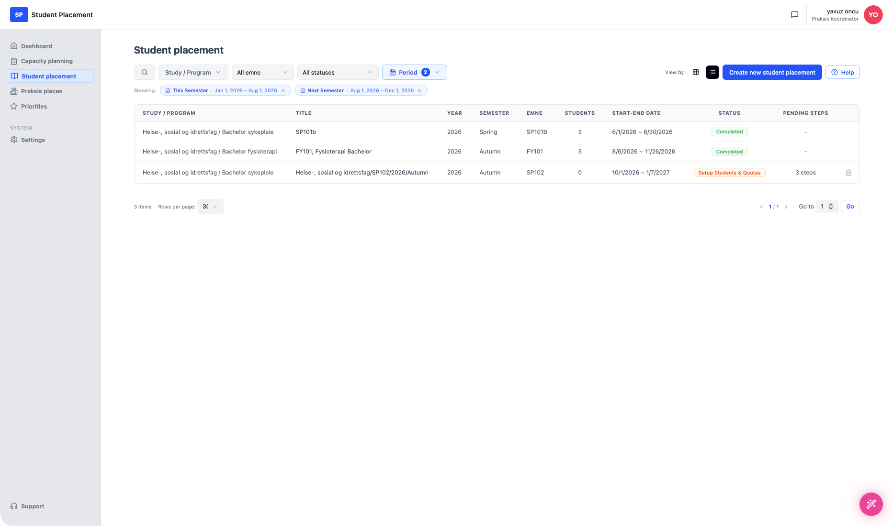
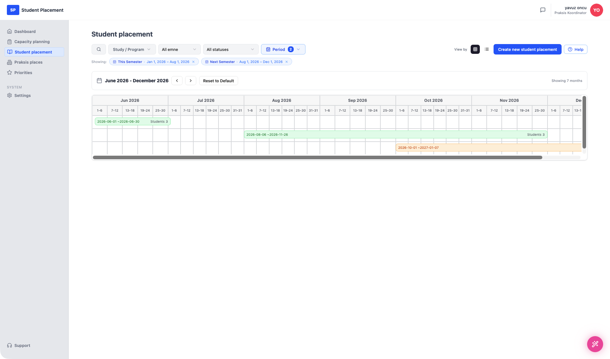
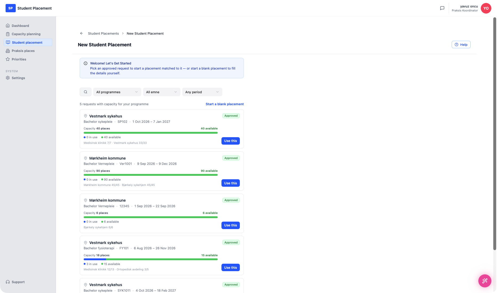
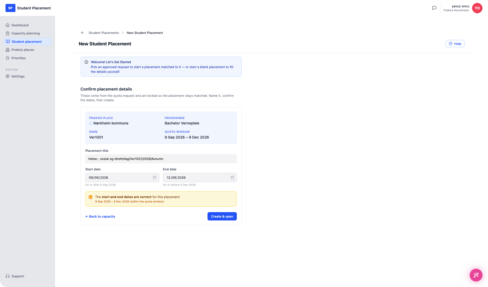
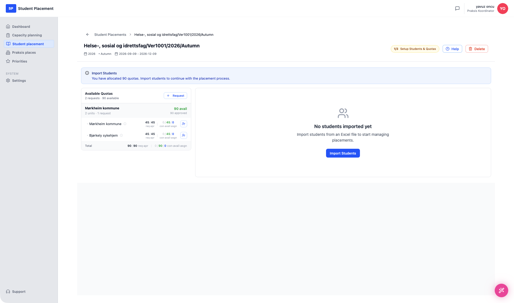

# Testscenario 09 — Student plassering - Opprett

:::info[Scenariooversikt]

- **Side:** Student plassering → Ny student plassering
- **Rolle:** Praksiskoordinator (PK)
- **Mål:** Opprett en studentplassering fra en **godkjent kvoteforespørsel**, slik at plasseringen er koblet til forespørselen fra starten av.
- **Forutsetning:** Minst én godkjent kvoteforespørsel med ledig kapasitet finnes (opprettet via Kapasitetsplanlegging). Plasseringsskjemaet fylles ikke lenger ut manuelt — detaljene kommer fra forespørselen du velger.

:::

## Hva denne siden er

**Student plassering** viser alle plasseringer for programmene dine. Øverst finnes filtre (**Studium / program**, **emne**, **status** og en **Periode**-velger — de aktive periodene vises som fjernbare chips, f.eks. *This Semester · Jan 1, 2026 – Aug 1, 2026*). **Vis etter**-bryteren veksler mellom to visninger:

- **Tabellvisning** — én rad per plassering med Studium/program, Tittel, År, Semester, Emne, antall Studenter, Start–sluttdato, Status og Ventende trinn, pluss paginering.
- **Kalendervisning** — en tidslinje over måneder (f.eks. *June 2026 – December 2026*, "Showing 7 months") der hver plassering tegnes som en horisontal stolpe over start–sluttdatoene sine, merket med datointervall og antall studenter. Pilene flytter det synlige vinduet, og **Tilbakestill til standard** gjenoppretter det.

---

## Trinn

### 1. Start på Dashbord

<figure>

<figcaption>Startpunkt — Dashbord</figcaption>

</figure>

### 2. Åpne Student plassering

Klikk på **Student plassering** i sidemenyen. Listen åpnes i visningen du brukte sist — her **tabellvisningen**.

<figure>

<figcaption>Student plassering — tabellvisning med filtre og periode-chips</figcaption>

</figure>

Bytter du **Vis etter** til kalenderen, vises de samme plasseringene som stolper på en månedstidslinje:

<figure>

<figcaption>Student plassering — kalendervisning (plasseringer tegnet over datointervallene sine)</figcaption>

</figure>

### 3. Klikk på "Opprett ny student plassering"

Siden **Ny student plassering** åpnes med meldingen *"Velkommen! La oss komme i gang — velg en godkjent forespørsel for å starte en plassering som er koblet til den, eller start en tom plassering og fyll inn detaljene selv."*

Den viser de godkjente kvoteforespørslene med kapasitet for programmet ditt (her *"5 forespørsler med kapasitet for programmet ditt"*), filtrerbare på **program**, **emne** og **periode**. Hvert kort viser praksisstedet, programme · emne · periode, et **Godkjent**-merke, en kapasitetslinje (plasser i bruk vs. ledige), fordelingen per enhet og en **Bruk denne**-knapp. Du kan også velge **Start en tom plassering** eller **Be om kvote** hvis ingenting passer.

<figure>

<figcaption>Ny student plassering — velg en godkjent kvoteforespørsel</figcaption>

</figure>

### 4. Velg en kvoteforespørsel og klikk på "Bruk denne"

Velg forespørselen du vil basere plasseringen på — her **Mørkheim kommune · Bachelor Vernepleie · Ver1001 · 9 Sep 2026 – 9 Dec 2026** (90 ledige plasser) — og klikk på **Bruk denne**.

### 5. Bekreft plasseringsdetaljene og opprett

Trinnet **Bekreft plasseringsdetaljer** vises: *"Disse hentes fra kvoteforespørselen og er låst slik at plasseringen holdes koblet. Gi den et navn, bekreft datoene, og opprett den."*

- **Praksissted**, **Program**, **Emne** og **Kvotevindu** vises skrivebeskyttet.
- **Plasseringstittel** er forhåndsutfylt (her `Helse-, sosial og idrettsfag/Ver1001/2026/Autumn`) og kan redigeres.
- **Startdato** og **Sluttdato** er forhåndsutfylt med kvotevinduet og må holde seg innenfor det (*"På eller etter 9. sep. 2026"* / *"På eller før 9. des. 2026"*).

Huk av for **"Start- og sluttdatoene er riktige for denne plasseringen"** — den bekrefter *9 Sep 2026 – 9 Dec 2026 (innenfor kvotevinduet)* — og klikk på **Opprett og åpne**.

<figure>

<figcaption>Bekreft plasseringsdetaljer — låste forespørselsdata, forhåndsutfylte datoer, bekreftelsesboks</figcaption>

</figure>

---

## Sluttresultat

Plasseringen opprettes og åpnes på detaljsiden sin: **Helse-, sosial og idrettsfag/Ver1001/2026/Autumn** (2026 · Høst · 2026-09-09 – 2026-12-09) med status **1/3 Sett opp studenter og kvoter**. Fordi den ble opprettet fra forespørselen, viser **Tilgjengelige kvoter**-panelet til venstre allerede den koblede forespørselen — **Mørkheim kommune** med enhetene sine (Mørkheim kommune 45/45, Bjørkely sykehjem 45/45, totalt 90 ledige). Høyre kolonne ber deg om å **Importer studenter**.

Scenarioet slutter her — import av studenter dekkes i neste scenario.

<figure>

<figcaption>Etter Opprett og åpne — koblede kvoter til venstre, Importer studenter-oppfordring til høyre</figcaption>

</figure>

---

<ScenarioFeedback scenarioId="TS-09-create-placement" />
