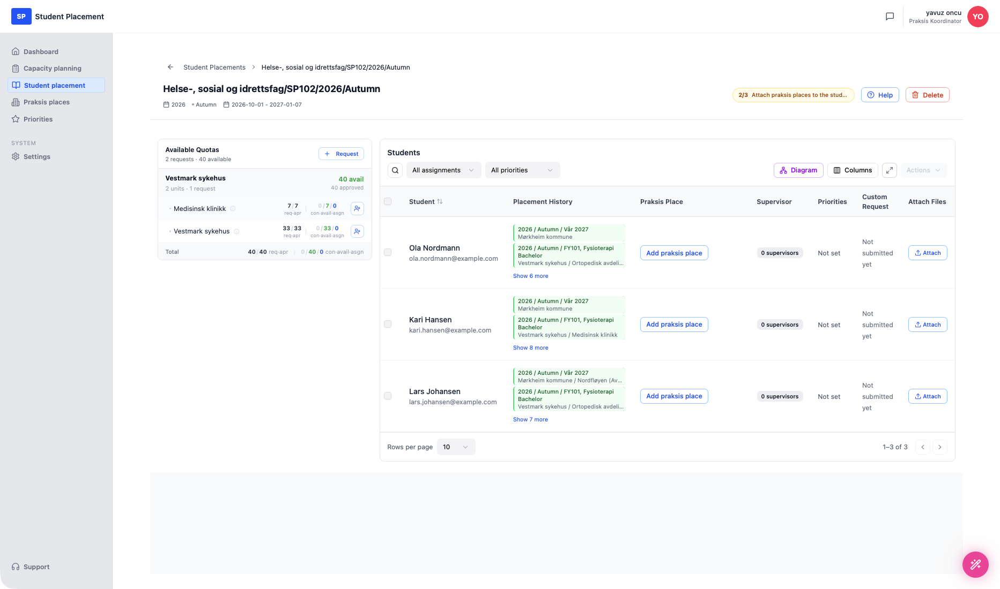
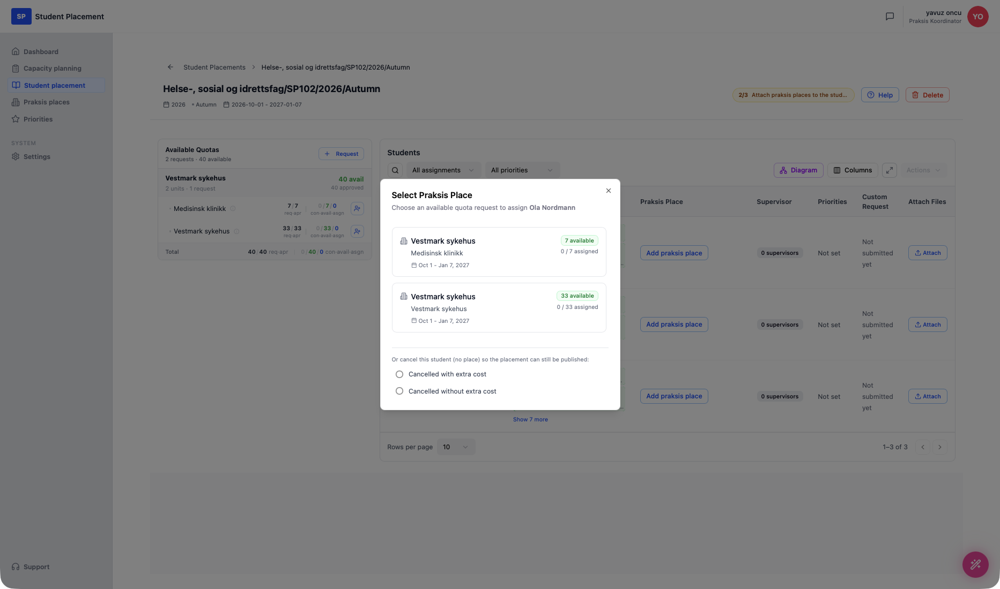
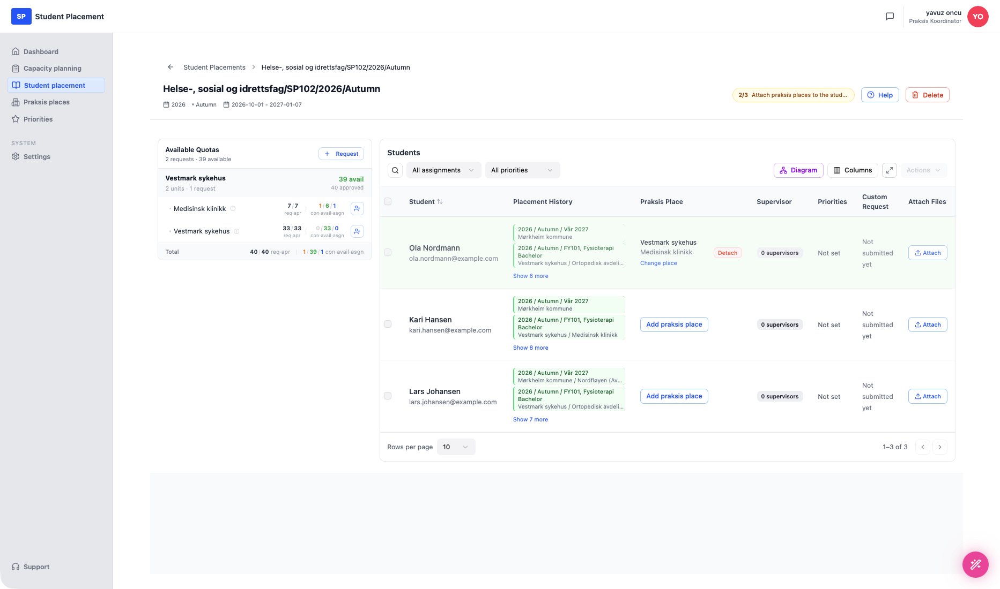
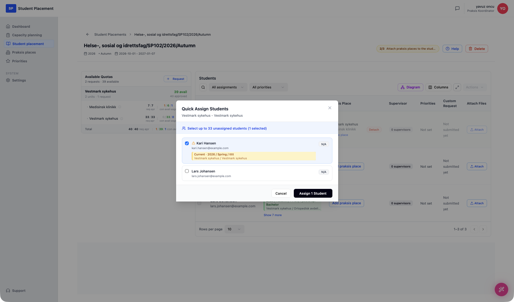
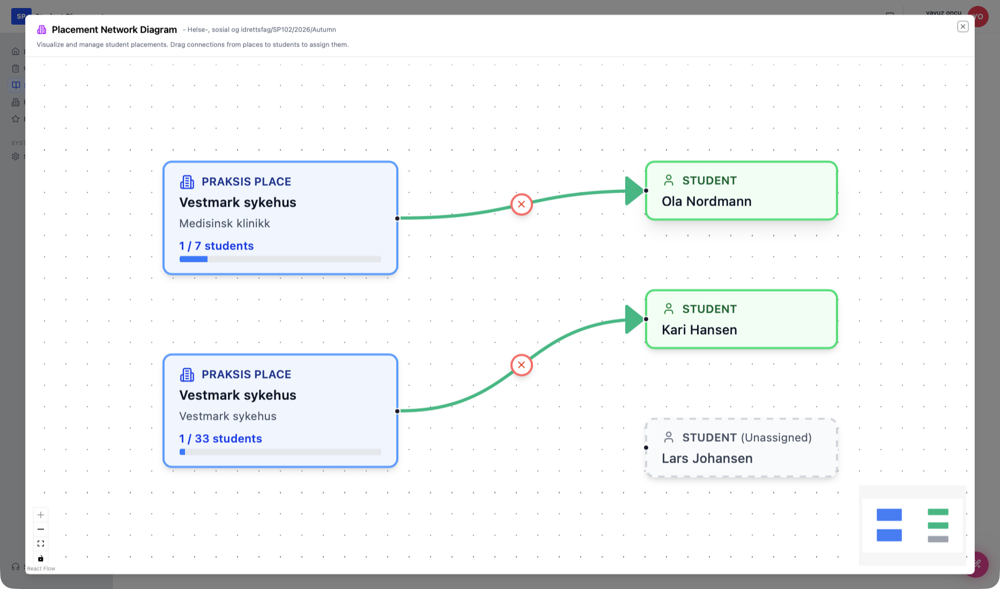
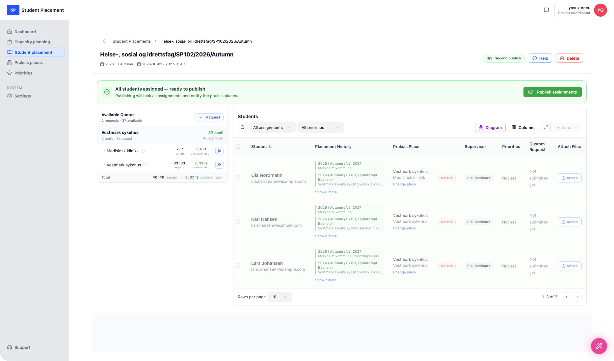

# Testscenario 10 — Student plassering - Fordele studenter

:::info[Scenariooversikt]

- **Side:** Student plassering → *(en plassering)*
- **Rolle:** Praksiskoordinator (PK)
- **Mål:** Fordel de importerte studentene på de tilgjengelige kvotene (praksisstedene), slik at hver student har en plass for praksisen sin.
- **Forutsetning:** En plassering finnes med importerte studenter og minst én godkjent kvote. Denne gjennomgangen bruker **Helse-, sosial og idrettsfag/SP102/2026/Autumn** med **3 importerte studenter**.

:::

## Om import av studenter

Studenter legges til en plassering før dette trinnet. De kan **importeres fra en Excel-fil** eller **hentes automatisk fra det nasjonale studentregisteret** — **FS** i Norge eller **Ladok** i Sverige. For denne demonstrasjonen ble **3 mock-studenter** importert (Ola Nordmann, Kari Hansen, Lars Johansen).

## Forstå denne siden

Plasseringens detaljside har to koblede paneler:

- **Tilgjengelige kvoter** (venstre) — **plassene studenter kan tilordnes**. Hver godkjente forespørsel er gruppert per praksissted og fordelt på enheter, med tallene **req · apr** (forespurt / godkjent) og **con · avail · asgn** (bekreftet / ledig / tilordnet). **+ (Tilordne studenter)**-ikonet på en enhet åpner et hurtigtilordningspanel. **Totalt**-raden summerer hele kvoten.
- **Studenter** (høyre) — **personene som må plasseres** for praksisen sin. Hver rad viser studenten, plasseringshistorikken, det tilordnede **Praksissted** (eller en **Legg til praksissted**-knapp når ingen er satt), veiledere, prioriteringer, egendefinert forespørsel og filvedlegg. Over tabellen finnes et søkefelt, filtrene **Alle tilordninger** / **Alle prioriteringer** og knappene **Diagram**, **Kolonner**, utvid og **Handlinger**.

Et fremdriftsmerke øverst (f.eks. **2/3 Knytt praksissteder til studentene**) viser hvor langt plasseringen har kommet i arbeidsflyten. Etter hvert som studenter tilordnes, oppdateres kvotetallene til venstre i sanntid.

Det finnes **tre måter å tilordne en student til en plass på**, alle vist nedenfor.

<figure>

<figcaption>Plasseringssiden — Tilgjengelige kvoter (venstre) og de 3 importerte studentene (høyre)</figcaption>

</figure>

---

## Trinn

### 1. Åpne plasseringen

Klikk på **Student plassering** i sidemenyen og velg **Helse-, sosial og idrettsfag/SP102/2026/Autumn**.

### 2. Tilordne første student — "Legg til praksissted" (studenttabellen)

I **Studenter**-tabellen klikker du på **Legg til praksissted** på raden til **Ola Nordmann**. En **Velg praksissted**-dialog viser de tilgjengelige kvoteforespørslene (med ledighet og antall tilordnede). Den tilbyr også å *kansellere* studenten — med eller uten ekstra kostnad — slik at plasseringen fortsatt kan publiseres hvis ingen plass passer.

Velg en plass — her **Vestmark sykehus · Medisinsk klinikk** — for å tilordne Ola.

<figure>

<figcaption>"Legg til praksissted" — velg en kvoteforespørsel for studenten</figcaption>

</figure>

Studentens rad viser nå den tilordnede plassen med **Bytt sted** / **Koble fra**, og Tilgjengelige kvoter-tallene oppdateres (enheten går til *1 tilordnet*).

<figure>

<figcaption>Ola tilordnet Medisinsk klinikk — kvotetallene oppdatert til venstre</figcaption>

</figure>

### 3. Tilordne andre student — "+"-ikonet i Tilgjengelige kvoter

I **Tilgjengelige kvoter**-panelet klikker du på **+ (Tilordne studenter)**-ikonet på en enhet — her **Vestmark sykehus**. Et **Hurtigtilordne studenter**-panel åpnes med de ikke-tilordnede studentene. Huk av **Kari Hansen** og klikk på **Tilordne 1 student**.

<figure>

<figcaption>Hurtigtilordne — velg ikke-tilordnede studenter for en enhet og tilordne i bulk</figcaption>

</figure>

### 4. Tilordne siste student — Diagram-visningen

Klikk på **Diagram** (over studenttabellen) for å åpne **Nettverksdiagram for plassering**. Den viser praksissteder til venstre og studenter til høyre; eksisterende tilordninger tegnes som forbindelseslinjer (hver med en **×** for å fjerne den), og ikke-tilordnede studenter vises som stiplede kort. Du tilordner en student ved å **dra en forbindelse fra en plass til studenten**.

Her er **Lars Johansen** den gjenværende ikke-tilordnede studenten — å koble ham til **Vestmark sykehus** fullfører fordelingen.

<figure>

<figcaption>Diagram-visning — dra fra en plass til en student for å tilordne (Lars fortsatt ikke tilordnet)</figcaption>

</figure>

---

## Sluttresultat

Når alle tre studentene er tilordnet, viser fremdriftsmerket **3/3**, og et grønt banner vises: **"Alle studenter er tilordnet — klar til publisering. Publisering låser alle tilordninger og varsler praksisstedene."** En **Publiser tilordninger**-knapp blir tilgjengelig. Hver studentrad viser den tilordnede plassen sin, og Tilgjengelige kvoter-panelet gjenspeiler **3 tilordnet**.

Scenarioet slutter her — studentene er fullt fordelt, og plasseringen er klar til å publiseres.

<figure>

<figcaption>Alle 3 studentene plassert — klar til å publisere</figcaption>

</figure>

---

:::note[Neste steg]

Hvis **"Første publisering"** er aktivert i **Innstillinger → Arbeidsflyter**, fortsett med scenarioet **"11 · Student plassering - Samle inn studentønsker"**. I dette tilfellet må du publisere plasseringen til studentene for å samle inn ønskene deres. Ellers vil du ikke kunne fortsette plasseringsprosessen.

:::

<ScenarioFeedback scenarioId="TS-10-distribute-students" />
