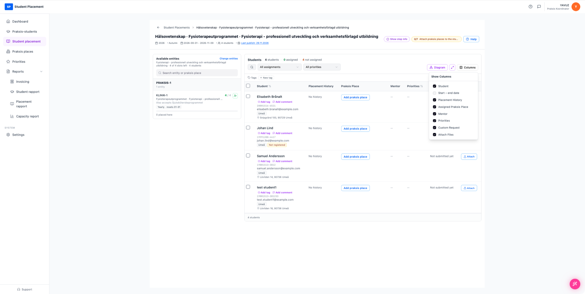
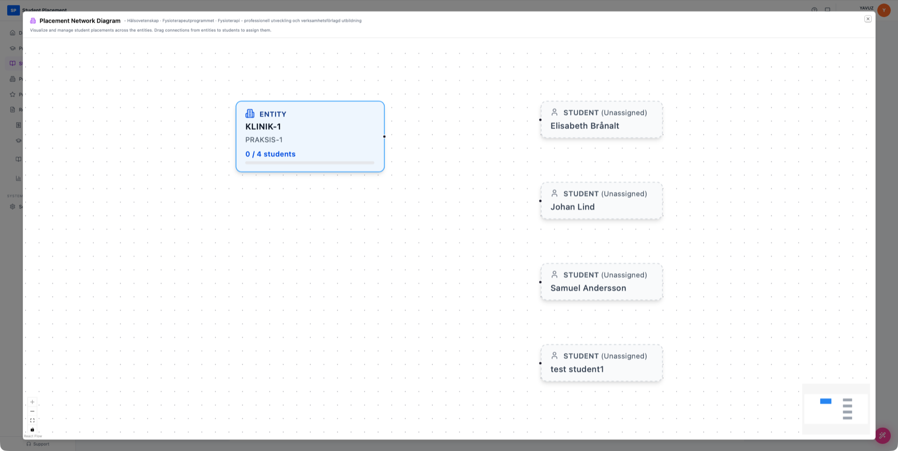
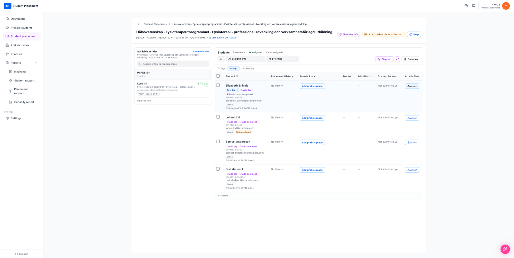
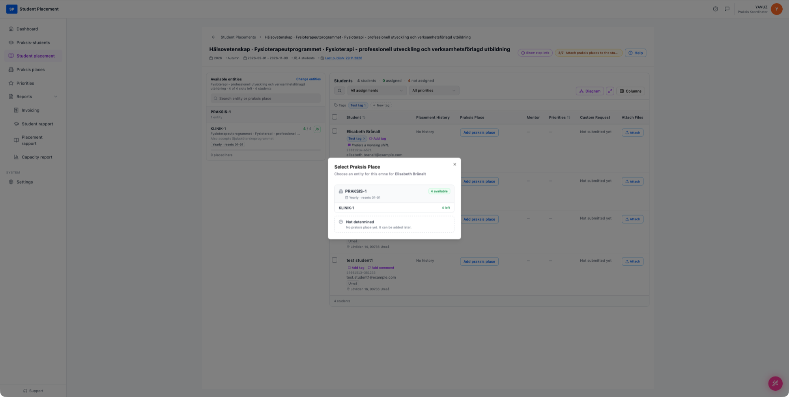
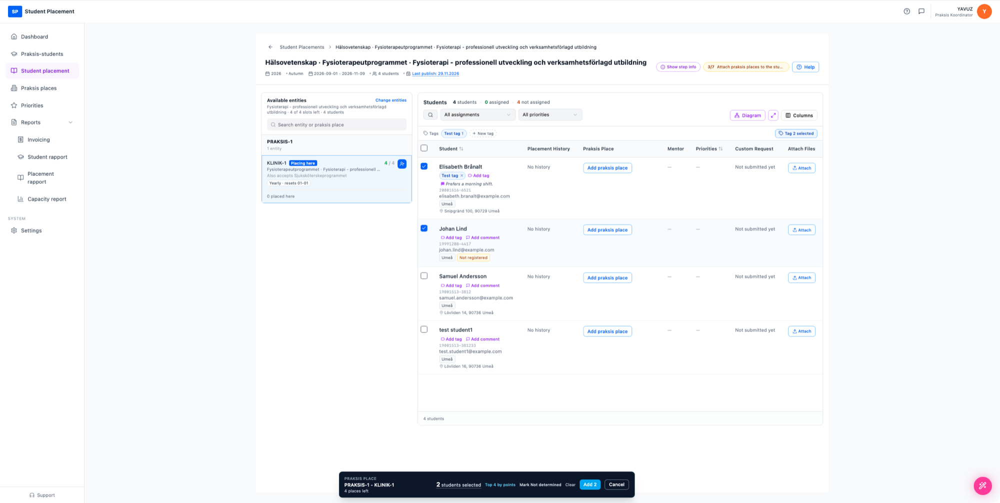
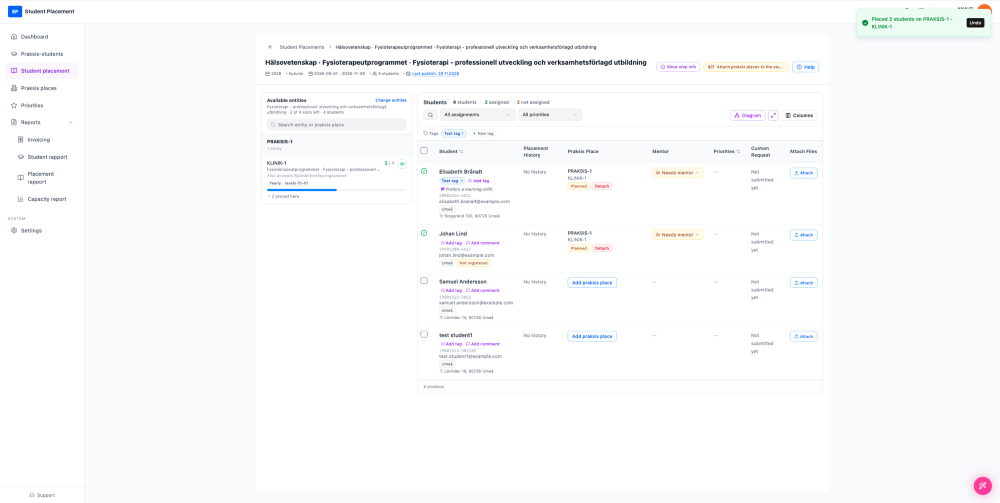
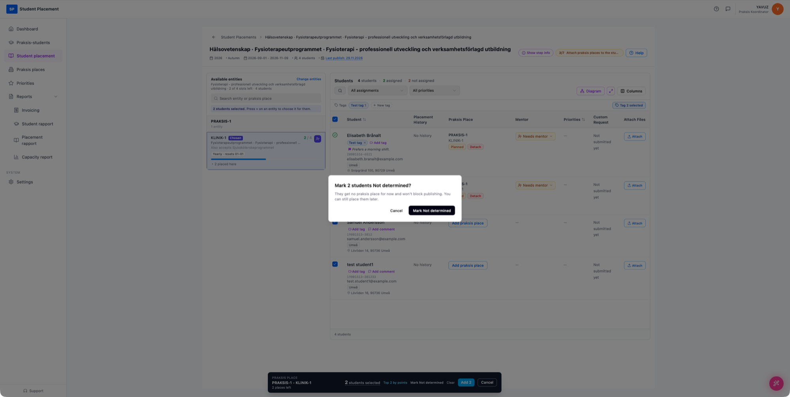
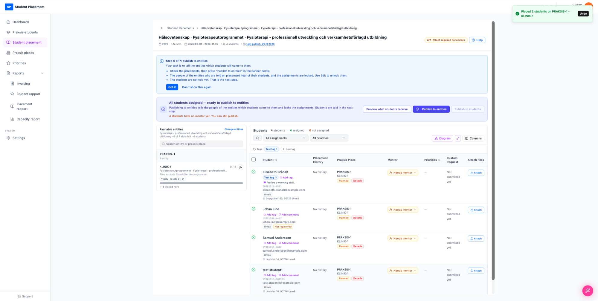

# Testscenario 10 — Studentplassering - Plasser studentene

:::info[Scenariooversikt]

- **Side:** Studentplassering → *plassering* (trinn 3/7, *Knytt praksisplasser til studentene*)
- **Rolle:** Praksiskoordinator (PK)
- **Mål:** Plassere hver student i plasseringen på en av de valgte enhetene — og bli kjent med verktøyene på siden: filtre, kolonner, diagram, etiketter, kommentarer og plasseringslinjen.
- **Forutsetning:** Enheter og plasser er valgt (se *Testscenario 09*). Denne gjennomgangen fortsetter med plasseringen på **KLINIK-1 · 4 plasser** og de 4 studentene.

:::

## Hva denne siden er

På trinn 3 får studentene praksisplass. Infoboksen oppsummerer: *trinn 3 av 7: plasser studentene på enheter —
 oppgaven din er å plassere hver student på en av de valgte enhetene.*

Siden har to paneler.

### Tilgjengelige enheter (til venstre)

Hver enhet som ble valgt på trinn 2, gruppert etter praksissted, med:

- ledige plasser (f.eks. **4 / 4**) og en stolpe som viser hvor mange som er tatt;
- en **+**-knapp (*Plasser studenter på KLINIK-1*) — starter plassering av studenter på enheten;
- **N plassert her** — utvides til en liste over studentene på enheten, hver med **×** for å ta dem av, og
  **Fjern alle**;
- et søkefelt (*Søk etter enhet eller praksissted*) og **Endre enheter** for å gå tilbake til trinn 2.

### Studenter (til høyre)

Oppsummeringen *4 studenter · 0 tildelt · 4 ikke tildelt* — klikk på *tildelt* eller *ikke tildelt* for å vise
 bare de studentene. Verktøylinjen har:

| Kontroll | Hva den gjør |
|---|---|
| **Søk** (forstørrelsesglass) | Søk på navn, personnummer, adresse eller studentnotat. **Lukk** gir verktøylinjen tilbake. |
| **Alle tildelinger** | *Tildelt*, *Ikke tildelt*, *Ikke bestemt*, eller ett praksissted (f.eks. *PRAKSIS-1*). |
| **Alle prioriteringer** | *Med prioritet* / *Uten prioritet*. |
| **Diagram** | Åpner **Plasseringsnettverksdiagram** (se trinn 2 nedenfor). |
| **Utvid** (pilikon) | Skjuler enhetspanelet så tabellen får hele bredden; klikk igjen for å vise det. |
| **Kolonner** | Viser eller skjuler kolonner: *Student*, *Start–sluttdato* (av som standard), *Plasseringshistorikk*, *Tildelt praksisplass*, *Veileder*, *Prioriteringer*, *Egne ønsker*, *Vedlegg*. |
| **Etiketter** | Viser etikettene med antall studenter (klikk på en for å vise de studentene), og **Ny etikett**. |

Hver studentrad viser navnet med **Legg til etikett** og **Legg til kommentar**, personnummer, e-post,
 studiested (og *Ikke registrert* når det gjelder) og hjemmeadresse, fulgt av disse kolonnene:

| Kolonne | Innhold |
|---|---|
| **Plasseringshistorikk** | Tidligere plasseringer (*Ingen historikk* hvis ingen). |
| **Praksisplass** | **Legg til praksisplass** — eller, når studenten er plassert, praksissted og enhet med *Planlagt* og **Koble fra**. |
| **Veileder** | Etter at studenten er plassert: **Trenger veileder** — en meny med enhetens kontakter og *Legg til en person…*. |
| **Prioriteringer** | Studentens prioritet, hvis noen. |
| **Egne ønsker** | *Ikke sendt ennå* til studenten sender et. |
| **Vedlegg** | **Legg ved** — åpner en filvelger for å laste opp en fil for studenten. |

---

## Trinn

### 1. Se på trinn 3

Åpne plasseringen (eller fortsett fra *Testscenario 09*). Merket viser **3/7 Knytt praksisplasser til
 studentene**. KLINIK-1 viser *4 / 4* og *0 plassert her*; alle 4 studentene er *ikke tildelt*.

<figure>

<figcaption>Trinn 3 av 7 — enheter til venstre, studenter til høyre</figcaption>

</figure>

### 2. (Valgfritt) Utforsk visningsverktøyene

- Klikk på **Kolonner** for å velge hvilke kolonner som vises.

<figure>

<figcaption>Kolonner — Start–sluttdato er skjult som standard</figcaption>

</figure>

- Klikk på **Diagram**. **Plasseringsnettverksdiagrammet** viser enheten (*KLINIK-1 · PRAKSIS-1 · 0 / 4
  students*) og hver student (*STUDENT (Unassigned)*). Dra forbindelser fra enheter til studenter for å tildele
  dem. Bruk zoom- og *tilpass visning*-knappene nede til venstre; lukk med **×**.

<figure>

<figcaption>Plasseringsnettverksdiagram — dra fra en enhet til en student for å tildele</figcaption>

</figure>

- Klikk på **Utvid** (pilikon) for å skjule enhetspanelet; klikk igjen for å vise det.

### 3. Gi en student en etikett og legg til en kommentar

1. Klikk på **Ny etikett**, skriv `Test tag` og klikk på **Lag etiketten «Test tag»**. Den vises ved *Etiketter*
   med antallet *0*.
2. På **Elisabeth Brånalt** klikker du på **Legg til etikett** og velger **Test tag**. Etiketten vises under
   navnet (fjern den med **×**), og antallet blir *1*.
3. Klikk på **Legg til kommentar**, skriv `Prefers a morning shift.` og klikk på **Lagre**. Kommentaren (maks
   1000 tegn, synlig bare for folk ved universitetet) vises nå under navnet.

<figure>

<figcaption>Elisabeth Brånalt med «Test tag» og en kommentar</figcaption>

</figure>

### 4. Plasser én student med «Legg til praksisplass»

På raden til Elisabeth klikker du på **Legg til praksisplass**. Dialogen **Velg praksisplass** viser
 **KLINIK-1 · 4 left** under PRAKSIS-1, og **Ikke bestemt** — *ingen praksisplass ennå; den kan legges til
 senere*. Klikk på **KLINIK-1**.

<figure>

<figcaption>Velg praksisplass — velg en enhet, eller Ikke bestemt</figcaption>

</figure>

En melding bekrefter at Elisabeth er tildelt KLINIK-1. Raden viser nå **PRAKSIS-1 · KLINIK-1** med *Planlagt*
 og **Koble fra**, og knappen **Trenger veileder** vises. Klikk på **Koble fra** for å ta henne av igjen — det
 skjer med en gang.

### 5. Plasser flere studenter fra enhetens +

1. I venstre panel klikker du på **+** ved **KLINIK-1**. Enheten merkes *Plasserer her*, og en linje vises
   nederst: *PRAKSIS-1 - KLINIK-1 · 4 places left · 0 students selected*. Lukk infovinduet med **Skjønner**.
2. Kryss av for **Elisabeth Brånalt** og **Johan Lind**. Linjen viser *2 studenter valgt* med **Topp 4 etter
   poeng**, **Merk som ikke bestemt**, **Fjern**, **Legg til 2** og **Avbryt** — og knappen **Merk 2 valgte**
   vises ved etikettene.

<figure>

<figcaption>Plasseringslinjen — 2 studenter valgt for KLINIK-1</figcaption>

</figure>

3. Klikk på **Legg til 2**. Meldingen om at 2 studenter er plassert på PRAKSIS-1 - KLINIK-1, har en
   **Angre**-knapp. KLINIK-1 viser nå *2 / 4* og **2 plassert her** — klikk for å se hvem som er plassert der.

<figure>

<figcaption>2 tildelt · 2 ikke tildelt — KLINIK-1 har 2 plasser igjen</figcaption>

</figure>

### 6. Plasser resten — kryss av først, så +

Du kan også gå motsatt vei: kryss av for **Samuel Andersson** først. Venstre panel ber deg trykke **+** på en
 enhet for å velge den for studenten. Klikk på **+** ved **KLINIK-1** — enheten merkes *Valgt*, og linjen viser
 *2 plasser igjen*.

Klikk på **Topp 2 etter poeng** — den velger studentene med flest prioritetspoeng, så mange som det er plasser
 igjen (her de to siste studentene).

:::note[Merk som ikke bestemt]

**Merk som ikke bestemt** gir de valgte studentene *ingen praksisplass foreløpig*. Den spør først: skal 2
 studenter merkes som ikke bestemt? De får ingen praksisplass nå og blokkerer ikke publisering, og de kan
 fortsatt plasseres senere. I denne gjennomgangen klikker vi på **Avbryt**.

<figure>

<figcaption>Merk som ikke bestemt — ber om bekreftelse</figcaption>

</figure>

:::

Klikk på **Legg til 2**.

### 7. Alle studentene er plassert

Alle 4 studentene er tildelt, og KLINIK-1 viser *0 / 4*. Et banner vises over listen: *alle studenter
 tildelt — klar til å publisere til enheter*, med merknaden *4 studenter har ingen veileder ennå, men du kan
 fortsatt publisere*, og knappene **Forhåndsvis det studentene mottar**, **Publiser til enheter** og
 **Publiser til studenter** (deaktivert til du har publisert til enhetene).

**Forhåndsvis det studentene mottar** viser plasseringen slik en student vil se den — enhet, datoer og
 kontakter — og varsler hvis enheten mangler informasjon (f.eks. aktivitetsbeskrivelse), som du kan fylle ut
 under **Praksissteder → Enheter**.

<figure>

<figcaption>Alle studenter tildelt — publiseringstrinnet åpnes over listen</figcaption>

</figure>

---

## Sluttresultat

Alle 4 studentene er plassert på **KLINIK-1** (*Planlagt*), og plasseringen er klar til å publiseres til
 enhetene.

## Merknader

-   Plassene blokkerer aldri: du kan plassere flere studenter enn plasser — enheten viser da *«over by N»*.
-   **Koble fra** tar en student av med en gang, uten å spørre.
-   Veiledere og publisering beskrives i de neste scenarioene.

---

<ScenarioFeedback scenarioId="TS-10-place-students" />
