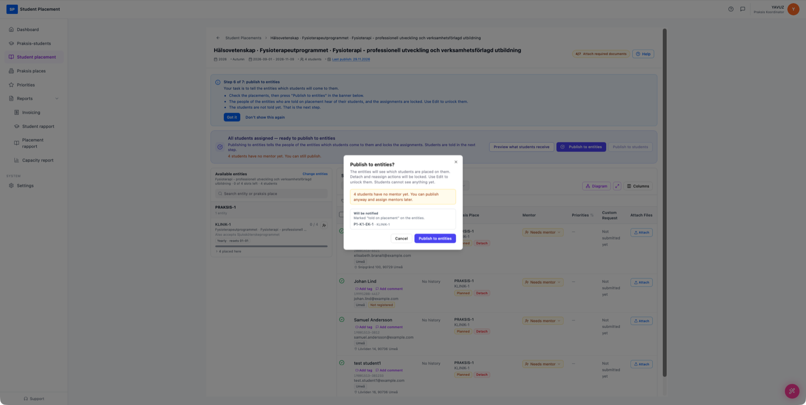
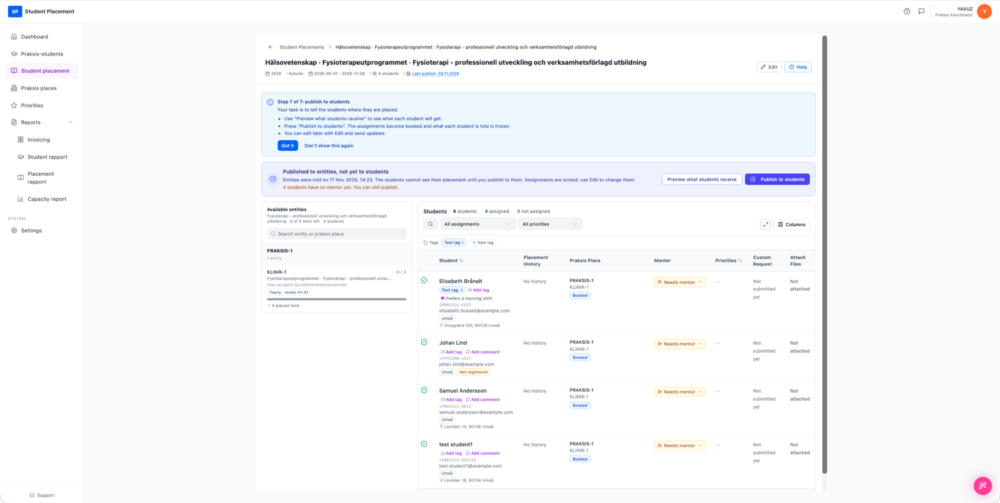
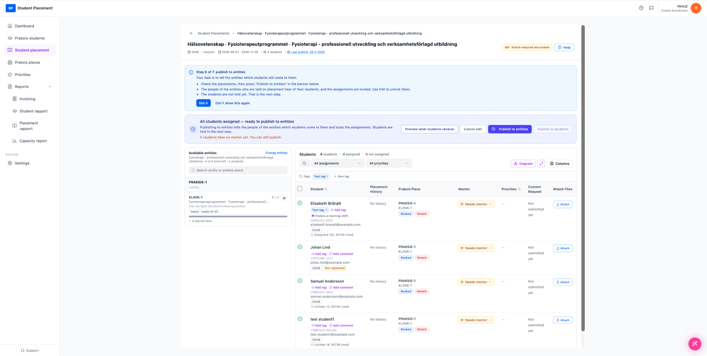
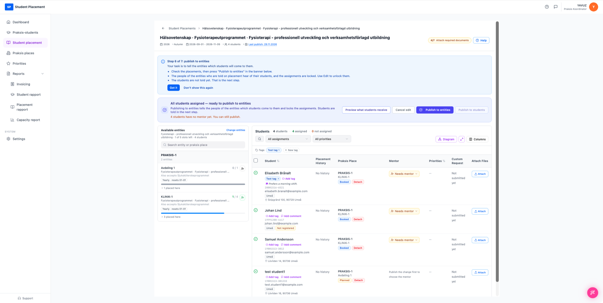
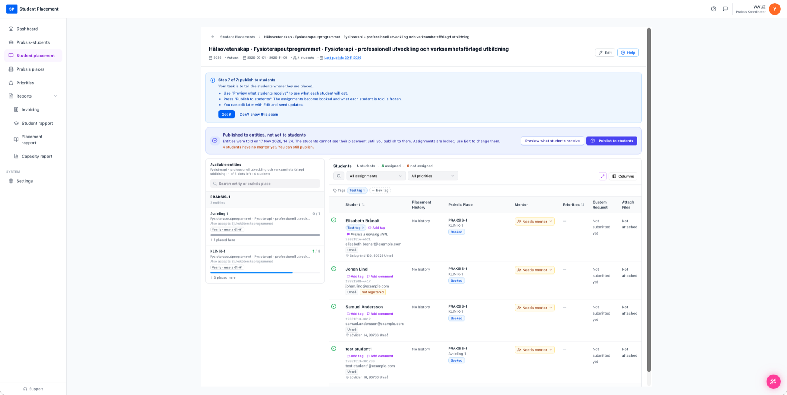

# Testscenario 10b — Studentplassering - Publiser til enheter og rediger

:::info[Scenariooversikt]

- **Side:** Studentplassering → *plassering* (publiser til enheter)
- **Rolle:** Praksiskoordinator (PK)
- **Mål:** Publisere plasseringen til enhetene, deretter bruke **Rediger** for å endre en tildeling og publisere endringen på nytt.
- **Forutsetning:** Alle studentene er plassert (se *Testscenario 10*). Denne gjennomgangen fortsetter med de 4 studentene på **KLINIK-1**.

:::

## Hva denne siden er

Når alle studentene har plass, vises et banner over studentlisten: *alle studenter tildelt — klar til å
 publisere til enheter*. **Publisering til enheter** forteller enhetene hvilke studenter som kommer til dem:

- **enhetskontaktene** kan nå se tildelingene — hvilke studenter som er plassert på enheten deres;
- tildelingene **låses** (*Booket*) — **Koble fra** og omtildeling er slått av til du trykker på **Rediger**;
- **studentene får ikke beskjed ennå** — det er neste trinn, **Publiser til studenter**.

Veiledere er ikke påkrevd: *4 studenter har ingen veileder ennå, men du kan fortsatt publisere.*

---

## Trinn

### 1. Publiser til enheter

Klikk på **Publiser til enheter** i banneret. En bekreftelse åpnes: enhetene vil se hvilke studenter som er
 plassert hos dem, **Koble fra** og omtildeling låses (bruk **Rediger** for å låse opp), og studentene ser
 ingenting ennå. Under **Vil bli varslet** vises kontaktene som er merket *«told on placement»* på enhetene —
 her **P1-K1-EK-1 · KLINIK-1**. Klikk på **Publiser til enheter**.

<figure>

<figcaption>Publiser til enheter? — viser hvem som blir varslet</figcaption>

</figure>

### 2. Se den publiserte plasseringen

Meldingen *Publisert til enheter* vises, og banneret endres til **Publisert til enheter, ikke ennå til
 studenter** — enhetene fikk beskjed 17. nov. 2026 kl. 14.23; studentene ser ikke plasseringen før du
 publiserer til dem, og tildelingene er låst (bruk **Rediger** for å endre dem).

- Alle studentene er nå **Booket** på KLINIK-1; **Koble fra** og **Legg ved** er borte (*Ikke vedlagt*).
- **Endre enheter**, **Diagram** og trinnmerket er skjult; en **Rediger**-knapp vises i overskriften.
- Banneret har **Forhåndsvis det studentene mottar** og **Publiser til studenter**.

<figure>

<figcaption>Publisert til enheter, ikke ennå til studenter — tildelingene er booket og låst</figcaption>

</figure>

### 3. Lås opp med Rediger

Klikk på **Rediger** (øverst til høyre). Plasseringen låses opp med en gang: **Koble fra**, **Endre enheter**,
 **Diagram** og trinnmerket kommer tilbake, og banneret viser **Avbryt redigering** ved siden av **Publiser
 til enheter**. Bruk **Avbryt redigering** for å gå ut uten endringer.

<figure>

<figcaption>Rediger — tildelingene kan endres igjen</figcaption>

</figure>

### 4. Gjør en endring

I dette eksempelet flytter vi **test student1** til en annen enhet:

1. Klikk på **Endre enheter**, **Legg til** **Avdeling 1** (den får 1 plass) og klikk på **Fortsett til
   studenter** — se *Testscenario 09*.
2. På **test student1** klikker du på **Koble fra**, deretter **Legg til praksisplass** og velger
   **Avdeling 1**. En melding bekrefter tildelingen.

Studenten som ble endret, viser **Planlagt** (ikke publisert ennå), mens de andre forblir **Booket**.
 Veilederkolonnen for den endrede studenten sier at endringen må publiseres før veileder kan velges.

<figure>

<figcaption>test student1 flyttet til Avdeling 1 — Planlagt til endringen publiseres</figcaption>

</figure>

### 5. Publiser endringen

Klikk på **Publiser til enheter** igjen og bekreft. Banneret går tilbake til **Publisert til enheter, ikke
 ennå til studenter** med nytt klokkeslett, og **test student1** er nå **Booket** på **Avdeling 1**.
 Tildelingene er låst igjen.

<figure>

<figcaption>Endringen er publisert — alle tildelinger er booket og låst igjen</figcaption>

</figure>

---

## Sluttresultat

Enhetene har fått beskjed om studentene sine — 3 på **KLINIK-1** og 1 på **Avdeling 1** — og enhetskontaktene
 kan se tildelingene. Studentene har ikke fått beskjed ennå; plasseringen er klar for **Publiser til
 studenter**.

## Merknader

-   Bare kontakter som er merket *«told on placement»* på en enhet, vises under **Vil bli varslet**. I dette
    eksempelet hadde Avdeling 1 ingen slik kontakt, så bare P1-K1-EK-1 (KLINIK-1) ble vist — sjekk enhetens
    kontakter under **Praksissteder → Enheter** hvis noen bør varsles.
-   Publisering til studenter beskrives i neste scenario.

---

<ScenarioFeedback scenarioId="TS-10b-publish-to-entities" />
