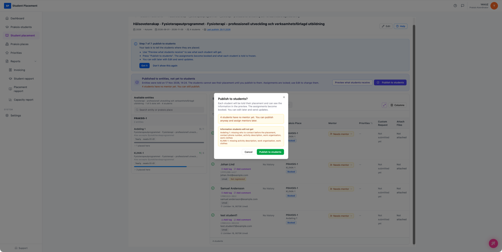
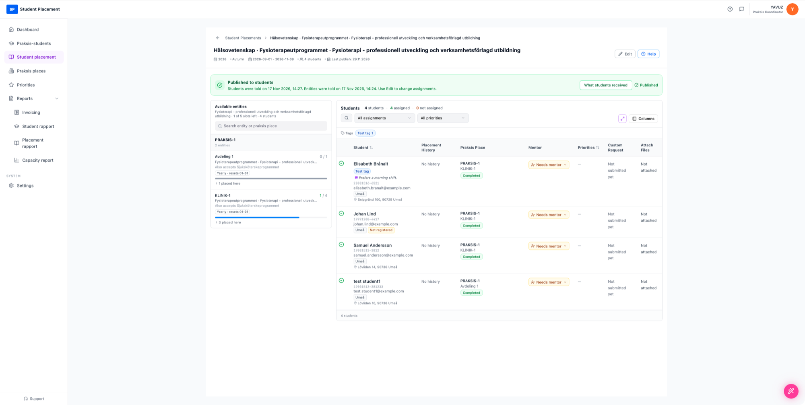
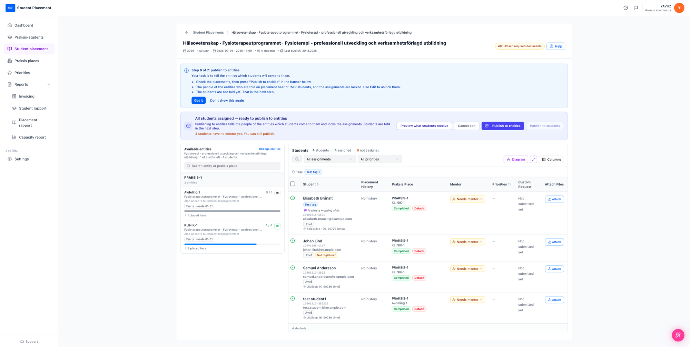
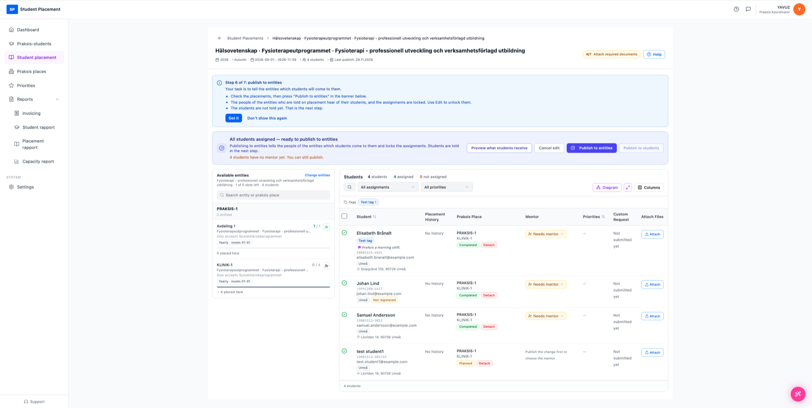
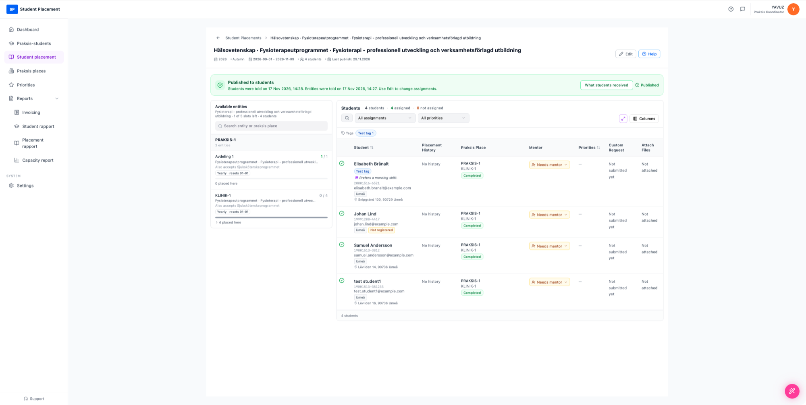

# Testscenario 10c — Studentplassering - Publiser til studenter og rediger

:::info[Scenariooversikt]

- **Side:** Studentplassering → *plassering* (trinn 7/7, publiser til studenter)
- **Rolle:** Praksiskoordinator (PK)
- **Mål:** Fortelle studentene hvor de er plassert, og deretter bruke **Rediger** for å endre en tildeling og sende oppdateringen til enheter og studenter.
- **Forutsetning:** Plasseringen er publisert til enheter (se *Testscenario 10b*). Denne gjennomgangen fortsetter med 3 studenter på **KLINIK-1** og **test student1** på **Avdeling 1**.

:::

## Hva denne siden er

Etter publisering til enheter viser infoboksen *trinn 7 av 7: publiser til studenter*. **Publisering til
 studenter** forteller hver student hvor de er plassert — det de mottar, er det **Forhåndsvis det studentene
 mottar** viser. Tildelingene viser deretter **Fullført**, og plasseringen merkes **Publisert**.

Du kan fortsatt endre plasseringen etterpå: **Rediger** låser den opp, og du publiserer endringen til enhetene
 og deretter til studentene igjen.

---

## Trinn

### 1. Publiser til studenter

I banneret *Publisert til enheter, ikke ennå til studenter* klikker du på **Publiser til studenter**. En
 bekreftelse åpnes: hver student får beskjed om plasseringen sin og kan se informasjonen i forhåndsvisningen;
 tildelingene blir booket, og du kan redigere senere og sende oppdateringer.

Under **Informasjon studentene ikke får** vises det hver enhet mangler — her *Avdeling 1: mangler hvem som skal
 kontaktes før plasseringen, kontakttelefon, aktivitetsbeskrivelse, arbeidsorganisering, arbeidsklær* og
 *KLINIK-1: mangler aktivitetsbeskrivelse, arbeidsorganisering, arbeidsklær*. Du kan likevel publisere; fyll inn
 dette under **Praksissteder → Enheter**. Klikk på **Publiser til studenter**.

<figure>

<figcaption>Publiser til studenter? — viser informasjon studentene ikke får</figcaption>

</figure>

### 2. Se den publiserte plasseringen

Meldingen *Publisert til studenter* vises. Det grønne banneret **Publisert til studenter** viser når studentene
 og enhetene fikk beskjed (17. nov. 2026 kl. 14.27 og 14.24), og at du bruker **Rediger** for å endre
 tildelinger.

- Alle studentene viser **Fullført**.
- Banneret har **Det studentene mottok** (plasseringen slik studenten ser den, merket *Publisert* med dato) og
  merket **Publisert**.
- Bare **Rediger** er igjen i overskriften; etiketter og kommentarer kan ikke lenger legges til.

<figure>

<figcaption>Publisert til studenter — alle tildelinger er fullført</figcaption>

</figure>

### 3. Rediger etter publisering

Klikk på **Rediger**. Plasseringen låses opp med en gang, akkurat som etter publisering til enheter:
 **Koble fra**, **Endre enheter**, trinnmerket og **Avbryt redigering** kommer tilbake, og banneret tilbyr
 **Publiser til enheter** igjen. **Publiser til studenter** er deaktivert (*publiser til enheter først*) til
 enhetene har fått endringen.

<figure>

<figcaption>Rediger — plasseringen er låst opp igjen</figcaption>

</figure>

### 4. Gjør en endring

Flytt **test student1** tilbake til **KLINIK-1**: klikk på **Koble fra**, deretter **Legg til praksisplass** →
 **KLINIK-1**. Studenten viser **Planlagt**, de andre forblir **Fullført**.

<figure>

<figcaption>test student1 tilbake på KLINIK-1 — Planlagt til publisering</figcaption>

</figure>

### 5. Send oppdateringen — først enheter, så studenter

1. Klikk på **Publiser til enheter** og bekreft. Banneret går tilbake til *Publisert til enheter, ikke ennå til
   studenter*; test student1 er **Booket**.
2. Klikk på **Publiser til studenter**. Bekreftelsen viser igjen manglende informasjon (nå bare KLINIK-1).
   Klikk på **Publiser til studenter**.

Banneret viser **Publisert til studenter** med de nye tidspunktene, og alle 4 studentene er **Fullført** på
 **KLINIK-1**.

<figure>

<figcaption>Oppdateringen er publisert til enheter og studenter</figcaption>

</figure>

---

## Sluttresultat

Studentene har fått beskjed om plasseringen. Etter redigeringen er alle 4 studentene **Fullført** på
 **KLINIK-1**, og både enhetene og studentene har den nyeste versjonen.

## Merknader

-   En redigering sendes alltid ut i samme rekkefølge som første gang: **Publiser til enheter**, deretter
    **Publiser til studenter**.
-   Veiledere er ikke nødvendig for å publisere. Tildeling av veiledere beskrives i neste scenario.

---

<ScenarioFeedback scenarioId="TS-10c-publish-to-students" />
